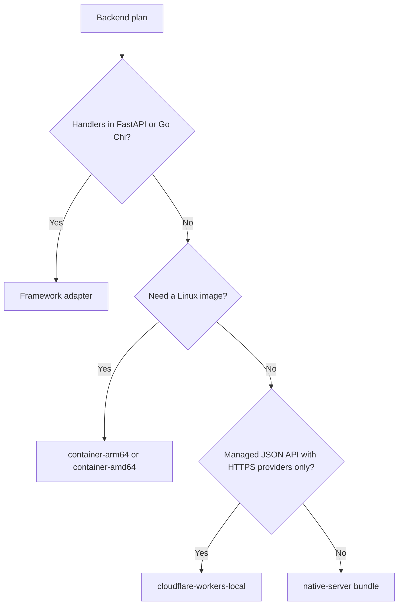

<span id="request-and-response-rules" />
<span id="typed-native-interceptors" />
<span id="reproduce-the-http-gate" />
<span id="configuration-credentials-and-readiness" />
<span id="promote-and-roll-back-by-digest" />
<span id="reproduce-the-gates" />
<span id="available-profiles" />
<span id="offline-local-packaging" />
<span id="release-v2-verification" />
<span id="rollback-review" />
<span id="local-and-hosted-acceptance" />

Pick where a backend runs and check that its private plan fits that target.
Support comes from a compiled target record and its recorded conformance
checks: a target name or `--target` flag cannot grant a capability. Packaging,
validation and inspection all use the same assessment.

## Targets and status

| Target | Status | What it runs | Evidence |
| --- | --- | --- | --- |
| `native-server` | **Experimental** | Managed and verified sandbox HTTP actions on macOS `aarch64` and Linux `aarch64` or `x86_64` | Local conformance on the host |
| `container-arm64` | **Experimental** | A Linux arm64 image built from source | Native arm64 Linux runtime checks |
| `container-amd64` | **Experimental** | A Linux x86_64 image built from source | Runtime checks under emulation on arm64 Linux |
| `cloudflare-workers-local` | **Experimental** | A managed JSON API with HS256 JWT and HTTPS providers, in local workerd | Local workerd checks; no hosted run |
| `cloudflare-workers` | **Coming soon** | Hosted Workers | Hosted acceptance not performed |
| `serverless` (AWS Lambda) | **Coming soon** | Not implemented | Runtime, lifecycle and hosted checks not performed |
| `edge` | **Coming soon** | No generic edge runtime | None |
| FastAPI and Go Chi adapters | **Experimental** | Your framework's native handlers behind the shared validator | Adapter conformance checks |

The unqualified `container` target is reported unavailable; choose an
architecture. `native-server` is reported and packaged for the machine the CLI
runs on: the macOS arm64 build of CLI 0.149.1 packages it for macOS `aarch64`.
Native packaging from the 0.149.1 Linux archives (**Experimental**) has not been
checked, and the CLI cannot package the native profile for a different
operating system or architecture. Container and
Worker packaging need the matching AxiomCore runtime source
(`--runtime-source`), which is not distributed with the CLI.



Adapters keep your existing handlers. Containers package the stock server
runtime for Linux. The Workers profile accepts only a portable subset: native
callbacks, Unix storage and jobs never silently become Worker features, and
substituting a provider is an explicit private review. Every other plan uses a
native server bundle. Development runners and registered application hosts keep
their own platform support. A passing adapter check does not certify the
generic server runtime, and HTTP releases do not certify delivery workers.

## Check a plan against a target

```bash title="Terminal"
axiom server targets
axiom server inspect backend.axiom backend.server.json --deployment deployment.json --target native-server
axiom inspect server backend.axiom backend.server.json --deployment deployment.json --target native-server --format json
axiom server validate backend.axiom backend.server.json --deployment deployment.json --target native-server
```

`server targets` prints each `axiom-server-target/v1` record as JSON: runtime
ABI and version, operating system and architecture, transports, provider
features, implementation kinds, facilities, limits, evidence scope and
`available`. Hosted validation is recorded separately from local conformance.
`--target` defaults to `native-server`. Add `--bindings bindings.json` for
sandbox plans.

- Without a deployment, inspection lists the declared requirements and reports
  that provider review is pending. It cannot establish compatibility.
- `server validate` also builds the real providers and authentication,
  verifies sandbox assets and checks cleanup, without opening a listener.
  Missing credentials fail validation.
- An incompatible plan fails before any release is written, naming the target
  and the action, resource, capability or limit that does not fit. Public
  endpoint IDs, codecs and client semantics never depend on the target.

| Target record limit | `native-server`, containers | Workers |
| --- | --- | --- |
| JSON request | 1 MiB | 1 MiB |
| JSON response | 8 MiB | 1 MiB |
| Artifact | 16 MiB | 1 MiB |
| Sandbox module | 4 MiB | Not supported |
| Release | 512 MiB, 256 files | 16 MiB, 32 files |

| Providers | Targets |
| --- | --- |
| `postgres` (storage mappings) | `native-server` |
| `jsonSnapshot`, `memoryCache`, `localUpload`, `memoryCoordination`, `redisCoordination`, `apiKey`, `session` | `native-server`, containers |
| `httpClient`, `jwt` | All available targets |

The native and container records also include HTTP JSON, SSE, NDJSON,
WebSocket and multipart transports. Distributed admission needs its declared
Redis configuration.

<span id="transitive-and-opaque-requirements" />

### Requirements and opaque code

The `axiom-server-requirements/v1` record lists each action's reachable calls,
resources, resource dependencies, guards and opaque requirements, plus the
aggregate capabilities, provider features, transports, sandbox exports,
configuration references and minimum limits. Provider bindings keep their
exact interface hashes and grants. Sandbox bindings must cover exactly the
plan's extensions and hash. Unknown keys, missing or extra extensions, and
artifact references that shadow provider or authentication configuration fail.

Native callbacks, native interceptors, custom providers and required HTTP
metadata producers are opaque. The CLI cannot register or certify them. A
registered trusted Rust application host can record its own reviewed target and
a declaration bound to the exact target, plan, deployment, bindings and runtime
digests, with its opaque requirements and hashed conformance tests; the host
supplies its independently established runtime digest. Hashes alone do not
prove tests ran. There is no CLI override for target availability
or native registrations.

## Native server bundle

```bash title="Terminal"
axiom server package backend.axiom backend.server.json --deployment deployment.json --target native-server --output release-v1
axiom server verify-bundle release-v1
release-v1/bin/axiom server run-bundle release-v1 --listen 127.0.0.1:8080
```

Packaging is offline. It checks structural authority, target compatibility and
captured sandbox assets, and reports `preflightScope: artifacts-only`. It does
not read provider data or credential registries, start providers, provision
anything, upload or widen grants. Only sandbox artifact references must resolve.
Startup still runs the full configuration preflight. Native symbols are
rejected by this generic bundle; they need their registered Rust host. Delivery
workers have their own runner and queue setup. See
[Release a backend](/backend/releases) for the bundle format and rollback.

## Linux containers

Compile and review the deployment and sandbox bindings first, then build a
source context and an image:

```bash title="Terminal"
axiom build service.acore --out backend.axiom
axiom server inspect backend.axiom backend.server.json --deployment deployment.json --target container-arm64
axiom server package backend.axiom backend.server.json --deployment deployment.json --target container-arm64 --runtime-source /path/to/runtime-source --output container-context
cat container-context/container.json
docker buildx build --platform linux/arm64 --load --tag my-api:candidate container-context
```

For x86_64, use `container-amd64` with `--platform linux/amd64`. Add
`--bindings bindings.json` for sandbox plans. Production provider paths and
credentials are resolved at startup, not during packaging.

- **Context.** The exact public and private artifacts, content-addressed sandbox
  files, the source allowlist and hashes, a pinned Dockerfile, image metadata
  and a Compose template. It excludes production configuration, mock
  fixtures, caches and host executables. Docker builds the Linux runtime from
  source and seals a v2 release with that Linux executable; a macOS executable
  never becomes a Linux image. `/app/release.json` binds the runtime, target,
  requirements, launch template and full file inventory. Modified, extra,
  symlinked or unbound files fail verification.
- **Toolchain.** Rust 1.93.0 and digest-pinned Debian images. Cross-compilation
  uses a signed Debian archive at a fixed snapshot and the matching Rust
  standard library target. Runtime packaging and requests run on the selected
  Linux architecture. amd64 evidence comes from emulation on an arm64 Linux VM;
  measure native performance yourself.

### Configure and run the image

The image runs as UID and GID `65532`, listens on `0.0.0.0:8080` (override
with `AXIOM_LISTEN`), and serves `GET /_axiom/ready`; its healthcheck probes
that route. Use a fixed nonzero port so the listener and healthcheck agree. TLS
termination and public routing belong to your deployment.

Bind the exact references listed in `/app/launch.json`. Credential registries
must be regular private files readable by UID `65532`, mode `0600` or `0400`.
A plain Compose file secret keeps host ownership and broader permissions, so it
does not meet this rule; the supplied template uses an external volume whose
files you prepare. Keep secrets out of build arguments, Dockerfiles, artifacts
and source control. For a file-backed task example:

```bash title="Terminal"
export AXIOM_IMAGE='registry.example/my-api@sha256:REVIEWED_IMAGE_DIGEST'
export AXIOM_TASKS_FILE='/absolute/path/to/tasks.json'
export AXIOM_SECRETS_VOLUME='my-api-private-credentials'
docker compose -f container-context/compose.yaml up -d
```

| Compose template setting | Value |
| --- | --- |
| Published port | `127.0.0.1:8080` |
| Root filesystem | Read-only |
| Capabilities | All dropped, `no-new-privileges` |
| CPU and memory | One CPU, 256 MiB |
| Processes | 64 |
| `/tmp` | Private 32 MiB tmpfs |
| Stop grace period | 15 seconds |
| Restart policy | `unless-stopped` |

The runtime requires cgroup v2 with finite CPU and memory budgets. Missing or
unbounded limits, running as root, missing resources or credentials, stale
artifacts and invalid listen settings fail before readiness. Memory may be 64
MiB to 64 GiB; 256 MiB is a tested starting point, not a capacity claim.

<span id="shutdown-storage-and-separate-workers" />

### Shutdown, storage and scale

- SIGTERM removes readiness and stops admission. HTTP drains for five seconds,
  then cancels remaining work; provider cleanup has its own five seconds. A
  missed deadline exits with failure, so monitor exit status. Keep at least the
  15-second stop grace.
- Restart recreates owned session state and repeats the external
  configuration preflight.
- A verified sandbox instance admits one invocation at a time; concurrent busy
  requests get a redacted `503 overloaded`. Retry within the caller's deadline
  and size capacity for your workload. Request deadlines, disconnect
  cancellation and sandbox limits still apply.
- `/tmp` and in-memory caches are ephemeral. For uploads, mount only the
  configured private upload directory, owned by `65532`, mode `0700`, with one
  writer and your own retention, quota and backup. A tmpfs upload directory
  loses files on restart; a dedicated volume keeps them. A read-only deployment
  without the required upload mount fails at startup. Never share one upload
  directory between replicas.
- Distributed rate limits and durable idempotency need the declared Redis
  provider with network, TLS and persistence configured. Memory coordination
  does not become distributed across replicas.
- HTTP containers do not start workers, schedules or consumers. The stock HTTP
  target rejects `jobs` and opaque native code.

### FastAPI and Chi images

Adapter images need a separately pinned, reviewed enforcement boundary and
adapter dependencies. That profile covers typed requests and responses, guards,
declared effects and resources, HTTP metadata, native interceptors and
qualified admission providers. Managed actions, sandboxes, streams, caching,
outbound HTTP, uploads and workers are not supported there, and a generic
application image does not gain them by installing the CLI. The adapter base
alone is not an HTTP application: add your ASGI application or Linux Go binary,
its exact artifacts and native registrations, and keep route and interceptor
registration, provider preflight, readiness and bounded shutdown in that
application. Pin the base by digest, bind configuration at runtime, and run the
application's conformance checks before promotion; an image label cannot
certify native code, and the generic packager never resolves native symbols
from labels.

## Cloudflare Workers (local)

`cloudflare-workers-local` packages a managed JSON API and runs it in local
workerd through Wrangler. It uses the same Rust admission, validation,
projections, security rules, authentication, guards, resource signatures,
grants and effect gate as the native server, in a request-local WebAssembly
instance. The public `.axiom` bytes are kept unchanged in the bundle. Local
results say nothing about hosted CPU, billing, network, deployment or rollback.

| Setting | Value |
| --- | --- |
| Rust | 1.93.0, `wasm32-unknown-unknown`, locked dependencies |
| Wrangler / workerd | 4.132.0 / 1.20260915.1 |
| Compatibility date | `2026-09-15`, no compatibility flags |
| Request and JSON response | 1 MiB each; UTF-8 strict JSON, at most 16,384 values per document |
| URL / request headers | 16 KiB / 32 KiB, at most 128 headers |
| Memory and admission | 32 MiB per request instance; two active requests per isolate |
| Wall deadline | 30 seconds including remote work; shorter declared deadlines still apply |
| Managed composition | Depth 32, 128 calls, 256 steps |
| Remote operations | 16 sequential calls, one attempt each, 2 MiB total response transcript |
| Release | 16 MiB total; core module at most 8 MiB; JSON artifacts at most 1 MiB each |

Admission and circuit counters are local to one isolate, with no distributed
or durable coordination. Cloudflare's own
[limits](https://developers.cloudflare.com/workers/platform/limits/) and
[compatibility dates](https://developers.cloudflare.com/workers/configuration/compatibility-dates/)
still apply; no Free plan or hosted performance claim is made.

<span id="build-and-inspect-locally" />
<span id="build-a-release" />
<span id="build-and-verify" />

### Build and run locally

```bash title="Terminal"
rustup toolchain install 1.93.0
rustup target add wasm32-unknown-unknown --toolchain 1.93.0
axiom build service.acore --out backend.axiom
axiom server deployment backend.axiom backend.server.json --output deployment.json
axiom server inspect backend.axiom backend.server.json --deployment deployment.json --target cloudflare-workers-local
axiom server package backend.axiom backend.server.json --deployment deployment.json --target cloudflare-workers-local --runtime-source /path/to/runtime-source --output worker-release
axiom server verify-bundle worker-release
cd worker-release
pnpm install
pnpm verify
pnpm dry-run
```

Review the deployment and add only the needed grants before packaging.
Packaging resolves no secrets and makes no Cloudflare requests. The output
holds the WebAssembly core, fetch glue, the unchanged public contract, the
private plan and deployment references, pinned Wrangler configuration and a
hashed inventory. `verify-bundle` binds the target, artifact closure, glue,
compatibility date, imports and memory limit; `pnpm verify` also runs the
portable semantic checks. Verification proves integrity against the reviewed
manifest, not who published it; keep a trusted manifest and review the runtime
source you package.

Configuration enters through Worker `env` bindings. For local runs, create a
private `.dev.vars` file in the release directory with the references listed
in `worker-release.json`, never commit it, and run `pnpm dev`; the script
verifies the release before starting Wrangler. `.dev.vars` is not part of the
immutable inventory. `axiom server validate ... --target cloudflare-workers-local`
resolves the same references from local environment variables, checks shared
configuration and authentication, and opens no listener or remote connection.
Native `serve` and `run-bundle` stay separate host workflows.

### Providers and unsupported declarations

- **Capabilities.** The Workers record lists only `sharedValidation`,
  `typedInvocation`, `http`, `guards`, `effectGate`, `resourceBindings`,
  `managed`, `httpMetadata`, `reusableActions` and `outboundHttp`. Actions
  written with the current managed form (`let`, `await`, `guard`, `return`,
  `fail`) need `managedFlow` and typed failures need `typedFailures`, so they
  are rejected; Workers runs the data-only `perform`, `invoke` and `result`
  form. Outbound declarations must allow one attempt.
- **Authentication.** HS256 JWT only, with a key of at least 32 bytes and
  signature, issuer, audience, expiry, not-before, issued-at and unambiguous
  claim checks. API-key and session files and other algorithms are rejected.
- **Resources.** Only `httpClient`, with a reviewed `outbound` declaration for
  every operation. Bind `origin`, `credential`, `allowLoopback` and
  `idempotencySupported`. Origins must be HTTPS with no credentials, path,
  query or fragment; `allowLoopback` must be `false`; literal IP and loopback
  origins are rejected. Paths and methods come from the plan, redirects are
  rejected, and the whole Authorization header value comes from the credential
  binding. GET object fields become query parameters; other methods send the
  exact JSON input. Idempotency-key policies need provider attestation and a
  bounded typed key.
- **Failures.** Unsafe failures return `outbound_indeterminate` and are never
  retried. Invalid, ambiguous, oversized or mistyped remote output is rejected
  before composition resumes.
- **State.** Completed typed effects are kept only within the request, and
  composition resumes from the verified transcript without refetching.
  Cancellation stops further dispatch but cannot undo a remote write. Only
  code, artifacts and bounded counters survive between requests; principals,
  secrets and provider results never do. Resources describe stateless remote
  interfaces and create no Worker storage.

Not available on Workers: native callbacks, WASI sandbox modules, Unix or
custom providers, resource dependencies, retries, jobs, queues, schedules,
uploads, streams, native interceptors, server caches and admission
coordination. Each gets a diagnostic at the unsupported declaration. A
per-action concurrency limit below the two-request isolate bound needs a
separate profile. D1, KV, R2, Durable Objects, sockets and cache APIs need
their own adapter and checks. For example, replacing an action with a native
implementation fails at `actions.NAME.implementation`, and file-based API keys
and the Unix snapshot provider are rejected.

### Hosted Workers

Hosted acceptance is a separate operator step that has not been performed.
After choosing an account, Worker name, provider destinations and budget,
verify the immutable bundle, bind platform secrets separately, upload a
version, send authenticated hosted requests and record the runtime and version
evidence. Promote and roll back explicit versions with Cloudflare's
[versions workflow](https://developers.cloudflare.com/workers/versions-and-deployments/)
and [Wrangler commands](https://developers.cloudflare.com/workers/wrangler/commands/).
Code rollback does not restore provider data, and credential rotation needs
its own review. The local checks cover warm isolates, tenant isolation, typed
outputs, provider failures, deadlines, circuits, admission, cancellation,
bundle tampering and local version replacement, with test-only interception of
remote HTTPS; production has no mock or loopback fallback.

## FastAPI and Go Chi adapters

A framework adapter enforces the contract around your existing native handlers.
FastAPI and Go Chi share one Rust request and response validator, which runs
as the private `axiom server boundary` process. The adapter calls your handlers
and validates their output; it never runs mock declarations. Deployments can
add verified authentication, guards, ownership lookups, rate limits and
idempotency ([Identity and policies](/backend/policies)). Managed actions,
sandbox bindings and streaming fail at startup.

The adapters are not published to a package registry; they ship with the
AxiomCore runtime source. The FastAPI package imports as
`axiom_server_fastapi`.

### Build the plan

```bash title="Terminal"
axiom check axiom.acore
axiom build axiom.acore --out backend.axiom
axiom server inspect backend.axiom backend.server.json
axiom server openapi backend.axiom backend.server.json --output openapi.json
axiom server types backend.axiom backend.server.json --language python --output handler_types.py
axiom server types backend.axiom backend.server.json --language go --output handler_types.go
```

`build` writes `backend.server.json` when the source has server declarations.
For a contract with none, scaffold native bindings once with
`axiom server plan backend.axiom --output backend.server.json`. Scaffolds and
generated files need a new output path; a source build regenerates its own
plan, and removing every server declaration removes the generated plan so stale
private behavior cannot survive. Hand-scaffolded plans are kept. Regenerate the
plan after a public contract change; startup rejects a stale contract hash.
Review the success statuses, body mappings and failure mappings.

### FastAPI

```python title="app.py (excerpt)"
from axiom_server_fastapi import AxiomMiddleware, NativeBoundary

boundary = NativeBoundary(
    ["axiom", "server", "boundary"],
    "backend.axiom",
    "backend.server.json",
)
app.add_middleware(AxiomMiddleware, boundary=boundary)
```

- Register every route before startup. The middleware verifies the real route
  inventory; missing or duplicate routes prevent startup.
- Install it as the outermost middleware so every response passes its output
  check. It wraps FastAPI validation and exception handling. Unhandled
  exceptions return a redacted error.
- Handlers read `request.state.axiom_input`, `axiom_action`, `axiom_principal`
  and `axiom_trace`. Input keys keep their source, such as `path.id` or
  `body.task`, matching the generated types.
- Call `boundary.begin_drain()` before the ASGI server's graceful shutdown (the
  lifespan shutdown event also starts a drain), let active requests finish,
  then call `boundary.close()`.
- Pass `deployment="deployment.json"` to `NativeBoundary` to enable policies.

### Go Chi

- Start the bridge with
  `axiom.StartCLI("axiom", "backend.axiom", "backend.server.json")`, or
  `axiom.StartCLIConfigured(...)` with a deployment path.
- Use `boundary.Middleware(router)` as the outer HTTP handler. Do not install it
  with `router.Use`, which can recycle Chi's pooled routing context while a
  timed-out callback still runs.
- Collect routes with `chi.Walk`, pass them to `boundary.VerifyRoutes`, and
  serve only after verification succeeds. Use a real `net/http` server whose
  response controller supports read and write deadlines.
- `axiom.Invocation(r.Context())` returns the validated input, action, deadline
  budget, verified principal and trace context. JSON numbers keep their exact
  representation until decoded into generated types.
- Shut down with `boundary.BeginDrain()`, `http.Server.Shutdown`, then
  `boundary.Wait(ctx)`, which includes native cleanup that continues after a
  response, then close the bridge. Your process owns the final deadline; the
  adapter cannot safely kill an uncooperative handler, and the concurrency slot
  stays held until a timed-out handler exits.

<span id="health-and-diagnostics" />

### Health, drain and interceptors

`GET /_axiom/health` reports ready only after route and interceptor
verification. The `/_axiom/` prefix is reserved. Draining makes readiness false
and rejects new admissions with `503` while existing responses finish; it is
irreversible for that process, and a fresh process verifies its own artifact,
configuration, routes and callback registrations before readiness. Valid W3C `traceparent` headers propagate a
trace ID with a fresh boundary span; invalid ones are dropped. Logs carry
endpoint IDs, decisions and durations, never payloads or credentials, and the
bridge keeps bounded aggregate metrics. Handler internals stay opaque.

Exactly one callback is registered per interceptor symbol, and registration
freezes before serving. FastAPI uses
`Interceptor(before_action=...)`, `Interceptor(after_action=...)` or
`Interceptor(cleanup=...)` and passes `interceptors={"hooks.trace": ...}` to
`AxiomMiddleware`; a before callback returns `None` or
`HookResponse(status, body, headers)`, an after callback receives and returns a
`HookResponse`, and cleanup receives the context and an outcome string. Each
callback receives an `InvocationContext` with the verified input, principal,
trace and deadline. Go uses
`boundary.RegisterInterceptors(map[string]axiom.Interceptor{...})` before
`VerifyRoutes`; callbacks receive `context.Context` and
`axiom.InvocationContext`, `BeforeAction` returns `(*axiom.HookResponse, error)`,
`AfterAction` returns `(axiom.HookResponse, error)`, `Cleanup` receives an
`axiom.Outcome`, and bodies are `json.RawMessage`. Missing callbacks and wrong
stages prevent readiness. Ordering and cleanup rules are in
[Execution plan](/backend/execution).

<span id="verify-your-adapter-integration" />

### Verify an adapter integration

Test the running service, not only the generated types: malformed requests and
responses, authorization, typed failures, deadlines, disconnects, concurrency,
tracing and cookies. Exercise JWT, API-key and session verification,
revocation, ownership and tenant boundaries, success statuses, CORS, shared
rate limits and idempotency. Durable Redis replay needs its persistence
settings and restart tests; in-memory tests do not prove it. Cover interceptor
order, early responses, cleanup, replay, startup drift and error redaction. Use
disposable services and ephemeral ports, never a shared Redis. Adapter checks
do not certify other transports, job delivery or a production deployment.

## Next steps

- [Release a backend](/backend/releases)
- [Execution plan](/backend/execution)
- [Identity and policies](/backend/policies)
