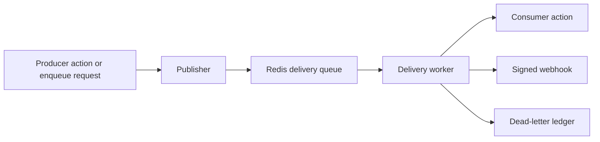

<span id="delivery-and-recovery" />
<span id="schedule-semantics" />
<span id="owned-operations" />

Run work outside the request: publish typed events to consumers and webhooks,
enqueue jobs, and fire schedules. Delivery uses a single durable Redis server
and runs every attempt through the same guarded action boundary as HTTP.

<StatusNote status="experimental" title="Durable delivery">
  Asynchronous bindings need the `jobs` capability and an explicitly
  configured delivery worker. The CLI worker runs managed and verified sandbox
  actions; native implementations need a trusted Rust host that registers them.
  Ordinary HTTP hosts and stock HTTP containers reject `jobs`.
</StatusNote>



A publisher validates the payload and atomically creates one task per bound
consumer and webhook. A worker leases each task, runs the guarded action or
sends the signed webhook, and acknowledges only a validated success. Exhausted
tasks move to the dead-letter ledger.

## Declare asynchronous work

```acore title="delivery.acore"
project(id: "delivery-example", version: "1.0.0")
variant default(include: ["*"])
model Work { id: Int64 mode: String }
guard signed(kind: GuardKind.authenticated)
action execute(kind: ActionKind.command, input: Models.Work, output: Models.Work) {
  require(guard: Guards.signed)
  managed { return {id: Input.id, mode: Input.mode} }
}
event changed(payload: Models.Work)
publisher publishChanged(event: Events.changed)
consumer consumeChanged(event: Events.changed, action: Actions.execute,
  attempts: 3, backoff: 1s, maxBackoff: 1m, deadline: 1h,
  ordering: DeliveryOrdering.binding)
job executeWork(action: Actions.execute, attempts: 3, deadline: 1h)
schedule periodic(job: Jobs.executeWork, every: 1h, timezone: "UTC",
  overlap: ScheduleOverlap.queue, missed: MissedRun.catchUp, maxCatchUp: 2,
  input: {id: 1, mode: "scheduled"})
webhook notify(event: Events.changed, attempts: 3, timeout: 5s,
  deadline: 1h, replayWindow: 5m)
```

| Declaration | Arguments |
| --- | --- |
| `event name` | `payload`: a named model |
| `publisher name` | `event` |
| `consumer name` | `event`, `action`, `attempts`, `backoff`, `maxBackoff`, `deadline`, `ordering` |
| `job name` | `action`, `attempts`, `backoff`, `maxBackoff`, `deadline`, `ordering` |
| `schedule name` | `job`, `every` or `at`, `timezone`, `overlap`, `missed`, `maxCatchUp`, `grace`, `input` |
| `webhook name` | `event`, `attempts`, `backoff`, `maxBackoff`, `deadline`, `timeout`, `replayWindow` |

- A consumer's action input must match the event payload model exactly.
- Jobs and consumers target guarded, non-streaming actions.
- An event with no binding is rejected.
- A source binding grants nothing: publishing, enqueueing, cancellation and
  recovery each need an explicit grant.
- A managed command can enqueue directly with
  `Jobs.<name>.enqueue(input: ..., key: ..., delay: 1h)` through a trusted
  delivery controller bound to the exact plan; pass it with `--delivery` to
  `serve`, `server run` or `server invoke`. Input, grants, producer
  fingerprints, receipts and per-attempt worker identities keep the semantics
  on this page. See [Managed logic and concurrency](/acore-language/managed-language).

## Configure delivery

```bash title="Terminal"
axiom server delivery-deployment backend.axiom backend.server.json --output delivery.json
```

The private `axiom-delivery-deployment/v1` manifest binds to the exact plan
hash. The scaffold for the example contains:

| Field | Scaffold value |
| --- | --- |
| `redisUrlEnv` | `AXIOM_DELIVERY_REDIS_URL` |
| `namespace` | `delivery` |
| `leaseMs` | `30000` |
| `retentionMs` | `86400000` (one day); allowed range is one minute to 30 days |
| `credentials` | `job:executeWork` and `consumer:consumeChanged`, each a `service` identity with an `authorization` header reference |
| `destinations` | `notify`: `urlEnv` and `signingKeyEnv` references |
| `grants` | Empty |
| `allowLoopbackHttp` | `false` |

Add only the grants you need: `enqueue:jobName`, `publish:publisherName`,
`cancel:job:jobName` and `recover:job:jobName`; cancellation and recovery also
accept `consumer` and `webhook` bindings. References and secrets never enter
the public `.axiom` artifact or a queue payload. Keep this file private beside
`deployment.json`.

## Run and operate

```bash title="Terminal"
axiom server enqueue backend.axiom backend.server.json --delivery delivery.json --request submission.json
axiom server worker backend.axiom backend.server.json --deployment deployment.json --delivery delivery.json
axiom server delivery-inspect backend.axiom backend.server.json --delivery delivery.json --dead
```

| Command | Purpose and options |
| --- | --- |
| `server enqueue` | Submit a typed job or publish to granted event bindings (`--request FILE`) |
| `server worker` | Run job, consumer, schedule and webhook attempts. `--once` processes one attempt and ticks schedules; `--poll-ms` defaults to `100`; `--bindings` for sandbox actions |
| `server delivery-inspect` | Show states, attempts, trace parents, failure codes and bounded recovery history, without payloads or credentials. `--id`, `--dead`, `--limit` (default `32`) |
| `server delivery-cancel --id ID` | Cancel pending work or signal the active attempt |
| `server delivery-redrive --id ID` | Redrive a dead letter. Needs a recovery grant and accepts that effects can repeat |

SIGTERM stops new attempts and cooperatively cancels current work; native
callbacks must check their action context and return. The CLI loads no
arbitrary native plugin.

A submission has a stable producer identity, a typed payload, and an optional
delay and trace parent:

```json title="submission.json"
{"kind":"job","name":"executeWork","id":"order-42","payload":{"id":42,"mode":"normal"},"delayMs":1000}
```

Use `"kind":"publish"` with a publisher name for events. Repeating the same
identity and payload returns the same receipts during retention; changing the
payload or delay under that identity is a conflict. Event identity is scoped to
the event, so two publishers for the same event share deduplication.
Publishing and your database write are separate operations; transactional
publication needs a [database integration](/backend/integrations).

## Delivery guarantees

The supported provider is one Redis server that reports `appendonly=yes`,
`appendfsync=always` and `maxmemory-policy=noeviction`. Startup rejects weaker
settings and a namespace bound to another plan. Redis Cluster, failover and an
in-memory production queue are not supported. See Redis
[persistence](https://redis.io/docs/latest/management/persistence/).

- **At least once.** Leases carry random fencing tokens, and every transition
  is an atomic script. A worker acknowledges only a validated success; a dead
  worker's lease expires and another worker recovers the task. A crash after an
  external effect and before acknowledgment can repeat that effect. Receivers
  should deduplicate on the stable receipt identity.
- **Ordering.** `unordered` runs tasks independently. `binding` keeps enqueue
  order for the whole job or consumer binding, including delayed and retrying
  tasks, so a delayed head holds later tasks. There is no global order.
- **Retries.** Only declared retryable action failures retry. Authorization,
  invalid input and indeterminate failures are terminal. Webhooks retry on
  transport failures, HTTP 429 and HTTP 5xx. Backoff doubles up to its cap.
  Expired leases count as attempts. Deadlines include delay and retries and
  also cap the action deadline. An indeterminate idempotency claim still blocks
  unsafe replay.
- **Identity.** Each attempt resolves its credentials again and enters the
  guarded action with a service or delegated identity
  ([claim rules](/backend/policies)). Browser sessions and caller identities
  cannot authorize background work, and an expired or revoked credential stops
  the callback.

## Schedules

Interval schedules (`every`) are anchored to UTC epoch multiples. Daily
schedules use `at: "HH:MM"` and an explicit IANA `timezone`. A repeated local
time fires once at its earliest occurrence; a nonexistent local time skips that
day. A schedule's cursor starts when it first gains ownership, so first startup
does not backfill. Redis time drives due times and deadlines.

| Setting | Behavior |
| --- | --- |
| `overlap: allow` | Occurrences run independently; job ordering still applies |
| `overlap: queue` | Occurrences serialize in the schedule lane, or in the job's binding lane |
| `overlap: skip` | Skip a due occurrence while the lane has unfinished work |
| `missed: skip` | Only the most recent occurrence within `grace` is eligible |
| `missed: latest` | Enqueue the most recent missed occurrence |
| `missed: catchUp` | Enqueue up to `maxCatchUp` occurrences per tick and keep the rest |

Owners renew a provider lease. Committing occurrences and advancing the cursor
is atomic and checks the owner token and previous cursor, so competing or
restarted schedulers cannot commit under an expired owner. Deterministic
occurrence identities prevent re-enqueueing after a crash. Skipped occurrences
still advance the cursor.

<span id="webhook-signatures-and-replay" />

## Webhook signatures

Destinations are private exact URL references. Production requires HTTPS;
literal loopback HTTP is allowed only with explicit development configuration.
Redirects and environment proxies are disabled. Each attempt resolves the
signing key again, uses a bounded timeout and keeps no response payload.

| Header | Value |
| --- | --- |
| `x-axiom-delivery` | Delivery identity, stable across retries |
| `x-axiom-timestamp` | Unix milliseconds, fresh per attempt |
| `x-axiom-attempt` | Attempt number |
| `traceparent` | W3C trace context |
| `x-axiom-signature` | `v1=` plus hex HMAC-SHA256 of `timestamp + "." + deliveryId + "." + exactBodyBytes` |

The signing key must be at least 32 bytes. A signature alone does not prevent
replay. Receivers must check freshness, compare the MAC in constant time, and
reject a previously accepted delivery identity using a durable replay ledger.
Record the identity only after the signature verifies, and coordinate business
effects with the receiver's own durability rules. The native Rust runtime
includes helpers for these checks.

## Limits

| Limit | Value |
| --- | --- |
| Payload | 64 KiB |
| Fanout per publication | 128 tasks |
| Records per namespace | 4,096 |
| Retry attempts | 1 to 16 |
| Backoff cap | One hour |
| Delivery deadline | Seven days |
| Webhook timeout | 30 seconds |
| Schedule catch-up | 32 per tick |
| Recovery history | 32 entries per receipt |
| Receipt retention | One minute to 30 days, set explicitly |

After a receipt expires, reusing its identity can enqueue again. A full queue
or replay ledger fails explicitly instead of evicting evidence.

## Next steps

- [Identity and policies](/backend/policies)
- [Integrations and transports](/backend/integrations)
- [Deployment targets](/backend/deployment)
