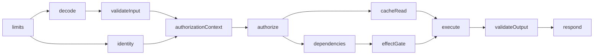

<span id="public-contract-and-private-execution" />
<span id="actions-and-guards" />
<span id="register-native-code-and-lifecycle-hooks" />
<span id="execution-and-termination" />
<span id="verify-the-foundation" />
<span id="m1-managed-flow-and-typed-outcomes" />
<span id="managed-flow-and-typed-outcomes" />
<span id="ownership-release-and-prepared-transactions" />
<span id="owned-operations" />

The execution plan (`.server.json`) is the private companion to a public
`.axiom` contract. It binds every endpoint to an action and records guards,
resources, policies and integrations. The server runtime and framework
adapters enforce it. A validated plan alone does not start a service or prove
that a handler enforces its requirements.

For ordinary development, `axiom build` and `axiom run` create and use the plan
for you; generated plans and bindings live under the project's `.axiom/`
directory. The explicit plan commands on this page are for operators, adapters
and compatibility workflows.

## Plan and companion files

| File | Format | Created by | Bound to |
| --- | --- | --- | --- |
| `backend.axiom` | Public contract | `axiom build` | Nothing private |
| `backend.server.json` | `axiom-server-plan/v2`; legacy `axiom-server-plan/v1` | `axiom build`, or `axiom server plan` for native bindings | SHA-256 of the canonical public contract |
| `deployment.json` | `axiom-server-deployment/v1` | `axiom server deployment`, then review | Plan hash |
| `bindings.json` | `axiom-action-bindings/v1` | You, from the reviewed release | Plan hash |
| `delivery.json` | `axiom-delivery-deployment/v1` | `axiom server delivery-deployment` | Plan hash |
| Target record | `axiom-server-target/v1` | The runtime (`axiom server targets`) | Runtime version |
| Requirements | `axiom-server-requirements/v1` | Inspection and packaging | Plan, deployment, bindings |
| `release.json` | `axiom-server-release/v2` | `axiom server package` | Everything above |

Adding a plan never adds handler names, provider configuration or secret
references to the client artifact. Endpoint identity, the JSON-Atom diff and
codec layouts keep their meaning.

## Validation rules

Plan validation checks the public contract binding, complete endpoint coverage,
action input and output compatibility, failure mappings, guard references,
resource interfaces, capability requirements and stage ordering.

- Every endpoint binds to exactly one action.
- Every action input maps to exactly one path, query, header or body parameter
  with a matching type and optionality. Parameters are never silently dropped.
- Domain failures have a typed payload and a category. The endpoint maps each
  to an HTTP status separately.
- No-content responses require `Void`.

## Request and response boundary

The same Rust validator runs in the server runtime and the framework adapters.

- Requests are JSON. The boundary enforces field types, enums, constraints,
  optional versus nullable fields, numeric ranges and unknown-field rejection.
  It rejects duplicate JSON object keys and repeated scalar query parameters;
  repeated query parameters represent `List<T>`. Header names are case
  insensitive; adapters reject repeated header fields.
- One body parameter uses `bodyEncoding: "whole"`: the action input receives
  the entire JSON document. Several body parameters use `"fields"`, an object
  keyed by parameter name. Explicit framework embedding can also use `fields`.
  Generated OpenAPI reflects the mapping. Map framework validator errors to a
  declared failure rather than leaking an untyped exception.
- Handler output must match the declared type and status before it is sent. A
  response projection then removes unselected fields; a request projection
  rejects fields outside its allowlist.
- Typed failures use `{"error":{"code":"name","payload":...}}`. Undeclared
  codes, mismatched statuses and malformed output become a `502` boundary
  error.
- Multiple `Set-Cookie` headers survive validation, including in idempotent
  replays. `HEAD` never sends a body. HTTP responses default to
  `Cache-Control: no-store` unless supported response metadata declares a
  reviewed cache policy.
- Limits apply before buffering: 1 MiB requests, 8 MiB responses, bounded
  request targets and headers, and at most 32 active requests per adapter.
  Action concurrency can set a lower limit.
- Action deadlines cover body acquisition, handler work and response delivery.
  Disconnects cancel cooperative handlers. The boundary cannot undo native side
  effects or safely kill native code.

<span id="authored-actions" />

## Actions

An action has a typed input and output, declared failures, an implementation,
effects, dependencies and a bounded execution policy. Native, managed and
sandbox implementations share one invocation contract.

| Policy field | Default |
| --- | --- |
| `timeoutMs` | `30000` |
| `maxAttempts` | `1` |
| `maxInFlight` | `128` |

Authored actions require the `reusableActions` capability. The server runtime
supports it; the FastAPI and Chi adapter boundary rejects it. Extracted native
routes stay executable through those adapters.

Action guards are mandatory on every entry point (HTTP, direct, job and
consumer); endpoint guards only add to them. Policy scopes compose global,
service, outer group, inner group, then endpoint, and deadlines, attempts and
concurrency stay ceilings everywhere. See
[Identity and policies](/backend/policies) for guard forms, ownership
resolvers and overrides.

In the declaration catalog (`axiom explain --schema`), an action reference
resolves its input, output and failure interface, and a resource operation
reference resolves its signature and effect category. Catalog entries carry
valid contexts, defaults, source spans, diagnostics and server plan mappings.

## Managed composition

The legacy managed form is data only:

```acore title="Acore excerpt"
action fetchTask(kind: ActionKind.query, input: Models.Selector, output: Models.Task) {
  managed {
    perform task(resource: Resources.tasks, operation: .lookup, input: Input.id)
    result(value: Steps.task)
  }
}
action readTask(kind: ActionKind.query, input: Models.Selector, output: Models.Task) {
  managed {
    invoke fetched(action: Actions.fetchTask, input: {id: Input.id})
    result(value: Steps.fetched)
  }
}
```

`perform` dispatches a typed resource operation. `invoke` calls another action
with fresh authentication and that callee's mandatory guards; the caller must
declare the callee's typed failures. `result` binds the output. Values are
literals, records, lists, required `Input` fields or earlier `Steps` outputs.
The current form (`let`, `await`, branches, `guard`, `match`, `return`, `fail`)
adds checked expressions, optional selection and branches; see
[Managed logic and concurrency](/acore-language/managed-language). Unbounded
loops are not available. Named finite `parallel` read groups need the
structured-concurrency capability; children keep the parent's ceilings and
ownership through cancellation and drain.

| Limit | Value |
| --- | --- |
| Steps per program | 64 |
| Binding nodes per program | 4,096 |
| Value nesting | 32 levels |
| Action calls per request | 128 |
| Call depth | 32 |
| Managed steps per request | 256 |
| Provider attempts per request | 256 |

The compiler checks types, references, dependency cycles and query-safe effect
categories. A request shares one root deadline, cancellation token, generation
and budget. Each callee inherits its caller's deadline and keeps its own
deadline and concurrency ceiling. Awaited dispatches and errors keep exact
source spans. Cancellation never undoes an effect that already happened.

**Typed outcomes.** Native and sandbox outcomes pass the same validation as
managed ones. Cancellation and deadline checks happen before a business failure
is translated into its public form ([typed failures](/backend/declarations)).

**Ownership and release.** Provider acquisitions are owned and released once;
shutdown or duplicate teardown cannot reacquire a disposed provider. Cleanup
attempts every remaining acquisition in reverse order. Up to 16 safe secondary
issues accompany the original failure, with a truncation marker beyond that. A
release context has a separate 250 ms cooperative deadline and 128 work units.
Release errors never expose private provider text. A callback that ignores
cancellation remains trusted native work and keeps its admission until it
exits.

**Prepared transactions.** A source transaction becomes one derived resource
operation after exact offline preparation against the declared qualified SQL
programs. Deployment and simulation reject missing preparation or changed
programs, and the grant names the derived operation. Atomicity covers the
business, outbox and receipt work in that provider, with result validation
before commit; it does not cover another resource or a network effect.

**Private diffs.** `axiom server diff` keeps exact before and after hashes. It
may classify a bounded straight-line rewrite from the legacy form to `await` as
a representation change with an empty behavior diff. Validation, branches,
computations, unbounded values and unknown native behavior remain ordinary
changes that need review.

**Batching.** A `batchPolicy` adds the `requestBatching` capability; see
[Integrations and transports](/backend/integrations).

## Run and invoke

```bash title="Terminal"
axiom build main.acore --out backend.axiom
axiom server deployment backend.axiom backend.server.json --output deployment.json
axiom server run backend.axiom backend.server.json --deployment deployment.json --listen 127.0.0.1:8080
axiom server invoke backend.axiom backend.server.json --deployment deployment.json --request request.json
```

| Option | `server run` | `server invoke` |
| --- | --- | --- |
| `--deployment` | Required | Required |
| `--bindings` | Sandbox references | Sandbox references |
| `--delivery` | Reviewed delivery controller; producer input cannot choose its grants | Same |
| `--listen` | Default `127.0.0.1:8080` | Not used |
| `--observations` | Writes bounded, payload-free native observations privately after shutdown; the destination must be new | Not used |
| `--request` | Not used | Required |

`server run` executes managed and sandbox actions over HTTP and never starts
mocks. Missing native symbols, providers or capabilities fail startup.
`GET /_axiom/ready` reports readiness, and SIGTERM drains HTTP work and closes
the host. A direct invocation file holds typed business input:

```json title="request.json"
{
  "action": "readTask",
  "origin": "direct",
  "identity": "caller",
  "input": {"id": 1},
  "headers": {}
}
```

The request fields and identity rules are described in
[Identity and policies](/backend/policies). Idempotency keys for direct, job and
consumer calls use the `@action:<name>` namespace, so each transport keeps its
own statuses, projections and metadata; replays recheck guards and keep native
behavior unknown. Job and consumer entry points do not implement a delivery
provider or schedule; see [Events, jobs and webhooks](/backend/events-and-jobs).

## Native hosts

A trusted native Rust application registers handlers against explicit action
names and the exact contract, plan, deployment and configuration. A handler
receives an immutable admitted context and returns a typed success or a
declared failure. It must check cancellation during long work, and it keeps its
concurrency slot until it exits. Required response headers and cookies need an
explicit metadata producer; outputs are validated before completion.

The host can register startup, shutdown, request begin and end, and action
begin and end hooks. Begin hooks run in registration order; end and shutdown
hooks run in reverse and keep attempting cleanup after a failure. Request hooks
also cover denied requests and replays; action hooks cover executed actions.
Panics and hook failures release admission and abandon unfinished claims. Hooks
and native providers are trusted code with cooperative deadlines, and their
internal effects are unknown. Transaction hooks are not available. Authored
interceptor declarations use the framework adapters and fail explicitly on the
server runtime.

## Interceptors

```acore title="Acore excerpt"
interceptor trace(stage: InterceptorStage.beforeAction, native: "hooks.trace")
interceptor decorate(stage: InterceptorStage.afterAction, native: "hooks.decorate")
interceptor release(stage: InterceptorStage.cleanup, native: "hooks.release")

endpoint getTask(method: GET, path: "/tasks/{id}") {
  request { path("id", type: Int32) }
  intercept(interceptor: Interceptors.trace)
  intercept(interceptor: Interceptors.decorate)
  intercept(interceptor: Interceptors.release)
  response(type: Models.Task)
}
```

- Admission and required guards run before the first hook. An interceptor
  cannot turn a denied invocation into a success.
- Before hooks run in declaration order and can return an early response,
  which skips the handler and the remaining before hooks. After hooks then run
  in declaration order. The validator checks the final status, payload, failure
  and projection.
- Each callback gets an isolated copy of the context with the verified input,
  principal, trace and deadline.
- Cleanup runs in reverse order after success, failure, cancellation or
  disconnect, with a separate one-second cooperative budget, and holds the
  concurrency slot until it exits. A failed cleanup cannot replace the
  response. Outcomes are `success`, `failed`, `rejected`, `cancelled`,
  `deadline` and `disconnected`; how transport cancellation maps depends on the
  server.
- Idempotent replay skips the handler and every hook. Callbacks are opaque to
  effect analysis.

Registration in FastAPI and Go is described in
[Deployment targets](/backend/deployment).

<span id="verified-sandbox-bindings" />

## Sandbox bindings

A server sandbox binding needs a verified executable package, the exact module
digest, a matching application identity and a release-pinned authority lock.
Package imports and action declarations supply no authority.

```json title="bindings.json"
{
  "format": "axiom-action-bindings/v1",
  "planSha256": "EXACT_PLAN_SHA256",
  "sandboxes": {
    "pricing": {
      "packageEnv": "PRICING_PACKAGE",
      "authorityEnv": "PRICING_AUTHORITY",
      "moduleEnv": "PRICING_MODULE",
      "authoritySha256": "REVIEWED_AUTHORITY_SHA256"
    }
  }
}
```

Each key is an extension used by a sandbox action, and the map must cover
exactly the plan's sandbox extensions (at most 128). Unknown fields are
rejected. The three `...Env` fields name environment variables that resolve
private artifact paths; the authority pin comes from the reviewed release
manifest. Pass the file with
`--bindings` to `serve`, `server run`, `server invoke`, `server validate` and
`server package`.

The server sandbox runs bounded computation and denies every external host
operation, even ones an extension lock would otherwise allow. Broker denials
are audited and returned to the guest, which may handle them and return a valid
fallback; no denied effect reaches a provider. Memory, fuel, messages, deadlines
and cancellation use the extension kernel limits. The typed JSON bridge
excludes floating-point and byte fields and recursive or deeply nested models.
See [Extensions](/extensions).

<span id="resources-and-deployment" />

## Resources and providers

A resource has named operations with typed inputs and outputs, effect
classifications, dependencies and an `application` or `invocation` lifetime.
Application providers cannot hold invocation-scoped dependencies, and
dependency cycles are rejected.

The deployment binds each resource to a provider with the same interface hash.
Configuration values are environment variable references; resolved credentials
never enter the plan. Binding grants nothing: each `resource.operation` needs
an explicit grant. Deployment capabilities must match the plan and the real
host, so a manifest cannot enable an unimplemented capability.

- Providers are verified against their registered implementation at startup; a
  claimed interface hash is not proof. A provider factory must expose the exact
  operation signatures and configuration key schema.
- The configuration resolver reads references once at startup. Resolved
  configuration is redacted in debug output and never serialized. Factory
  validation runs before readiness.
- Application dependencies start once, in dependency order. Invocation
  dependencies are acquired lazily and shared across guard checks and nested
  actions in one request. Cleanup runs once, in reverse acquisition order,
  including after partial creation and failure.
- The built-in `jsonSnapshot` provider reads private bounded JSON files with
  typed scalar keys. Custom providers and hooks are opaque native code, so their
  presence prevents a complete effect claim, including on replay. Bindings,
  dependencies and models never install a database or grant authority.

## Effects and evidence

Effects identify a resource operation, its kind and its source provenance. The
kinds are reads, writes, deletion, network calls, publication, consumption,
file reads and writes, secret use, scheduling, jobs, logging, tracing, clocks
and randomness.

- Declared, inferred and extracted provenance differ from runtime evidence.
  Implementation kind also differs from enforcement evidence: a native handler
  can have validated input while its network behavior stays unknown. Native
  implementations cannot claim complete effect analysis, and unknown behavior
  propagates through dependencies.
- Queries reject declared business mutations and calls to command or stream
  actions; explicit tracing and similar operations stay allowed. An
  unclassified network call is never assumed read-only. A list of effects does
  not state their order.

## Execution stages



The plan records this graph, and validation rejects unsafe orderings:

- Apply request limits before decoding.
- Obtain identity and validated input before resolving authorization context.
- Authorize before protected cache reads or ordinary provider resolution.
- Install the effect gate before running the implementation, and check managed
  effect permissions before each dispatch.
- Validate output before responding. Output validation cannot undo an effect
  that already happened.
- Clean up on `success`, `rejected`, `failed`, `cancelled`, `deadline` and
  `disconnected`.

Retries stay inside the original deadline. A command cannot opt into automatic
retries by raising an attempt count, and an indeterminate external outcome is
never retried automatically. Transaction and after-commit stages are not part
of this graph.
