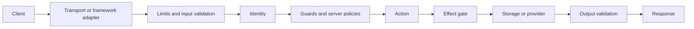

import { Card, Cards } from 'fumadocs-ui/components/card';

An AxiomCore backend is an HTTP service described by an Acore contract. This
section shows how to declare a backend in Acore, run it locally, protect it,
connect providers and package it for a deployment target. Both paths below
produce a contract that clients, tests and Inspector can read.

| Start from | First guide | What stays yours |
| --- | --- | --- |
| FastAPI | [FastAPI](/guides/fastapi-to-web) | The Python application and its business logic |
| Go | [Go](/guides/go-to-web) | The Go application and its router |
| Acore | [Build your first API](/getting-started/quickstart-backend) | Authored models, actions, policies and deployment choices |
| A database-backed app | [Run your first app](/getting-started/quickstart) | The database contract and typed storage mappings |

## What a backend is made of

| File | Created by | Read by |
| --- | --- | --- |
| `.acore` source and `AxiomDeps.toml` with `type = "backend"` | You | Compiler and editor |
| `backend.axiom`, the public contract | `axiom build` | Clients, tests, Inspector and Axiom Cloud |
| `backend.server.json`, the private execution plan | `axiom build`, when the source declares server behavior | The server runtime only |
| `deployment.json`, the private deployment | `axiom server deployment`, then your review | The server runtime only |

The public contract describes endpoints, models and client policies. The
private plan holds actions, guards, resources and server policies, which
clients never receive. The deployment names environment variables and grants,
never secret values.

## A request through an Acore backend

The transport applies size limits and validates the request against the
contract. The server verifies the caller, then enforces the action's mandatory
guards and the server policies (rate limits, idempotency, timeouts). The action
runs as managed Acore code, a verified WebAssembly sandbox or registered native
code. Each storage or provider call passes an effect gate that checks the
declared operation and the deployment's grant. Output is validated before the
response is sent. [Execution plan](/backend/execution) gives the exact stage
order.

## Contract lifecycle

```mermaid title="From Acore source to a released backend"
flowchart LR
  A[Write .acore source] --> B[axiom check]
  B --> C[axiom build]
  C --> D[Contract and private plan]
  D --> E[Inspect, test and diff]
  E --> F[Review deployment.json]
  F --> G[Run locally]
  G --> H[Package for a target]
  H --> I[Verify and release]
```

1. Write the source and validate it with `axiom check`.
2. Build with `axiom build main.acore --out backend.axiom`. This writes the
   contract and, beside it, `backend.server.json`.
3. Review with `axiom inspect`, `axiom server inspect`, `axiom test`,
   `axiom diff`, `axiom security check` and `axiom domain validate`.
   Inspection reads artifacts; it does not run the backend.
4. Scaffold `deployment.json` with `axiom server deployment`, then review its
   providers, authentication and grants.
5. Run the real service with `axiom run` or `axiom serve`, or choose an
   explicit [mock](/testing/mocks). Add [persistence](/database/persistence)
   with storage mappings.
6. Package for a [deployment target](/backend/deployment), verify the bundle,
   and [release](/backend/releases). A Cloud contract release is immutable;
   publish a new version instead of overwriting one.

A built contract does not start or deploy a service.

## Status

| Capability | Status |
| --- | --- |
| Backend contracts: check, build, inspect, semantic diff | **Alpha** |
| Managed actions, typed failures and local real serving | **Experimental** |
| SQLite and PostgreSQL storage mappings | **Experimental** |
| Deployment targets | Per target; see [Deployment targets](/backend/deployment) |
| FastAPI extraction / Go extraction | **Available** / **Alpha**; see [Use your existing stack](/guides) |
| HTTP adapters for FastAPI and Go Chi handlers | **Experimental** |

See [Support and availability](/introduction/support-matrix) for the full matrix.

## In this section

<Cards>
  <Card title="Backend declarations" href="/backend/declarations" description="Models, endpoints, actions, failures and storage." />
  <Card title="Run a backend locally" href="/backend/local-development" description="Real serving, reload and mocks." />
  <Card title="Identity and policies" href="/backend/policies" description="Authentication, guards and admission." />
  <Card title="Events, jobs and webhooks" href="/backend/events-and-jobs" description="Durable asynchronous work." />
  <Card title="Integrations and transports" href="/backend/integrations" description="Caches, outbound HTTP, uploads, streams." />
  <Card title="Secrets at runtime" href="/backend/runtime-secrets" description="Purpose-bound credentials." />
  <Card title="Deployment targets" href="/backend/deployment" description="Where a backend can run." />
  <Card title="Release a backend" href="/backend/releases" description="Package, verify and roll back." />
  <Card title="Execution plan" href="/backend/execution" description="The private plan reference." />
</Cards>

## Next steps

- [Build your first API](/getting-started/quickstart-backend)
- [Backend declarations](/backend/declarations)
- [Run a backend locally](/backend/local-development)
