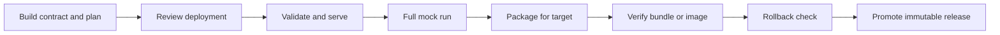

<span id="choose-the-supported-workflow" />
<span id="reproduce-acceptance-and-retain-evidence" />
<span id="explore-and-continue" />

Release a backend so that one public API keeps its endpoint IDs, types, guards,
projections and client codecs while its private deployment selects a host and
reviewed providers. A successful contract build does not certify a deployment;
each target needs its own run and checks. See
[Deployment targets](/backend/deployment) for target status.



<span id="build-and-review-from-a-clean-directory" />

## 1. Build and review

Start from your backend source and manifest, with compatible CLI and runtime
versions:

```bash title="Terminal"
axiom build service.acore --out backend.axiom
axiom server deployment backend.axiom backend.server.json --output deployment.json
axiom server targets
axiom server inspect backend.axiom backend.server.json --deployment deployment.json --target native-server
```

`backend.axiom` (public) and `backend.server.json` (private) are separate
outputs. The deployment must bind exact plan and interface hashes, explicit
operation grants, and environment variable **names**; values are supplied
separately. Regenerate the deployment references after any plan change. Never
edit hashes to silence a stale-artifact error.

For a portable API with JWT authentication and one remote HTTPS provider, the
private references look like this:

| Reference | Meaning |
| --- | --- |
| `JWT_KEY` | Reviewed HS256 signing key, at least 32 bytes |
| `REMOTE_ORIGIN` | HTTPS origin that implements the declared remote operations |
| `REMOTE_TOKEN` | The whole upstream Authorization header value, such as `Bearer TOKEN` |
| `ALLOW_LOOPBACK` | `false` for a production provider |
| `IDEMPOTENCY_SUPPORTED` | `true` only after reviewing the provider's idempotency behavior |

Load them from your trusted environment or secret manager. Packaging captures
references; validation and activation need the real values.

## 2. Review the change

```bash title="Terminal"
axiom diff service.acore --format changelog
axiom server diff previous.axiom previous.server.json backend.axiom backend.server.json
axiom security check service.acore --fail-on-warning
axiom domain validate service.acore
axiom test service.acore
```

- `axiom diff FILE` compares evaluated source with the local lock; pass two
  files to compare explicit sources. `--format` is `text`, `semantic`, `atom`
  or `changelog` (default).
- `axiom server diff` compares private behavior. It validates both public
  bindings and reports deterministic JSON paths with before and after values,
  separating behavior changes, scope provenance and public contract hash
  changes. Adding a guard need not change the client artifact. It does not
  classify private changes as backward compatible; review them.
- `axiom test` runs contract tests, which can target a configured live or
  staging base URL. See [Contract tests](/testing/contracts) and
  [CI checks](/testing/ci).

## 3. Validate and exercise the real boundary

```bash title="Terminal"
axiom server validate backend.axiom backend.server.json --deployment deployment.json --target native-server
axiom serve backend.axiom --plan backend.server.json --deployment deployment.json --port 8080
```

From another terminal, check one allowed and several rejected requests. For an
API whose `/tasks/{id}` action requires permission `task.read`:

| Request | Expected |
| --- | --- |
| `curl --fail http://127.0.0.1:8080/status` | `"ready"` |
| `curl -i -X POST http://127.0.0.1:8080/tasks/1` | `401` |
| `curl --fail -X POST -H "Authorization: Bearer $READER_JWT" http://127.0.0.1:8080/tasks/1` | The typed task |
| `curl -i -X POST -H "Authorization: Bearer $READER_JWT" http://127.0.0.1:8080/tasks/0` | `400` |
| A valid token without `task.read` | `403` |

Issue the reader JWT from your trusted issuer with the deployment's issuer and
audience, a nonempty subject, a tenant, a valid expiry and permission
`task.read`. Inspection is declaration evidence; these requests test real
enforcement. Check successful and denied requests, constrained input, nested
guards, ownership and tenant checks, projections, exact `Int64` JSON, response
metadata, and security, media and CORS headers, including failures before
dispatch. Stop with Ctrl-C before changing mode.

<span id="exercise-full-mocks-without-provider-access" />

## 4. Run full mocks without provider access

Create `mock.json` with finite typed replies and a separately reviewed
`mock-identities.json`, both bound to the exact contract and plan (see
[Server simulation](/testing/server-simulation)):

```bash title="Terminal"
axiom serve backend.axiom --plan backend.server.json --mock --fixtures mock.json --identities mock-identities.json --port 8080
```

`axiom mock service.acore` also selects full simulation for a source with a
private plan. Managed programs and guards still run. Use a finite reply
sequence, such as sixteen replies per operation; running out fails explicitly. A synthetic owner
fixture can say task 1 belongs to Alice in tenant red; it is not a database.
Startup prints a private `credentialsFile`; use its `reader.headers` for a
success and `denied.headers` for `403`, and omit credentials for `401`. These
fresh development credentials never authenticate against a production key.

```python title="check_mock.py"
import json
import urllib.request
from pathlib import Path

credentials = json.loads(Path("PATH_FROM_credentialsFile").read_text())
request = urllib.request.Request(
    "http://127.0.0.1:8080/tasks/1",
    headers=credentials["reader"]["headers"], method="POST")
with urllib.request.urlopen(request) as response:
    assert response.status == 200
    assert json.load(response)["title"] == "task-1"
```

Stopping the service removes its credential and session files. Full mocks never
load real providers or retry exhausted fixtures against them.

<span id="package-and-activate-the-chosen-target" />

## 5. Package for the target

Choose a new, immutable output directory for each release.

| Target | Package | Then |
| --- | --- | --- |
| `native-server` | `axiom server package ... --target native-server --output release-v1` | `axiom server verify-bundle release-v1`, then `release-v1/bin/axiom server run-bundle release-v1 --listen 127.0.0.1:8080` |
| `container-arm64`, `container-amd64` | `axiom server package ... --target container-arm64 --runtime-source DIR --output container-v1` | `docker buildx build --platform linux/arm64 --load --tag my-api:candidate container-v1` |
| `cloudflare-workers-local` | `axiom server package ... --target cloudflare-workers-local --runtime-source DIR --output worker-v1` | `axiom server verify-bundle worker-v1`, then `pnpm install`, `pnpm verify`, `pnpm dry-run` and `pnpm dev` in `worker-v1` |

`...` stands for `backend.axiom backend.server.json --deployment deployment.json`;
add `--bindings` for sandbox plans. `run-bundle --listen` defaults to
`127.0.0.1:8080`. Configure containers with the runtime settings in
[Deployment targets](/backend/deployment); their readiness route is
`/_axiom/ready`, and TLS, routing and publication are yours. Worker local
bindings go in a private `.dev.vars`; hosted uploads are not available.

The same executable and inputs produce identical bundle files and manifest.
That is packaging reproducibility; it does not promise that arbitrary Rust
toolchains produce identical executables.

## 6. Verify the release

An `axiom-server-release/v2` bundle binds:

- the complete target record and its digest;
- the runtime ABI, version, platform and executable digest;
- canonical hashes of the public contract, private plan, deployment and
  optional bindings;
- the recomputed transitive requirements and the exact launch template;
- every file's relative path, size, SHA-256 and executable role.

Sandbox assets use `assets/<sha256>.<suffix>` addresses and a sealed reference
map. `launch.json` records the entrypoint, configuration reference names and
the deployment's exact grants; provider paths and resolved secrets never enter
it.

The directory must contain exactly that closure and `release.json`. Unlisted
files, missing assets, duplicate or unknown JSON fields, path aliases or
traversal, symlinks, hard links, special files and oversized content fail.

| Release limit | Value |
| --- | --- |
| Files | 256 |
| Total size | 512 MiB |
| Executable | 256 MiB |
| JSON or package artifact | 16 MiB each |
| Sandbox module | 4 MiB |

Verification and activation use the captured, verified bytes. Activation also
requires the exact packaged executable, the current certified target and
runtime version, and a fresh private configuration preflight. The manifest is
an integrity inventory, not a publisher signature: deliver the whole immutable
directory through a trusted channel.

**Legacy v1 bundles.** `axiom-server-release/v1` has no bound target or
runtime, so verification, activation and rollback reject it with a repackage
diagnostic. Repackage from the original artifacts, deployment and bindings with
the current CLI; editing the format string is not a migration. Unknown future
formats also fail.

## 7. Rotate credentials

Keep credential changes separate from code promotion, and record which secret
versions and provider endpoints belong to each release. For native bundles and
containers, update the external secret values or private credential files with
correct ownership and permissions, validate, restart the same immutable
release, and repeat the allowed, denied and invalid-input checks. Providers and
authentication preflight again at startup; in-process file replacement is not a
supported reload. (API-key registries are the exception: they are reread on
every request.)

The HS256 profile accepts one signing key. Coordinate rotation with your issuer
and a restart: tokens signed with the old key stop working at activation. There
is no overlapping-key or zero-interruption rotation. Upstream token rotation
needs its own provider review. Local Worker binding changes need a local
restart and request checks; hosted secret and version changes are part of the
hosted acceptance that has not been performed.

<span id="rotate-credentials-promote-and-roll-back" />

## 8. Promote and roll back

Promote an immutable directory, or an OCI manifest or index digest, through
your trusted release channel after verifying the inventory, runtime and
platform, source provenance and test record. A local Docker image
configuration ID is not a registry digest: record the real OCI digest after
export or publication. These workflows publish nothing to a registry and change
no infrastructure. Hashes prove integrity against the
reviewed inventory; they do not prove who published it or that tests ran. An
unchanged public contract says nothing about provider authority or private
behavior.

Before switching native bundles, check the rollback:

```bash title="Terminal"
axiom server verify-bundle release-v2
axiom server rollback-check release-v2 release-v1
```

`rollback-check CURRENT PREVIOUS` verifies both v2 inventories and
target and runtime compatibility, and compares public semantics: IR, codec and
schema bytes, validators, security manifests, client policies and UI metadata,
allowing release version and schema hash updates. A public contract change
exits with failure; a private-only change is reported for review. It does not
activate a release or reverse provider data. To roll back, review the private
diff, preflight the previous release against current configuration, drain the
current process and run the previous bundle's executable.

- **Containers.** Keep the previous image digest and configuration versions.
  Run `server rollback-check` with the new image's bundled executable against
  read-only release directories, verify the previous `/app` bundle, switch the
  deployment to that digest and recheck readiness and requests. Byte-identical
  images need the same base, toolchain, platform, Dockerfile, Cargo locks,
  source and artifact bytes, BuildKit version, build options, timestamps,
  metadata and provenance settings; keep those inputs and the built digest with
  each promotion.
- **Local Workers.** Verify both inventories and review the public contract and
  private plan and deployment diff before restarting Wrangler from the previous
  directory. `rollback-check` does not activate a Worker or certify hosted
  rollback.

Rollback never restores provider data, and a revoked credential must not come
back with old code. Review data and schema compatibility separately; schema
migrations and cloud orchestration are outside this local release profile.

## Publish the contract to Axiom Cloud

<StatusNote status="alpha" title="Cloud releases">
  Cloud contract releases need a live account and a linked project.
</StatusNote>

```bash title="Terminal"
axiom login
axiom build service.acore --release --version 1.2.0 --out backend.axiom
```

Or release an already built artifact with `axiom release backend.axiom`
(`--project` and `--version` override the linked project and version). A Cloud
release is immutable; publish a new version instead of overwriting one. A Cloud
release distributes the contract; it does not deploy the server. See
[Releases and environments](/cloud/releases-and-environments).

## Keep acceptance evidence

For each release, record the commands and results for every target you ship:
one hashed request corpus across profiles, both container architectures built
from the reviewed context, matching response metadata, preserved public
contract bytes, readiness and bounded local load, and the runtime, toolchain
and image versions. For Workers, also cover concurrent tenants, cancellation,
unsafe provider outcomes, overload and version replacement. Keep failed runs
as well as the final passing run. Test credentials and intercepted providers
used for acceptance must never enter production artifacts, and failure fixtures
and toolchains belong in a validation image or external test mount, not the
production image. Local timings are observations, not cold-start, native amd64
or throughput guarantees.

The [playground](https://playground.axiomcore.dev) **Portable · deployment
profiles** example shows source-only target assessments and incompatible
declarations, and its download includes setup helpers. Private actions stay
unexecuted in the browser.

## Next steps

- [Deployment targets](/backend/deployment)
- [Releases and upgrades](/delivery/releases)
- [Production readiness](/delivery/production-readiness)
