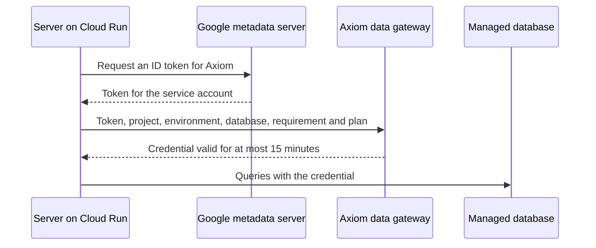

<StatusNote status="alpha" title="Hosted runtime connections">
  Connecting a Cloud Run server to managed SQLite and PostgreSQL is **Alpha**,
  checked on October 24 and 25, 2026 with source builds of the Axiom CLI and
  runtime, for invited accounts: Axiom Cloud signup is invite-only. These
  commands need CLI 0.151.0 or later.
  [Hosted migrations](/cloud/hosted-migrations) are **Alpha**.
</StatusNote>

An Acore backend running on Google Cloud Run can use the managed database of
its [project environment](/cloud/project-resources). The server proves its
Google identity, and Axiom Cloud returns a short-lived credential for one
database, scoped to the tables of the schema you applied. No database password
or token is stored in the image, in `AxiomSecrets.toml` or in Cloud Run
settings.

| Path | Used here |
| --- | --- |
| Backend | An Acore backend packaged for `container-amd64` or `container-arm64` |
| Database | The environment's managed SQLite (Free and Pro) or PostgreSQL (Pro) database |
| Host | Google Cloud Run, second-generation execution environment |
| Identity | A Google service account that you create for one environment |

Servers outside Google Cloud are not supported. They would need workload
identity federation, which is not available.

## How the server gets a credential



1. The server asks the Google metadata server for an ID token. The token names
   the service account the Cloud Run service runs as.
2. Axiom Cloud checks that the identity is registered for this project,
   environment and exact backend plan, and that an owner granted it the
   database. IDs in the request confer nothing on their own.
3. The server receives a credential that opens new connections for at most 15
   minutes. It renews the credential while handling requests, when 3 minutes
   or less remain, and after the database refuses it.

Credentials never appear in logs, errors or diagnostics. Sandboxed extensions
and browsers never receive database credentials, and a managed database
cannot be granted to a sandbox.

## Before you start

- A project with a **Ready** managed database in the environment you deploy
  to. See [managed resources](/cloud/project-resources).
- The database contract applied with [hosted migrations](/cloud/hosted-migrations).
  A database with no applied migration gets no credential.
- An Acore backend whose database resource uses the same contract version.
  Before its first query on each credential, the server checks that the
  applied schema matches its plan.
- An Axiom CLI build with `axiom server package --environment`, and the
  matching AxiomCore runtime source for container packaging. See
  [deployment targets](/backend/deployment#linux-containers).
- A Google Cloud project with Cloud Run and Artifact Registry, the `gcloud`
  CLI and Docker with `buildx`.
- Owner role in the Axiom Cloud project. Only owners register workloads and
  grant database access.

## 1. Declare the database resource

The database resource declares exactly one secret with the `connectDatabase`
purpose. For managed SQLite, use the hosted SQLite transaction profile:

```acore title="service.acore (partial backend declaration)"
secret tasks(purpose: SecretPurpose.connectDatabase)

resource tasks(
  lifetime: ProviderLifetime.application,
  transactionProfile: TransactionProfile.hostedLibsql,
  secrets: [Secrets.tasks]
) {
  operation list(input: Models.Empty, output: List<Models.Task>, effect: EffectKind.read)
}
```

A SQLite `storage` resource without this profile, such as the
[task app](/examples/task-app)'s, is not a hosted SQLite resource, and the
deployment scaffold proposes `postgres` for it. For managed PostgreSQL, use
`TransactionProfile.postgres17_11`. Implement the
operations with a `storage` declaration that points at the migrated contract,
as in [connect a backend with typed storage](/database/persistence#connect-a-backend-with-typed-storage).

The secret's name is the **requirement**. This page uses `tasks`. The same
name appears in the deployment file, in `AxiomSecrets.toml` and in the
database grant.

## 2. Build the plan and review the deployment

```bash title="Terminal: project root"
axiom build service.acore --out backend.axiom
axiom server inspect backend.axiom backend.server.json
axiom server deployment backend.axiom backend.server.json --output deployment.json
```

`server inspect` prints JSON that includes `planSha256`. Keep it: the workload
registration and the grant use that exact plan. Any change that produces a new
plan needs a new registration and a new grant.

Review the scaffolded binding for the database resource:

| Field | Managed SQLite | Managed PostgreSQL |
| --- | --- | --- |
| `provider` | `libsql` | `postgres` |
| `configuration` | Empty | Empty |
| `secrets` | `{"tasks": "secret:tasks"}` | `{"tasks": "secret:tasks"}` |

The scaffold proposes `postgres` with a `binding` file for every transaction
profile. A managed database takes its endpoint and credential from the lease,
so remove the `binding` entry, and use `libsql` for managed SQLite.

## 3. Create the service account

Create one service account for each environment. Do not reuse it for another
environment or another application.

```bash title="Terminal"
gcloud iam service-accounts create my-api-production --display-name "my-api production"
gcloud iam service-accounts describe my-api-production@GOOGLE_PROJECT.iam.gserviceaccount.com --format "value(uniqueId)"
```

The second command prints the account's numeric unique ID. It equals the
`sub` claim of the account's ID tokens, so it is the **Google workload
subject** you register in the next step.

## 4. Register the workload

1. In the [Cloud Dashboard](https://app.axiomcore.dev), open the project's
   **Secrets** page and select the environment that owns the database.
2. Open **Runtime access**, then **Workload identities**, and select
   **+ Register workload**. The **Resources** page links here with
   **Register a workload for database access**.
3. Enter the service account's unique ID as **Google workload subject**.
4. Under **Used for**, choose **Database access**. The audience fills in.
5. Paste the `planSha256` value as **Compiled backend plan SHA-256**, then
   select **Register workload**.

Registration alone grants nothing. A database-access registration does not
grant secrets, and a secrets registration cannot hold a database grant. Each
environment holds at most 64 workload identities, disabled ones included.

## 5. Grant the database

1. Open the project's **Resources** page and find the database's
   **Database access** section.
2. Select **Grant access**.
3. Enter the requirement (`tasks`). It starts with a lowercase letter and
   continues with letters or digits, up to 64 characters.
4. Choose the workload. Only enabled database-access workloads of this
   environment appear. The plan fills in from the registration.
5. Choose an expiry of 7, 30 or 90 days and select **Grant access**.

The consumer is always `server`. A workload holds at most one active grant per
requirement on a database. If the confirmation is lost, select **Grant access**
again with the same details: the retry does not create a second grant.

## 6. Write the secrets profile

Create `AxiomSecrets.toml` in the project root. It contains IDs and no
credential.

```toml title="AxiomSecrets.toml"
format = "axiom-secret-bindings/v1"

[environments.production.cloud]
identity = "google-metadata"
project_id = "PROJECT_UUID"
environment_id = "ENVIRONMENT_UUID"
data_gateway = "https://axiom-data-gateway-617539083629.asia-southeast1.run.app"

[environments.production.secrets.tasks]
source = "axiom-cloud-database"
resource = "RESOURCE_UUID"
```

| Field | Value |
| --- | --- |
| `identity` | `google-metadata`: the token comes from the Cloud Run service account. |
| `project_id`, `environment_id` | Lowercase UUIDs of the Axiom Cloud project and the environment that owns the database. |
| `data_gateway` | The Axiom data gateway origin shown above: `https`, a host, no path. |
| `secrets.tasks` | The requirement. `resource` is the database's lowercase UUID. |

`production` here is the profile name you pass to `--environment`. Leave out
`project_slug` and `bindings` unless the profile also has `axiom-cloud`
secrets. An `axiom-cloud-database` source is refused under `configuration` and
in sandbox grants. In a container profile, every secret must be an
`axiom-cloud-database` or `axiom-cloud` source, and configuration comes only
from `env` sources.

## 7. Package and push the image

```bash title="Terminal: project root"
axiom server package backend.axiom backend.server.json \
  --deployment deployment.json --target container-amd64 \
  --runtime-source /path/to/runtime-source \
  --environment production --secret-root . \
  --output container-context
docker buildx build --platform linux/amd64 \
  --tag REGION-docker.pkg.dev/GOOGLE_PROJECT/REPOSITORY/my-api:candidate \
  --push container-context
```

`--environment` seals the selected profile into the release as a value-free
record, so the container needs no secrets file at run time. It is refused for
targets other than containers. Without `--secret-root`, the CLI reads
`AxiomSecrets.toml` from the contract's directory. For an arm64 image, use
`container-arm64` and `linux/arm64`.

## 8. Deploy to Cloud Run

```bash title="Terminal"
gcloud run deploy my-api \
  --image REGION-docker.pkg.dev/GOOGLE_PROJECT/REPOSITORY/my-api@sha256:IMAGE_DIGEST \
  --region asia-southeast1 \
  --service-account my-api-production@GOOGLE_PROJECT.iam.gserviceaccount.com \
  --execution-environment gen2 \
  --port 8080 --cpu 1 --memory 512Mi \
  --set-env-vars AXIOM_CONTAINER_MEMORY_BYTES=536870912,AXIOM_CONTAINER_CPU_MILLIS=1000
```

- **Execution environment and budget.** The runtime needs a finite CPU and
  memory budget. Second-generation Cloud Run instances expose no cgroup
  budget, so declare the service limits: `AXIOM_CONTAINER_MEMORY_BYTES` is the
  memory limit in bytes (64 MiB to 64 GiB) and `AXIOM_CONTAINER_CPU_MILLIS` is
  the CPU limit in millicores. Without them the server refuses to start.
  Change both when you change `--memory` or `--cpu`.
- **Port.** The image listens on `0.0.0.0:8080`. If you change the container
  port, set `AXIOM_LISTEN` to the same address and port.
- **Region.** Run near the database: SQLite databases are only in Mumbai,
  and PostgreSQL databases are in Singapore. Hosted SQLite write transactions must commit within 4 seconds of
  starting, so distant regions can fail writes.
- **Files.** `TMPDIR` must be writable. The image sets it to `/tmp`.

Choose who may invoke the service as you would for any Cloud Run service.
Database access does not depend on that choice.

## 9. Verify

Call an endpoint that reads from the database. In the service's logs, the
server writes a structured `database.lease.issued` event with your
requirement name when it gets a credential. Events never contain the
credential, the token or the endpoint.

If the call fails, look for these events:

- `database.readiness.failed` with stage `applied-head`: the applied schema
  differs from the backend's plan. Callers get `503 database_not_ready`.
  Apply the matching contract version, or build the backend from it.
- `database.lease.failed`: Axiom Cloud refused a credential. Its `code` field
  is one of the codes below. Callers of your API see only a redacted
  `503 database_unavailable` response.

| Code | Meaning | What to do |
| --- | --- | --- |
| `AXDATA_DENIED` | No registered, enabled identity for this project, environment and plan, or no unexpired grant for the requirement. | Check the subject, the **Database access** choice, the plan SHA-256, the requirement name and the grant expiry. |
| `AXDATA_QUOTA` | The database is stopped for usage, or a shared limit refuses new credentials. | See [usage and limits](/cloud/backend-databases#when-a-limit-is-reached). |
| `AXDATA_STALE` | The database or environment is not ready, or the database changed since the credential was issued. | The server takes a new credential by itself. If it persists, check the database state and the environment. |
| `AXDATA_NOT_ADMITTED` | Runtime connections are not available for this database's profile or location. | Check the database's engine and location on the **Resources** page. |
| `AXDATA_PAYMENT_REQUIRED` | The Pro subscription is not active. | Review the subscription on the **Resources** page. |
| `AXDATA_NO_SCHEMA` | No migration is applied to the database. | Apply the contract with [hosted migrations](/cloud/hosted-migrations). |
| `AXDATA_SCOPE_TOO_LARGE` | The applied schema has more than 64 tables and views. | Reduce the schema. |
| `AXDATA_UNSUPPORTED` | The applied SQLite schema uses an `AUTOINCREMENT` table or a name the credential cannot scope. | Change the schema. |
| `AXDATA_UNAVAILABLE` | A temporary failure or rate limit. | The server keeps a credential that is still valid and retries on later requests. |

The server also refuses some plans when it builds its providers, before it
serves. On managed SQLite, these fail with `AXDATA_UNSUPPORTED`: operations
with idempotency receipts, `InsertBatch` (it always needs a receipt),
discarded constraint steps and `AUTOINCREMENT` tables. A secrets profile with
an `axiom-cloud-database` source but without `google-metadata` identity or a
`data_gateway` origin is refused with `AXSECRET_BINDING`, at packaging and at
startup.

## 10. Revoke access

On the **Resources** page, select **Revoke** next to the grant and confirm. To
stop every grant of one server at once, disable its workload identity on the
**Secrets** page. Disabling the environment stops all of them.

New credentials are refused at the server's next request for one. A credential
the server already holds keeps working for a bounded time:

| Engine | Credential already issued |
| --- | --- |
| SQLite | Works until it expires, at most 15 minutes. The database checks the credential on every request, so a held session is refused once it expires. |
| PostgreSQL | Axiom replaces the database login, normally within 10 minutes, and ends the old login's connections. Until a replacement succeeds, it is retried on every maintenance run (every 10 minutes). Other servers with a grant reconnect with a new credential. In qualification, a revoked server was refused 8.4 minutes after the revoke while the other server kept working. |

A credential copied out of a server works at the database until it expires or
the database is stopped. Treat the container's memory and logs accordingly.

## Limits

| Item | Limit |
| --- | --- |
| Credential lifetime | At most 15 minutes for new connections; 5 minutes while any usage metric is at or above 80% |
| Grant expiry | At most 90 days |
| Tables and views in the applied schema | 64 |
| PostgreSQL connections per server process | 2. Idle connections close within 5 minutes, and every connection within 20 minutes. A full connection limit is retried as busy. |
| SQLite write transaction | Commits within 4 seconds of starting |
| SQLite transport | HTTP only; Hrana WebSocket sessions are not available |
| PostgreSQL row-level security | No row-level security policy is supported in managed PostgreSQL schemas yet. Tenant isolation comes from the runtime's tenant filter on every statement. |
| Workload identities per environment | 64, disabled ones included |

The SQLite credential can read the definitions and column names of every
table in the database, but not the data of tables outside the applied schema,
and it cannot change the schema.

## Clean up

1. Revoke the grant on the **Resources** page.
2. Disable the workload identity on the **Secrets** page.
3. Delete the service and the service account:

```bash title="Terminal"
gcloud run services delete my-api --region asia-southeast1
gcloud iam service-accounts delete my-api-production@GOOGLE_PROJECT.iam.gserviceaccount.com
```

## Next steps

- [Track database usage and limits on Free and Pro](/cloud/backend-databases)
- [Apply schema changes with hosted migrations](/cloud/hosted-migrations)
- [Review container packaging and run settings](/backend/deployment#linux-containers)
