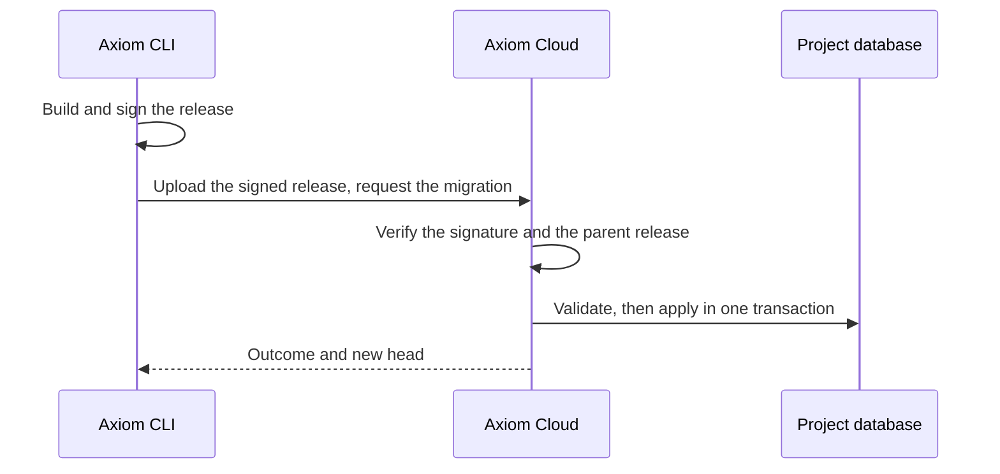

Apply versioned schema changes from an Acore database contract to the managed
database of an Axiom Cloud project environment. You sign each release on your
machine; Axiom Cloud checks it and applies it in one transaction.

**Alpha:** hosted migrations for managed SQLite and PostgreSQL, for invited
accounts (Axiom Cloud signup is invite-only). The
`--project` and `--environment` database commands are **Coming soon** in a
released CLI; this page was checked with a source build. PostgreSQL needs a Pro
project, and public paid checkout is **Coming soon**.

## How it works



1. The CLI builds a release from `schema.acore`, signs it with a key that stays
   on your machine, and uploads it.
2. Axiom Cloud accepts releases only from keys enrolled for the project. It
   checks that the release follows the database's current head.
3. The change is validated against a copy of the database schema, then applied
   in one transaction. A failed release changes nothing.

The database records every applied release. That history is the source of
truth for status, rollback and download.

## Before you start

- Axiom CLI with hosted migration commands, signed in with `axiom login`.
- A project you own whose environment has a **Ready** database. See
  [managed resources](/cloud/project-resources) to provision one.
- The project slug and environment name. This page uses `my-project` and
  `development`.

Create an empty directory named `hosted-demo` and run every command from it.

```toml title="AxiomDeps.toml"
type = "database"
targets = ["server"]
```

```acore title="schema.acore"
profile database 1
project(id: "docs.hosted", version: "1.0.0")
module docs.hosted

database main(engine: DatabaseEngine.sqlite) {
  manage(schemas: [Schemas.main], mode: ManagementMode.ownedObjects)
  schema main {
    table tasks(strict: true) {
      id: Sqlite.Text
      title: Sqlite.Text
      primaryKey(columns: [.id])
    }
  }
}
```

For a PostgreSQL project, use `DatabaseEngine.postgres`, a schema such as
`app`, and `Pg` column types. The commands are the same.

## 1. Enroll your signing key

```bash title="Terminal: hosted-demo"
axiom project signers add --project my-project --schema schema.acore --label laptop
axiom project signers list --project my-project
```

```text title="Output"
Enrolled signing key e735908a… as "laptop" for my-project.
```

The CLI keeps one private key per contract. `--schema` selects it, and the key
is created on first use. Only the public key and a proof of possession leave
your machine. Every project owner who migrates enrolls their own key.

## 2. Check, then apply the first version

```bash title="Terminal: hosted-demo"
axiom database migrate schema.acore --project my-project --environment development --dry-run
axiom database migrate schema.acore --project my-project --environment development
```

```text title="Output"
Hosted database my-project/development
Migration 1.0.0
  add Schemas.main
  add Tables.main.tasks
Applied migration 1.0.0 · hosted head 1073f1b3b216… (generation 1)
```

`--dry-run` runs the same checks and changes nothing. Each command waits for
the hosted operation and prints its outcome. Expect about a minute per
command while the operation starts.

## 3. Inspect status and history

```bash title="Terminal: hosted-demo"
axiom database status schema.acore --project my-project --environment development
axiom database history schema.acore --project my-project --environment development
```

```text title="Output"
Applied: 1.0.0 · Working: 1.0.0 · Drift: none
Database matches the contract.
```

`history` lists the applied releases and the environment's operations, newest
first. Neither command changes anything.

## 4. Make a change

Change the version to `1.1.0`, add an index to `tasks`, and add a table:

```acore title="schema.acore: changed lines"
project(id: "docs.hosted", version: "1.1.0") // [!code highlight]
// Inside table tasks, after primaryKey:
index byTitle(columns: [.title]) // [!code highlight]
// After table tasks:
table labels(strict: true) { // [!code highlight]
  id: Sqlite.Text // [!code highlight]
  name: Sqlite.Text // [!code highlight]
  primaryKey(columns: [.id]) // [!code highlight]
} // [!code highlight]
```

This is an excerpt. Keep the rest of the file.

```bash title="Terminal: hosted-demo"
axiom database migrate schema.acore --project my-project --environment development --dry-run
axiom database migrate schema.acore --project my-project --environment development
```

```text title="Output"
Applied migration 1.1.0 · hosted head d45dd941d276… (generation 2)
```

On managed SQLite, a release that changes the columns or constraints of an
existing table is refused with `ADB1132`, for example adding a column to
`tasks`. Create a new table instead. Managed PostgreSQL accepts such changes,
such as a new nullable column.

## 5. Roll back

```bash title="Terminal: hosted-demo"
axiom database rollback schema.acore --project my-project --environment development --steps 1
```

```text title="Output"
Migration 2.0.0 · BREAKING / possible data loss
  remove Indexes.main.tasks.byTitle (*)
  remove Tables.main.labels (*)
Restores schema state of 1.0.0; working source is preserved.
Applied rollback 2.0.0 · hosted head 4f99b62ef61a… (generation 3)
```

Rollback publishes a new compensating version and keeps the history. It drops
`labels` and its rows; it does not restore deleted data. Review the prompt
before you accept. In scripts, `--non-interactive` with `--auto-version` and
`--allow-destructive` authorizes this exact change.

Compare the hosted head with your working source:

```bash title="Terminal: hosted-demo"
axiom database diff schema.acore --project my-project --environment development
```

## 6. Download the history on another machine

In a new directory that contains only `AxiomDeps.toml` and `schema.acore`:

```bash title="Terminal: another checkout"
axiom database pull schema.acore --project my-project --environment development
```

```text title="Output"
Hosted history for docs.hosted from my-project/development: 3 release(s), head 4f99b62ef61a… (generation 3)
  added 1.0.0  migration  1073f1b3b216  .axiom/database/migrations/1.0.0/release.axiom
  added 1.1.0  migration  d45dd941d276  .axiom/database/migrations/1.1.0/release.axiom
  added 2.0.0  rollback  4f99b62ef61a  .axiom/database/migrations/2.0.0/release.axiom
Nothing was executed.
```

`pull` verifies each release's signature and parent, refuses a history that
conflicts with local releases, never overwrites a local release, and runs
nothing against the database. To migrate from that machine, enroll its key
with step 1.

## Common failures

| Code | Meaning | What to do |
| --- | --- | --- |
| `ADB1109` | The signing key is not enrolled for the project, or `--schema` is missing. | Run `axiom project signers add --project <slug> --schema schema.acore`. |
| `ADB1132` | Managed SQLite refuses a change to an existing table's columns or constraints. | Express the change as a new table, or keep it local. |
| `ADB1104` | The database head changed after your release was built. | Run `status`, then build the change again from the current head. |
| `ADB1131` | The operation reached its time limit and rolled back. | Retry. Split a very large release into smaller ones. |
| `AXRESOURCE_CONFLICT` | Another migration is running for this database. | Wait for it, then retry. |
| `AXRESOURCE_NOT_ADMITTED` | Hosted migrations are not available for this database yet. | Use the local workflow in [database contracts](/database/contracts). |
| `AXRESOURCE_OUTCOME_UNRESOLVED` | The outcome could not be confirmed. The migration may have been applied. | Run `status` before anything else. |

## Clean up

Revoke a key you no longer use:

```bash title="Terminal: hosted-demo"
axiom project signers revoke --project my-project --public-key <hex>
```

Revocation is permanent. Releases that key already signed stay valid in the
history. To remove the database and its data, follow
[suspend, resume and delete](/cloud/project-resources#suspend-or-delete).
Delete `hosted-demo` when you no longer need its local catalog.

## Next steps

Read [database contracts](/database/contracts) for versioning and rollback
rules, and [managed resources](/cloud/project-resources) for database plans
and locations. A server reads and writes the applied schema through
[a Google Cloud server connection](/cloud/connect-a-server) (**Alpha**).
