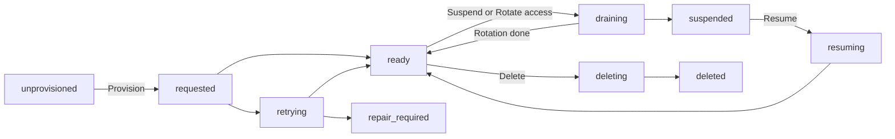

<StatusNote status="alpha" title="Managed databases">
  Saving database preferences, provisioning managed storage in available
  locations, retry, suspend, resume, access rotation and deletion are **Alpha**,
  checked on October 20, 2026. Hosted runtime connections, hosted migrations,
  managed application authentication, archive, restore, customer-owned
  database connections and public paid checkout are **Coming soon**. No hosted
  database recovery SLA or automatic archive policy is announced.
</StatusNote>

A managed resource is persistent hosted storage for one
[project environment](/cloud/releases-and-environments). It is separate from
published contracts and temporary sandboxes. A project can exist long before
it needs hosted storage, and local database workflows stay available.

## Choose a database

| Choice | Storage | Boundary |
| --- | --- | --- |
| Free | Managed SQLite | One database per hosted environment. |
| Pro | Private PostgreSQL database on shared managed compute | Its application and protected authentication schemas belong to that environment. PostgreSQL requires Pro. |
| Upgrade an existing SQLite project to Pro | Keeps SQLite with its displayed allowances | A subscription upgrade never converts the engine. |

Axiom manages hosting and placement behind these choices. Native local SQLite
and managed SQLite have different capability profiles. Support for one does
not qualify every deployment target.

## Locations and allowances

| Item | Free | Pro |
| --- | --- | --- |
| Location | Mumbai (SQLite) | Singapore (PostgreSQL), or Mumbai for SQLite |
| Hosted environments per project | 1 | 1 |
| Storage | 100 MB | 1 GB for PostgreSQL. Paid SQLite keeps its displayed allowance. |
| Lifecycle operations per project, per UTC calendar month | 20 | 100 |
| Lifecycle operations across your Free projects, per UTC calendar month | 60 | Not applicable |
| Free databases across the projects you own | 3, including suspended ones | Not applicable |

Provision, retry, resume and rotate count as operations. Suspend and delete
never count, so cleanup always works. Other limits (requests, rows read and
written, execution time, egress and connections) appear on the **Resources**
page.

The dashboard shows the choices available at the time of the request. A
location name does not prove backup residency or an availability guarantee.
Check the requested and actual location separately.

## Provision a database

Saving preferences records your choices. It does not allocate a database or
start a charge. Hosting also needs an available database option and location,
free capacity and the right project entitlement.

1. Create a project and choose Free or Pro, SQLite or PostgreSQL, a location
   and an environment name (default `development`). Free uses SQLite.
2. Open the project's **Resources** page. For an existing project without
   database preferences, an owner chooses them there and selects **Save
   preferences**. Preferences are saved once and cannot be edited.
3. Select **Provision**, review the environment and database, then confirm.
4. Follow the operation under recent operations until it completes. `ready`
   means storage was initialized and verified. **Auth: not_configured** means
   application authentication is not available for that database.

Allocation runs in the background and can take several minutes. Refreshing
the page never creates another database. If capacity is unavailable, nothing
extra is allocated: review the displayed failure before retrying.

## Lifecycle

The **Resources** page shows these state values:

| State | Meaning |
| --- | --- |
| `unprovisioned` | Preferences exist. No hosted database is allocated. |
| `requested` | A provision or retry is allocating and initializing storage. |
| `ready` | Storage verification passed. Authentication readiness is separate. |
| `retrying` | A recoverable failure. The operation runs again automatically. |
| `repair_required` | Automatic retries stopped after five attempts or a non-recoverable error. |
| `draining` | Routing is fenced while a suspend or access rotation runs. |
| `suspended` | Axiom routing is paused. Data is not archived or deleted. |
| `resuming` | Placement is being verified before the database returns to `ready`. |
| `deleting`, `deleted` | Deletion is running, or the provider deletion was verified. Metadata keeps the outcome. |

Any operation that fails can move to `retrying`. For a database in
`repair_required`, review the failure, then choose **Retry** to repeat the
failed operation (a failed delete retries the delete) or **Delete**.

### Safe retries

Each lifecycle request carries an idempotency key and the resource generation
you saw. Repeating a request with the same key returns the same operation.
Reusing the key with changed input fails, and a stale generation is rejected.

A timeout does not prove that a provider operation failed. The service
reconciles the recorded provider identity before it retries. It never creates
a second database, or deletes an unfamiliar one, based only on a name.

### Suspend, resume and delete

Open **Resources**, find the environment, choose the action and review the
destination before you confirm.

- **Suspend** fences Axiom application routing. The stored database stays and
  still uses hosting capacity.
- **Resume** verifies the existing placement before returning to `ready`.
- **Delete** permanently removes the hosted database. Type `delete database`
  to confirm. Deletion is not an archive and leaves no restore point. Test it
  on a disposable database.

### Rotate database access

1. Open **Resources** and find the `ready` database.
2. Select **Rotate access**. It appears only for a database whose profile
   supports qualified rotation.
3. Review the environment and confirm, then follow the operation.

Rotation replaces the database access credentials. PostgreSQL connections
close, and Axiom pauses database access until the operation finishes. Your
application's users and their passwords do not change. Credentials are never
displayed.

Storage readiness alone does not enable runtime connections, hosted
migrations or application authentication. Those remain **Coming soon**.

## Usage

Work totals show the budget reserved this month. Storage measurements appear
beside each database (**Not measured** until the first measurement).
**Not reported** means no total exists for that metric, not zero usage. These
totals are not an invoice.

## Plans and billing

A project subscription funds the included resources of one project. Upgrading
one project never upgrades other projects in the workspace.

- The launch price is $20 USD per Pro project per month. Released allowances
  and tax treatment will be shown before checkout.
- Selecting Pro saves a preference. Payment details are collected by
  Stripe-hosted Checkout.
- A browser success redirect alone never activates paid access. Verified
  subscription state must synchronize first.
- Public paid checkout is not enabled yet. Controlled test checkout is labeled
  **Test billing** and makes no real charge.
- A Pro preference alone does not authorize hosting. Provision and resume need
  an active Pro subscription for Pro databases.
- A past-due or cancelled subscription blocks provision and resume. Failed
  payments and exceeded quotas never delete data.

Storage, database work, execution time, traffic and message delivery have
separate budgets. A request allowance does not authorize an arbitrarily
expensive query. Additional environments, SMS, AI inference and dedicated
availability need separately funded allowances.

## Who can manage resources

Any project member can view the **Resources** page. Only owners can save
preferences, run lifecycle actions, rotate access and manage billing.

The resource-management CLI commands (`axiom project resources`) are a source
preview and are not in CLI 0.149.1. Use the dashboard for this workflow.

## Credentials and recovery

- Provider administration credentials stay in trusted services. Frontend
  bundles, Acore contracts and sandbox extensions never receive platform-wide
  database tokens or unrestricted database-owner credentials.
- Cloud membership is separate from the users who sign in to your application.
- No automatic 30-day inactivity archive is announced. Suspension, archive and
  deletion have different effects. A provider's history window is not an Axiom
  recovery guarantee.
- A future restore must validate a new target before it changes routing, and
  fence old writers and credentials. Restoring historical authentication data
  must not revive revoked sessions or permissions. Recovery and customer-owned
  database support will be documented for each qualified profile before
  release.

## Next steps

- [Keep project environments isolated](/cloud/releases-and-environments)
- [Store secrets for the same environment](/cloud/secrets)
- [Use the local database workflow](/getting-started/quickstart-database)
