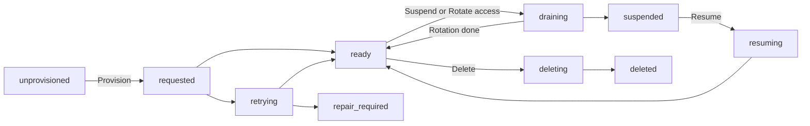

<span id="creation-and-allocation" />
<span id="provision-from-the-dashboard" />
<span id="project-subscriptions" />
<span id="states" />
<span id="limits-and-payment-failures" />

<StatusNote status="alpha" title="Managed databases">
  Saving database preferences, provisioning managed storage in available
  locations, retry, suspend, resume, access rotation and deletion are **Alpha**,
  checked on October 20, 2026. [Hosted migrations](/cloud/hosted-migrations)
  are **Alpha**; these commands need CLI 0.151.0 or later.
  [Hosted runtime connections](/cloud/connect-a-server) from Cloud Run
  servers are **Alpha**, checked on October 24 and 25, 2026.
  [Managed application authentication](/authentication) is **Alpha**,
  checked on October 25, 2026. These are available to invited accounts: Axiom
  Cloud signup is invite-only. Backups, restore and archive are **Coming soon**
  and turned on for selected projects only. Your own Turso database
  connections and public paid checkout are **Coming soon**. No hosted database
  recovery SLA or automatic archive policy is announced.
</StatusNote>

A managed resource is persistent hosted storage for one
[project environment](/cloud/releases-and-environments). It is separate from
published contracts and temporary sandboxes. A project can exist long before
it needs hosted storage, and local database workflows stay available.

<span id="database-choices" />

## Choose a database

| Choice | Storage | Boundary |
| --- | --- | --- |
| Free | Managed SQLite | One database per hosted environment. |
| Pro | Private PostgreSQL database on shared managed compute | Its application and protected authentication schemas belong to that environment. PostgreSQL requires Pro. |
| Upgrade an existing SQLite project to Pro | Keeps SQLite with its displayed allowances | A subscription upgrade never converts the engine. |

Axiom manages hosting and placement behind these choices. Native local SQLite
and managed SQLite have different capability profiles. Support for one does
not qualify every deployment target.

## Locations and allowances

| Item | Free | Pro |
| --- | --- | --- |
| Location | Mumbai (SQLite) | Singapore (PostgreSQL), or Mumbai for SQLite |
| Hosted environments per project | 1 | 1 |
| Storage | 100 MB | 1 GB for PostgreSQL. Paid SQLite keeps its displayed allowance. |
| Lifecycle operations per project, per UTC calendar month | 20 | 100 |
| Lifecycle operations across your Free projects, per UTC calendar month | 60 | Not applicable |
| Free databases across the projects you own | 3, including suspended ones | Not applicable |

Provision, retry, resume and rotate count as operations. Suspend and delete
never count, so cleanup always works. Other limits (requests, rows read and
written, execution time, egress and connections) appear on the **Resources**
page.

The dashboard shows the choices available at the time of the request. A
location name does not prove backup residency or an availability guarantee.
Check the requested and actual location separately.

## Provision a database

Saving preferences records your choices. It does not allocate a database or
start a charge. Hosting also needs an available database option and location,
free capacity and the right project entitlement.

1. Create a project and choose Free or Pro, SQLite or PostgreSQL, a location
   and an environment name (default `development`). Free uses SQLite. Use the
   dashboard's **New project** form, which has no slug field (Axiom Cloud
   derives the slug from the name), or
   [`axiom project create`](/cloud/project-management#create-and-link-a-project)
   with `--tier`, `--database`, `--region` and `--environment`.
2. Open the project's **Resources** page. For an existing project without
   database preferences, an owner chooses them there and selects **Save
   preferences**, or runs
   [`axiom project resources configure`](#axiom-project-resources-configure).
   Preferences are saved once and cannot be edited.
3. Select **Provision**, review the environment and database, then confirm.
4. Follow the operation under recent operations until it completes. `ready`
   means storage was initialized and verified. **Auth: not_configured** means
   [application authentication](/authentication) is not enabled for that
   database; **Auth: ready** means its authentication tables are installed and
   verified.

Allocation runs in the background and can take several minutes. Refreshing
the page never creates another database. If capacity is unavailable, nothing
extra is allocated: review the displayed failure before retrying.

## Lifecycle



The **Resources** page shows these state values:

| State | Meaning |
| --- | --- |
| `unprovisioned` | Preferences exist. No hosted database is allocated. |
| `requested` | A provision or retry is allocating and initializing storage. |
| `ready` | Storage verification passed. Authentication readiness is separate. |
| `retrying` | A recoverable failure. The operation runs again automatically. |
| `repair_required` | Automatic retries stopped after five attempts or a non-recoverable error. |
| `draining` | Routing is fenced while a suspend or access rotation runs. |
| `suspended` | Axiom routing is paused. Data is not archived or deleted. |
| `resuming` | Placement is being verified before the database returns to `ready`. |
| `deleting`, `deleted` | Deletion is running, or the provider deletion was verified. Metadata keeps the outcome. |

Any operation that fails can move to `retrying`. For a database in
`repair_required`, review the failure, then choose **Retry** to repeat the
failed operation (a failed delete retries the delete) or **Delete**.

### Safe retries

Each lifecycle request carries an idempotency key and the resource generation
you saw. Repeating a request with the same key returns the same operation.
Reusing the key with changed input fails, and a stale generation is rejected.

A timeout does not prove that a provider operation failed. The service
reconciles the recorded provider identity before it retries. It never creates
a second database, or deletes an unfamiliar one, based only on a name.

<span id="suspend-or-delete" />

### Suspend, resume and delete

Open **Resources**, find the environment, choose the action and review the
destination before you confirm.

- **Suspend** fences Axiom application routing. The stored database stays and
  still uses hosting capacity.
- **Resume** verifies the existing placement before returning to `ready`.
- **Delete** permanently removes the hosted database. Type `delete database`
  to confirm. Deletion is not an archive and leaves no restore point. Test it
  on a disposable database.

### Rotate database access

1. Open **Resources** and find the `ready` database.
2. Select **Rotate access**. It appears only for a database whose profile
   supports qualified rotation.
3. Review the environment and confirm, then follow the operation.

Rotation replaces the database access credentials. PostgreSQL connections
close, and Axiom pauses database access until the operation finishes. Your
application's users and their passwords do not change. Credentials are never
displayed. While a suspend, deletion or access rotation runs, and while the
database is suspended, sign-in and refresh for that environment's
[application authentication](/authentication) are refused; access tokens
already issued work until they expire.

Storage readiness alone does not enable runtime connections or application
authentication. [Runtime connections](/cloud/connect-a-server) also need an
applied migration, a registered workload and a database grant, and are
**Alpha**. [Managed application authentication](/authentication) is enabled
per environment and is **Alpha**.
[Hosted migrations](/cloud/hosted-migrations) are **Alpha**.

## Database access

A server workload gets credentials for a database only through a grant: one
requirement of your app, one enabled workload registered for database access in
the database's environment, its compiled backend plan, and an expiry of 7, 30
or 90 days. Only owners can list, create and revoke grants. The **Database
access** section of **Resources** and these CLI commands (CLI 0.152.0 and
later) do the same:

```bash title="Terminal: grant and revoke database access"
axiom project resources --project my-project grants --environment production
axiom project resources --project my-project grant --environment production \
  --requirement tasks --workload 104200000000000000001 --expires-days 30
axiom project resources --project my-project revoke GRANT_ID --environment production
```

`revoke` asks you to confirm, as the dashboard does. Without a terminal, pass
`--yes`; without it nothing is sent.

`grants` lists the requirement, the workload's Google subject (its ID when the
workload is no longer in the environment's list), the state (**Active**,
**Expired** or **Revoked**), the expiry and the grant ID. `--json` prints the
list with `state` and `workload_subject` added to each grant.

`grant` takes the workload ID or its Google subject. It checks the requirement
name, the workload (enabled, registered for database access, with a plan) and
the expiry before it sends anything. The 90-day expiry ends five minutes before
the 90-day limit. Every write carries an idempotency key, printed on standard
error, and `--operation-id` sets it. If the result of `grant` is lost, the
command prints how to repeat it with the same `--operation-id` and
`--expires-at`: the repeat returns the same grant. The same `--operation-id`
with other details is refused with `AXRESOURCE_CONFLICT`. A workload holds at most one
active grant per requirement, so no repeat creates a second one. A repeat
works while the first attempt's expiry is still in the future; otherwise, run
`grants` to check what was saved.

`revoke` stops new credentials at once. A credential the workload already holds
keeps working for a bounded time: on SQLite until it expires, at most 15
minutes; on PostgreSQL its open connections end within about 10 minutes. See
[Connect a server](/cloud/connect-a-server) for the whole setup.

## Usage

Work totals show the budget reserved this month. Storage measurements appear
beside each database (**Not measured** until the first measurement).
**Not reported** means no total exists for that metric, not zero usage. These
totals are not an invoice. Measured rows and storage per database, and what
happens at a database's monthly limit, are described in
[Acore backend databases on Free and Pro](/cloud/backend-databases).

## Plans and billing

A project subscription funds the included resources of one project. Upgrading
one project never upgrades other projects in the workspace.

- The launch price is $20 USD per Pro project per month. Released allowances
  and tax treatment will be shown before checkout.
- Selecting Pro saves a preference. Payment details are collected by
  Stripe-hosted Checkout.
- A browser success redirect alone never activates paid access. Verified
  subscription state must synchronize first.
- Public paid checkout is not enabled yet. Controlled test checkout is labeled
  **Test billing** and makes no real charge.
- A Pro preference alone does not authorize hosting. Provision and resume need
  an active Pro subscription for Pro databases.
- A past-due or cancelled subscription blocks provision and resume. Failed
  payments and exceeded quotas never delete data.

Storage, database work, execution time, traffic and message delivery have
separate budgets. A request allowance does not authorize an arbitrarily
expensive query. Additional environments, SMS, AI inference and dedicated
availability need separately funded allowances.

## Who can manage resources

Any project member can view the **Resources** page. Only owners can save
preferences, run lifecycle actions, rotate access and manage billing.

The same rules apply to the `axiom project resources` commands in CLI 0.151.0
and later. See [Manage resources from the CLI](#manage-resources-from-the-cli).

## Manage resources from the CLI

`axiom project resources` reads and changes a project's managed resources from
a terminal. Every subcommand needs `axiom login` and takes the project slug
with `--project`, written before the subcommand. Most subcommands print the
service's response as JSON.

```text title="Usage"
axiom project resources --project <PROJECT> [COMMAND]
```

Without a subcommand, it prints the project's resources and recent
operations:

```bash title="Terminal"
axiom project resources --project my-project
```

| Subcommand | Use it to | Details |
| --- | --- | --- |
| `checkout` | Create or reuse the project's Stripe-hosted Checkout session | [Below](#axiom-project-resources-checkout) |
| `billing-portal` | Get the project's Stripe subscription management URL | [Below](#axiom-project-resources-billing-portal) |
| `configure` | Save database preferences for an existing project that has none | [Below](#axiom-project-resources-configure) |
| `catalog` | List the configured database options and which locations admit new databases | [Below](#axiom-project-resources-catalog) |
| `request` | Request `provision`, `retry`, `suspend`, `resume`, `delete` or `rotate` for one database, a recovery action, or a conversion | [Conversion](/database/project-upgrades) |
| `recovery` | Show restore options for one database | [Upgrade guide](/cloud/upgrade-guide) |
| `placement`, `relocation-consent`, `receipt` | Inspect placement and consent to a move | [Database placement](/cloud/database-placement) |
| `connect`, `connection`, `disconnect` | Use your own Turso database | [Your own Turso database](/cloud/turso-connections) |

`request` takes the database ID (`--resource`), the `--action` and the
resource generation you saw (`--generation`). A delete also needs
`--confirm 'delete database'`. Add `--wait` to poll until the operation
finishes. Status labels on this page and the linked pages still apply: for
example, backups, restore and your own Turso database are **Coming soon**.

### axiom project resources configure

Save database preferences for an existing project that does not have any yet.
This is the CLI form of **Save preferences**. It records your choices only: it
does not allocate a database or start a charge. Preferences are saved once.

```text title="Usage"
axiom project resources --project <PROJECT> configure [OPTIONS]
```

| Option | Value | Default | Meaning |
| --- | --- | --- | --- |
| `--tier` | `free` or `pro` | `free` | Project plan. |
| `--database` | `sqlite` or `postgres` | `sqlite` for Free, `postgres` for Pro | Database engine. Free allows only `sqlite`. |
| `--region` | location name | `mumbai` for SQLite, `singapore` for PostgreSQL | Requested location. `catalog` shows the locations that admit new databases. |
| `--environment` | environment name | `development` | Hosted environment. Up to 64 characters: a lowercase first letter, then lowercase letters, digits, `-` or `_`. |

```bash title="Terminal"
axiom project resources --project my-project configure \
  --tier free --database sqlite --region mumbai --environment development
```

The CLI checks the choices before it sends the request. `--tier free
--database postgres` fails with `Invalid tier or database`, and a name that
breaks the environment rule fails with `Invalid environment name`. Only an
owner can save preferences.

### axiom project resources checkout

Create or reuse the project's Stripe-hosted Checkout session for the Pro
subscription.

```text title="Usage"
axiom project resources --project <PROJECT> checkout [OPTIONS]
```

| Option | Value | Default | Meaning |
| --- | --- | --- | --- |
| `--operation-id` | UUID | a new random UUID | Idempotency key for the request. |

```bash title="Terminal"
axiom project resources --project my-project checkout
```

The command prints `Checkout idempotency key: <UUID>` to standard error, then
the service's JSON response. It does not open a browser. If the connection
fails before you see a response, run it again with
`--operation-id <UUID>` and the printed key, so the request is not repeated
under a new key. `--operation-id` must be a UUID.

Only an owner can manage billing. Public paid checkout is **Coming soon**, so
the service can refuse checkout for your project. Controlled test checkout is
labeled **Test billing** and makes no real charge. Completing Checkout does
not activate paid access by itself: see [Plans and billing](#plans-and-billing).

### axiom project resources billing-portal

Get the URL of the Stripe page that manages the project's subscription.

```text title="Usage"
axiom project resources --project <PROJECT> billing-portal
```

```bash title="Terminal"
axiom project resources --project my-project billing-portal
```

There are no options other than `--help`. The command prints the service's
JSON response and does not open a browser: open the URL it returns yourself.
Only an owner can manage billing.

### axiom project resources catalog

Show the database options that are currently configured and whether each
location admits new databases. Check it before you choose `--region` for
`configure` or `axiom project create`.

```text title="Usage"
axiom project resources --project <PROJECT> catalog
```

```bash title="Terminal"
axiom project resources --project my-project catalog
```

There are no options other than `--help`. The catalog is the same for every
project, but the command still requires `--project`. A location in the
catalog does not prove backup residency or an availability guarantee.

<span id="credentials" />
<span id="recovery" />

## Credentials and recovery

- Provider administration credentials stay in trusted services. Frontend
  bundles, Acore contracts and sandbox extensions never receive platform-wide
  database tokens or unrestricted database-owner credentials.
- Cloud membership is separate from the users who sign in to your application.
- No automatic 30-day inactivity archive is announced. Suspension, archive and
  deletion have different effects. A provider's history window is not an Axiom
  recovery guarantee.
- A future restore must validate a new target before it changes routing, and
  fence old writers and credentials. Restoring historical authentication data
  must not revive revoked sessions or permissions. Recovery and customer-owned
  database support will be documented for each qualified profile before
  release.

## Next steps

- [Apply schema changes with hosted migrations](/cloud/hosted-migrations)
- [Keep project environments isolated](/cloud/releases-and-environments)
- [Store secrets for the same environment](/cloud/secrets)
- [Use the local database workflow](/getting-started/quickstart-database)
