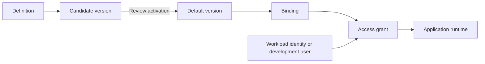

<StatusNote status="alpha" title="Secret management">
  Managing secrets in the Cloud Dashboard is **Alpha**. Protected application
  consumption is **Experimental** and has separate
  [runtime and version limits](/backend/runtime-secrets). CLI 0.151.0 and
  later also manage secrets from a terminal with the `axiom secrets` commands.
  See [Secrets commands](/tooling/secrets-cli).
</StatusNote>

Use **Secrets** in the [Cloud Dashboard](https://app.axiomcore.dev) to manage a
project's credentials without putting their values in contracts or public
configuration. You need project membership. While you learn, use a disposable,
unprotected staging environment and a synthetic credential.

## How secrets are organized

| Term | Meaning | Scope |
| --- | --- | --- |
| Environment | A named configuration and access scope, such as `staging-payments`. | Project |
| Definition | A secret's name, purpose and description. | Whole project |
| Version | One saved value. It is a **candidate** until activated as the environment's default. | One environment |
| Binding | Connects a requirement declared in a compiled backend plan to the secret. | One environment |
| Workload identity | A registered runtime identity for one backend revision. | One environment |
| Access grant | Lets one identity use one binding until an expiry. | One environment |

Saving or activating a value grants no access, and neither does owning the
project. A runtime can use a secret only through a binding and an unexpired
grant for its identity. Values, bindings and grants belong to one environment
and are never inherited from another.

## Environments

A secret environment keeps one set of credentials apart from another. It is
the same project environment that a [managed database](/cloud/project-resources)
attaches to. It is separate from the [managed sandbox](/cloud/releases-and-environments)
used for contract tests.

| Kind | Intended use | Access boundary |
| --- | --- | --- |
| Development | Local developer work | Developer grants allowed only when unprotected. |
| Staging | Integration and pre-release checks | Developer grants allowed only when unprotected. |
| Production | Live application credentials | Always protected. Only a registered workload with a grant can use secrets. |
| Preview | A temporary scope | Needs an expiry. Developer grants are unavailable. |

**Protected** environments restrict changes to owners and allow no developer
grants. Binding, grant and activation changes need an owner in every
environment. An environment named `production` does not establish production
runtime support. See the [support matrix](/introduction/support-matrix).

### Create an environment

1. Open the project's **Secrets** page.
2. Open **Environment settings** and select **Create environment** (or the
   initial **Create environment** action in a project with none).
3. Enter a unique name such as `staging-payments` and select its kind.
4. Choose **Protect activation and access changes** where needed. Production
   is always protected.
5. Review the destination and create the environment.

Names start with a lowercase letter and use only lowercase letters, digits,
underscores and hyphens, up to 64 characters. The dashboard gives a new preview
a 24-hour expiry. The API and `axiom secrets create-environment --expires-at`
accept an explicit expiry up to seven days ahead.

A new environment has no values or grants. Project-wide definitions appear in
its inventory as missing a value. Nothing is copied or promoted from staging to
production automatically.

### Check the destination before each change

The context header shows the selected environment's name, protection, state
and expiry. Every value or access change applies to that environment. The page
asks you to discard unsaved input before you switch.

A local runtime picks its environment separately. A profile in
`AxiomSecrets.toml` (for example `cloud-staging`) maps to a Cloud project ID
and environment ID, and you choose it with `--environment` when you start the
runtime. Selecting an environment in the browser never retargets a
running process, and a matching name does not create a connection. Local `.env`
files are never uploaded or merged into Cloud.

## Add a secret and its first value

1. On the **Secrets** page, select **Add secret**.
2. Enter a name such as `payments/api-key`, choose a purpose (HTTP
   authentication, request signing, token verification, database
   authentication or worker authentication), and add an optional description.
   Keep values out of names and descriptions.
3. Leave **Add a value in [environment]** checked to save a value now, or clear
   it to create only the definition.
4. Enter the value and select **Save candidate in [environment]**.

You cannot view or download a saved value. **Show** reveals only what you are
typing. The field clears on submission, even when it fails. After a successful
save, the secret's versions open so you can review the candidate.

If the definition saves but the value upload fails, the definition stays.
Retry the value step. If a network interruption leaves a save unconfirmed,
open the versions and check the refreshed metadata before retrying. An
unconfirmed response does not mean the server rejected the upload.

Open a secret to see **Values & versions**, **Bindings & access** and its
**Activity**. Inventory counts describe configuration, not whether a running
workload can use the secret. **Last value added** refers to the latest value
upload, not every configuration change.

## Activate and rotate

In **Values & versions**, find the candidate and choose **Review activation**.
Check the environment and the affected bindings, then confirm. Activation needs
an owner and the secret's current configuration revision. A stale revision is
rejected: refresh, review the current state and try again. The previous default
stays active (shown as **Active · not default**) until you disable it.

| Binding mode | Effect of activation |
| --- | --- |
| **Follow active version** | Uses the new default the next time the runtime resolves the secret. |
| **Pin a version** | Keeps its numeric version. Update the pin yourself. |

Activation never rewrites a runtime pin or switches a running generation.
Update the reviewed pin and reload the application through its supported
runtime path.

To rotate a credential: create a new value at its provider, save it as a
candidate, review activation and pins, and check an authorized application
operation. Retire the old credential at the provider separately.

| Version action | Effect |
| --- | --- |
| **Disable version** | Denies further use of that version. A disabled version cannot be activated again. |
| **Rewrap encryption key** | Re-wraps the version's data key under the configured encryption key. It does not rotate the provider credential. |
| **Destroy retained value** | Permanently removes the encrypted value. Appears seven days after the version was disabled. Backup retention is separate. |

## Bind a requirement and grant access

The **Runtime access** tab lists bindings, workload identities and grants for
the selected environment. A secret's **Bindings & access** view filters that
list to one secret.

### Create a binding

Choose **Create binding**, then review:

- The secret and its purpose.
- The consumer and logical requirement from the compiled backend plan. Known
  records appear as suggestions. The dashboard does not discover your whole
  application for you.
- The exact compiled backend plan SHA-256. It identifies executable server
  behavior, not the billing plan or the public contract hash.
- **Follow active version** or **Pin a version**.
- For HTTP authentication and request signing, the approved HTTPS origin,
  method and path prefix.
- For a server sandbox consumer, the **Canonical extension package SHA-256**.
  A module hash alone is not the package fingerprint.

Keep destination restrictions narrow. Saving a binding still authorizes no one.
Protected runtimes also enforce their own
[adapter and extension boundaries](/backend/runtime-secrets).

### Grant access

Choose **Grant access**, pick the binding, and choose an identity:

- **Workload identity:** an enabled registration that matches the binding's
  backend fingerprint. Use **Register a new workload identity** if needed. A
  registration records the exact Google workload subject, audience and compiled
  backend plan SHA-256. Registration alone grants no access.
- **Development user:** a project member's user ID. Only in unprotected
  development and staging environments.

Choose an expiry (1 hour, 24 hours, 7 days or a custom time), check the exact
timestamp and timezone, then select **Review access**. Confirm the identity,
secret, binding, environment, operation and expiry. Grants last at most 90
days, so use short access for local work. A grant does not qualify an
unsupported runtime or deployment target.

### Choose what a workload is used for

When you register a workload (**Runtime access**, **Workload identities**,
**+ Register workload**), **Used for** sets its audience:

| Choice | Purpose | Where it gets access |
| --- | --- | --- |
| **Secrets** | Uses secrets through bindings and grants on this page. | **Grant access** on this page |
| **Database access** | Gets short-lived managed database credentials. | **Grant access** on the [**Resources**](/cloud/project-resources) page |

The audience fills in from the choice; enter another audience only if you were
given one. For **Database access**, the plan SHA-256 must match the compiled
backend that connects to the database. Database-access workloads do not appear
in the secret grant picker. Disabling one stops new database credentials: a
SQLite credential it already holds works until it expires (at most 15
minutes), and its PostgreSQL connections end within about 10 minutes. See
[connect a server on Google Cloud](/cloud/connect-a-server).

## Investigate activity

**Activity** lists recent events. Search by event, operation, resource or
identity, filter by category (configuration, or runtime use and leases) or by
outcome. **Load older events** loads the next page of history. Filters search
only the events already loaded.

Open an event for its full IDs. **Allowed** means authorization was permitted.
It does not prove that an upstream business operation completed. Saved values
never appear in audit metadata.

## Stop access and clean up

| Goal | Action | Effect |
| --- | --- | --- |
| Remove one identity's access | Revoke the grant. | That identity can no longer use the binding. |
| Stop a workload | Disable the workload identity. | Its leases stop working. |
| Stop a whole environment | **Environment settings**, then **Disable environment**. | Denies all use and invalidates leases. Versions and history are kept. |
| Resume an environment | **Enable environment**. | Allows use again only where version, binding and grant rules allow it. Revoked grants and disabled versions stay that way. |

Any update to an environment invalidates its existing leases, so consumers
must get fresh authorized access. A disabled or expired environment accepts no
new candidate values.

When a preview expires, runtime access closes, its grants are revoked and its
workload identities are disabled. History is kept. The dashboard cannot extend
an expired preview: create a new one. With `axiom secrets update-environment`,
an owner can submit a reviewed update with a new expiry (within seven days) and
the current revision. Enabling alone never extends an expiry.

There is no general environment deletion. Records are kept for audit. When you
finish a temporary environment, revoke its grants, disable its workload
identities and disable the environment. Revoke compromised credentials at the
upstream provider too.

To check isolation, compare value and access metadata in two environments.
A candidate added in one never appears in the other. Do not use a real
production credential for this check.

## Roles

| Operation | Reader | Maintainer | Owner |
| --- | :---: | :---: | :---: |
| Inspect metadata and activity | Yes | Yes | Yes |
| Create definitions | No | Yes | Yes |
| Create unprotected development, staging or preview environments | No | Yes | Yes |
| Save candidates in an unprotected environment | No | Yes | Yes |
| Create protected or production environments, or change protected values | No | No | Yes |
| Activate, disable, rewrap or destroy versions | No | No | Yes |
| Manage bindings, workload identities, grants or environment settings | No | No | Yes |

## Limits

| Item | Limit |
| --- | --- |
| Secret name | Starts with a letter; letters, digits, `/`, `_` and `-`; up to 128 characters |
| Description | 1,000 characters |
| Value size | 1 to 65,536 bytes |
| Environments per project | 64 |
| Definitions per project | 256 |
| Versions per secret in one environment | 200 |
| Bindings per environment | 128 |
| Workload identities per environment | 64 |
| Active grants per environment | 200 |
| Grant lifetime | 90 days |

## Resolve common problems

| Symptom | Check |
| --- | --- |
| Definition has no value | Select the intended environment and add a candidate. Values are not inherited. |
| Candidate saved, but the application uses an older version | Activation, binding pins, runtime pins and the running generation. |
| Active value, but runtime access is denied | Environment state and expiry, version status, exact plan and package fingerprints, binding scope, identity and grant expiry. |
| Workload missing from the grant picker | The registration is enabled, matches the binding's backend fingerprint and is registered for **Secrets**, not **Database access**. |
| Developer access unavailable | Use an unprotected development or staging environment, or an approved workload on a qualified runtime. |
| Change rejected after another edit | Refresh, check the current revision and review the action again. |
| Unexpected denial | Environment state, expiry and protection first, then the runtime profile and exact IDs. |

## Next steps

- [Consume secrets in a backend at runtime](/backend/runtime-secrets)
- [Manage secrets from the CLI](/tooling/secrets-cli)
- [Provision a managed database for an environment](/cloud/project-resources)
