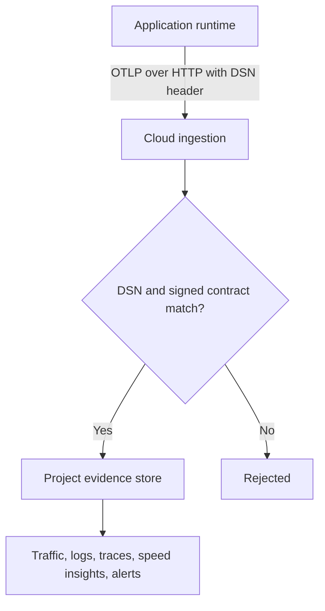

AxiomCore has two separate telemetry surfaces:

| Surface | What it carries | Who controls it |
| --- | --- | --- |
| Runtime observability | Traces and execution evidence from your application, sent to your project. | You, through the contract and the project's settings. |
| CLI adoption telemetry | One small event about each Cloud-facing CLI command. | The `AXIOM_TELEMETRY` environment variable. |

They use different data, credentials, configuration and retention.

## Runtime observability

<StatusNote status="alpha" title="Project observability">
  The runtime, ingestion service and dashboard implement scoped OTLP sources,
  traces, traffic, logs, retention settings, alerts and security posture. A
  project must create and configure a source before data can arrive.
</StatusNote>



Your application exports OpenTelemetry (OTLP) traces with a project-scoped
credential called a **DSN**. Cloud accepts them only when the DSN is valid and
the signed contract of the release declares that DSN and endpoint. Accepted
data appears in the project's observability pages.

### Connect a project

1. Open **Usage & Limits** in the project settings. A maintainer or owner can
   create a source.
2. Under AxiomCore OTLP ingestion, enter a **Source name** and a
   **Spans / minute** limit (100 to 10,000, default 5,000), then select
   **Create OTLP source**.
3. Copy the generated Acore block. The DSN is shown once, kept in that page's
   memory for five minutes, and never stored in the browser.
4. Add the block to your contract, then build and release a new signed
   version. The endpoint and DSN are pinned in that release.
5. Send a known request and confirm that it appears before you rely on the
   dashboard for incident response.

```acore title="Acore excerpt"
observability(
  enabled: true,
  telemetryUrl: "<endpoint from the generated block>/v1/traces",
  sampleRate: 1,
  headers: { "x-axiom-telemetry-dsn": "<scoped-write-credential>" }
)
```

The generated block uses `sampleRate: 1`. Lower it to sample deliberately.
The DSN can only write traces for this project, within its span limit. It
cannot read project data or call management APIs. Still keep source that
contains it private, and never paste it into public examples or logs.

To rotate a DSN, create a new source, release a contract that uses it, then
revoke the old source. Revoking a source rejects its future exports
immediately.

You can also send traces to your own collector instead, such as Grafana,
Honeycomb, Datadog or an OpenTelemetry Collector. The same page builds the
Acore block for any OTLP/HTTP endpoint. AxiomCore never receives that
collector's credential. Use an ingest-only, restricted token, because the
configuration becomes part of the signed contract. Change it with a new
release.

The runtime can link native work to an incoming W3C `traceparent`. Export and
sampling depend on the runtime configuration you select.

### Read the data

| Page | What it shows |
| --- | --- |
| **Overview** | Project summaries. |
| **Traffic** | Live traffic. |
| **Logs** | Project logs. |
| **Traces** | Traces, with trace detail and its security decision context. |
| **Speed Insights** | p50 and p95 latency, cache hit rate, retry rate and failure rate from retained runtime events. |
| **Alerts** | Alert policies and alert history for error rate, p95 latency and validation failures. |
| **Security Audit** | The contract posture derived from the signed manifest. |
| **Usage & Limits** | Runtime event counts, retention and OTLP sources. |

Retention applies on the server to raw events, traces and rollups. It defaults
to 30 days and accepts 1 to 365 days. Changing it recalculates expiry from each
record's collection time.

An empty view means no retained evidence matched the query. It does not prove
that the application did no work.

## CLI adoption telemetry

When this machine has an Alpha access profile (created when you register a
referral code), the CLI sends one event after each Cloud-facing command, such
as `login`, `release`, `pull` or `project`. Local commands such as `check`,
`build` without `--release`, `test`, `serve` and `mock` without `--cloud` send
nothing.

| Field | Value |
| --- | --- |
| Machine identifier | A random identifier from the CLI access profile |
| Command | Top-level command name only |
| Arguments | A fixed schema marker, never the raw arguments |
| Timing and result | Duration, success flag and a coarse error category |
| Environment | OS type and CLI version |

The event never includes file paths, URLs, credentials, project or contract
names, query parameters, raw arguments or raw error messages. Delivery waits at
most 1.5 seconds. Runtime trace data never becomes CLI telemetry.

To turn the event off for a process or shell:

```bash title="Terminal"
AXIOM_TELEMETRY=0 axiom release backend.axiom
```

The CLI accepts `0`, `false`, `FALSE`, `off` and `OFF`. Other spellings, such
as `False` or `no`, leave telemetry on.

If the service responds that Alpha access was revoked, the CLI deletes its
access profile, prints the referral code and exits with an error. This belongs
to Alpha access control. It is not an observability retention or project data
deletion feature.

## Operational checklist

1. Classify each event as runtime observability, audit activity or CLI
   adoption telemetry before you set retention or access policy.
2. Use scoped ingestion credentials, and rotate them after any exposure.
3. Sample deliberately, and test browser CORS for WebAssembly export.
4. Never log authorization headers, sandbox keys, request bodies or sensitive
   cache payloads.
5. Test alert delivery separately from trace ingestion.

## Next steps

- [Trace a request with Axiom Inspector](/inspector/trace-and-explain)
- [Check readiness before promotion](/delivery/production-readiness)
- [Store the credentials your runtime needs](/cloud/secrets)
