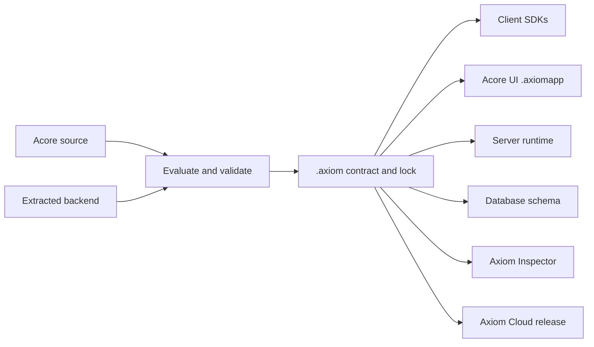

AxiomCore turns application declarations into a versioned **contract**: a
typed description of models, operations and policy that every other tool reads.
This page explains that path and the nouns you will meet in the rest of the docs.

1. **Source.** You write `.acore` files in Acore, or you extract declarations
   from an existing FastAPI or Go backend. Acore is optional at supported
   integration edges: an existing backend and framework can keep their code.
2. **Evaluation.** The Axiom CLI parses the source, resolves imports and
   amendments, and checks types and validation rules.
3. **Contract and lock.** `axiom build` writes a canonical `.axiom` artifact.
   A manifest (`AxiomDeps.toml`) states which contracts a consumer wants; a
   lock pins the exact bytes by SHA-256 digest.
4. **Consumers.** Generated clients, Acore UI applications, the server
   runtime and database migrations all read the same contract. None of them
   receives backend author code through it.
5. **Review and release.** Axiom Inspector explains what the application
   declares and can reach. Axiom Cloud stores immutable, signed releases.

## Key terms

| Term | What it is | Status |
| --- | --- | --- |
| Acore | The declarative language for contracts, backends, UIs and databases | Alpha |
| `.acore` | Editable Acore source | Alpha |
| Extraction | Generating reviewable declarations from a FastAPI or Go backend; OpenAPI and SQL bootstrap a domain model | FastAPI Available, Go Alpha, bootstrap Experimental |
| `.axiom` | A canonical, versioned contract or package (service, theme, component library, database schema, extension, application policy) | Alpha |
| Manifest and lock | Dependency intent, and the pinned artifact, version and digest a build used | Alpha |
| `.axiomapp` | A deterministic Acore UI application artifact for one or more targets | Alpha |
| Contract runtime | The engine that loads a contract and executes requests in a client | Web Available, React and Flutter Alpha, Swift Experimental |
| Server plan | The private `.server.json` file `axiom build` writes next to a backend artifact | Experimental (managed logic) |
| Database contract | Acore database source built into a server-only schema package and applied as migrations to PostgreSQL or SQLite | Experimental |
| Axiom Inspector | A local, queryable model of facts and relationships in your application | Alpha |
| Axiom Cloud | Hosted projects, environments and signed releases | Alpha |

See [Support and availability](/introduction/support-matrix) for the full matrix.

## Boundaries

- A contract describes an interface. It does not contain the backend
  implementation or make extracted code trustworthy.
- A local build can be unsigned. Production Acore UI builds reject unsigned
  contracts; Cloud releases add signatures.
- Every target runtime shares the contract model but has its own storage,
  network and lifecycle. Test each target you ship.
- Executable extensions are separate, sandboxed WebAssembly modules with their
  own trust chain. See [Extensions](/extensions).

## Next steps

- [Contracts and artifacts](/core-concepts/contracts-and-artifacts)
- [The contract pipeline](/core-concepts/the-axiom-pipeline)
- [Artifact trust](/core-concepts/trust-and-security)
- [Axiom Inspector](/inspector)
