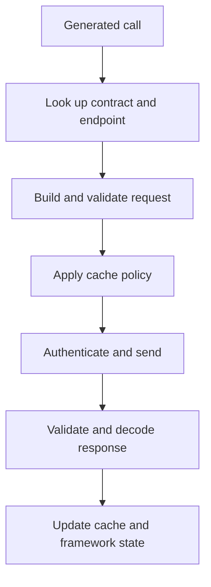

The contract runtime is the engine inside each client. It loads compiled
contract data, resolves endpoint identity, builds and validates requests,
applies authentication and cache policy, sends the request, validates the
response and returns structured events or errors to your framework binding.

<StatusNote status="alpha" title="Shared semantics, platform-specific lifecycle">
  Native and browser runtimes share the same contract concepts. They do not
  share storage engines, networking APIs, startup behavior or framework
  integration. Validate each target you ship.
</StatusNote>

## Runtime targets

| Target | Status | Engine and bridge | Network | Local cache |
| --- | --- | --- | --- | --- |
| Vanilla web (ATMX) | Available | Rust compiled to WebAssembly plus the ATMX JavaScript layer | Browser fetch and WebSocket | Query snapshots in `sessionStorage` (`atmx_cache_*`); the runtime's response cache in `localStorage` (`axiom_cache_*`), or in memory when storage is blocked |
| React (ATMX) | Alpha | Same engine through the React provider | Browser fetch and WebSocket | Query state in memory; the runtime's response cache in `localStorage` (`axiom_cache_*`) |
| Flutter and Dart | Alpha | Rust runtime through native bindings | Native HTTP client | Optional persistent cache at a database path the application chooses |
| Swift and Apple platforms | Experimental | Native runtime distribution foundations | Native runtime transport | Binding and lifecycle surface is incomplete |

The browser cache is not an IndexedDB durability guarantee, and a native cache
is never shared with a browser or another app. ATMX cache methods do not clear
the runtime's `localStorage` entries, so remove private cached responses on
logout yourself.

## Request lifecycle

The runtime validates input before sending and validates the response before
it updates cache or framework state. A cache hit can be published while a
network refresh continues.

Failures keep their stage, category, symbolic code, retryability and safe
details when available. Your application can tell a missing contract apart from
request validation, authentication, timeout, HTTP status, decoding or cache
failure. See [Runtime errors](/reference/error-codes).

## Cache behavior

Cache behavior comes from the compiled endpoint policy and the target runtime.
A query can emit cached data and stay in a fetching state while the refresh
runs. A successful mutation does not invalidate related queries unless the
generated client or your application declares that link, so test mutations and
invalidation together.

ATMX exposes `getCachedQueryData`, `setQueryData`, targeted `invalidate`,
`clearCache` (clears and refetches, optionally for one namespace) and
`purgeCache` (clears without refetching). Native applications choose a
database path when they need persistence. Cache entries are application data:
apply the same privacy and logout-clearing policy as any client store.

## Authentication

Contracts describe how credentials attach to a request. Your application
obtains and protects them.

- ATMX keeps method, namespace or global bearer tokens in memory only and never
  persists them. It removes tokens that older versions stored in `localStorage`.
- Cookie sessions use normal browser cookie behavior (for example HttpOnly
  cookies) when the contract declares a cookie session.
- Native bindings expose token APIs so the application can restore a token from
  its platform secure store after a restart.

Never put a production credential in Acore source, a generated config, a
contract artifact or a committed mock.

## Tracing

The native runtime accepts W3C `traceparent` context with a call and attaches
it to runtime spans. OTLP export depends on configuration; it does not promise
that every request reaches a hosted observability service. Runtime tracing is
separate from the CLI's optional, aggregate adoption telemetry. See
[Observability](/cloud/telemetry-and-observability).

## Next steps

- [Client SDKs](/sdks)
- [Web (atmx-web)](/sdks/web)
- [Artifact trust](/core-concepts/trust-and-security)
- [Runtime errors](/reference/error-codes)
