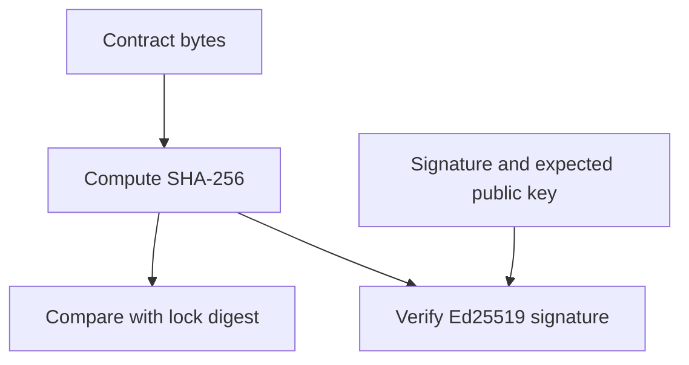

AxiomCore separates **integrity** from **provenance**. A SHA-256 digest
identifies exact bytes. A detached Ed25519 signature, checked against its paired
public key, proves that the expected signer signed that digest.



The lock identifies the expected bytes. A paired signature and trusted public
key establish provenance for that digest. The signature and public key are
proof material that travels with an artifact, not content inside the contract,
and they must always appear together.

## Local and Cloud artifacts

| Artifact path | Trust posture |
| --- | --- |
| Local `axiom build` | Exact-byte hash and lock validation; the artifact can be unsigned for development |
| Axiom Cloud release | Immutable stored bytes, a server-computed digest, a Cloud signature and durable validation evidence |
| Pulled dependency | Pinned source and version, plus the proof and lock metadata the client workflow keeps |
| Acore UI build (`axiom ui build`) | Rejects unsigned local contracts unless you pass `--development`, which marks the artifact development-only and lists every unsigned contract in its manifest |

Unsigned does not mean corrupted. It means no signing boundary has established
provenance. `axiom contract resolve` and `axiom contract verify` warn about each
unsigned local artifact, and `axiom check` reports diagnostic `AUI059` for an
unsigned development contract. Keep unsigned artifacts in clearly marked local
development workflows.

## Verification sequence

A consumer must fail initialization or installation cleanly when any step fails:

1. Load the exact artifact bytes.
2. Compare their SHA-256 digest with the committed lock or manifest.
3. When proof is declared, require both the Base64 signature and the public key.
4. Verify the Ed25519 signature over the artifact digest.
5. Only then expose contract endpoints to the runtime.

```bash title="Terminal"
axiom contract verify --deps AxiomDeps.toml --lock .axiom/axiom.ui.lock.json
```

In the browser, ATMX accepts proof from its configuration
(`contractSignature` and `contractPublicKey`) or from the
`X-Axiom-Signature` and `X-Axiom-Public-Key` response headers. A configured
pair always wins, and a partial pair is an error rather than a silent fallback.

Never catch an integrity failure and retry with an unpinned network copy.
Report it as a deployment or dependency error.

## Executable extension boundary

An executable extension adds its own trust chain. Its separate WebAssembly
module, signed authority request, application grant, per-target policies and
resolved authority lock must agree before a target host loads it. The host then
applies the effective authority and resource limits on every call. A module
digest or signature is not permission to use every host capability.
Executable extensions are **Experimental**; see [Extensions](/extensions) and
[Extension reference](/extensions/reference).

## What verification does not prove

A valid signature proves byte provenance relative to a key. It does not prove
that:

- the backend enforces authorization;
- an extracted handler matches its business intent;
- a release is free of breaking changes; or
- client storage is appropriate for sensitive data.

Pair trust verification with semantic diff, security analysis, tests, code
review and environment-specific release gates.

## Secret boundary

Private signing material belongs to the Cloud signing service or an explicitly
controlled signing process. Applications receive only public verification
material. Authentication tokens, database credentials, provider keys and
telemetry DSNs are operational secrets: never embed them in a contract to make
them convenient for a client.

## Next steps

- [Production readiness](/delivery/production-readiness)
- [Releases and environments](/cloud/releases-and-environments)
- [Runtime evidence, security and audits](/inspector/runtime-and-audits)
- [Security rules](/reference/security-rules)
