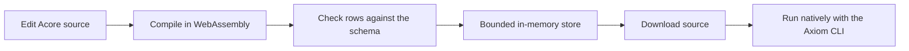

Use the [playground](https://playground.axiomcore.dev) to explore database
contracts without installing anything. The browser compiles real database and
version metadata in WebAssembly, then simulates storage and history. It never
performs a native migration.

<StatusNote status="experimental" title="Experimental simulation">
The browser database preview is Experimental. Its rows, versions, history,
identity and tenant isolation are simulations. No PostgreSQL connection or
SQLite file is created.
</StatusNote>

## Open an example

1. Open the playground and choose **Database · tasks**, **Database · inventory**
   or **Database · SQLite**.
2. Edit the frontend, backend and database source in their tabs. Each layer has
   its own manifest.
3. Watch **Changes** and **Impact**: a database edit lists the backend and
   frontend fields that consume it.
4. Open the lower **Database** tab to see tables and rows. Add, update,
   complete, restock or delete a record in a supported example to see the table
   activity.

Before accepting a complete mutation, the preview checks storage types,
primary keys, unique keys, foreign keys and supported check constraints. An
invalid mutation keeps the previous accepted store.

## Versions, history and resets

| Action | Browser behavior |
| --- | --- |
| Run valid source | Recompile and keep compatible accepted rows |
| Edit a schema version that is already used | Suggest a fresh version; accepting it updates the source buffer |
| Make an invalid schema change | Keep the last accepted preview |
| Compare or roll back | Show simulated schema and history changes |
| Reset data or history | Perform only the reset you select, in this session |
| Download Source or Schema | Export source, manifests and mappings, or the compiled database package |

Preview migrations, version conflicts, comparisons and rollbacks are simulation
events. History lasts for the browser session. It does not replace native
migration history, signing, deployment review, or backup and recovery checks.

## Know the execution boundary

- The preview runs declared backend storage operations through the checked
  managed-flow interpreter, with a bounded in-memory provider.
- Storage bindings supply the field and table associations. Endpoint mock data
  may seed initial fixtures, but mock mutations do not implement create, read,
  update or delete. Mapping API fields to a table does not itself implement a
  write.
- Browser authentication, development identity, tenant context, provider
  observations and migration authority are synthetic and grant no native
  authority. Host operations the browser cannot run need the local CLI.
- A successful preview does not prove database persistence or a production
  security boundary.

## Run the downloaded source

A **Source** download contains Acore mappings and manifests, executable native
handlers, hidden artifact references, web targets and instructions for the real
development API key. PostgreSQL examples declare application grants and
row-level security, and explain how to seed any referenced parent rows through
the Axiom SQL console. Review the manifests, grants and row policies, and the
API key setup before running.

Native and browser evidence stay distinct: run the downloaded project with the
Axiom CLI to test real persistence.

## Next steps

- Run a checked local SQLite app in [Run your first app](/getting-started/quickstart).
- Connect PostgreSQL and migrate natively with [Database contracts](/database/contracts).
- Wire endpoints to tables in [Migrations and persistence](/database/persistence).
