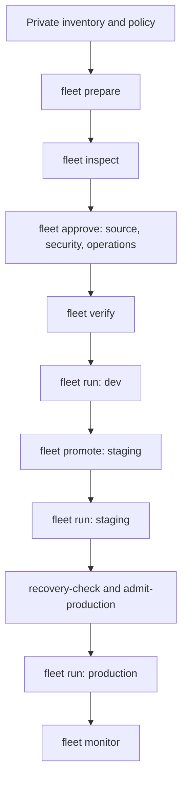

A database fleet delivers one reviewed release to many already enrolled
PostgreSQL and SQLite targets, such as one database per tenant, stage by stage
and without a Cloud login. You author the desired Acore state; migration SQL
and durable delivery artifacts stay private below `.axiom/database/v1/` or in
private CI artifacts.

<StatusNote status="experimental" title="Experimental fleet profile">
Fleet delivery uses the Experimental `database-experimental-offline-fleet/v1`
profile. Production execution additionally requires admission under the named
PostgreSQL production profile, which is Available only for its exact qualified
build. `axiom database fleet` ships in CLI 0.149.1 but is hidden from
`axiom database --help`; run `axiom database fleet --help` to list it. There is
no MySQL or MariaDB adapter.
</StatusNote>

## How a fleet release moves



1. `prepare` freezes the inventory, each target's signed history and the policy
   into one artifact. A changed inventory or budget needs a new freeze and
   review.
2. `inspect` shows each target's masked, typed impact. The source owner,
   security reviewer and operations reviewer each sign the exact artifact with
   `approve`.
3. `verify` checks every review against a policy digest you pin independently,
   with no database effects.
4. `run` applies one stage. `promote` carries the same bytes to the next stage
   with a fresh signed receipt; it never replans or retargets history.
5. Production also needs a recovery check per member and a one-hour admission.
6. `monitor` reports fresh drift and history without applying DDL.

## Inventory and policy

Both files are private JSON. Unknown fields and untyped URL or SQL templates
fail.

| Inventory field (`axiom-database-fleet-inventory/v1`) | Meaning |
| --- | --- |
| `targets` | 1 to 32 members. Each has `id`, `tenant` (`id`, optional PostgreSQL `schema`), `instance`, `group`, `stage` (`dev`, `staging` or `production`), `engine` (`postgres` or `sqlite`), signed `bundle` and target `binding`. |
| `groups` | 1 to 32 rollout groups with `id`, `after` (groups that must finish first), `canary` and `stopOnError`. Canary groups must stop on error, and no group may be empty. |
| `instanceBudgets` | 1 to 32 database instances, each with a budget from 1 to 16. Every target names its instance. |

IDs use up to 64 letters, digits, `_` or `-`. A tenant appears once per stage.
Promoted targets of one engine must share one typed desired-schema intent.

| Policy field (`axiom-database-fleet-policy/v1`) | Meaning |
| --- | --- |
| `reviewers` | Up to 32 reviewer IDs, each with a hex public key |
| `sourceOwners` | Up to 256 source paths, each mapped to an owning reviewer. Every source file in the release needs an owner. |
| `securityReviewer`, `operationsReviewer` | Reviewer IDs required for those review kinds |
| `denyOperations` | Up to 128 operation kinds the release must not contain |
| `maxAffectedObjects` | 1 to 10,000 |
| `maxStatementSeconds` | 1 to 600 |
| `resumePending` | Authorizes continuing supported native PostgreSQL checkpoints. Special index repair stays a separate signed native operation. |

Enroll and plan each target first with the ordinary commands in
[Database contracts](/database/contracts).

## Prepare, review and run dev

```bash title="Terminal: project root"
axiom database fleet prepare --inventory .axiom/database/v1/inventory.json \
  --policy .axiom/database/v1/policy.json --out .axiom/database/v1/fleets/release
axiom database fleet inspect .axiom/database/v1/fleets/release
axiom database fleet approve .axiom/database/v1/fleets/release \
  --reviewer owner --kind source --key-file /private/owner-key.json
axiom database fleet approve .axiom/database/v1/fleets/release \
  --reviewer security --kind security --key-file /private/security-key.json
axiom database fleet approve .axiom/database/v1/fleets/release \
  --reviewer operations --kind operations --key-file /private/operations-key.json
axiom database fleet verify .axiom/database/v1/fleets/release \
  --trusted-policy-sha256 "$REVIEWED_POLICY_SHA256"
axiom database fleet run .axiom/database/v1/fleets/release \
  --inventory .axiom/database/v1/inventory.json \
  --providers /private/providers --journal .axiom/database/v1/fleets/dev-journal \
  --stage dev --receipt-key /private/operations-key.json \
  --trusted-policy-sha256 "$REVIEWED_POLICY_SHA256"
```

- Set `REVIEWED_POLICY_SHA256` to the reviewed canonical policy digest in
  protected operator or CI configuration. An artifact's own keys and digests are
  not independent trust.
- Each review binds the exact artifact, typed evidence and an expiry
  (`--ttl-seconds`, default 3600, at most 604,800). Renewed reviews append
  immutable evidence.
- `run --stage` defaults to `dev`. The scheduler runs one target at a time,
  below every instance budget. The fleet has no shared database transaction.
  A failed canary blocks dependent groups.
- Rerunning verifies each native accepted head again and skips completed work,
  including a commit whose fleet acknowledgement was lost. A partial fleet exits
  non-zero and keeps masked per-target outcomes; a partial or non-zero result
  never means convergence.
- Supported PostgreSQL data transforms keep their signed batch limits and
  durable per-target cursors. Reports show bounded progress counts and no row
  values.

### Schema-per-tenant releases

```bash title="Terminal: project root"
axiom database fleet expand database/schema.acore --schema app --tenant tenant1 \
  --sql-name tenant_one --out /private/tenant-one-project
```

`expand` changes one parsed literal PostgreSQL schema name, recompiles, keeps
logical IDs and records digests. Plan and sign the expanded project before
freezing it. It accepts core local PostgreSQL templates; opaque or advanced
definitions and imported package templates need explicit authoring. There is
no deploy-time SQL substitution. Independent schemas in one physical database
use one aggregate contract and revision scope; separate databases are
independent fleet targets.

## Other fleet commands

| Command | Purpose |
| --- | --- |
| `fleet export ARTIFACT --out DIR` | Copy the exact private bytes and reviews to another machine; no Cloud login |
| `fleet promote ARTIFACT --receipt FILE --to staging --trusted-policy-sha256 ... --key-file ... --out FILE` | Promote with a fresh complete signed receipt and the operations key. The next stage's `run` then needs `--promotion FILE`. Promotion to production also needs the named production profile, current recovery receipts and production admission. |
| `fleet monitor ARTIFACT ...` | Takes the same inventory, provider, journal, stage, receipt-key and trust arguments as `run`. Returns fresh drift, history and checkpoint results. It never migrates or performs writable SQLite journal recovery. |
| `fleet dashboard ARTIFACT --out FILE.html` | Write a local, masked impact and column-dependency view with no external assets. Opaque SQL lineage and runtime backend or frontend consumers stay unknown. |
| `fleet terraform-plan ARTIFACT` | Print a flat string map for Terraform's external-data protocol. It carries no migration authority. |
| `fleet ci`, `fleet operator`, `fleet terraform-apply` | Hidden aliases of `run` for CI jobs, an Axiom controller or a Terraform job |

No Kubernetes controller, Terraform provider plugin or hosted registry is
installed. Discovery is bounded local-file resolution. Arbitrary shell hooks,
HTTP or SQL discovery and unbounded data-report scripts are not supported.

## Named PostgreSQL production admission

The named profile `postgres-17.11-darwin-25.2-arm64-file/v1` is **Available**
for exactly this environment:

| Item | Qualified value |
| --- | --- |
| Engine | Self-managed PostgreSQL 17.11, UTF8 encoding, libc `C` collation and ctype |
| Platform | macOS 26.2 (Darwin 25.2.0) arm64 |
| CLI | The native release build with the recorded executable SHA-256 (locked Rust 1.93) |
| Transport and providers | Explicit verified-TLS CA and private file providers |

Another build, engine patch, operating system or hosted provider needs separate
qualification. SQLite keeps its Experimental gate.

Before production:

1. Quiesce the clean enrolled checkpoint and stop application writes.
2. Take and verify an actual physical backup and retain its WAL.
3. Restore to a named point on an isolated server and prove that a later
   committed transaction is excluded.
4. Keep backup, WAL, restoration, isolation, fencing and recovery-point logs in
   private operator storage. The provider evidence record binds their digests,
   the observation time and the measured RPO and RTO. A reversible SQL flag
   cannot replace a restore.
5. Run `recovery-check` for every member, then `admit-production`, then the
   production `run`:

```bash title="Terminal: operator"
axiom database fleet recovery-check /private/fleet/release \
  --member tenant_one --restored-binding /private/tenant-one-restored.json \
  --providers /private/providers --provider-evidence /private/provider-evidence.json \
  --trusted-policy-sha256 "$REVIEWED_POLICY_SHA256" \
  --key-file /private/operations-key.json --out /private/tenant-one-recovery.json
axiom database fleet admit-production /private/fleet/release \
  --recovery /private/tenant-one-recovery.json \
  --trusted-policy-sha256 "$REVIEWED_POLICY_SHA256" \
  --key-file /private/operations-key.json --out /private/production-admission.json
axiom database fleet run /private/fleet/release \
  --inventory /private/inventory.json --providers /private/providers \
  --journal /private/production-journal --stage production \
  --promotion /private/production-promotion.json \
  --production-admission /private/production-admission.json \
  --receipt-key /private/operations-key.json \
  --trusted-policy-sha256 "$REVIEWED_POLICY_SHA256"
```

Supply one distinct `--recovery` receipt per production member. The recovery
check compares physical identity, ledger incarnation and head, ownership and
ordinary managed heap rows with fixed output settings. A same-server alias,
mismatched data, a pending checkpoint or an inaccessible row-security subset
fails. It does not compare foreign data, sequence counters, materialized
results, credentials or provider jobs.

Admission binds the exact artifact, inventory, independently pinned policy,
executable and receipts. It cannot override drift, ownership or native
pending-state checks.

| Limit | Value |
| --- | --- |
| Provider and restore evidence age | At most 24 hours |
| Measured RPO | 60 seconds or less |
| Measured RTO | 1 to 300 seconds |
| Admission lifetime | At most one hour |
| Production targets | Up to 8, scheduled serially |
| Affected objects | 1,000 |
| Statement timeout | 30 seconds |
| Restore comparison | 32 ordinary heaps, 10,000 rows, 64 KiB per row and 16 MiB of row input per target |

These are implementation ceilings. The measured two-tenant users and tasks
fixture and the retained feature drills do not establish service levels for
arbitrary workloads.

Every production connection that executes or verifies status must be a durable
TLS primary with data checksums, `fsync`, `full_page_writes`,
`synchronous_commit=on`, `wal_level=replica` and currently successful physical
WAL archiving. To recover from a partial run, rerun the exact admitted artifact;
it verifies again and skips committed work.

### Operator responsibilities

- Own archive retention, backup verification, isolation, fencing and routing.
- During failover, replay the protected LSN and fence the old primary before
  promotion and routing.
- Rotate credentials by updating PostgreSQL and the private provider file, then
  verify fresh connections.
- Cloud CI may copy private bytes or orchestrate this exact native runner. Other
  Cloud runtime or provider profiles are unqualified.

### Moving from an experimental PostgreSQL 17.5 installation

Keep the old signed history and backups. Follow PostgreSQL patch, security and
reindex guidance, then transfer schema and data to an isolated 17.11 target,
excluding the old `_axiom_database` ledger. Verify data equivalence, adopt the
exact schema, enroll new authority, then replay, review, recover and admit. The
profile never silently repins or transplants old ledgers.

Backend queries and pools, full rolling application compatibility and complete
PostgreSQL and Atlas property coverage keep separate gates.

## Next steps

- Review the per-target workflow in [Migrations and persistence](/database/persistence).
- Check exact limits in [Capability boundaries](/reference/capability-boundaries).
- Gate releases in [CI checks](/testing/ci).
