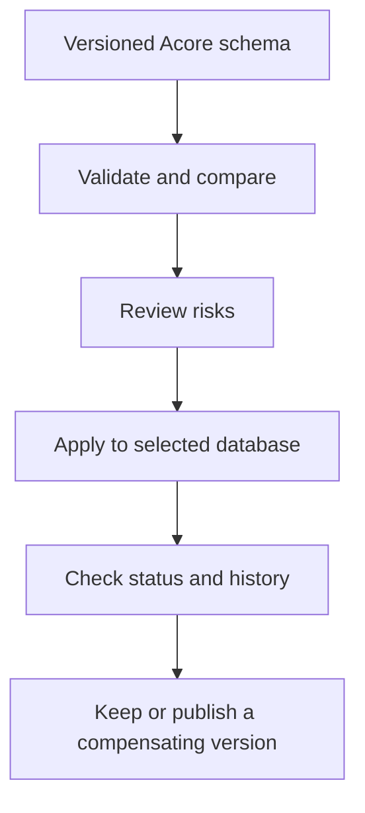

Acore database contracts describe a desired schema and its version. Use the
CLI to connect, apply a reviewed change, inspect history, and compare versions.
Connect the schema to an Acore backend through typed storage mappings.

| Goal | Guide |
| --- | --- |
| Start with a local database | [Database quickstart](/getting-started/quickstart-database) |
| Build an app with persisted records | [Task app](/examples/task-app) |
| Author PostgreSQL schemas and migrations | [Database contracts](/database/contracts) |
| Use SQLite files | [SQLite contracts](/database/sqlite) |
| Retain an existing database | [Existing database adoption](/guides/existing-database) |
| Connect endpoints to data | [Typed persistence](/database/persistence) |
| Experiment in the browser | [Browser preview](/database/browser-preview) |
| Coordinate multiple qualified targets | [Fleet operations](/database/fleets) |

Validation and review precede application to the selected database. Rollback
creates another version; it does not reconstruct deleted values. Keep backups
and verify recovery for data you need to retain.

## Choose an engine

| Engine | Local path | Boundary |
| --- | --- | --- |
| SQLite | CLI 0.149.0 resolves SQLite and creates the local file | Selected Unix adapters require SQLite 3.37+; check platform and production limits |
| PostgreSQL | Connect to an existing 17/18 server with the matching validator | The CLI does not provision or restart the database server |

Database contracts, application persistence, browser simulations, and qualified
production recovery have separate [availability boundaries](/introduction/support-matrix).
