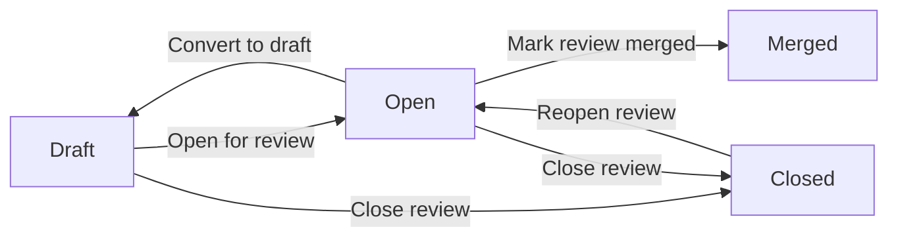

<StatusNote status="alpha" title="Contract pull requests">
  Proposals, semantic changes, review comments and the review-state workflow
  are implemented in Axiom Cloud. APIs and limits may change.
</StatusNote>

A contract pull request is a review of what changed between two released
versions of a contract. It is a native Axiom Cloud project record. It does not
need a repository, branch, webhook or GitHub connection.

Each request permanently records one ordered pair of signed releases: an
earlier **From release** and a later **To release**. The pair cannot be edited
after creation. If you release a newer artifact, open another request instead
of changing the evidence under an existing review.

## Who can do what

| Action | Reader | Maintainer | Owner |
| --- | :---: | :---: | :---: |
| View requests, changes and discussion | Yes | Yes | Yes |
| Comment and reply | Yes | Yes | Yes |
| Create a request and change its state | No | Yes | Yes |

## Open a review

Prerequisite: at least two releases in the same project. See
[Releases and upgrades](/delivery/releases).

1. Open **Pull Requests** in the project dashboard.
2. Select **New pull request**.
3. Choose the earlier **From release** and the newer **To release**. The From
   release must be earlier than the To release.
4. Enter a **Title** and an optional **Description**.
5. Set **Initial state** to **Open for review** or **Draft**, then select
   **Open pull request**.

## Review the changes

The review page shows the semantic comparison that Cloud saved when it
processed the releases. It has five views:

| View | What it shows |
| --- | --- |
| **All changes** | A plain-language summary of each change with its compatibility level. |
| **Domain** | Entities, relationships, invariants, safe projections and endpoint bindings from the Domain Model v1 layer. |
| **Security** | Signed security policy changes and finding changes, each labeled with its category. |
| **Runtime configuration** | Authentication, field validation, streaming, cache, retry and other runtime behavior. |
| **Raw change data** | The technical before and after JSON, loaded only when you open this view. |

Breaking, risky and compatible counts appear immediately from the saved
analysis. The dashboard loads changes in pages of 50, so a very large diff
never blocks the first screen. Raw values are capped at 4 KiB for each side of
a change. For a larger value, inspect the immutable artifact or run a focused
local diff.

The release worker computes the diff from the two stored artifacts. Your
browser never calculates a compatibility result, and opening a review never
recomputes the comparison.

### How changes are classified

| Change | Level |
| --- | --- |
| A removed domain entity, relationship, projection or binding | Breaking |
| A replaced relationship, projection or endpoint binding | Breaking |
| Any invariant change | Risky, because you must review its enforcement effect |
| A removed security policy | Breaking |
| Another security policy change, or a security finding change | Risky |
| A new optional model field, with its matching validation index update | Compatible |

The comparison recognizes that a new optional field also updates the
compiler-generated validator index, so the addition is not mislabeled as a
risky whole-model validation change.

### Impact on consumers

When the comparison has Domain Model v1 evidence, the sidebar shows an impact
panel. It follows the signed dependency graph to the endpoint routes a change
affects. It adds runtime telemetry attributed to the earlier release, from the
last 30 days and for at most 50 consumers. The panel is separate from the
change list, so it never causes a large browser download.

An empty list of observed consumers is not proof that a breaking change is
safe. It means Cloud has no attributable runtime evidence for that window.

## Discuss

- Comment directly below a change to start a thread about it. Replies attach
  to that thread and go one level deep.
- Use **Review discussion** for general notes.

Comments and replies are saved with the request and visible to every project
member.

## Complete the review

A draft can be opened or closed. An open review can return to draft, close or
be marked merged. A closed review can be reopened. **Merged** is final. The
dashboard buttons match the arrow labels. The API also allows a closed review
to return to draft.

**Merged** records that the review was accepted. It does not move the
project's `latest` release channel. Promotion stays an explicit, audited
release operation. See [Releases and environments](/cloud/releases-and-environments).

## Evidence chain

Each step points at immutable evidence from the step before:

1. The contract pull request names two releases.
2. Each release is an immutable, Cloud-signed artifact with a SHA-256 hash.
3. The persisted semantic diff compares those two artifacts.
4. A release attempt records verification, tests and policy for the To release.
5. Runtime traces name the contract version that produced them.

## Next steps

- [Release a version and upgrade consumers](/delivery/releases)
- [Review security changes before promotion](/delivery/production-readiness)
- [Run the same semantic diff in CI](/testing/ci)
