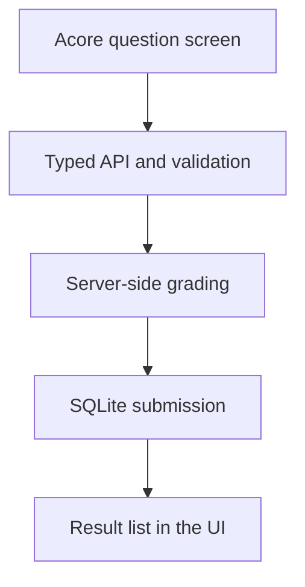

<span id="public-api" />
<span id="managed-grading" />
<span id="persistence-and-failures" />
<span id="submission-table" />
<span id="inspect-the-database" />
<span id="make-a-compatible-change" />
<span id="queries-and-a-mutation" />
<span id="submission-and-error-ui" />
<span id="lifecycle-and-accessibility" />
<span id="scope" />
<span id="troubleshooting-and-cleanup" />
<span id="scoring-and-input-checks" />
<span id="example-request" />

Run a two-question exam built with **Acore across the frontend, backend and
database**. Candidates choose answers in the browser. The backend calculates
the score, rejects a reused attempt ID, and stores the result in SQLite.

<StatusNote status="experimental" title="Experimental path">
  Managed actions, typed failures and SQLite persistence are Experimental.
  Acore UI is Alpha.
</StatusNote>


This screen was captured from the running application with a real local API.

## What you will build



The browser sends answers, not a score. The server validates and grades them
and inserts one submission; a successful submission refreshes the results list.

This is an **untimed learning application** with one local development
identity, one fixed exam, and results shared within that development tenant.
It has no registration, instructor or candidate permissions, publishing
workflow or production session issuance. Do not use it to assess real
candidates without adding those requirements and testing their enforcement.

## Prerequisites

- [Axiom CLI 0.149.1](/getting-started/installation) on macOS arm64.
- Web UI host 0.6.12:
  `axiom ui host install --target web --version 0.6.12 --non-interactive`.
- `git`, a browser and two terminals, with ports 8082 and 5174 free.

No PostgreSQL server or extractor is needed.

## 1. Start the backend

```bash title="Terminal 1"
git clone --depth 1 https://github.com/AxiomCore/AxiomCore.git
cd AxiomCore/examples/documentation/exam-app
unset DATABASE_URL
axiom check backend/main.acore
axiom run backend/main.acore --port 8082
```

```text title="Expected output of the check"
Valid backend contract: backend/main.acore
```

`axiom run` then validates the database, applies schema version `1.0.0`,
starts the API and prints a **development API key**. Keep it running and keep
the key local. Unsetting `DATABASE_URL` stops the CLI from using an unrelated
database from your shell.

## 2. Start the frontend

In a second terminal, in the same `exam-app` directory:

```bash title="Terminal 2: exam-app"
axiom run frontend/main.acore --target web --port 5174
```

Open `http://127.0.0.1:5174`, paste the key and select **Connect**. The app
loads the questions and any stored results.

## 3. Submit an attempt

1. Enter a synthetic name, such as Ada.
2. Keep the attempt ID `attempt-001` or enter another unique ID.
3. Choose **B** for the source-file question and **A** for the grading question.
4. Select **Submit exam**. The results list shows `2 / 2`.
5. Submit the same ID again. The server returns the declared duplicate failure.


The result in this screenshot came from the backend and was stored in SQLite.
A new attempt ID with different choices gives a score of zero or one.

## 4. Confirm persistence

Reload the page and reconnect. Then stop the backend with Ctrl-C, start it
again with the same command, and reconnect. The result is still there.

## How the backend grades

The backend owns grading. The browser sends an attempt ID, a name and two
choices; it cannot send a score or choose a database tenant. Every endpoint
requires the development key in the `apikey` header.

| Endpoint | Behavior |
| --- | --- |
| `GET /questions` | Returns the two public questions and their options |
| `POST /submissions` | Validates, grades, inserts and returns the stored result |
| `GET /results` | Lists up to 100 results in the development tenant |

```json title="POST /submissions body (the answer model itself)"
{"attemptId":"attempt-001","name":"Ada","first":"B","second":"A"}
```

The contract checks the attempt ID (1 to 40 letters, digits, `_` or `-`), the
name (1 to 80 characters) and each choice (`A` or `B`). The submit action then
trims the name, rejects it if nothing is left, grades the answers and stores
the result:

```acore title="backend/application.acore (grading function and submit logic)"
pure fn grade(first: String, second: String): String = first == "B" && second == "A" ? "2" : first == "B" || second == "A" ? "1" : "0"

// Inside the submit action's managed block:
let name = Input.answers.name.trim()
guard name.length > 0 else fail Failures.invalidName({message: "Enter your name"})
let score = grade(Input.answers.first, Input.answers.second) // [!code highlight]
let result = await Resources.submissions.create(input: {
  id: Input.answers.attemptId, name: name,
  first: Input.answers.first, second: Input.answers.second, score: score, total: "2"
})
return result
```

`backend/main.acore`, the entry file, implements the resource with a typed
insert and maps the primary-key constraint to the `duplicate` failure. No
hand-written SQL is needed.

| Result | HTTP status |
| --- | --- |
| Valid submission | 200 |
| Missing key header, invalid choice, or an extra `score` field | 400 |
| Invalid development key | 401 |
| Name that is blank after trimming | 422 |
| Attempt ID already used | 409 |

A successful submission invalidates the `exam:results` cache identity, which
refreshes the results query in the open page.

## How the data is stored

`database/schema.acore` owns the schema identity and version. Each row stores
the answers with the backend-calculated score; the questions live in the
backend source.

| Column | Meaning |
| --- | --- |
| `tenant` | Trusted development tenant, supplied by the backend |
| `id` | The attempt ID, unique within the tenant |
| `name` | Trimmed display name |
| `first`, `second` | Validated `A` or `B` choices |
| `score`, `total` | Portable decimal strings calculated by the backend |

```acore title="database/schema.acore (table excerpt)"
table submissions(strict: true) {
  tenant: Sqlite.Text()
  id: Sqlite.Text()
  name: Sqlite.Text()
  first: Sqlite.Text()
  second: Sqlite.Text()
  score: Sqlite.Text()
  total: Sqlite.Text()
  primaryKey(columns: [.tenant, .id], sqlName: "submissions_pkey") // [!code highlight]
}
```

The primary key prevents a second result for the same tenant and attempt. It
is a uniqueness rule, not a resumable or exactly-once submission protocol.
SQLite tenant scoping comes from the typed application operations; it is not
PostgreSQL row-level security.

Inspect the database from the example root. `axiom run` on the schema opens
the SQL console and prints the SQLite file location; exit with `\q`.

```bash title="exam-app"
axiom database status database/schema.acore
axiom database history database/schema.acore
axiom run database/schema.acore
```

```sql title="Axiom SQL console"
SELECT id, name, score, total FROM submissions;
```

To make a compatible change, stop the backend, set the project version in
`database/schema.acore` to `1.0.1`, and add `note: Sqlite.Text(nullable: true)`
after `total`. Then migrate and compare:

```bash title="exam-app, backend stopped"
axiom database migrate database/schema.acore
axiom database diff database/schema.acore --from 1.0.0 --to 1.0.1
```

The API does not need to expose `note`; the backend's models and response
projections still select only their declared fields. Restart the backend before
you test again. For several exams, add versioned exam and question
relationships and application-owned candidate identities, and keep historical
question versions so stored scores stay meaningful. See
[database contracts](/database/contracts) for migration and rollback limits.

## How the UI connects

The frontend calls the backend through its contract, not hand-written URLs and
decoders. Its manifest selects the contract:

```toml title="frontend/AxiomDeps.toml"
type = "frontend"
targets = ["web"]

[contracts.exam]
artifact = "../backend/.axiom/contracts/backend.axiom"
baseUrl = "http://127.0.0.1:8082"
audience = "web"
operations = ["questions", "results", "submit"]
```

`artifact` must be a manifest-relative path or a URL. `operations` is optional:
omit it to allow every operation the audience may call, or keep the list sorted
and unique. The backend's response projections decide which fields the UI can
read.

```acore title="frontend/main.acore (operation bindings; state declarations omitted)"
use contract Exam from "exam" audience "web"
// Inside page Home:
query questions = Exam.questions(apiKey: apiKey) when apiKey.length > 0
query results = Exam.results(apiKey: apiKey) when apiKey.length > 0
mutation submission = Exam.submit(apiKey: apiKey, answers: {
  attemptId: attemptId, name: name, first: first, second: second
})
```

Queries wait until the app has a key. Each question card emits a typed choice
event, and page state keeps the two answers. **Submit exam** stays disabled
while a field is empty or a request is pending; the page awaits the mutation
and shows any returned error. A disabled button is not a validation or
authorization boundary: the backend checks every request. Reloading loses an
unsent draft but keeps stored submissions.

Inputs have accessible labels, choice buttons use their visible option text,
pending and error states appear as text, and controls stack at compact widths.
Check keyboard and target-specific behavior before going beyond the checked
browser path. For inherited form rules and field-level failures, see the
[task app](/examples/task-app), [Acore UI](/frontend/acore-ui) and
[app lifecycle](/frontend/application-lifecycle).

## Verify behavior

Use a fresh attempt ID for each successful submission.

| First and second answer | Expected score |
| --- | --- |
| A, B | 0 / 2 |
| A, A | 1 / 2 |
| B, B | 1 / 2 |
| B, A | 2 / 2 |

Then send direct requests for every row of the HTTP status table above, and
confirm a 409 adds no row. Set `EXAM_API_KEY` in your shell to the printed key;
do not commit it.

```bash title="Terminal"
curl -sS http://127.0.0.1:8082/submissions \
  -H "apikey: $EXAM_API_KEY" \
  -H 'content-type: application/json' \
  -d '{"attemptId":"request-001","name":"Ada","first":"B","second":"A"}'
```

The response holds the stored attempt, the answers, score `"2"` and total
`"2"`. Repeat it to see the duplicate failure. Confirm persistence from the
SQLite rows and migration history; an in-memory preview or a mock does not
prove it.

## Troubleshooting

| Symptom | Check |
| --- | --- |
| Questions do not load | Backend process, key, the manifest's `baseUrl`, and the allowed frontend origin |
| Incompatible host | Install web UI host 0.6.12 |
| Attempt already submitted | Use a new ID; a duplicate never creates another row |
| UI no longer compiles after a backend edit | Rebuild the backend entry file; check the selected operations and projections |

After you change an imported backend file, stop the backend, run
`axiom build backend/main.acore`, and restart both processes so the UI uses the
updated contract. A schema change also needs a new database version.

## Extend the app deliberately

The lesson has no timed exams, separate instructor access, production login or
multi-exam question management. Before you add them, define and test
server-side authorization, trusted time, ownership, historical exam versions
and submission recovery. A browser countdown or hidden control enforces none
of these. Tie each new guarantee to the target you actually tested.

## Clean up

Stop both processes with Ctrl-C. The SQLite data stays inside the clone; delete
the clone when you no longer need it.

## Next steps

- [Identity and policies](/backend/policies)
- [Managed logic](/acore-language/managed-language)
- [Database contracts](/database/contracts)
- [Axiom Inspector](/inspector)
