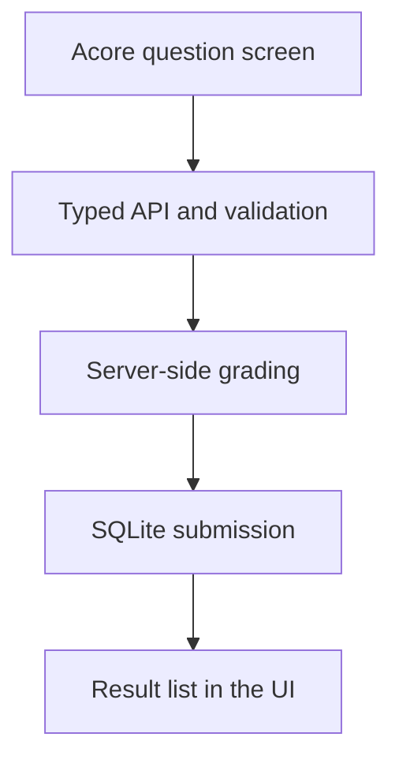

Build a two-question exam with **Acore across the frontend, backend, and
database**. Candidates choose answers in the browser. The backend calculates
the score, rejects duplicate attempt IDs, and stores the result in SQLite.

This screen was captured from the running application with a real local API.

## What you will build

The browser sends answers, not a score. The server grades and inserts one
submission. A successful mutation refreshes the results query.

| Chapter | Result |
| --- | --- |
| [Run the application](/examples/exam-app/run) | A complete local app from the downloadable source |
| [Define the data](/examples/exam-app/database) | A versioned schema and one record per attempt |
| [Build the backend](/examples/exam-app/backend) | Checked input, grading, typed errors, and persistence |
| [Connect the UI](/examples/exam-app/frontend) | Selected contracts, questions, state, and result refresh |
| [Verify behavior](/examples/exam-app/testing) | Scoring, validation, authorization, duplicates, and restart persistence |

## Scope

This is an **untimed learning application** with one local development identity
and one fixed exam. Results are shared within that development tenant. It has
no registration, instructor/candidate permissions, publishing workflow, or
production session issuance. Do not use it to assess real candidates without
adding those application requirements and testing their enforcement.

[Download the complete source](/examples/exam-app.zip), then
[run the application](/examples/exam-app/run).
