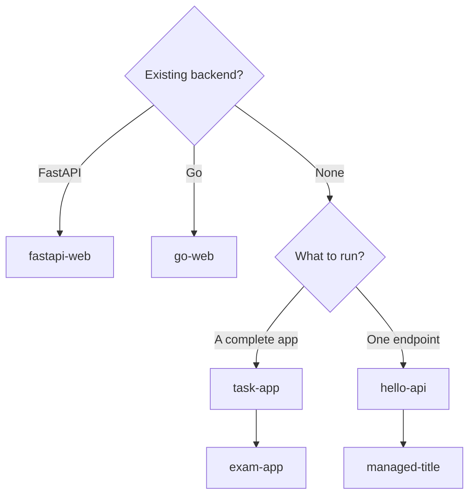

<span id="start-with-an-application" />
<span id="self-contained-validation" />
<span id="safety-and-maintenance" />

Each example is a small project you can run to see one AxiomCore path end to
end. The examples use synthetic local data. They are learning fixtures, not
production templates.



If you already run FastAPI or Go, start with the matching existing-stack
example. Otherwise start with `task-app` for a complete Acore application and
continue with `exam-app`, or start with `hello-api` for a single endpoint and
continue with `managed-title`.

## Get the source

The documentation examples live in the public AxiomCore repository. A shallow
clone is about 6 MB:

```bash title="Terminal"
git clone --depth 1 https://github.com/AxiomCore/AxiomCore.git
cd AxiomCore/examples/documentation/task-app
```

Replace `task-app` with the directory from the table below. Each directory has
a README with its own setup and cleanup steps.

## Documentation examples

Status is the most restrictive label among the capabilities an example uses
(see [Support and availability](/introduction/support-matrix)).

| Directory | What it shows | Status | Ports | Guide |
| --- | --- | --- | --- | --- |
| `task-app` | Acore UI and API, form validation, typed errors, SQLite create, update, delete | Experimental: managed actions and SQLite persistence; Acore UI is Alpha | 8080, 5173 | [Task app](/examples/task-app) |
| `exam-app` | Acore UI and API, server-side grading, persisted results | Experimental: managed actions and SQLite persistence; Acore UI is Alpha | 8082, 5174 | [Exam app](/examples/exam-app) |
| `hello-api` | One Acore endpoint that returns a JSON greeting | Experimental: managed action | 8081 | [Build your first API](/getting-started/quickstart-backend) |
| `managed-title` | Acore input normalization and a typed 422 failure | Experimental: managed logic and typed failures | 8085 | [Backend declarations](/backend/declarations) |
| `fastapi-web` | An existing FastAPI service called from an `atmx-web` browser client | Available | 8083, 5175 | [FastAPI](/guides/fastapi-to-web) |
| `go-web` | An existing Go service on Chi called from an `atmx-web` browser client | Alpha: Go extraction | 8084, 5176 | [Go](/guides/go-to-web) |

Requirements: [Axiom CLI 0.149.1](/getting-started/installation) on macOS
arm64. The Acore UI examples also need web UI host 0.6.12. The existing-stack
examples need their [backend extractor](/getting-started/installation#backend-extractors)
and pin their client generator and runtime versions. For patterns beyond these apps, read
[Advanced patterns](/examples/advanced-patterns) (Experimental).

## Capability fixtures

The separate [AxiomCore/examples](https://github.com/AxiomCore/examples)
repository holds smaller fixtures that each test one boundary:

```bash title="Terminal"
git clone --depth 1 https://github.com/AxiomCore/examples.git
cd examples/domain-commerce
```

| Directory | Capability | Needs | Status | Primary check |
| --- | --- | --- | --- | --- |
| `domain-commerce` | Domain entities, relationships, invariants, projections, and an audience-visible projection change | Axiom CLI | Alpha | `axiom domain validate commerce-v1.acore` |
| `domain-support` | A compact domain model with an audience projection | Axiom CLI | Alpha | `axiom domain validate support-v1.acore` |
| `domain-inference-fastapi` | FastAPI and Pydantic extraction with explicit domain promotion | FastAPI extractor | Alpha | `axiom domain validate axiom.acore` |
| `security-mode-v1` | A passing audit baseline and an intentionally rejected strict input | Axiom CLI | Alpha | `axiom security check axiom.acore` |
| `simple-backend` | FastAPI and Go services with web, React and Flutter consumers | The chosen backend and frontend toolchains | Available to Alpha, by path | Validate the backend and the consumer separately |
| `offline-first-feed` | A cached feed with online and offline consumer states | Backend and web toolchains | Experimental: caching | Build the contract, then exercise online and offline states |
| `realtime-chat` | A Go streaming service with web, React and Flutter consumers | Go and the chosen frontend toolchain | Experimental: streams | Build, then test connect, message, error, reconnect and dispose |

The `rpc`, `stream` and `observability-and-auth` directories are lower-level
runtime fixtures for maintainers. The repository README also lists UI
galleries, demos and extension samples.

## Validate a fixture

From the `domain-commerce` directory:

```bash title="examples/domain-commerce"
axiom domain validate commerce-v1.acore
axiom diff commerce-v1.acore commerce-v2.acore --format semantic
```

```text title="Expected output"
✅ Domain Model v1 valid · 2 entities · 1 relationships · 2 projections
   Manifest: "ab07fcf7185f6cdf4ecaa803493d0cc5b3140d87461abad8e7573dd0aedd4213"
Semantic State Changes:

- $.domain.projections.publicCustomer.fields[1]
~ $.project.version : "v1.0.0" -> "v1.1.0"
+ $.models.Customer.fields.loyaltyTier = {"isOptional":true,"name":"loyaltyTier","typeRef":{"kind"...
```

The `-` line is the removed projection field. The diff reports it as a path
change but does not classify it as breaking, so you must treat it as a
consumer-breaking change in review.

From the `security-mode-v1` directory:

```bash title="examples/security-mode-v1"
axiom security check axiom.acore
axiom security check axiom.unsafe.acore
```

```text title="Expected output"
Security Mode audit · 0 error(s), 0 warning(s) · 3 of 3 endpoints covered (2 direct, 1 default-policy)
Security Mode strict · 1 error(s), 0 warning(s) · 0 of 1 endpoints covered (0 direct, 0 default-policy)
AXSEC-001 ERROR [GetNote] `GetNote` is externally reachable but has no explicit public declaration or authorization policy.
  → Declare `security.endpoints[endpoint]` as public or bind it to a user-defined policy.
Error: security check found 1 error(s) and 0 warning(s)
```

The safe input passes. The unsafe input exits with a non-zero status and
`AXSEC-001`.

## Example safety rules

Examples use relative paths, synthetic data and visibly non-production
placeholder values. They never contain a home-directory path, token, private
key, telemetry DSN, cookie, sandbox key or production endpoint. When an example
depends on an Alpha or Experimental surface, its README states the runtime and
dependency boundary.

## Next steps

- [Run your first app](/getting-started/quickstart)
- [Task app walkthrough](/examples/task-app)
- [Use your existing stack](/guides)
