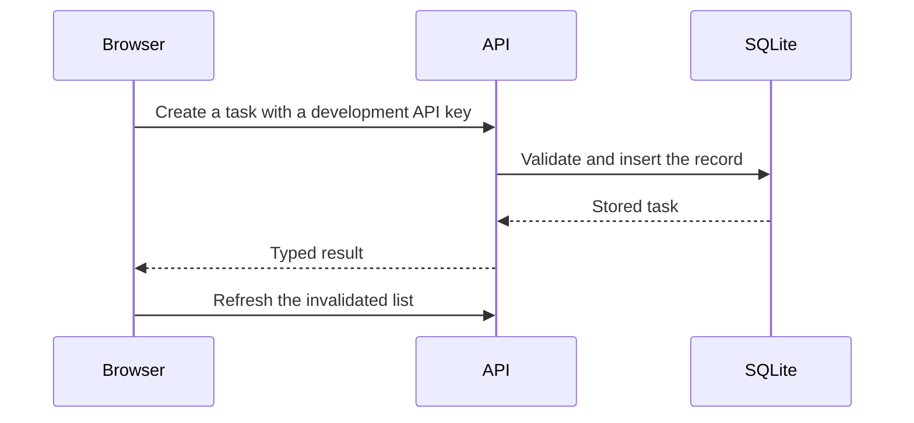

This small application demonstrates create, list, update, and delete with real
SQLite persistence. Its UI, backend, and schema are authored in Acore.

[Download the source](/examples/task-app.zip) and follow the
[first-app run instructions](/getting-started/quickstart).

## How a request reaches the data

The endpoint binds to an action. The action validates input and calls a resource;
a typed storage mapping implements the operation. A successful mutation
invalidates `tasks:list`, so the frontend fetches the updated list.

## Find each part

| File | Responsibility |
| --- | --- |
| `database/sqlite/schema.acore` | Table, tenant and ID key, schema identity/version |
| `backend/Task.acore` | Public task model |
| `backend/application.acore` | Endpoints, guards, validation, failures, actions, CORS |
| `backend/sqlite.acore` | Typed select/insert/update/delete mappings |
| `frontend/main.acore` | Form, query, mutations, error UI, list |
| Each `AxiomDeps.toml` | Project profile and dependencies |

The backend uses the normalized title as the initial task ID. This keeps the
example small; a real application should choose an ID and uniqueness policy
that fits its domain.

## API surface

All endpoints require the printed development key in the `apikey` header.

| Method and path | Input | Result |
| --- | --- | --- |
| `GET /tasks` | No body | Up to 100 tasks |
| `POST /tasks` | `{"title":"Read the guide"}` | Created task; duplicate ID gives the declared 409 failure |
| `PATCH /tasks/{id}` | A JSON string, such as `"Updated title"` | Updated task |
| `DELETE /tasks/{id}` | ID in the URL | Deleted task |

The UI blocks blank titles, and the contract checks title length. A missing required key header returns 400; an invalid key returns 401. Updating a title does not replace the task's ID.
URL-encode IDs when calling the API directly.

## What to verify

Create a record, check duplicate and missing-key failures, update its title,
delete another record, reload the page, and restart the backend. The retained
record must survive; the deleted one must stay deleted.

The development key represents one local principal and tenant. This example
has no user registration, production session issuance, or multi-user role UI.
Review [identity](/backend/policies) before extending it to protected accounts.

Stop both servers with Ctrl-C. Retain or remove the disposable example directory
and its data as needed. Continue with [schema migrations](/getting-started/quickstart-database)
or the [exam app](/examples/exam-app).
