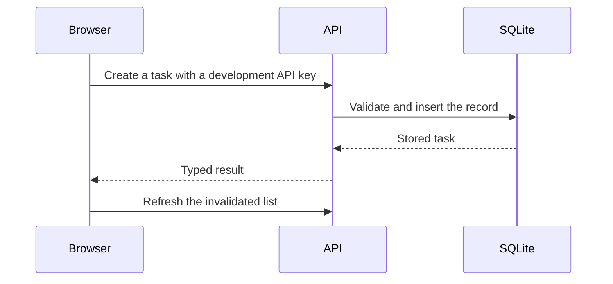

The task app creates, lists, renames and deletes tasks with real SQLite
persistence. Its UI, backend and schema are all written in Acore. This page
explains how the parts fit together; [Run your first app](/getting-started/quickstart)
walks through running it step by step.

<StatusNote status="experimental" title="Experimental path">
  Managed actions and SQLite persistence are Experimental. Acore UI is Alpha.
</StatusNote>


## Run it

You need [Axiom CLI 0.149.1](/getting-started/installation) on macOS arm64,
the web UI host 0.6.12
(`axiom ui host install --target web --version 0.6.12 --non-interactive`), a
browser, two terminals, and free ports 8080 and 5173.

```bash title="Terminal 1"
git clone --depth 1 https://github.com/AxiomCore/AxiomCore.git
cd AxiomCore/examples/documentation/task-app
unset DATABASE_URL
axiom check backend/sqlite.acore
axiom run backend/sqlite.acore --port 8080
```

```bash title="Terminal 2: same task-app directory"
axiom run frontend/main.acore --target web --port 5173
```

Open `http://127.0.0.1:5173`, paste the development API key that Terminal 1
printed, and select **Connect**. The [quickstart](/getting-started/quickstart)
shows the expected output and troubleshooting.

## How a request reaches the data



Each endpoint binds to an **action**. The action checks the guard, validates
input and calls a **resource** operation. A typed **storage mapping**
implements that operation against the SQLite table. A successful create,
rename or delete invalidates the `tasks:list` cache identity, so the frontend
fetches the list again.

## Find each part

| File | Responsibility |
| --- | --- |
| `database/sqlite/schema.acore` | The `tasks` table, its tenant and ID key, and the schema identity and version |
| `backend/Task.acore` | The public `Task` model |
| `backend/application.acore` | Endpoints, guard, validation, failures, actions, CORS |
| `backend/sqlite.acore` | Typed select, insert, update and delete mappings; the entry file you run |
| `frontend/main.acore` | Form, query, mutations, error UI and list |
| Each `AxiomDeps.toml` | The project type, targets and dependencies for that folder |

The storage mapping turns a database constraint into a declared failure:

```acore title="backend/sqlite.acore (excerpt)"
storage tasks(schema: "../database/sqlite/schema.acore", resource: Resources.tasks) {
  select list(table: "main.tasks", fields: {id: "id", title: "title"}, limit: 100)
  insert create(table: "main.tasks", values: {id: Input.title, title: Input.title},
    fields: {id: "id", title: "title"}, constraint: "tasks_pkey",
    failure: Failures.duplicate, message: "That task already exists")
  // update and delete mappings follow in the complete file
}
```

The backend uses the trimmed title as the new task's ID. This keeps the example
small; a real application should choose an ID and uniqueness policy that fits
its domain.

In the frontend, a form model trims the title, checks it on submit with the
contract's validation, and shows the server's duplicate failure on the title
field.

## API surface

Every endpoint requires the printed development key in the `apikey` header.

| Method and path | Request | Result |
| --- | --- | --- |
| `GET /tasks` | No body | Up to 100 tasks |
| `POST /tasks` | `{"title":"Read the guide"}` | The created task; a duplicate ID returns the declared 409 failure |
| `PATCH /tasks/{id}` | A JSON string, such as `"Updated title"` | The updated task |
| `DELETE /tasks/{id}` | The ID in the URL | The deleted task |

| Condition | HTTP status |
| --- | --- |
| Duplicate task ID | 409 |
| Missing `apikey` header | 400 |
| Invalid key | 401 |

The UI blocks blank titles, and the contract limits titles to 1 to 120
characters. Renaming a task does not change its ID. URL-encode IDs when you
call the API directly.

<span id="what-to-verify" />

## Verify

1. Create a task, then create the same title again and check the 409 failure.
2. Call the API without the key header (400) and with a wrong key (401).
3. Rename a task and delete another one.
4. Reload the page, reconnect, then restart the backend and reconnect again.
   The kept task must still be there and the deleted one must stay deleted.

## Limits

The development key represents one local principal and one tenant. The app has
no user registration, production session issuance or multi-user role UI, and
list responses stop at 100 tasks. Review [identity and policies](/backend/policies)
before you extend it to protected accounts.

If you edit an imported backend file, stop both processes, run
`axiom build backend/sqlite.acore`, and start both again. Change the database
project version before you apply a schema change.

## Clean up

Stop both processes with Ctrl-C. The SQLite data stays inside the clone. Keep
it to continue, or delete the clone when you no longer need the data.

## Next steps

- [Create your first database](/getting-started/quickstart-database)
- [Exam app](/examples/exam-app)
- [Backend declarations](/backend/declarations)
