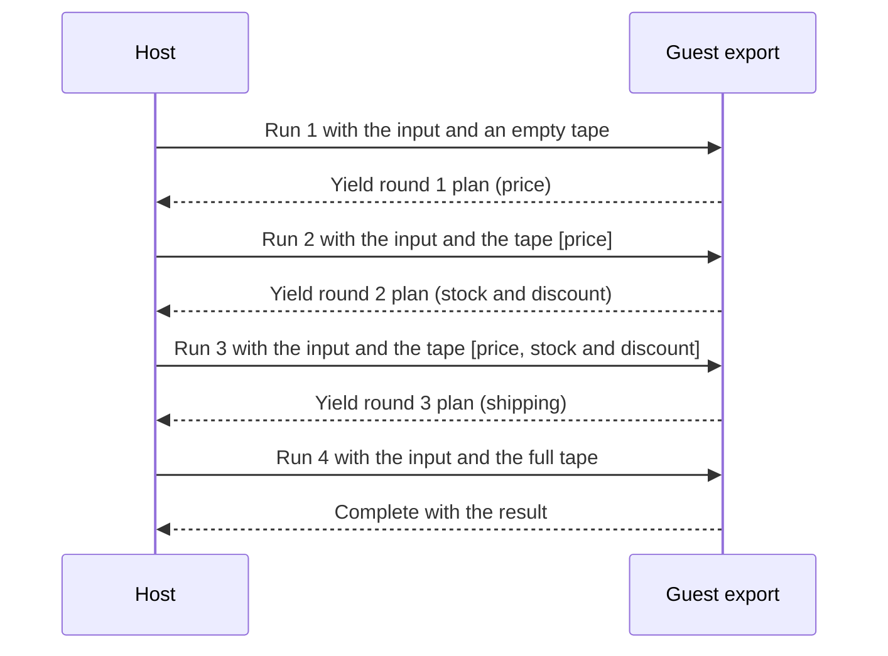

import { Tab, Tabs } from 'fumadocs-ui/components/tabs';

<StatusNote status="experimental" title="Requires extension SDK 0.1.5 and ABI 1.1">
  Async exports need the Rust, TypeScript or Python extension SDK 0.1.5. A
  module with an async export uses extension ABI 1.1, which hosts negotiate
  per module. Modules without async exports are unchanged and stay on ABI 1.0.
</StatusNote>

An async export can wait for host results several times in one invocation:
load a price, then query stock and a discount together, then ask for shipping
only if the item is in stock. You write ordinary `async` code. This page
explains what the host does underneath, because that model decides which code
is valid.

## How it works: rounds and replay

An extension never keeps memory between host calls. Each time it needs host
results, it stops and hands the host a plan of calls. That is one **effect
round**. When the host has the results, it starts the export again **from the
top**, with the same input, and gives it the results of every earlier round.



The host-owned record of results is the **tape**. On each run, every `await`
whose plan is already on the tape resolves at once with the recorded result,
in order. The first `await` that is not on the tape becomes the next plan.

This is why `await` works without a persistent heap: nothing in the guest's
memory survives from one run to the next, and nothing needs to. The program
rebuilds its state by running the same code over the same input and the same
recorded results. The host keeps the tape, seals it so it cannot be altered
between runs, and never takes tape data from the guest.

It also explains the rules on this page:

- The export must make the **same calls in the same order** on every run.
  Otherwise the replayed plan no longer matches the tape (see
  [Determinism](#determinism)).
- Effects run once. A call answered in round 1 is answered from the tape in
  every later run; the host does not repeat it.
- The cost of an invocation grows with the number of rounds, because every run
  repeats the earlier steps (see [Cost and limits](#cost-and-limits)).

## A three-round example

The `quote` export below behaves identically in all three languages. It
comes from
[`extension-authoring-samples`](https://github.com/AxiomCore/examples/tree/main/extension-authoring-samples).

<Tabs items={['Rust', 'TypeScript', 'Python']}>
<Tab value="Rust">

```rust title="logic/pricing.rs (excerpt)"
#[extension]
impl Pricing {
    #[export]
    async fn quote(cx: &Cx, sku: String) -> Result<Quote> {
        // Round 1: one host call.
        let price: Cents = cx.call(price_of::<String, Cents>().call(sku.clone())).await?;
        // Round 2: two independent calls, sent together as one group.
        let (stock, discount) = try_join!(
            cx.call(stock_of::<String, u64>().call(sku.clone())),
            cx.call(discount_of::<String, Percentage>().call(sku.clone())),
        )
        .await?;
        if stock == 0 {
            return Ok(Quote { available: false, label: String::from("Out of stock"), total_cents: Cents::ZERO });
        }
        // Round 3: only reached when the item is in stock.
        let shipping: Cents = cx.call(shipping_of::<String, Cents>().call(sku)).await?;
        let discounted = price.checked_sub(discount.of(price)?)?;
        let total = discounted
            .value()
            .checked_add(shipping.value())
            .map(Cents::new)
            .ok_or_else(|| SdkError::invalid_input("total is out of range"))?;
        Ok(Quote { available: true, label: total.as_currency(), total_cents: total })
    }
}
```

An async export is `#[export] async fn name(cx: &Cx, input: In) -> Result<Out>`
inside an `#[extension]` impl. It has no `self`, because no guest memory
survives between runs. `cx.call(op.call(input))` resolves to the operation's
declared output type. `try_join!` is imported from `axiom_extension_sdk`;
`join!` and `join_all` are in the prelude. Sync `#[export]` methods can sit in
the same impl.

</Tab>
<Tab value="TypeScript">

```typescript title="logic/pricing.ts (excerpt)"
export default defineExtension({
  exports: {
    quote: extension.export(async (cx: AsyncContext, input: unknown) => {
      const sku = String(input);
      // Round 1: one host call.
      const price = Cents.decode(await cx.call(priceOf.call(sku)));
      // Round 2: two independent calls, sent together as one group.
      const [stock, discount] = await Promise.all([
        cx.call(stockOf.call(sku)),
        cx.call(discountOf.call(sku)),
      ]);
      if (stock === 0) {
        return cx.complete({ available: false, label: "Out of stock", total_cents: Cents.ZERO.encode() });
      }
      // Round 3: only reached when the item is in stock.
      const shipping = Cents.decode(await cx.call(shippingOf.call(sku)));
      const discounted = price.checkedSub(Percentage.decode(discount).of(price));
      const total = Cents.new(discounted.value + shipping.value);
      return cx.complete({ available: true, label: total.asCurrency(), total_cents: total.encode() });
    }),
```

`extension.export(fn)` makes an `async` function an async export; a plain
function stays a sync export in the same module. `cx.call(effect)` returns a
promise of the operation's output. `cx.complete(output, { patches })` returns
the result; returning a plain value means that value with no changes.

</Tab>
<Tab value="Python">

```python title="logic/pricing.py (excerpt)"
@extension.export
async def quote(cx: "AsyncContext", sku: str):
    # Round 1: one host call.
    price = Cents.decode(await cx.call(price_of(sku)))
    # Round 2: two independent calls, sent together as one group.
    stock, discount = await gather(cx.call(stock_of(sku)), cx.call(discount_of(sku)))
    if stock == 0:
        return cx.complete({"available": False, "label": "Out of stock", "total_cents": Cents.ZERO.encode()})
    # Round 3: only reached when the item is in stock.
    shipping = Cents.decode(await cx.call(shipping_of(sku)))
    discounted = price.checked_sub(Percentage.decode(discount).of(price))
    total = Cents(discounted.value + shipping.value)
    return cx.complete({"available": True, "label": total.as_currency(), "total_cents": total.encode()})
```

`@extension.export` on an `async def` makes an async export. `gather` comes
from `axiom_extension_sdk`; `asyncio` is not available. A failed host call
raises `HostOperationError` with `code` and `retryable`.

</Tab>
</Tabs>

The extension requests three rounds:

```toml title="AxiomDeps.toml"
[extensions.pricing.budgets]
maxRounds = 3
```

With the catalog answering price 12000, stock 3, discount 1500 basis points
and shipping 499, each edition makes the same calls in the same rounds and
returns the same result:

| Round | Plan sent to the host | Result |
| --- | --- | --- |
| 1 | `catalog.price` | 12000 |
| 2 | One group: `catalog.stock`, `catalog.discount` | 3, 1500 |
| 3 | `catalog.shipping` | 499 |
| 4 | (completes) | `{"available": true, "label": "$106.99", "total_cents": 10699}` |

With stock 0, the export completes in its third run after two rounds and
returns `{"available": false, "label": "Out of stock", "total_cents": 0}`.

## Request rounds and a deadline

`maxRounds` counts **yields**. An export may yield at most `maxRounds` times
and then complete; the completing run is not counted.

| Yields in one invocation | Outcome with `maxRounds = N` |
| --- | --- |
| 0 to N | Completes and commits |
| N + 1 | The extra yield is refused with `Exhausted` ("maxRounds exceeded"). Effects of the first N rounds have already run. Nothing commits. |

The default of 1 gives an async export exactly what a sync export has: one
yield, then completion. The ceiling is 16. A source build prints
`warning[AXIOM_ASYNC_MAX_ROUNDS]` for each async export of a module that keeps
the default, naming the export and the fix. The minimum a module needs cannot
be computed in general (loops and data decide it), so set it from the longest
path through your code.

`deadlineMs` is one wall-clock deadline for the whole invocation, all rounds
together:

```toml title="AxiomDeps.toml"
[extensions.pricingpy.budgets]
maxRounds = 3
deadlineMs = 5000
```

Raising either value is a permission increase that needs review. See
[Request budgets](/extensions/declare-and-call#request-budgets) for ranges.

A module with an async export is an ABI 1.1 module. A host that offers only
ABI 1.0 lets an async export yield once, then fails it with `Exhausted`.

## Batch calls that do not depend on each other

Calls awaited together are sent in **one** round. Await independent calls
together; a sequential `await` costs a round each.

| Rust | TypeScript | Python | On the first failure |
| --- | --- | --- | --- |
| `try_join!`, `try_join_all` | `Promise.all` | `gather(...)` | Fail fast: returns the first error and drops the other branches |
| `join!`, `join_all` | `Promise.allSettled` | `gather(..., return_exceptions=True)` | Wait for all: every branch gets its own result or error |

Plans, rounds, host calls and audit records are identical across the three
languages for the same program.

How a round's plan is shaped:

| Calls pending together | Plan |
| --- | --- |
| 1 | A plan with one call |
| 2 to 32 | One group with a branch per call, in the order the calls were first awaited |
| More than 32 | The invocation fails with `Exhausted` before yielding |

A group also cannot be wider than the package's `maxEffects`. In a group, each
branch gets its own outcome: a branch the broker refuses (no grant, revoked)
resolves with a `Denied` error for that branch only, and the others get their
values. Groups run granted contract queries; await other calls on their own.

When a call joins a round:

- A call registers when it is first awaited (Rust: first polled). A call that
  is never awaited is never sent.
- Calls register in a fixed depth-first order of the async call tree, so the
  order does not depend on how many helper functions sit in between.
- A registered call is never withdrawn. If a fail-fast combinator drops a
  branch after its call was registered, the call still runs with its round and
  its result is discarded.
- Calls still pending when the export returns are never sent.

## Determinism

Every run must produce the same plans as the runs before it. Follow these
rules:

- Get time, randomness and state only through host operations. They are on the
  tape, so every run sees the same values.
- Do not branch on the round number (`cx.round()`) or on state kept in
  globals or statics before an await. The round number is for diagnostics
  only.
- Do not await anything that is not a host operation. A timer, a channel or a
  hand-made promise fails the invocation with `InvalidInput`.
- There is no racing combinator. In TypeScript, `Promise.race` and
  `Promise.any` over host calls settle in plan order, so the first call in the
  plan wins, and the losers still run.

The engines also remove ambient sources of variation. In TypeScript,
`Date.now()` and `new Date()` are always 0 and `Math.random()` returns a fixed
sequence; module state starts fresh every run. In Python, every clock returns
0 and `random` is seeded with 0 unless you seed it.

**What happens on divergence.** If a run produces a plan whose hash differs
from the tape, the invocation fails with `Protocol` and the message
`non-deterministic guest: the plan re-derived for effect round <k> differs from the tape`.
If the export completes before replaying every recorded round, it fails with
`non-deterministic guest: the export completed after replaying <k> of <n> effect rounds`.
Nothing commits in either case.

## What is atomic and what is not

- **Patches and transactions are atomic.** Only the completing run's patches
  are sent, once, at the end. The host checks each patch against the revision
  of the snapshot the export received in round 1, so a value changed by
  someone else in the meantime gives a `Conflict` and nothing commits.
- **Effects of earlier rounds have happened** even if a later round fails,
  exceeds `maxRounds` or is cancelled. Prefer idempotent operations, and keep
  writes in the final result where you can.
- Cancellation is checked between rounds and stops the invocation with
  `Cancelled`.

## Cost and limits

Each run repeats the earlier steps, so cost grows faster than linearly with the
number of rounds.

**Budgets across rounds.** The host gives one invocation a single fuel budget
of `fuel per invocation × (maxRounds + 1)`; each round uses what the earlier
rounds left. Only fuel scales. The deadline, the host-call budget and the read
and write byte budgets are **not** scaled by `maxRounds` and are shared by all
rounds.

**On the web.** Multi-round (ABI 1.1) extensions in Rust, TypeScript and
Python also run on the web target. The browser has no fuel metering, so there
the guest's CPU is limited by the invocation deadline (`deadlineMs`) instead of
fuel: one deadline covers every round and the host work between rounds, and it
is not scaled by `maxRounds`. When it passes, the invocation fails with
`AXIOM_EXTENSION_DEADLINE_EXCEEDED` and nothing commits. Choose `deadlineMs`
for the slowest browser you support.

Measured costs per language under the default policy (release builds,
1,000 ms deadline, 64 memory pages):

| | Rust | TypeScript | Python |
| --- | --- | --- | --- |
| First run | About 60,000 to 72,000 fuel | About 49 M managed fuel, 6 to 7 ms | About 1.47 G managed fuel, 0.10 to 0.25 s (the Python runtime starts every run) |
| Each replayed round | About 20,000 to 30,000 fuel for a small guest | About 13 M managed fuel | About 32 M managed fuel |
| Memory | Bounded by the module | No growth per round | No growth per round |
| What limits rounds | `maxRounds` | `maxRounds` | The deadline |
| Most yields that commit under the defaults | 16 | 16 | About 7 |

Rust fuel for N sequential awaits in one test guest (fuel is deterministic):

| Yields | Runs | Total guest fuel |
| --- | --- | --- |
| 0 | 1 | 71,731 |
| 1 | 2 | 179,240 |
| 2 | 3 | 307,902 |
| 4 | 5 | 636,910 |
| 8 | 9 | 1,618,336 |
| 16 | 17 | 4,738,970 |

All of these fit the default budget (1 M fuel per invocation, times
`maxRounds + 1`).

**Async Python and the deadline.** Every Python run starts the Python
runtime, so a Python async export spends most of its time starting up. Under
the default 1,000 ms deadline, measured on a quiet machine, 1 to 2 yields
committed reliably, 4 yields in 4 of 5 runs and 8 yields in 1 of 5. Under CPU
load, even one yield committed in only 1 of 5 runs. A 16-yield Python export
needs about 4 s on a quiet machine and about 10 s under load. If a Python
export awaits more than once or twice, raise `deadlineMs` and test under
realistic load. TypeScript committed 16 yields in every quiet run and in 2 of
5 runs under load.

Wall-clock numbers depend on the machine; fuel does not. Measure your own
export before you choose `deadlineMs`.

## What is not supported

- Racing (`select!`) and timeouts. There are no timers.
- Python `asyncio`, tasks, `async for`, `async with`, asynchronous
  comprehensions and generators, and an `async` resume handler. The compiler
  rejects them with a located diagnostic.
- Async exports with a selected `interface` (named continuations stay on
  ABI 1.0), and Rust modules built with `export_extension!` instead of
  `#[extension]`.
- More than 16 yields, or more than 32 calls awaited together.

## Next steps

- [Test and debug extensions](/extensions/testing) to record and replay an invocation
- [Declare and call an extension](/extensions/declare-and-call) for budgets
- [What an extension can do](/extensions/effect-summaries) for the effects of all rounds of an export
