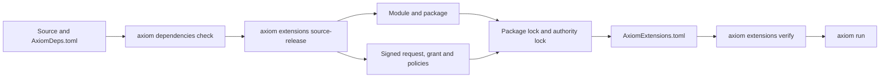

import { Step, Steps } from 'fumadocs-ui/components/steps';
import { Tab, Tabs } from 'fumadocs-ui/components/tabs';

<span id="what-the-application-author-prepares" />
<span id="generated-release-inputs" />
<span id="verify-before-a-host-can-load-the-module" />
<span id="bind-and-invoke-at-a-coarse-boundary" />
<span id="test-the-right-host" />
<span id="operate-and-update-safely" />
<span id="checked-values-cleanup-and-conflicts" />
<span id="migrate-axiomdepstoml" />
<span id="migrate-low-level-rust-sdk-imports" />

<StatusNote status="experimental" title="Experimental workflow">
  Commands and file formats can change between CLI releases. Pin the Axiom CLI
  and SDK versions in CI and keep the JSON output of each check with the release.
</StatusNote>

This guide adds a discount rule, written in Rust, TypeScript or Python, to an
Acore UI page. The page passes the cart subtotal to the extension, and the
extension returns a patch that sets the discount and the total. Use an
extension only when declarative Acore and ordinary integration are not a good
fit; see [Extensions](/extensions) for the model.

You write four files. Axiom generates the build workspace, bindings,
WebAssembly module, package, signatures and locks; never edit generated files
to add authority.

```text title="Project layout"
main.acore           Acore UI page that calls the extension
AxiomDeps.toml       Extension declaration and requested permissions
logic/pricing.ts     Extension source (pricing.rs or pricing.py for other languages)
package.json         Pins the SDK (Cargo.toml for Rust, pyproject.toml for Python)
```



## Before you start

Install the Axiom CLI 0.149.1 and the toolchain for your language. The
TypeScript and Python tools must report exactly the versions shown.

| Language | Tools | SDK versions CLI 0.149.1 accepts |
| --- | --- | --- |
| Rust | `cargo` and `rustc` with the `wasm32-unknown-unknown` target | `axiom-extension-sdk` 0.1.0, 0.1.1 or 0.1.2 (crates.io) |
| TypeScript | `tsc` 7.0.2, `esbuild` 0.28.2, `javy` 9.1.0 | `@axiomcore/extension-sdk` 0.1.0, 0.1.1 or 0.1.2 (npm) |
| Python | `python3.12` reporting Python 3.12.11, plus the TypeScript tools | `axiom-extension-sdk` 0.1.0 or 0.1.1 (PyPI) |

The CLI finds tools on `PATH`. To use another location, set
`AXIOM_TYPESCRIPT_TSC`, `AXIOM_TYPESCRIPT_ESBUILD`, `AXIOM_TYPESCRIPT_JAVY` or
`AXIOM_PYTHON_COMPILER` to the tool's path; for Rust, `RUSTUP_TOOLCHAIN` selects
a rustup toolchain. TypeScript build tools run with no inherited environment
and the fixed search path `/opt/homebrew/bin:/usr/local/bin:/usr/bin:/bin`, so
`tsc` needs Node.js installed in one of those directories.

<Callout type="warn" title="Newer SDK releases are not accepted yet">
  The latest published SDKs are Rust 0.1.4, TypeScript 0.1.3 and Python 0.1.3.
  CLI 0.149.1 rejects any SDK newer than the versions in the table, so pin
  those exactly.
</Callout>

<Steps>
<Step>

### Declare the extension

`AxiomDeps.toml` registers the source file, its exports and targets, and the
most authority it may use. Omitted permissions are denied. Every list must be
sorted and contain no duplicates; targets go in the order `android`, `ios`,
`web`, `server`.

```toml title="AxiomDeps.toml"
type = "frontend"
targets = ["web"]

[extensions.pricing]
language = "typescript"
source = "logic/pricing.ts"
exports = ["apply_discount"]
targets = ["web"]

[extensions.pricing.permissions.ui-state.cart]
read = ["subtotal_cents"]
write = ["discount_cents", "total_cents"]
```

For Rust or Python, change `language` to `rust` or `python` and `source` to
the `.rs` or `.py` file. Validate the manifest without fetching anything:

```bash title="Terminal"
axiom dependencies check
```

```text title="Expected output"
Valid AxiomDeps.toml v2: AxiomDeps.toml
Canonical manifest: <sha256>
0 contract(s), 0 Axiom package(s), 1 extension(s), 0 build environment(s).
```

</Step>
<Step>

### Install the SDK

The SDK gives your editor and the Axiom compiler the same typed API. Third-party
packages do not go here; declare them in `AxiomDeps.toml` (see
[Extension dependencies](/extensions/dependencies)).

<Tabs items={['TypeScript', 'Rust', 'Python']}>
<Tab value="TypeScript">

```json title="package.json"
{
  "name": "checkout-extensions",
  "private": true,
  "type": "module",
  "devDependencies": {
    "@axiomcore/extension-sdk": "0.1.2",
    "typescript": "7.0.2"
  }
}
```

```bash title="Terminal"
npm install
```

The CLI reads the SDK from `node_modules/@axiomcore/extension-sdk`. A local
`typescript` install is not on `PATH`; set `AXIOM_TYPESCRIPT_TSC` to the
absolute path of `node_modules/.bin/tsc`, or install `tsc` 7.0.2 globally.

</Tab>
<Tab value="Rust">

```toml title="Cargo.toml"
[package]
name = "checkout-extensions"
version = "0.0.0"
edition = "2021"
publish = false

[lib]
path = "logic/pricing.rs"

[dependencies]
axiom-extension-sdk = "=0.1.2"
```

```bash title="Terminal"
rustup target add wasm32-unknown-unknown
cargo fetch
```

The CLI locates the SDK with `cargo metadata --locked --offline`, so
`Cargo.lock` and the downloaded crate must exist before you build.

</Tab>
<Tab value="Python">

```toml title="pyproject.toml"
[project]
name = "checkout-extensions"
version = "0.0.0"
requires-python = ">=3.12"
dependencies = ["axiom-extension-sdk==0.1.1"]
```

```bash title="Terminal"
uv sync
```

The CLI reads the SDK from the project's `.venv`. The SDK supplies type stubs
only. Axiom parses your Python with Python 3.12.11 and compiles it ahead of
time; your code never runs in a host Python interpreter.

</Tab>
</Tabs>

</Step>
<Step>

### Write the extension

The export name must match `exports` in `AxiomDeps.toml`. Selectors and typed
state views come from bindings that Axiom generates from the manifest and the
page's `state` declarations; they contain only the fields you requested.

<Tabs items={['TypeScript', 'Rust', 'Python']}>
<Tab value="TypeScript">

```typescript title="logic/pricing.ts"
import { defineExtension } from "@axiomcore/extension-sdk";
import { selectors } from "@axiomcore/extension-bindings";

export default defineExtension({
  exports: {
    apply_discount(context) {
      const subtotal = Number(context.input);
      if (!Number.isSafeInteger(subtotal) || subtotal < 0) {
        throw new Error("subtotal must be a non-negative integer");
      }
      const discount = Math.min(Math.floor(subtotal / 10), 2_500);
      const total = subtotal - discount;
      const patch = context
        .patch("ui:cart")
        .set(selectors.ui_cart_discount_cents, discount)
        .set(selectors.ui_cart_total_cents, total)
        .build();
      return context.complete({ discount_cents: discount, total_cents: total }, { patches: [patch] });
    },
  },
});
```

</Tab>
<Tab value="Rust">

```rust title="logic/pricing.rs"
use crate::axiom_bindings::ui::Cart;
use axiom_extension_sdk::prelude::*;

#[derive(Default)]
struct Pricing;

#[derive(AxiomType)]
struct Applied {
    discount_cents: Cents,
    total_cents: Cents,
}

#[extension]
impl Pricing {
    #[export]
    fn apply_discount(&mut self, invocation: TypedInvocation) -> Result<ExtensionResponse> {
        let cart = Cart::from(&invocation)?;
        let subtotal = invocation.input::<Cents>()?;
        // 10 percent off, capped at $25.
        let discount = Percentage::from_whole(10)?
            .of(subtotal)?
            .min(Cents::from_dollars(25)?);
        let total = subtotal.checked_sub(discount)?;
        let patch = cart.patch().discount_cents(discount).total_cents(total);
        Ok(ExtensionResponse::new(Applied { discount_cents: discount, total_cents: total }).patch(patch))
    }
}
```

</Tab>
<Tab value="Python">

```python title="logic/pricing.py"
from axiom_extension_sdk import Context, extension
from axiom_bindings import selectors


@extension.export
def apply_discount(context: Context):
    subtotal: int = context.input
    if subtotal < 0:
        raise ValueError("subtotal must be a non-negative integer")
    discount = min(subtotal // 10, 2_500)
    total = subtotal - discount
    patch = (
        context.patch("ui:cart")
        .set(selectors.ui_cart_discount_cents, discount)
        .set(selectors.ui_cart_total_cents, total)
        .build()
    )
    return context.complete(
        {"discount_cents": discount, "total_cents": total},
        patches=[patch],
    )
```

</Tab>
</Tabs>

</Step>
<Step>

### Call it from Acore

Import one export under a local name, then call it from an action with one
input: a typed literal or a declared state field.

```acore title="main.acore"
module example.checkout.ui

use extension Pricing from "pricing" export "apply_discount"

app Checkout { route "/" => Home }

page Home {
  state cart {
    subtotal_cents: Int = 12000
    discount_cents: Int = 0
    total_cents: Int = 12000
  }

  action apply() {
    Pricing.apply_discount(cart.subtotal_cents)
  }

  view {
    SafeArea {
      Text(value: cart.total_cents)
      Button(label: "Apply discount", on_press: apply)
    }
  }
}
```

The permission scope `cart` names the page's `state cart { ... }` group. If a
page has no group with that name, the scope maps to the page's top-level
states. A UI export may request only one state scope.

</Step>
<Step>

### Check the bindings

These commands generate and print bindings without compiling or running guest
code:

```bash title="Terminal"
axiom extensions interface pricing
axiom extensions typescript-inspect pricing --view declarations
axiom ui inspect extensions main.acore --target web
```

Use `rust-inspect` (views `macros`, `bindings`, `interface`, `workspace`) or
`python-inspect` (views `stubs`, `lowering`, `source-map`, `interface`) for the
other languages. `axiom extensions prepare-ide pricing` writes typed editor
helpers under `.axiom/extensions/ide/pricing/`.

</Step>
<Step>

### Build, sign and verify

```bash title="Terminal"
axiom extensions source-release pricing --application example.checkout
```

The command compiles the source in an isolated, offline build, signs the
package, the authority request, the application grant and one policy per
target, resolves both locks, writes `AxiomExtensions.toml` and verifies the
result. It prints a JSON report whose `status` is `signed-and-verified`.

| Path | Commit it |
| --- | --- |
| `AxiomExtensions.toml` | Yes. Ordinary `axiom run` commands load it. |
| `.axiom/extensions/release/pricing/` | Yes. Module, package, locks, signed request, grant and policies. |
| `.axiom/extensions/keys/pricing/` | No. Local signing keys, mode `0600`, reused so an unchanged release stays byte-stable. |
| `.axiom/extensions/cache/` | No. Build cache. |

If the extension's `dependencies` field lists other extensions, release those
first; `source-release` refuses to build it otherwise.

</Step>
<Step>

<span id="final-review" />

### Review authority

```bash title="Terminal"
axiom extensions verify
axiom extensions permissions pricing
axiom extensions inspect pricing
axiom extensions graph
axiom extensions test
```

`verify` works offline: it rechecks package and module identity, signatures,
the authority lock, target policies and provenance without fetching new bytes.
`permissions` shows requested, granted and target-effective authority. To
compare two releases, diff their authority locks; an increase fails unless you
approve it:

```bash title="Terminal"
axiom extensions diff before/authority.lock.json after/authority.lock.json
axiom extensions diff before/authority.lock.json after/authority.lock.json --approve permission-increase
```

</Step>
<Step>

### Run

```bash title="Terminal"
axiom run main.acore --target web
```

Use `--target android` or `--target ios` for the other targets an extension
declares. In development, `axiom run` re-runs `source-release` for every extension in
`AxiomDeps.toml`, then prints `Prepared and verified 1 sandbox extension(s).`
It takes the application identity from `[application]` in `AxiomDeps.toml`,
or else from the Acore `module` name without its `.ui` suffix (here
`example.checkout`) at version `0.1.0`. In CI, add `--frozen`: the run then requires the
reviewed UI lock and the committed `AxiomExtensions.toml`, and verifies them
without regenerating anything.

For an extension that targets `server`, you can run one export in the server
reference host and save redacted audit evidence:

```bash title="Terminal"
axiom extensions run pricing --target server --export apply_discount --input 12000 --audit-out audit.json
```

Without `--export`, the command prints the verified handoff for the selected
target and runs no guest code. `--export` works only with `--target server`;
frontend exports run through `axiom run`.

</Step>
</Steps>

## Upgrade an older extension

Migration has two separate, reviewable parts.

1. Convert a v1 `AxiomDeps.toml` to the strict v2 schema. Preview first, then
   write to a review file or replace the input atomically:

   ```bash title="Terminal"
   axiom dependencies migrate
   axiom dependencies migrate --out AxiomDeps.v2.toml
   axiom dependencies migrate --write
   axiom dependencies check
   axiom dependencies format --check
   ```

   Unknown fields, version ranges, unsafe paths, unresolved environments and
   ambient dependency sources fail instead of being guessed.

2. Move a legacy low-level Rust extension onto the explicit compatibility
   surface. The migration rewrites legacy top-level SDK imports to
   `axiom_extension_sdk::raw::*` and keeps `invoke`, `resume`, `cancel`,
   `shutdown`, encoding, effects and business logic unchanged:

   ```bash title="Terminal"
   axiom extensions migrate-rust pricing
   axiom extensions migrate-rust pricing --out pricing.compat.rs
   axiom extensions migrate-rust pricing --write
   axiom extensions migrate-rust pricing --check
   ```

   Without `--out` or `--write` it is a dry run that reports each manual
   surface; add `--json` for a machine-readable report. `--check` fails while
   legacy imports remain. The raw surface stays supported and never grants extra
   authority. Converting a lifecycle state machine to `#[extension]` and
   `#[export]` is a separate refactor; test it with the deterministic test
   host, denial tests and an authority diff.

Before you replace the previous release, confirm there is no unreviewed
permission increase and that targets, lifecycle and audit behavior are
unchanged:

```bash title="Terminal"
axiom extensions rust-inspect pricing
axiom inspect authority .
axiom inspect security .
axiom inspect snapshot . --output migrated.jcs.json
axiom inspect diff before.jcs.json migrated.jcs.json --fail-on permission-increase
```

## Release checklist

Keep these together for each release:

- package and module digests, signatures, package lock, authority lock and target policy digests;
- requested, granted and effective authority reports;
- the authority diff and the recorded approval for each increase;
- target conformance and performance results;
- host and broker audit records, including denied, cancelled, conflicted and successful work.

Test the same signed package and authority lock on every target you ship.
Bind an extension to one coarse operation with one meaningful input, and
return one result, patch or transaction proposal rather than making many small
host calls. For streams, choose a bounded batch size and coalescing policy. Do
not use an extension as a layout callback, animation-frame handler,
per-character loop or row-by-row database adapter; those patterns add boundary
crossings and can exceed the deadline or quota.

## Next steps

- [Extension reference](/extensions/reference) for fields, limits, errors and the ABI
- [Extension dependencies](/extensions/dependencies) to add third-party packages
- [axiom extensions](/tooling/cli-extensions) for every flag
- [Execution plan](/backend/execution) to bind an extension to a backend action
