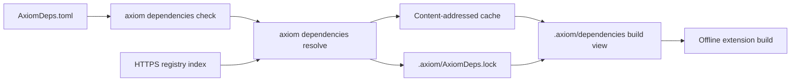

<span id="resolve-and-verify" />

Extension dependencies are third-party packages compiled into an
[extension](/extensions): Rust crates, npm packages or pure Python wheels. They
are build inputs, not runtime capabilities, so a package never grants an
extension any authority. Like the rest of the extension workflow, this surface
is <StatusBadge status="experimental" />.

You declare packages under one extension in `AxiomDeps.toml`. Axiom resolves
the complete graph once per compatible environment, verifies immutable bytes,
writes a canonical lock and materializes a content-addressed build view.
Sharing bytes between extensions never shares guest memory, instances,
permissions, handles or audit streams.



`check` validates the manifest without network access. `resolve` reads each
declared registry index, downloads the exact versions, verifies their digests
and writes the lock. Source builds then use only the verified, locked bytes and
never fetch.

## Example

```toml title="AxiomDeps.toml"
type = "frontend"
targets = ["web", "server"]

[dependencyEnvironments.rust-release]
language = "rust"
profile = "release"
runtimeVersion = "1.82.0"
toolchainSha256 = "<64 lowercase hex characters>"
engine = "cargo"
engineSha256 = "<64 lowercase hex characters>"
abi = "axiom-extension-abi@1.0.0"
sdk = "axiom-extension-sdk@0.1.0"
bindingSchema = "axiom-sdk-interface-ir/v1"
targetFamily = "wasm32"

[dependencyRegistries.crates]
language = "rust"
index = "https://packages.example/rust-index.json"
allowedHosts = ["packages.example"]

[dependencyPolicy]
approvedRegistries = ["crates"]
forbiddenLicenses = ["AGPL-3.0-only", "GPL-3.0-only"]
allowedAdvisories = []
allowPackageScripts = false
allowDuplicateVersions = false
allowUnsupportedPackageForms = false

[extensions.pricing]
language = "rust"
source = "logic/pricing.rs"
exports = ["apply_discount"]
targets = ["web", "server"]
environment = "rust-release"

[extensions.pricing.packages.portable-money]
version = "1.0.0"
registry = "crates"
```

Replace each placeholder with a real lowercase 64-digit SHA-256; `check`
rejects anything else. The registry URL is illustrative.

## Manifest sections

### `[dependencyEnvironments.<name>]`

A named, reproducible compiler and runtime environment. All fields except
`options` are required.

| Field | Meaning |
| --- | --- |
| `language` | `rust`, `typescript` or `python`; must match the extension. |
| `profile` | Compiler-defined compatibility profile, for example `release`. |
| `runtimeVersion` | Exact semantic runtime version. |
| `toolchainSha256` | SHA-256 of the selected toolchain. |
| `engine` | Guest engine identity. |
| `engineSha256` | SHA-256 of the engine. |
| `abi` | Guest ABI identity, for example `axiom-extension-abi@1.0.0`. |
| `sdk` | Guest SDK identity, for example `axiom-extension-sdk@0.1.0`. |
| `bindingSchema` | Compiler binding schema identity. |
| `targetFamily` | Guest target family; source builds require `wasm32`. |
| `options` | Optional string-to-string table owned by the environment. |

Source builds in CLI 0.149.1 also require:

| Language | Required environment values |
| --- | --- |
| Rust | `abi` starts with `axiom-extension-abi@`, `sdk` starts with `axiom-extension-sdk@` |
| TypeScript | `engine = "javy@9.1.0"`, `sdk` is `@axiomcore/extension-sdk@0.1.0`, `@0.1.1` or `@0.1.2` |
| Python | `engine = "axiom-python-aot-javy@0.1.0"`, `runtimeVersion = "3.12.11"`, `sdk` is `axiom-extension-sdk@0.1.0` or `@0.1.1` |

### `[dependencyRegistries.<alias>]`

| Field | Required | Meaning |
| --- | --- | --- |
| `language` | Yes | Ecosystem the registry serves; requirements must use the same language. |
| `index` | Yes | HTTPS URL of an `axiom-language-registry-index/v1` document. |
| `allowedHosts` | No | Hosts the resolver may contact. |
| `allowRedirects` | No | Whether the resolver follows redirects. |

The index lists, for each package version, the artifact URL, SHA-256, byte
length, dependencies, licenses, advisories and scripts. The alias (for example
`crates`) is only a name; it does not point at a public registry by itself.

### `[extensions.<alias>.packages.<name>]`

| Field | Required | Meaning |
| --- | --- | --- |
| `version` | Yes | Exact version. Ranges and floating tags are rejected. |
| `registry` | Yes | A declared registry alias with the same language. |
| `features` | No | Rust features. |
| `extras` | No | Python extras. |
| `markers` | No | Python environment markers. |
| `targets` | No | Restrict the requirement to some targets. |

The extension must also set `environment` to a declared environment of the
same language. A Rust extension that declares packages fails to build until
`axiom dependencies resolve` has written the lock.

### `[dependencyPolicy]`

Policy is checked offline. Declaring it never installs packages or runs scripts.

| Field | Meaning |
| --- | --- |
| `approvedRegistries` | Registry aliases allowed in a release. Each must be declared. |
| `forbiddenLicenses` | License identifiers that fail review. |
| `allowedAdvisories` | Advisory identifiers you accept. |
| `allowPackageScripts` | Whether package-script requests are allowed. Scripts are never executed. |
| `allowDuplicateVersions` | Whether one package may appear in several versions. |
| `allowUnsupportedPackageForms` | Whether otherwise unsupported package forms are allowed. |

Every list in `AxiomDeps.toml` must be sorted and unique, for example
`forbiddenLicenses = ["AGPL-3.0-only", "GPL-3.0-only"]`.

## Versions and conflicts

Versions are exact. If two extensions in one compatible environment request
different exact versions of the same package, resolution fails and names both
extensions. Axiom never picks a winner or creates a second environment by
accident. Two extensions that request the same exact version share the
verified bytes and keep separate instances, permissions and audit identities.

<span id="supported-subsets" />

## Supported package forms

| Ecosystem | Accepted | Rejected examples |
| --- | --- | --- |
| Rust | Reviewed `.crate` source packages compatible with the pinned WebAssembly environment | Extension-local Cargo or workspace control, build scripts, native links, proc macros, Git or path dependencies, undeclared features, one package name from several registries in one environment |
| TypeScript | Integrity-locked `.tgz` packages that are pure, statically bundleable ESM | Lifecycle scripts, native `.node` add-ons, CommonJS or dynamic loading, Node, DOM, process or network assumptions, `eval` or `Function` |
| Python | Exact pure-Python `py3-none-any.whl` wheels accepted by the restricted ahead-of-time profile | Native or platform wheels, source distributions, build backends, ambient stdlib, reflection, dynamic imports, unsupported syntax |

Archives with path traversal, unsafe links, the wrong identity, length or
digest fail before compilation. Package scripts are recorded for review and
never run. Python wheels are parsed, never installed or executed.

## Commands

| Command | Purpose | Defaults |
| --- | --- | --- |
| `axiom dependencies check` | Validate the whole v2 manifest without fetching. | `--deps AxiomDeps.toml`, `--json` |
| `axiom dependencies format` | Print the canonical form; `--check` fails if it would change, `--write` replaces the file. | `--deps AxiomDeps.toml` |
| `axiom dependencies migrate` | Convert a v1 manifest to strict v2; prints by default, `--out <file>` or `--write`. | `--deps AxiomDeps.toml` |
| `axiom dependencies schema` | Print the `AxiomDeps.toml` v2 JSON Schema. | |
| `axiom dependencies completions` | Editor completion candidates for a TOML path. | `--path ""`, `--json` |
| `axiom dependencies hover <path>` | Explain one field, for example `extensions.pricing.permissions`. | `--json` |
| `axiom dependencies resolve` | Resolve exact graphs, fill the cache, write the lock and the build view. | `--deps AxiomDeps.toml`, `--lock .axiom/AxiomDeps.lock`, `--workspace-view .axiom/dependencies`, `--cache`, `--locked`, `--offline`, `--json` |
| `axiom dependencies verify` | Validate the lock and every cached byte it references. | `--lock .axiom/AxiomDeps.lock`, `--cache`, `--json` |
| `axiom dependencies inspect` | Explain environments, provenance, licenses, advisories and package scripts. | `--lock .axiom/AxiomDeps.lock`, `--json` |
| `axiom dependencies cache verify` | Check every cache object. | `--cache`, `--json` |
| `axiom dependencies cache prune` | Remove objects not referenced by the given locks. Requires at least one `--lock`; refuses an unhealthy cache. | `--cache`, `--lock` (repeatable), `--json` |
| `axiom dependencies cache recover` | Quarantine corrupt objects and download the exact locked bytes again. Needs the network. | `--lock .axiom/AxiomDeps.lock`, `--cache`, `--json` |

The cache defaults to `axiom/dependencies/v1` inside your user cache directory
(for example `~/Library/Caches` on macOS or `~/.cache` on Linux). Pass
`--cache` to use another location.

### Resolution modes

```bash title="Terminal"
axiom dependencies check
axiom dependencies resolve
axiom dependencies resolve --locked
axiom dependencies resolve --offline
axiom dependencies verify
axiom dependencies inspect
```

| Mode | Behavior |
| --- | --- |
| `resolve` | Reads registry indexes, downloads and verifies bytes, writes the lock. |
| `resolve --locked` | Requires the existing lock and cache; never resolves or fetches. |
| `resolve --offline` | Reuses the existing lock and cache without network access. |

Locked and offline modes fail if the lock is missing, for example
`--offline requires an existing canonical AxiomDeps.lock`. Missing or corrupt
locked content fails closed; recover it explicitly with
`axiom dependencies cache recover`.

<span id="release-policy-and-inspector" />

## Release review with Inspector

```bash title="Terminal"
axiom inspect dependencies .
axiom inspect security .
axiom inspect provenance portable-money .
axiom inspect impact portable-money . --against release.snapshot.json
axiom inspect release-check . --enforce
```

Inspector shows the package graph, environment, compiler or interpreter
engine, SDK, ABI, hashes, licenses, advisories, scripts, the extensions that
introduce each package, authority consequences, targets, artifacts and
releases. Findings have stable rule codes and evidence; there is no opaque
security score. See [Changes and impact](/inspector/changes-impact-and-ci).

## Examples

The public examples repository has two resolver cases in
`axiom-extension-language-samples/dependencies`: `shared`, where two extensions
share `portable-money@1.0.0`, and `conflict`, where they request `1.0.0` and
`2.0.0` in one environment and resolution fails. Their registry URLs are
illustrative, not live endpoints.

```bash title="Terminal"
git clone --depth 1 https://github.com/AxiomCore/examples.git
cd examples/axiom-extension-language-samples/dependencies/shared
axiom dependencies check
```

```text title="Expected output"
Valid AxiomDeps.toml v2: AxiomDeps.toml
Canonical manifest: <sha256>
0 contract(s), 0 Axiom package(s), 2 extension(s), 1 build environment(s).
```
