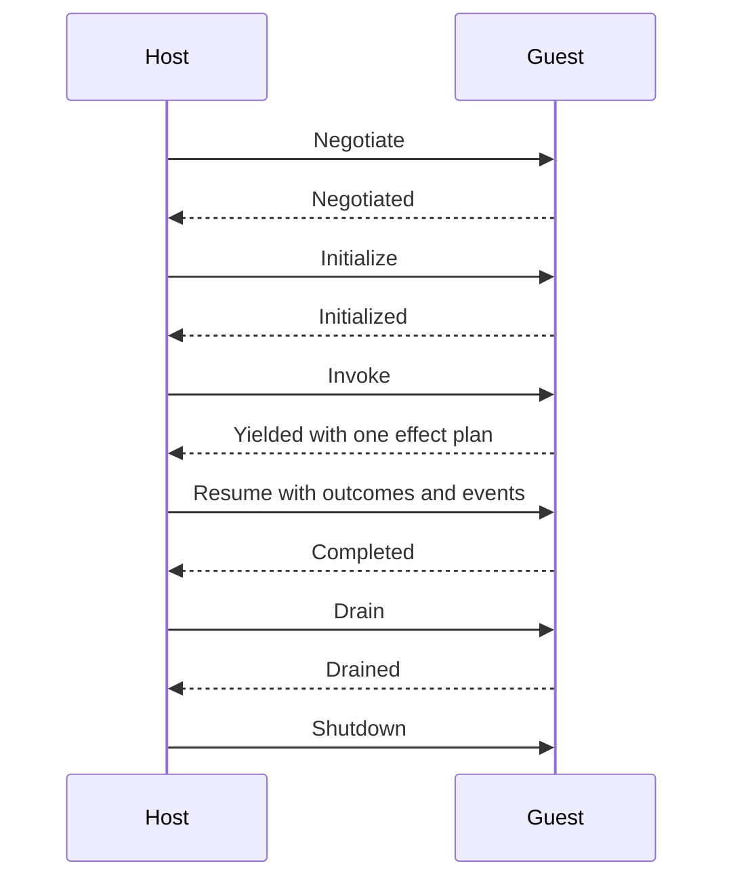

import { Tab, Tabs } from 'fumadocs-ui/components/tabs';

<span id="status-and-compatibility" />
<span id="language-sdk-model" />
<span id="source-authored-application-flow" />
<span id="reproducible-acceptance-evidence" />
<span id="shared-data-contracts" />
<span id="owned-operations" />
<span id="bounded-stream-decoder-candidate" />

<StatusNote status="experimental" title="No stable compatibility promise yet">
  Executable extensions are Experimental. None of the package, ABI, SDK,
  engine, broker, policy or host interfaces has a stable-major compatibility
  promise. Pin every identity below in your release provenance.
</StatusNote>

This page lists the exact surfaces of executable extensions for Axiom CLI
0.149.1. For a walkthrough, see [Build an extension](/extensions/build). For
every command flag, see [axiom extensions](/tooling/cli-extensions).

## Versions and identities

| Item | Value |
| --- | --- |
| Package payload | `axiom-extension/v2`; `axiom-extension/v3` for [selected interfaces](#selected-interfaces) |
| Wire ABI | `axiom-extension-abi@1.0.0`, `AXE1` frames. Published Rust crate: 1.0.4. |
| Rust SDK | `axiom-extension-sdk` on crates.io (uses `axiom-extension-sdk-derive` and `axiom-extension-abi`). Latest 0.1.4; CLI 0.149.1 builds with 0.1.0, 0.1.1 or 0.1.2. |
| TypeScript SDK | `@axiomcore/extension-sdk` on npm. Latest 0.1.3; CLI 0.149.1 builds with 0.1.0, 0.1.1 or 0.1.2. |
| Python SDK | `axiom-extension-sdk` on PyPI. Latest 0.1.3; CLI 0.149.1 builds with 0.1.0 or 0.1.1. |
| Rust engine | `wasmi@2.0.0` |
| TypeScript engine | `javy@9.1.0+wasmi@2.0.0`; build tools `tsc` 7.0.2 and `esbuild` 0.28.2 |
| Python engine | `axiom-python-aot-javy@0.1.0+javy@9.1.0+wasmi@2.0.0`; compiler frontend Python 3.12.11 |
| Broker and host | `axiom-extension-broker@0.1.0`, `axiom-extension-host@0.1.0` |
| Module media type | `application/wasm`, distributed separately from the package |

The module's SHA-256 and byte length must match the package, the package lock,
the authority lock and the target host handoff.

## Commands

`axiom extensions` has 19 subcommands. The full flag list is in
[axiom extensions](/tooling/cli-extensions).

| Stage | Subcommands | Behavior |
| --- | --- | --- |
| Author | `prepare-ide`, `interface`, `interface-diff`, `rust-inspect`, `typescript-inspect`, `python-inspect`, `migrate-rust` | Read `AxiomDeps.toml` and never compile or run a guest. `prepare-ide` writes Rust, TypeScript, Python and Go editor helpers under `.axiom/extensions/ide/<alias>/`. `interface --authority-lock <lock> --target <t>` shows the target-effective surface. |
| Build and release | `source-build`, `source-release`, `build`, `sign`, `resolve` | Source commands write under `.axiom/extensions`; `source-build` defaults to `--target web`, `source-release` requires `--application`. `build` encodes a hand-written package draft (JSON). `sign` writes a detached `axiom-package-proof/v1` from a hex-encoded 32-byte Ed25519 seed. `resolve` is `axiom packages resolve`. |
| Review | `verify`, `inspect`, `permissions`, `graph`, `test`, `diff` | Read `AxiomExtensions.toml` offline. `test` also fails when an extension has no executable target. `diff` compares two authority locks and accepts only `--approve permission-increase`. |
| Run | `run` | Prints the verified handoff for `--target` (default `server`) without running guest code. `--export` runs one export in the server reference host with a 1,000 ms deadline and prints an `axiom-extension-audit-export/v1` document; `--audit-out` saves it for `axiom inspect import-audit`. Server target only. |

## AxiomDeps.toml fields

Declare each extension under `[extensions.<alias>]`. Aliases are stable names
that Acore imports.

| Field | Required | Meaning |
| --- | --- | --- |
| `language` | Yes | `rust`, `typescript` or `python`. |
| `source` | Yes | Entry file relative to `AxiomDeps.toml` (`.rs`, `.ts` or `.mts`, `.py`). Paths cannot escape the project. |
| `exports` | Yes | Export names Acore may bind. |
| `targets` | Yes | Subset of the application `targets`. |
| `interface` | No | A separate `.json` selection file, at most 256 KiB, that narrows input and output types. Adds no authority. |
| `environment` | No | A [dependency environment](/extensions/dependencies) with the same language. |
| `packages` | No | Exact third-party packages. They grant no runtime authority. |
| `dependencies` | No | Other extension aliases this module depends on. |
| `sharedSources` | No | Extra source files or directories compiled with the entry. Sharing source never shares instances or grants. |
| `permissions` | No | Requested authority. Omitted means denied. |

Lists are sorted and unique. Targets use the order `android`, `ios`, `web`,
`server`. The top level uses `type = "frontend"` (or `backend`) or the legacy
`format = "axiom-deps/v2"`; `axiom dependencies migrate` converts v1
manifests. A field named in `ui-state` permissions must exist in the page's
local `.acore` state.

### Permissions

| Table | Keyed by | Accesses |
| --- | --- | --- |
| `permissions.ui-state.<scope>` | UI state scope | `read`, `write`, `dispatch`, `subscribe` (field names) |
| `permissions.backend-store.<alias>` | Backend store alias | `read`, `write`, `insert`, `remove`, `action`, `subscribe` |
| `permissions.contract-runtime.<alias>` | Contract alias | `query`, `mutation`, `command`, `batch`, `stream` (operation names) |
| `permissions.runtime` | (list) | `auth.context`, `clock.monotonic`, `clock.wall`, `logging.debug`, `logging.error`, `logging.info`, `logging.warn`, `random.secure`, `session.context`, `tracing.event` |

An unknown runtime capability fails binding generation, for example
`unsupported generated runtime permission`. A frontend export may request only
one `ui-state` scope.

<span id="authority-surface" />

## Authority model

Authority is declared per exact imported namespace and operation. The host
never infers authority from source code. An action becomes effective only when
it appears in the signed request, the application grant and the target policy.

| Group | Capabilities in the authority model |
| --- | --- |
| Contract runtime | Query, mutation, command, batch and stream operations on named services and methods |
| UI state | Read, write, dispatch and subscribe on declared scope paths |
| Backend store | Read, write, insert, remove, action and subscribe on declared object fields |
| Resources | HTTPS origin and method pairs, namespaced storage, rooted relative files, secret use, queues, logging, tracing, context, clocks and secure random |

In CLI 0.149.1, `AxiomDeps.toml` can request the first three groups and the
runtime list above. HTTPS origins, storage, files, secret use and queues have
no `AxiomDeps.toml` field.

A target policy can narrow a request but cannot add access the package did not
request. Frontend profiles deny backend-store, secret, file and private or
internal network authority unless an explicit host escalation and matching
signed inputs allow it.

### Limits and budgets

Source builds write these defaults into the package and the authority request.

| Package limit | Default | Authority budget | Default |
| --- | --- | --- | --- |
| `maxMemoryPages` | 64 (4 MiB) | `maxHostCalls` | 32 |
| `maxMessageBytes` | 65,536 | `maxReadBytes` | 65,536 |
| `maxEffects` | 32 | `maxWriteBytes` | 65,536 |
| `maxStreamBatch` | 64 | `maxMutations` | 32 |
| `deadlineMs` | 1,000 | `maxEvents` | 64 |
| | | `maxConcurrentStreams` | 4 |

Limits must be finite and non-zero, and `maxHostCalls` must be non-zero.

## Generated files

`source-release` writes these files (paths relative to `AxiomDeps.toml`):

| Path | Content |
| --- | --- |
| `AxiomExtensions.toml` | `axiom-extension-workflow/v1`: application identity, lock paths, authority lock digest, request, grant, policies and runtime identities per alias. Must sit beside `AxiomDeps.toml`. |
| `.axiom/extensions/release/<alias>/<alias>.wasm` | The module |
| `.axiom/extensions/release/<alias>/<alias>.axiom` | The extension package |
| `.axiom/extensions/release/<alias>/AxiomDeps.toml` and `AxiomPackages.lock` | Package manifest and lock for the signed package |
| `.axiom/extensions/release/<alias>/request.signed.json` | `axiom-extension-authority-request/v1` |
| `.axiom/extensions/release/<alias>/grant.signed.json` | `axiom-extension-application-grant/v1` |
| `.axiom/extensions/release/<alias>/<target>.policy.signed.json` | `axiom-extension-target-policy/v1`, one per target |
| `.axiom/extensions/release/<alias>/authority.lock.json` | `axiom-extension-authority-lock/v1` |
| `.axiom/extensions/keys/<alias>/` | Local Ed25519 keys (`package`, `request`, `grant`, `policy`), mode `0600`. Do not commit. |
| `.axiom/extensions/cache/<alias>/` | Build cache. Do not commit. |

Local keys are reused, so repeating an unchanged release does not change
signatures or locks.

## Source rules

| Language | Rejected at build time |
| --- | --- |
| Rust | `unsafe`, `extern crate`, native FFI, `#[link]`, `include!`, `include_str!`, `include_bytes!`, `env!`, `option_env!`, `#[path]` (use `sharedSources`), hand-built host bindings or selectors, exporting ABI symbols yourself. Exactly one `#[extension]` impl with at least one `#[export]`, or a legacy `fn axiom_extension()` factory, not both. |
| TypeScript | Files other than `.ts` or `.mts`; `eval(`, `new Function`, `require(`, `import(`, `process.`, `globalThis.`, `Deno.`, `Bun.`, `fetch(`, `WebSocket`, `XMLHttpRequest`, `Math.random`, `Date.now`, `node:`. Checked in source and again in the bundle. Native npm add-ons. |
| Python | Syntax outside the reviewed subset (reported with a source location), native or platform wheels, ambient stdlib, reflection, dynamic imports. |

A Rust module must be WebAssembly v1 with no imports, exactly one unshared
32-bit memory with a 64-page maximum, and the four ABI exports below. A
TypeScript or Python module is a Javy module that exports `memory` and
`_start`, declares at most 64 memory pages, and may import only these
`wasi_snapshot_preview1` functions, which the managed host supplies:
`environ_get`, `environ_sizes_get`, `clock_time_get`, `fd_close`,
`fd_fdstat_get`, `fd_read`, `fd_seek`, `fd_write`, `proc_exit`. Its runner
exchanges the same typed ABI messages with the host through bounded stdin and
stdout.

<span id="abi-lifecycle" />

## ABI

A binary frame starts with the `AXE1` magic value, carries the ABI version and
holds one typed message. The host validates frame size, magic, canonical
encoding, request IDs, pointer ranges and state transitions before it accepts
a message.



| Direction | Messages |
| --- | --- |
| Host to guest | `Negotiate`, `Initialize`, `Invoke`, `Resume`, `Cancel`, `Drain`, `Shutdown` |
| Guest to host | `Negotiated`, `Initialized`, `Completed`, `Yielded`, `Failed`, `Cancelled`, `Drained`, `Shutdown` |

A yielded invocation returns one bounded effect plan. The host validates and
runs the allowed effects, then resumes the same request with ordered effect
outcomes and event batches. The host accepts one terminal response per request.
Invalid transitions, use after shutdown, malformed frames, version mismatches,
oversize messages and duplicate terminal replies fail closed.

Error codes: `InvalidInput`, `Denied`, `Conflict`, `Exhausted`, `Deadline`,
`Cancelled`, `Host`, `Guest`, `Protocol`.

Rust guests export memory and four core WebAssembly functions:

```text title="Required guest exports"
axiom_extension_abi_version() -> i32
axiom_extension_alloc(length) -> pointer
axiom_extension_dispatch(pointer, length) -> packed length/pointer
axiom_extension_dealloc(pointer, length) -> 1 | 0
```

These are ABI details, not an application API. Authors use a language SDK and
never write JNI, Swift or Objective-C bridges or FFI pointers; those stay
trusted host details on Android and iOS. A TypeScript extension does not run
in Node or a browser realm, and a Python extension never embeds or calls host
CPython.

## SDK surfaces

| Language | Entry point | State and effects |
| --- | --- | --- |
| Rust | `use axiom_extension_sdk::prelude::*;` with `#[extension]`, `#[export]` (or `#[export(name = "...")]`), `#[derive(AxiomType)]`, `TypedInvocation`, `ExtensionResponse` | Generated `crate::axiom_bindings` module: typed `ui`, `store` and `operations` views with only the granted fields. Deterministic `Cents`, `Percentage`, `TimestampMs`, `DurationMs`, `Id`, `Revision`. |
| TypeScript | `defineExtension({ exports: { ... }, resume })` from `@axiomcore/extension-sdk` | `context.input`, `context.snapshot(resource).get(selector)`, `context.patch(resource).set/unset/increment(...).build()`, `context.effects(...)`, `context.complete(output, { patches, transactions, emitted_events })`. Branded selectors from `@axiomcore/extension-bindings`. |
| Python | `@extension.export` from `axiom_extension_sdk` | The same `Context` shape: `input`, `snapshot`, `patch`, `effects`, `complete(output, patches=[...])`. Selector stubs from `axiom_bindings`. |

Generated selectors are named `ui_<scope>_<field>`. Supported scalar state
fields carry `number`/`int`, `string`/`str` or `boolean`/`bool` types; other
fields stay generic. All three SDKs return the same completion, effect, patch,
transaction, stream, cancellation and error shapes. Language convenience never
creates authority missing from `AxiomDeps.toml`.

The Rust `Extension` trait models `initialize`, `invoke`, `resume`, `cancel`
and `shutdown`. Advanced code can import `axiom_extension_sdk::raw::*`
(`UiSelector`, `UiPatchBuilder`, `StoreSelector`, `StoreTransactionBuilder`,
`EffectPlanBuilder`). These build typed wire proposals and never mutate host
state:

```rust title="Rust excerpt: raw patch"
let discount = crate::axiom_bindings::ui_checkout_write_discount_selector::<()>();
let patch = axiom_extension_sdk::raw::UiPatchBuilder::new("checkout", revision)
    .set(&discount, axiom_extension_sdk::abi::Value::Unsigned(10))
    .build();
```

SDK assertions protect generated selector consistency; the host still
revalidates untrusted input. The Rust standard-library build includes
`axiom_extension_sdk::test::TestHost` for unit tests: it holds typed UI and
store snapshots, applies revision-checked proposals, supplies declared effect
results and records a deterministic audit trail with assertions such as
`assert_wrote` and `assert_no_denials`.

ABI integers are 64-bit. Rust keeps exact 64-bit values. Portable TypeScript
rejects integers outside the exact JavaScript number range.

<span id="state-effects-and-stream-rules" />

## State, effects and streams

An invocation receives only authorized snapshots. It can return bounded
effects, UI patches, backend transaction proposals and emitted events. The
host applies a patch only when its declared paths, types, invariants, expected
revision, effective authority, deadline and lifecycle are all valid. Patch
operations are set, unset, increment, append, compare-and-set and declared
action dispatch. Patches and transactions carry an expected revision and
commit atomically or fail with a conflict. The host records the extension and
resource identity, expected and resulting revision, paths, decision and
redacted details.

Subscription handles are opaque and scoped to one application, extension
instance, generation and permission. Delivery is ordered, bounded and
cancellable. The host can report dropped events or coalesce a subscription to
its latest event. A subscription never grants unrelated reads or writes.

Rust SDK 0.1.3 and later add a bounded stream decoder.
`Stream::<T>::bounded(handle, max_events, max_bytes)`, where `handle` is the
stream handle value, accepts 1 to 256 events and
64 to 65,536 bytes (`from_value` uses 256 and 65,536). It checks the handle and
generation, bounded nesting and contiguous sequence numbers before publishing
a batch. A malformed payload leaves sequence progress unchanged, and a terminal
handle rejects further batches. `decode_batch` rejects reported event loss;
`decode_state_batch` returns `StreamBatch<T>` with `dropped` and `terminal`
for replaceable state. Neither grants a subscription, authorizes coalescing or
certifies a durable cursor. CLI 0.149.1 builds with Rust SDK 0.1.2 at most, so
this decoder needs a later CLI.

## Failures and teardown

Business failures are separate from cancellation, deadlines, budget
exhaustion, revision conflicts, host faults and indeterminate commits. A typed
business handler cannot turn an execution abort into publishable work. Stale or
foreign generation handles fail at use even if a guest kept a copy. Duplicate
teardown is idempotent, and late proposals cannot revive an owner.

On cancellation, navigation, request completion, component removal, process
loss or shutdown, the host drains or retires the instance, invalidates handles
and rejects late work. An invalid update never replaces the last known-good
host. Native provider release keeps the primary outcome and records bounded,
safe secondary cleanup issues. Qualified hosts terminate trapped or timed-out
work and invalidate handles independently; native cooperative callbacks hold
their admission slot until they return. These guarantees come from the host
profile, not from an SDK helper or declaration.

<span id="security-and-lifecycle-limits" />

## Security and host limits

For core WebAssembly guests, native hosts run the Wasmi interpreter with no
ambient WASI, no start function, no unreviewed imports, bounded memory and fuel, recursion limits, a bounded worker
and finite teardown. The browser host runs a dedicated Worker and terminates it
on deadline or cancellation. Module identity, ABI version, application,
extension, effective authority, target, engine and limits are all part of the
cache identity.

No sandbox proves business logic correct. Also review the authority diff,
application-level authorization, data invariants, release policy and target
deployment configuration.

### Foreign web islands

A runtime-dependent web UI bundle (React, Vue or DOM) runs in an opaque-origin
iframe with a private typed message channel. It is Web-only, visibly foreign,
and cannot reach the parent document, browser credentials, direct network APIs
or undeclared host methods. It is not a native mobile WebView feature. The
bundle must be non-empty `text/javascript` of at most 16 MiB at a safe
package-relative `.js` path. Review its bundle, typed bridge, accessibility
metadata, host methods, navigation paths, resource limits, fallback,
mount/update/unmount lifecycle and Web-only target.

<span id="candidate-selected-extension-interfaces" />

## Selected interfaces

A source extension can name a project-relative `interface` JSON file
(`axiom-extension-selection/v1`) that selects pure input and output types for
its exports and requested host operations. It cannot add an export, host
operation, permission or target. The sealed output uses
`axiom-sdk-interface-ir/v2` and `axiom-sdk-interface-artifact/v2`; extensions
without a selection keep the v1 representation.

```toml title="AxiomDeps.toml"
[extensions.tools]
language = "rust"
source = "logic/tools.rs"
interface = "logic/tools.interface.json"
exports = ["normalize"]
targets = ["server"]
```

```json title="logic/tools.interface.json"
{
  "format": "axiom-extension-selection/v1",
  "types": {
    "Draft": {
      "kind": "record",
      "fields": [
        {"name": "title", "valueType": {"kind": "scalar", "value": "string"}},
        {"name": "offset", "valueType": {"kind": "scalar", "value": "signed64"}}
      ]
    }
  },
  "exports": [
    {"name": "normalize", "input": {"kind": "named", "value": "Draft"},
     "output": {"kind": "named", "value": "Draft"}}
  ],
  "imports": []
}
```

<Tabs items={['Rust', 'TypeScript', 'Python']}>
<Tab value="Rust">

```rust title="logic/tools.rs"
use crate::axiom_bindings::selected::{
    SelectedExports, SelectedExtension, Type_Draft as Draft,
};
use axiom_extension_sdk::{boxed_extension, Extension, Result, TypedInvocation};

struct Tools;
impl SelectedExports for Tools {
    fn normalize(&mut self, mut input: Draft, _: &TypedInvocation) -> Result<Draft> {
        input.title = input.title.trim().to_owned();
        Ok(input)
    }
}
pub fn axiom_extension() -> Box<dyn Extension> {
    boxed_extension(SelectedExtension(Tools))
}
```

</Tab>
<Tab value="TypeScript">

```typescript title="logic/tools.ts"
import { defineSelectedExtension } from "@axiomcore/extension-bindings";

export default defineSelectedExtension({
  normalize({ input, complete }) {
    return complete({ ...input, title: input.title.trim() });
  }
});
```

</Tab>
<Tab value="Python">

```python title="logic/tools.py"
from axiom_extension_sdk import extension
from axiom_bindings import Context_normalize

@extension.export
def normalize(context: Context_normalize):
    draft = context.input
    return context.complete({
        "title": draft["title"].strip(),
        "offset": draft["offset"],
    })
```

</Tab>
</Tabs>

Rules:

- Records reject missing or unknown fields and non-canonical ABI field order.
  Variants require exactly the selected case and payload.
- Signed positive numbers keep the signed ABI tag. Managed number profiles
  reject integers outside the exact JavaScript range; Rust keeps exact 64-bit
  integers.
- Pure values have finite nesting and work, a 64 KiB boundary and at most 256
  list or byte items. Host handles and recursive type graphs are rejected.
  Scalar and list ports use a named alias.
- These checks do not validate host authority or commit proposals; the broker
  does both.
- CLI 0.149.1 requires exactly Rust SDK 0.1.2 or TypeScript SDK 0.1.2 for a
  selected interface. Python uses the `axiom-python-aot-javy-selected@0.2.0`
  profile and checks source with `pyright` 1.1.408 (set `AXIOM_PYTHON_PYRIGHT`
  to override its location) before lowering; `python-inspect` needs it too.
- Selected packages use `axiom-extension/v3` with the exact signed interface
  and a separately identified interpreter budget and build profile. The
  current profile rejects snapshots, patches, transactions and emitted events.
  Browser and mounted mobile hosts need their own qualification.

### Named continuations

A selection can declare a finite continuation: an export, a pure state type
and named branches that refer to already requested call operations. For
example, `load: Key -> Draft` can declare `loaded`, carry `Key` as its state,
and name a `catalog.lookup` branch `task`:

```typescript title="TypeScript excerpt"
import { defineSelectedExtension } from "@axiomcore/extension-bindings";

export default defineSelectedExtension({
  load(context) {
    return context.effects.loaded(context.input, { task: context.input });
  },
  resume: {
    loaded(context) {
      const task = context.outcomes.task;
      if (task.case === "ok") return context.complete(task.value);
      return context.complete({ title: "Safe failure" });
    }
  }
});
```

Rust receives generated `Step_load`, `Calls_loaded` and `Outcomes_loaded`
types. Python uses `Context_load` and `Resume_loaded` stubs with
`@extension.export` and `@extension.resume`; the `resume` decorator is in the
Python SDK stubs from 0.1.2.

The host owns the invocation identity and continuation state. It checks every
branch before dispatch and every outcome before the authored resume runs. The
control descriptor is never dispatched or charged as a host call. A resume can
complete once; a second yield, stale identity, unknown branch or malformed
payload retires the guest. Fresh managed instances recover state from the host
envelope. General async code and persistent authored heaps are outside this
profile.

The shared language server completes and navigates the `interface` field.
`prepare-ide` emits typed helper files for native tools. Changing the
selection invalidates the prepared interface; editing never runs a guest or
grants permission.

## Effect groups and batching

Rust SDK 0.1.3 and later add `ExtensionResponse::yield_group(EffectGroup)` for
a finite, host-owned group of effects. The group descriptor is versioned, has
named branches, an explicit limit of 1 to 8 and fail-fast or collect mode, and
resume outcomes keep declaration order. A host must explicitly support groups;
other adapters reject before any I/O. Groups initially accept granted contract
queries and share finite host-call and byte capacities. Cancelling a group
drains started work before resume. A guest cannot expand root budgets or gain
retry or scheduling authority, and ordinary effect plans stay sequential. CLI
0.149.1 builds with Rust SDK 0.1.2 at most, so groups need a later CLI. For
owned operations in Acore, see
[Managed logic and concurrency](/acore-language/managed-language).

Backend `batchPolicy` aggregation (see [Integrations](/backend/integrations))
is a host facility under explicit deployment grants. A `Batch` capability
declaration alone does not aggregate requests or grant a private batch
operation. A guest receives only the selected or explicitly granted
interfaces.

## Checked values

The TypeScript SDK (0.1.2 and later) exports `@axiomcore/extension-sdk/schema`
and `@axiomcore/extension-sdk/selected`. The schema helper consumes selected
validation, codec and failure descriptors: it validates and normalizes drafts,
collects safe issues and decodes only selected public failure cases. Guest
validation is advisory and grants nothing. The broker independently validates
results and proposals, typed failure payloads are checked before public
projection, and private configuration and opaque secret handles never become
guest values. The published Rust SDK has no `schema` feature.

## Source preview

<StatusNote status="experimental" title="Not in CLI 0.149.1 or the published SDKs">
  These behaviors exist in unreleased source. Do not rely on them until a
  release lists them.
</StatusNote>

- Guests also export an optional
  `axiom_extension_last_error() -> packed length/pointer | 0`. When a dispatch
  is rejected or the guest traps (for example on a failed SDK assertion or a
  panic), the host reads at most 1 KiB of UTF-8 text from it and appends it to
  the reported error. Hosts that do not know the export ignore it; the wire
  format is unchanged.
- After the guest acknowledges `Drain`, the only accepted host message is
  `Shutdown`.
- TypeScript receives 64-bit values above `Number.MAX_SAFE_INTEGER`, including
  opaque handle IDs, as exact `bigint` values or exact decimal strings, never
  rounded. `encodeValue` accepts `bigint` and rejects a `number` outside the
  safe range. Selected interfaces keep the portable exact integer range.
- TypeScript and Python guests run on a dedicated worker per extension
  instance, never on the calling thread. The engine runs in bounded fuel
  slices, and the host checks cancellation and the deadline between slices.
  Each exchange starts from a fresh engine state. Interpreter fuel is
  calibrated separately from core WebAssembly fuel: the default allows at
  least 100,000 simple loop iterations per exchange, and the deadline, not
  fuel, bounds wall time.
- Audit records never contain secret material. Non-redacted values carry a
  keyed HMAC-SHA256 digest instead of a plain hash, so low-entropy values cannot
  be recovered by guessing. Digests compare only under the same host-managed key.

## Diagnostics

| Message or code | Cause | Fix |
| --- | --- | --- |
| `extension project needs a qualified axiom-extension-sdk version (0.1.0, 0.1.1 or 0.1.2)` | Rust SDK too new or missing from `Cargo.lock` | Pin `axiom-extension-sdk = "=0.1.2"` and run `cargo fetch` |
| `extension project needs @axiomcore/extension-sdk@0.1.0, @0.1.1 or @0.1.2` | TypeScript SDK version | Pin 0.1.2 and reinstall |
| `extension project needs axiom-extension-sdk==0.1.0 installed in its .venv` | Python SDK missing or unsupported | Install 0.1.0 or 0.1.1 into `.venv` |
| `tsc is unavailable; set AXIOM_TYPESCRIPT_TSC ...` (also `esbuild`, `javy`, `python3.12`) | Tool not on `PATH` | Install it or set the environment variable |
| `tool ... must report ...` | Wrong tool version | Install the exact version |
| `... must be sorted and unique` | Unsorted list in `AxiomDeps.toml` | Sort it, or run `axiom dependencies format --write` |
| `declares a target outside AxiomDeps.toml application targets` | Extension target not in the top-level list | Add the target at the top level |
| `declares <scope>.<field>, but the local .acore state has no such field` | Permission names a missing state field | Match the page's `state` declarations |
| `macro exports [...] do not match AxiomDeps.toml exports [...]` | Rust `#[export]` names differ from `exports` | Align the names |
| `source release currently requires dependency modules to be released separately` | `dependencies` lists other extensions | Release those first |
| `--export is currently available only for --target server` | Reference host used for a frontend target | Use `axiom run` for frontend exports |
| `AUI070` to `AUI075` | Extension import cannot be resolved: no source directory, unreadable manifest, duplicate local name, unknown alias, target or export not declared | Fix the `use extension` line or `AxiomDeps.toml` |
| `AUI076` | Typed bindings cannot be generated | See the attached message |
| `AUI077` | The local name exposes a different export | Call the imported export |
| `AUI078` | Call input is not one typed literal or declared state or operation field | Pass a single literal or field |
| `AUI079` | Export requests more than one `ui-state` scope | Bind one scope per frontend export |
| `AUI080`, `AUI081` | State scope or selector not in the permission declaration or page state | Align permissions with the page's `state` |

## Examples and evidence

The public examples repository contains a signed Rust extension
(`extension-sandbox`), Rust extensions in `axiom-shopping-app` and
`axiom-project-management-app`, compact TypeScript and Python samples
(`axiom-extension-language-samples`) and dependency resolution cases.

```bash title="Terminal"
git clone --depth 1 https://github.com/AxiomCore/examples.git
cd examples/extension-sandbox
cargo fetch
axiom run main.acore --target web
```

`cargo fetch` downloads the locked SDK, because the CLI compiles Rust guests
offline. Press **Calculate in Rust sandbox**: the status changes from
`Waiting for sandbox` to `Applied by verified Rust WASM` and the discount from
`0` to `12`. The repository builds and runs its three Rust extension examples on web with
each released CLI. Its TypeScript and Python samples are preview fixtures that
are checked for bindings and compilation, not run as WebAssembly. Some
examples still use the v1 manifest format and the legacy raw Rust surface;
`axiom dependencies migrate` and `axiom extensions migrate-rust` convert them.

Current conformance evidence covers server and headless, Chromium Worker,
Android Emulator and iOS Simulator. It does not certify physical mobile
devices, app-store distribution, durable production-store adapters or all
browser engines.
