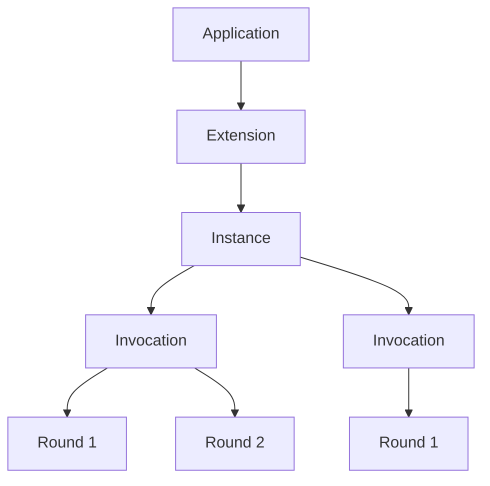

<StatusNote status="experimental" title="Executable extensions are Experimental">
  This page describes the extension host and build tooling that ship with
  extension SDK 0.1.5. Host interfaces have no stable compatibility promise
  yet.
</StatusNote>

[Extensions](/extensions) explains the core model: a signed module runs in a
WebAssembly sandbox and can only ask the host to act within the intersection
of its authority request, the application grant and the target policy. This
page covers four further guarantees: how long a handle lives, how a host
supplies its services, what a compiler can reach while it builds your
extension, and which engine runs the result.

## Scopes and handles

The host tracks every extension instance as a tree of **scopes**:

The application, extension and instance scopes exist as long as the loaded
extension. Each invocation gets its own scope, and each effect round of an
invocation gets a child scope. A host can also group invocations under a
capability scope of its own, for example one per signed-in session.

### What a handle is tied to

A **handle** is the opaque reference a guest receives for a stream, a
subscription or a secret. Every handle has one owner scope, fixed by the host
when it creates the handle. A handle works only from its owner scope or a
scope below it, and only while the owner is open. The guest cannot move a
handle to another scope; it only ever names the handle.

| Handle | Owner | Lifetime |
| --- | --- | --- |
| Stream, queue or state subscription, secret acquired by the extension, in an ABI 1.1 module | The invocation | All rounds of that invocation, never a later invocation |
| The same in an ABI 1.0 module | The instance | Unchanged from earlier releases: a warm instance can keep a stream across invocations |
| Secret injected by the host | The capability scope the host names | Until the host releases that scope |
| Pending host operations of a round | The round | Until the round's plan has run |

No handle a guest can see is tied to a single round. A handle that arrives as
the result of a call is given back to the guest from the tape in every later
round of the same invocation (see [Async exports and effect rounds](/extensions/async-rounds)).

Using a handle outside its scope fails:

| Misuse | Error code | Guest sees |
| --- | --- | --- |
| The owner scope has closed | `AXIOM_EXTENSION_BROKER_SCOPE_CLOSED` | `InvalidInput` |
| The handle belongs to another invocation or capability scope | `AXIOM_EXTENSION_BROKER_SCOPE_MISMATCH` | `InvalidInput` |

ABI 1.0 guests keep the error they received before (`AXIOM_EXTENSION_BROKER_STALE_HANDLE`)
for the same misuse; the check itself is the same. Every refusal is audited as
`denied`.

### What closing a scope guarantees

A scope closes when its invocation ends (completed, failed, cancelled, out of
budget, past its deadline), when the caller drops the invocation, when the
host releases a capability scope, or when the extension shuts down. Closing a
scope:

1. closes every scope below it first, newest first;
2. cancels the scope's in-flight host operations. A host handler that is still
   running is abandoned, the operation fails as `Cancelled`, and its late
   result is never used;
3. removes every handle the scope owns, so a later use fails with
   `AXIOM_EXTENSION_BROKER_SCOPE_CLOSED`;
4. writes one audit record per closed scope with the reason (for example
   `Completed`, `GuestFailed`, `Deadline`, `Cancelled`, `Abandoned`);
5. runs every host cleanup callback registered on the scope exactly once, even
   if another callback panics.

Closing is idempotent. If the engine has to retire an instance (for example
after a trap), the instance scope closes with reason `Retired`, so every
instance-wide handle of an ABI 1.0 module ends at once.

## Layered host services

<StatusNote status="experimental" title="For host integrators">
  This section matters only if you embed the extension host in your own
  server or application.
</StatusNote>

A host supplies the operations the broker dispatches through one handler per
capability: contracts, logging and tracing, clock, random, storage, network,
files, queues, and UI and store state (one handler, because a commit spans
both). Handlers come in two layers:

- an **application layer**, used by every invocation;
- an optional **session layer** per session, used by invocations that run in
  that session.

The nearest layer that provides a capability handles it. A capability that no
layer provides is refused with `AXIOM_EXTENSION_BROKER_NO_HANDLER` (`Denied`);
there is no fallback. A host that sets no layers behaves exactly as before.

Layers decide **who implements** an operation the broker has already
authorized, never **whether** it is allowed:

- Grant checks, revocation, handle scope checks, budgets, reply-size checks,
  audit records, spans and the round tape all run in the broker around the
  handler.
- A handler receives only the typed call, the remaining limits and a
  cancellation signal. It never receives a grant, another scope's handle or a
  secret handle; the network handler gets the validated secret name.
- A session layer cannot add capabilities to the grant or see another
  session's secrets.
- A handler that never answers holds nothing: the broker abandons it when its
  scope closes.
- Clock and random answers are effect results. They are recorded on the tape
  and replayed, not asked again.
- A call on an existing subscription goes to the handler that opened it, even
  if the session's layer has changed since.

## Build sandboxes

Building an extension from source runs compilers on code you may not fully
trust: your dependencies, their build-time code, or a hostile source file. On
macOS and on Linux, every compiler step runs in an operating-system sandbox.
The steps are `tsc`, `esbuild`, Javy, the Python compiler, `pyright` and the
Cargo and `rustc` steps of a Rust build.

| A compiler step | Can | Cannot |
| --- | --- | --- |
| Files | Read its inputs and toolchain; write only its own build workspace and output directory | Read credential stores (for example `~/.ssh`, `~/.aws`, `~/.netrc`, `~/.npmrc`, `~/.config/gh`, `~/.docker`, `~/.kube`, `~/.gnupg`, browser profiles, the macOS keychain, Axiom keys and sign-in files), any `.env*` file, `AxiomSecrets.toml` or the files it names, or other builds' outputs |
| Network | Nothing | Open any connection. Builds are offline; dependencies come from the lock and the local cache. |
| Environment | A cleared environment with only what the step needs | Inherit your shell variables or helper programs from `PATH` |

On Linux the sandbox uses user, mount, network and PID namespaces and a
seccomp filter, set up without helper programs. On macOS it uses a
`sandbox-exec` profile.

A Rust source build also:

- runs with the working directory `/` and reads **no** Cargo configuration file,
  so a project `.cargo/config.toml` (custom linkers, runners, rustflags,
  registries, patches) has no effect;
- pins the toolchain to the `rustc` found on your `PATH` at the start and
  ignores `RUSTC_WRAPPER` and similar overrides;
- refuses path dependencies outside the project, except the extension SDK
  itself. A path-pinned SDK is copied into the build workspace, so the build
  never reads the rest of the directory it came from.

### Reproducible, location-independent modules

A module built from source depends only on its inputs: the authored sources,
the generated bindings, the SDK's content and version, the locked dependency
archives, the toolchain and the build policy. It does not depend on where the
project, the SDK, the build output or your home directory are on disk. No
absolute path, and so no user name or directory layout, ends up in a module,
package or source lock.

Rust sources must not use `env!` or `option_env!`, and the SDK does not, so
build-time paths cannot be embedded that way. The only fixed paths inside
TypeScript and Python modules belong to the pinned Javy 9.1.0 release itself
and are the same on every machine.

Moving to this release changes the module hash of a Rust source extension
once; see [Upgrade an existing project](/extensions/upgrade).

## Engine

Native hosts run extension modules on the Wasmi 2.0.2 interpreter, with fuel
metering, bounded memory, no WASI for core modules and no start function.
TypeScript and Python modules run Javy 9.1.0 on the same engine.

Wasmi 2.0.0 and 2.0.1 had interpreter translation bugs that could return
wrong values or stop the host while it loaded a module. 2.0.2 fixes them.
No shipped or buildable extension module was affected, and no extension
result changed. Configurations signed with the `wasmi@2.0.0` engine identity
are still accepted and deprecated; `wasmi@2.0.1` identities are not accepted.

## Next steps

- [What an extension can do](/extensions/effect-summaries) for static effect summaries and audit sites
- [Artifact trust](/core-concepts/trust-and-security) for signatures and locks
- [Extension reference](/extensions/reference) for limits and budgets
