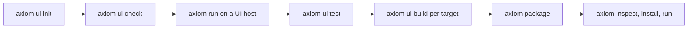

<span id="1-create-or-inspect-a-source-only-app" />
<span id="3-run-the-development-targets" />
<span id="dispose-owners-and-reject-stale-work" />
<span id="a12-candidate-contract-aware-forms-and-uncertain-writes" />
<span id="a12-candidate-logical-submission-and-resolution" />

This guide takes one Acore UI app from a starter to a packaged `.axiomapp`
artifact. It covers the `axiom ui` commands, the UI hosts that render each
target, and compiler and host compatibility. For every flag, see the
[axiom ui reference](/tooling/cli-ui).

<StatusNote status="alpha" title="Acore UI targets">
  Web, Android Emulator and iOS Simulator development paths are **Alpha**.
  Physical devices, app-store signing and publishing, and Axiom Marketplace
  distribution are **Coming soon**.
</StatusNote>



You create source, check it per target, run it on a host while you edit, test
it, then build one deterministic `.axiomapp` per target. `axiom package`
combines target builds into one multi-target artifact.

## Targets and UI hosts

A **UI host** is the signed shell that renders compiled Acore UI. Hosts are
installed outside your workspace and verified before use.

| Target | Host (release 0.6.12) | Also needs | Status |
| --- | --- | --- | --- |
| `web` | Browser host | A browser | **Alpha** |
| `android` | Android Emulator development host | A running Android Emulator | **Alpha** |
| `ios` | iOS Simulator host | A running iOS Simulator (macOS with Xcode) | **Alpha** |

`--target` defaults to `ios` for every `axiom ui` command and for `axiom run`
on Acore source. Pass `--target web` for browser work.

Host 0.6.12 was checked with CLI 0.149.0 on macOS arm64. A host older than
your CLI can fail even when both are installed.

```bash title="Terminal"
axiom ui host install --target web --version 0.6.12 --non-interactive
axiom ui host status --target web
```

| Command | Use it to |
| --- | --- |
| `axiom ui host install` | Install a host. `--version` picks an exact signed release, `--offline` uses a signed local manifest or retained version, `--release-manifest` names a manifest, `--non-interactive` fails instead of prompting. |
| `axiom ui host status` | Show the installed host for a target. |
| `axiom ui host recover` | Restart the development host and discard stale delivery records. |
| `axiom ui host rollback` | Restore a retained signed host that is compatible with the current CLI and bundles. |
| `axiom ui host quarantine --version V --incident ID` | Exclude a host release with a rendering regression from automatic selection. |

The first `axiom run` on a target offers to install the latest verified host.
`axiom ui build` refuses to build without the target's host
(`AXIOM_UI_HOST_MISSING`).

## 1. Create a starter

```bash title="Terminal"
axiom ui init my-app --target web
cd my-app
```

```text title="Output"
Created authored Acore UI starter at my-app. Next: axiom run src/main.acore --target web
```

The directory must be empty. The starter contains only authored files:
`axiom.app.toml`, `src/main.acore`, `tests/smoke.acore` and a `README.md`.
The compiler keeps UI IR, generated source, CSS and source maps in memory, so
edit the `.acore` source only.

<span id="2-check-target-capabilities" />

## 2. Check each target

```bash title="Terminal"
axiom ui doctor --target web
axiom ui capabilities --target web
axiom ui check src/main.acore --target web
```

```text title="Output (first lines of doctor, then check)"
Acore UI compiler: ready
Virtual graph: ready (workspace source generation disabled)
Checked UI module starter.app.ui (17 virtual read-only file(s), graph 4541...).
```

Before a host is installed, `doctor` also prints `AXIOM_UI_HOST_MISSING` for
the target with the install command to run. Repeat with `android` and `ios`. A passing web check does not prove native
parity. `axiom ui check` reads the committed lock at
`.axiom/axiom.ui.lock.json` when the source imports a contract (`--lock`
overrides the path); a missing lock fails with `AUI010`. `axiom check
src/main.acore --target web` runs the same frontend validation and never
resolves or changes a lock.

## 3. Run on a host

```bash title="Terminal"
axiom run src/main.acore --target web --port 5173
```

Open `http://127.0.0.1:5173`. Edits reload the running app; an invalid edit
keeps the last good build. For native targets, start the emulator or simulator
first, then run with `--target android` or `--target ios`.

| Option | Effect |
| --- | --- |
| `--launch` | Open the browser or simulator after the session starts. |
| `--once` | Compile once and exit, for CI and host-independent checks. |
| `--port` | HTTP port for the frontend session. |
| `--frozen` | Require reviewed locks and extension workflows; no development regeneration. |
| `--lock` | Advanced override. During development `axiom run` prepares locks automatically and rebuilds stale local Acore dependencies. |

`axiom ui run` starts only the virtual compiler and watch loop; device
rendering needs a native transport.

<span id="4-validate-behavior-not-screenshots-alone" />

## 4. Test behavior, not screenshots alone

```bash title="Terminal"
axiom ui test src/main.acore --target web
```

```text title="Output"
UI session checks passed: valid update preserved state; invalid update retained last-good graph.
```

Without `--suite`, `axiom ui test` runs compiler-session smoke checks with
zero interaction assertions. Pass an `acore-application-test/v1` suite with
`--suite`, choose `--layer reference` or `--layer adapter`, and write results
with `--report`. Neither layer launches a browser, emulator or simulator. See
[Frontend tests](/testing/frontend-applications).

On each mounted target, also check safe areas, text direction and wrapping,
local assets, focus and text selection, scroll and list behavior, pointer and
touch delivery, animation iteration and final state, and contract operation
states. For motion or input, record the interaction outcome as well as a
still image.

Read-only compiler views help with debugging:

| Command | Shows |
| --- | --- |
| `axiom ui inspect ir <source>` | The UI IR for the target |
| `axiom ui inspect lowered <source>` | Host-specific lowered output |
| `axiom ui inspect facade <source>` | The contract facade |
| `axiom ui inspect context <source>` | A bounded, redacted semantic view for tooling, not app source |
| `axiom ui inspect extensions <source>` | Extension imports traced to their action bindings, without running guest code |
| `axiom ui context <source>` | Compact semantic context for AI tooling (`--max-symbols`, default 24) |
| `axiom ui ai-check --base <revision> <source> <proposed>` | Validates a proposed replacement without writing it |

## 5. Build and package

```bash title="Terminal"
axiom ui build src/main.acore --target web
axiom ui build src/main.acore --target android
axiom ui build src/main.acore --target ios
axiom package \
  dist/starter.app.ui-web.axiomapp \
  dist/starter.app.ui-android.axiomapp \
  dist/starter.app.ui-ios.axiomapp \
  --out dist/starter.axiomapp
```

- Each build writes a deterministic, target-specific artifact. `--out`
  defaults to `dist/<module>-<target>.axiomapp`.
- `--development` permits unsigned local contracts and marks the artifact
  development-only. Release builds need Axiom Cloud signed contracts.
- `axiom package` combines intact target builds. `--out` defaults to
  `dist/application.axiomapp`. Packaging does not sign for an app store.
- Android host release builds verify their generated compiler configuration.
  Native release packages are inspected for local source paths. Android
  renderer diagnostics keep file basenames and line numbers only.

Inspect, install and run an artifact:

```bash title="Terminal"
axiom inspect dist/starter.axiomapp
axiom install dist/starter.axiomapp
axiom run dist/starter.axiomapp --target web --launch
```

`install` verifies and caches the archive; `run` can also read it directly.
`run` prompts for a target when a multi-target artifact is given without
`--target`.

<span id="continue-a-playground-application-locally" />

## Continue a playground app locally

The browser playground's **Export** button builds a portable development
`.axiomapp` for the targets you select. It contains authored sources, target
models, a local mock backend and Inspector evidence. `Frontend.acore` and
`Backend.acore` each have an **AxiomDeps.toml** tab: frontend imports live in
the frontend manifest, and the backend manifest selects its language and
audience vocabulary. Export keeps all four files, including comments and
uncompiled edits, in `source/frontend/` and `source/backend/`.

From the download directory:

```bash title="Terminal"
axiom inspect playground.axiomapp
axiom install playground.axiomapp
axiom run playground.axiomapp --target web --launch
```

`run` checks the contents, prepares the host and starts an isolated loopback
mock backend. Mock data resets on each launch. For a native target, install its
host, start the emulator or simulator, and pass that target with `--launch`.
An older CLI without playground application support reports
`AXIOM_APP_FORMAT: unsupported application format`; update the CLI.

Playground exports are development inputs, not signed native binaries.
`axiom package` combines native build artifacts and does not repackage these
exports.

## Compiler and host compatibility

CLI 0.149.1 compiles the `acore-ui/v6` profile. Every app requires
`acore-application/v2`, `acore-pure/v2`, `acore-reactive/v4`, `acore-data/v3`
and `acore-components/v1` support in the host.

| App uses | UI IR | Frontend program | Host IR reader | Extra |
| --- | --- | --- | --- | --- |
| No contract validation or typed failure cases | v10 | v1 | 10 | none |
| `FormValidation.contract` or typed failure cases | v11 | v2 | 11 | `axiom-validation-schema/v1` |

A host advertises the readers it supports, and an older host rejects newer
input before any work starts. Setting a legacy version on an app that needs the
newer graph is rejected. Contract applications also require runtime data ABI 1.
After a CLI upgrade, rebuild artifacts and install the matching host. See
[Versioning and deprecation](/reference/versioning-and-deprecation).

## Next steps

- [Acore UI reference](/frontend/acore-ui)
- [Frontend tests](/testing/frontend-applications)
- [Task app](/examples/task-app) for a full-stack web app
- [axiom ui reference](/tooling/cli-ui)
