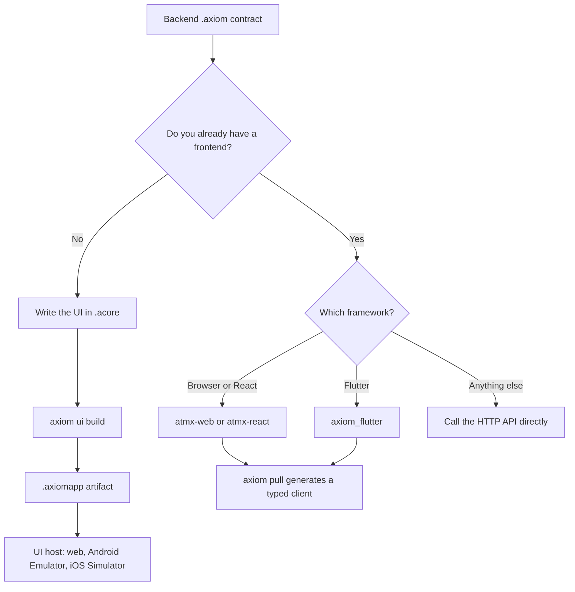

A frontend reaches your backend through its `.axiom` contract, the compiled
description of every operation, type and error the backend exposes. You can
build that frontend in two ways: write the UI itself in Acore, or keep your
existing app and call the contract through a client SDK.

## Choose a path

- **Acore UI.** You write pages, components and styles in `.acore`. The
  compiler checks them against target capabilities and a locked backend
  contract, then a UI host runs the app. A UI host is the signed browser,
  Android Emulator or iOS Simulator shell that renders compiled Acore UI. The
  build output is a target-specific `.axiomapp` artifact.
- **Client SDK.** Your React, browser or Flutter code stays as it is.
  `axiom pull` copies the contract into your project and generates a typed
  client. A runtime inside the SDK builds requests, validates responses,
  applies cache policy and attaches credentials.

| | Acore UI | Client SDK |
| --- | --- | --- |
| You write | `.acore` pages and components | Your framework code |
| Generated for you | Compiled UI, kept in memory by the CLI | `sdk.ts` and `models.ts`, or `axiom_sdk.dart` and `models.dart` |
| Runs in | Axiom UI host | Your app, with a Wasm or native runtime |
| Contract binding | `use contract` checked against a committed lock | `AxiomDeps.toml` written by `axiom pull` |
| Status | **Alpha** | Web **Available**; React and Flutter **Alpha**; Swift **Experimental** |
| Start with | [Acore UI](/frontend/acore-ui) | [Client SDKs](/sdks) |

Physical-device certification and app-store publishing are **Coming soon**
for both paths. See [Support and availability](/introduction/support-matrix).

## What every client path needs

1. A pinned `.axiom` artifact and, for a Cloud release, its signature proof.
2. A target-specific client: generated SDK code or Acore UI source.
3. Runtime configuration: where to load the contract and the backend base URL.
4. Application-owned authentication, error UI, cache privacy and startup order.

The contract is portable. The lifecycle is not. A browser client uses Wasm,
browser storage, CORS and cookie rules. Flutter uses a native runtime,
bundled contract assets and an optional cache database path. An Acore UI app
depends on its UI host version. Test every target you ship, including a release
build and a contract integrity failure.

## Other frameworks and languages

A framework without a first-party SDK can still call your backend over HTTP.
You can keep using the `.axiom` artifact for review, mocks, tests and change
control without routing production calls through an Axiom runtime. The
artifact format alone does not imply a client bridge for another stack.

## Next steps

- [Build your first UI](/getting-started/quickstart-frontend)
- [Acore UI reference](/frontend/acore-ui)
- [App lifecycle and targets](/frontend/application-lifecycle)
- [Client SDKs](/sdks) for an existing frontend
