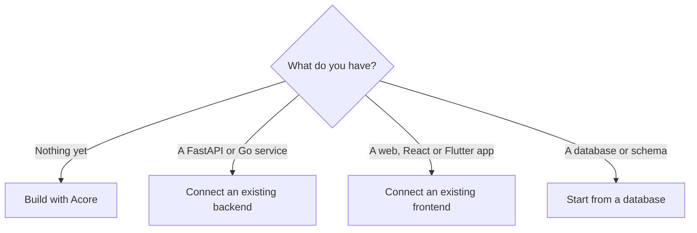

Pick the path that matches what you have today, get one part working, then add
the others. Every path starts with [installing the Axiom CLI](/getting-started/installation).
No Cloud account is needed for local work.

## Choose a path



| Path | First step | You keep | Start here |
| --- | --- | --- | --- |
| Build with Acore | Run an Acore UI and API on SQLite, then write your own | Authored `.acore` source; the generated UI host graph stays opaque | [Run your first app](/getting-started/quickstart) |
| Connect an existing backend | Extract and build a service contract from FastAPI or Go | Your Python or Go application and framework runtime | [FastAPI](/guides/fastapi-to-web) or [Go](/guides/go-to-web) |
| Connect an existing frontend | Pull a contract and generate a client for your framework | Your UI framework and application code | [Build your first UI](/getting-started/quickstart-frontend) |
| Start from a database | Write a schema in Acore, or bootstrap bounded input from OpenAPI or SQL DDL for review | Your existing schema authority and runtime | [Create your first database](/getting-started/quickstart-database) or [Existing database](/guides/existing-database) |

To share design, API or schema content between projects, build a typed `.axiom`
package and lock it in each consumer. See [Packages](/extensions/packages).

## Quickstarts

| Goal | Guide | Result |
| --- | --- | --- |
| A small full-stack app | [Run your first app](/getting-started/quickstart) | Acore UI and API with tasks stored in SQLite |
| An API | [Build your first API](/getting-started/quickstart-backend) | A running, typed endpoint |
| A UI | [Build your first UI](/getting-started/quickstart-frontend) | An Acore web app, or a client in your existing app |
| Data | [Create your first database](/getting-started/quickstart-database) | A schema, a row and a migration history |

## Let the CLI suggest a path

From your application's directory, `axiom doctor` reports prerequisites and
`axiom onboard` detects whether the repository is a backend, frontend or both
and prints the shortest supported next step. Neither command changes files
unless you ask.

```bash title="Your application directory"
axiom doctor
axiom onboard
```

In automation, pass the role explicitly:

```bash title="Terminal"
axiom onboard --role backend --entrypoint main.py:app --module axiom-fastapi
axiom onboard --role frontend --contract organization/project --framework atmx-web
```

Add `--apply` only when you want backend onboarding to create `axiom.acore`.
Onboarding never releases a contract. [Install the Axiom CLI](/getting-started/installation)
describes both commands in full.

## Boundaries to decide early

- **Authority.** Decide whether backend code, OpenAPI, SQL or authored Acore
  owns each fact. Avoid two owners for one fact.
- **Audience.** Choose the frontend projection before you lock a contract.
- **Runtime.** Decide whether your existing UI framework or Acore UI owns each
  screen. Both can consume Axiom contracts, and neither requires rewriting the
  backend in Acore.
- **Maturity.** Add an end-to-end test in your own CI for every **Alpha** or
  **Experimental** path. Check the [support matrix](/introduction/support-matrix)
  before taking a local example to another target or deployment.

## Next steps

- [Install the Axiom CLI](/getting-started/installation)
- [Run your first app](/getting-started/quickstart)
- [Use your existing stack](/guides)
- [Build a backend](/backend)
