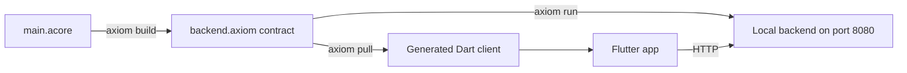

<StatusNote status="alpha" title="axiom_flutter 0.150.1 and Axiom CLI 0.156.0">
  The Flutter SDK is Alpha on Android, iOS, macOS and the web. Test release
  builds on every platform you ship.
</StatusNote>

In this tutorial you build a talks list. A small backend written in Acore
serves two endpoints, `GET /talks` and `POST /talks`. A Flutter app shows the
list and adds a talk with one button. The app calls the backend through a Dart
client that `axiom pull` generates from the backend contract, so a change to
the contract shows up as an analyzer error in the app.



## Prerequisites

| Tool | Version | Check |
| --- | --- | --- |
| [Axiom CLI](/getting-started/installation) | 0.156.0 | `axiom --version` |
| Flutter | 3.32 or newer (Dart 3.8) | `flutter --version` |
| Android | Android SDK and an emulator image for `x86_64` or `arm64` | `flutter doctor` |
| iOS and macOS | Xcode and CocoaPods | `flutter doctor` |
| Web | Chrome | `flutter devices` |

You need only the toolchain for the platform you want to run. Port 8080 must be
free.

## 1. Write the backend contract

Create a directory for the backend:

```bash title="Terminal"
mkdir -p talks/talks-api
cd talks/talks-api
```

Every backend contract needs an `AxiomDeps.toml` beside it:

```toml title="talks/talks-api/AxiomDeps.toml"
type = "backend"
targets = ["server"]
audiences = ["web"]
```

The contract declares three models, a CORS policy for the web app, and two
endpoints. Each endpoint is handled by a managed action that returns data
directly, so you need no database for this tutorial.

```acore title="talks/talks-api/main.acore"
project(id: "docs.talks", version: "1.0.0")
variant default(include: ["*"])

model Talk { id: String title: String speaker: String }
model TalkList { talks: List<Models.Talk> }
model NewTalk { title: String speaker: String }

cors(origins: ["http://localhost:5000", "http://127.0.0.1:5000"], methods: [GET, POST], headers: ["accept", "content-type", "x-axiom-request-id", "x-axiom-cache-mode", "traceparent", "tracestate"], credentials: false, maxAge: 10m)

action listTalks(kind: ActionKind.query, output: Models.TalkList) {
  managed {
    return {talks: [
      {id: "t1", title: "Typed APIs in Flutter", speaker: "Ada"},
      {id: "t2", title: "Contracts over REST", speaker: "Grace"}
    ]}
  }
}
endpoint listTalks(method: GET, path: "/talks") {
  handle(action: Actions.listTalks)
  response(type: Models.TalkList)
}

action createTalk(kind: ActionKind.command, input: Models.NewTalk, output: Models.Talk) {
  managed { return {id: "t3", title: Input.title, speaker: Input.speaker} }
}
endpoint createTalk(method: POST, path: "/talks") {
  request { body("title", type: String) body("speaker", type: String) }
  handle(action: Actions.createTalk, input: {title: Input.body.title, speaker: Input.body.speaker})
  response(type: Models.Talk, status: 201)
}
```

The `cors(...)` line matters only for the web build. It allows the origin that
the Flutter web app uses in step 7, and the request headers the SDK sends:
`accept`, `content-type`, `x-axiom-request-id` and `x-axiom-cache-mode`, plus
`traceparent` and `tracestate`, which go out on every call. If one of them is
missing, the browser's preflight request gets a 403 and the app shows no
data.

## 2. Check, build and run the backend

```bash title="Terminal: talks/talks-api"
axiom check main.acore
axiom build main.acore --out backend.axiom
axiom server deployment backend.axiom backend.server.json --output deployment.json
axiom run main.acore --deployment deployment.json --port 8080
```

```text title="Expected output (excerpt)"
Valid backend contract: main.acore
Built backend contract: backend.axiom
```

`axiom server deployment` never overwrites a reviewed file. When you repeat
this step, for example after a contract change, delete or move the old
`deployment.json` first, or the command stops with `File exists (os error 17)`:

```bash title="Terminal: talks/talks-api (only when repeating this step)"
mv deployment.json deployment.old.json
```

`axiom build` writes the contract `backend.axiom` and the server plan
`backend.server.json`. `axiom run` keeps running and prints one JSON line per
event. Leave it running and open a second terminal:

```bash title="Second terminal"
curl -s http://127.0.0.1:8080/talks
```

```json title="Expected output"
{"talks":[{"id":"t1","speaker":"Ada","title":"Typed APIs in Flutter"},{"id":"t2","speaker":"Grace","title":"Contracts over REST"}]}
```

## 3. Create the Flutter app

From the `talks` directory:

```bash title="Terminal: talks"
flutter create --platforms android,ios,macos,web talks_app
cd talks_app
```

`flutter create` writes a sample test, `test/widget_test.dart`, that refers to
the counter app's `MyApp` class. Step 6 replaces that app, so delete the test
now, or `flutter analyze` reports an error in it:

```bash title="Terminal: talks/talks_app"
rm test/widget_test.dart
```

## 4. Generate the Dart client

Add the SDK packages first. CLI 0.156.0 adds `axiom_flutter` 0.147.5 when the
app has none, and that version has no Android support:

```bash title="Terminal: talks/talks_app"
flutter pub add axiom_flutter:^0.150.1 dev:axiom_flutter_generator:^0.150.1
```

Then generate the client:

```bash title="Terminal: talks/talks_app"
axiom pull ../talks-api/backend.axiom --framework flutter --name talks --out lib/axiom_generated
```

```text title="Expected output (last line)"
✅ axiom pull finished successfully.
```

`axiom pull` does four things:

1. copies the contract to `assets/axiom/talks.axiom` and lists it under
   `flutter: assets:` in `pubspec.yaml`;
2. keeps the package versions you added (it adds them only when they are
   missing), then runs `dart pub get`;
3. writes `lib/axiom_generated/axiom_sdk.dart` and
   `lib/axiom_generated/models.dart`;
4. records the contract source in `AxiomDeps.toml` in the app directory.

CLI 0.156.0 records the source as an absolute path, for example
`source = "/path/to/talks/talks-api/backend.axiom"`, which does not work on
another machine. Before you commit the app, make it relative to the app
directory:

```toml title="talks/talks_app/AxiomDeps.toml (excerpt)"
[contracts.talks]
source = "../talks-api/backend.axiom"
```

Every pull writes the absolute path again, so repeat the edit after each pull.
Always pass the contract path to `axiom pull`, as above: without a source
argument, CLI 0.156.0 tries to resolve the contract through Axiom Cloud and
asks you to sign in.

The generated client has one module per contract (`sdk.talks`), one method per
endpoint (`listTalks()`, `createTalk(title:, speaker:)`) and one Dart class per
model (`Talk`, `TalkList`, `NewTalk`).

## 5. Set up each platform

**Android.** The runtime library is built for Android API 24, and the app must
reach your computer over plain HTTP during development.

1. In `android/app/build.gradle.kts`, set `minSdk = 24`.
2. In `android/app/src/main/AndroidManifest.xml`, add the internet permission
   inside `<manifest>`:

   ```html title="android/app/src/main/AndroidManifest.xml (excerpt)"
   <uses-permission android:name="android.permission.INTERNET"/>
   ```

3. Allow cleartext HTTP to the emulator's host address in debug builds only.
   Replace `android/app/src/debug/AndroidManifest.xml` and add a network
   security config:

   ```html title="android/app/src/debug/AndroidManifest.xml"
   <manifest xmlns:android="http://schemas.android.com/apk/res/android">
       <uses-permission android:name="android.permission.INTERNET"/>
       <application android:networkSecurityConfig="@xml/network_security_config"/>
   </manifest>
   ```

   ```html title="android/app/src/debug/res/xml/network_security_config.xml"
   <?xml version="1.0" encoding="utf-8"?>
   <network-security-config>
       <domain-config cleartextTrafficPermitted="true">
           <domain includeSubdomains="false">10.0.2.2</domain>
       </domain-config>
   </network-security-config>
   ```

The SDK ships the runtime for `arm64-v8a`, `armeabi-v7a` and `x86_64`. A
32-bit `x86` emulator image is not supported.

**iOS and macOS.** The plugin needs iOS 13 and macOS 11. CocoaPods downloads
the runtime framework and checks its SHA-256 the first time you build.

1. In `ios/Podfile`, set `platform :ios, '13.0'`. To reach the local backend
   over plain `http://`, add `NSAllowsLocalNetworking` (set to `true`) under
   `NSAppTransportSecurity` in `ios/Runner/Info.plist`.
2. In `macos/Podfile`, set `platform :osx, '11.0'`, and in Xcode set the
   macOS deployment target of the Runner target to 11.0.
3. Add the outgoing network entitlement to both
   `macos/Runner/DebugProfile.entitlements` and
   `macos/Runner/Release.entitlements`:

   ```html title="macos/Runner/DebugProfile.entitlements (excerpt)"
   <key>com.apple.security.network.client</key>
   <true/>
   ```

**Web.** Nothing to add. The WebAssembly runtime is bundled in the package.
The backend must allow the page's origin, which the `cors(...)` line in step 1
does for port 5000.

## 6. Write the app

Replace `lib/main.dart`:

```dart title="talks/talks_app/lib/main.dart"
import 'package:axiom_flutter/axiom_flutter.dart';
import 'package:flutter/foundation.dart';
import 'package:flutter/material.dart';

import 'axiom_generated/axiom_sdk.dart';
import 'axiom_generated/models.dart' as models;

late final AxiomSdk sdk;

/// The Android emulator reaches your computer at 10.0.2.2.
String backendUrl() {
  if (!kIsWeb && defaultTargetPlatform == TargetPlatform.android) {
    return 'http://10.0.2.2:8080';
  }
  return 'http://127.0.0.1:8080';
}

Future<void> main() async {
  WidgetsFlutterBinding.ensureInitialized();
  sdk = await AxiomSdk.create(baseUrlOverrides: {'talks': backendUrl()});
  runApp(const MaterialApp(home: TalksPage()));
}

class TalksPage extends StatelessWidget {
  const TalksPage({super.key});

  @override
  Widget build(BuildContext context) {
    return Scaffold(
      appBar: AppBar(title: const Text('Talks')),
      body: AxiomBuilder<models.TalkList, models.TalkList>(
        query: sdk.talks.listTalks(),
        loading: (context) => const Center(child: CircularProgressIndicator()),
        error: (context, error) => Center(child: Text(error.message)),
        builder: (context, state, list) => ListView(
          children: [
            for (final talk in list.talks)
              ListTile(title: Text(talk.title), subtitle: Text(talk.speaker)),
          ],
        ),
      ),
      floatingActionButton: const AddTalkButton(),
    );
  }
}

class AddTalkButton extends StatelessWidget {
  const AddTalkButton({super.key});

  @override
  Widget build(BuildContext context) {
    return AxiomMutationBuilder<models.Talk, String>(
      mutation: AxiomMutation(
        (title) => sdk.talks.createTalk(title: title, speaker: 'You'),
      ),
      builder: (context, state, execute) => FloatingActionButton.extended(
        onPressed: state.isMutating ? null : () => execute('My new talk'),
        label: Text(
          state.data == null ? 'Add talk' : 'Created ${state.data!.id}',
        ),
      ),
    );
  }
}
```

What the code does:

- `AxiomSdk.create()` starts the runtime and loads the contract from the asset
  bundle. It throws if the runtime or a contract fails to load, so call it
  before `runApp`.
- `baseUrlOverrides` sets the backend URL for the `talks` contract. Without it,
  the generated default `http://localhost:8000` applies. For build-time
  configuration, see [Configuration and environments](/sdks/flutter#configuration-and-environments).
- `AxiomBuilder` runs the query and rebuilds for the loading, error and data
  states.
- `AxiomMutationBuilder` runs the `POST` when you press the button. Mutations
  are never cached.

Check the code:

```bash title="Terminal: talks/talks_app"
flutter analyze
```

The analyzer reports no issues.

## 7. Run the app

Keep the backend from step 2 running.

**Android emulator:**

```bash title="Terminal: talks/talks_app"
flutter run -d emulator-5554
```

Use the device ID that `flutter devices` lists. The app calls
`http://10.0.2.2:8080`, which is your computer as seen from the emulator.

{/* VERIFY: physical Android devices, and 32-bit ARM (armeabi-v7a) hardware. The SDK suite passes on the Android emulator (arm64, API 36). */}

**iOS simulator or macOS:**

```bash title="Terminal: talks/talks_app"
flutter run -d "iPhone 16"
flutter run -d macos
```

The simulator and macOS app share your computer's network, so
`http://127.0.0.1:8080` works.

{/* VERIFY: physical iOS devices. The SDK suite passes on the iOS simulator and macOS (81 of 84 run checks; WebSocket needs the next AxiomRuntime). */}

**Chrome:**

```bash title="Terminal: talks/talks_app"
flutter run -d chrome --web-port 5000
```

Pass `--web-port 5000`. Without it, Flutter picks a random port, the origin is
not in the backend's CORS list, and every call fails with a network error.

**Verify.** The app shows two talks, **Typed APIs in Flutter** by Ada and
**Contracts over REST** by Grace. Press **Add talk**: the button changes to
**Created t3**. The backend terminal prints a `response.validated` line for
`listTalks` and one for `createTalk`.

## 8. Change the contract and re-pull

Rename the `speaker` field of `Talk` to `presenter` in `main.acore`, in the
model and in both managed actions:

```acore title="talks/talks-api/main.acore (changed lines)"
model Talk { id: String title: String presenter: String }
      {id: "t1", title: "Typed APIs in Flutter", presenter: "Ada"},
      {id: "t2", title: "Contracts over REST", presenter: "Grace"}
  managed { return {id: "t3", title: Input.title, presenter: Input.speaker} }
```

Rebuild the contract, then pull and analyze the app:

```bash title="Terminal: talks/talks-api"
axiom build main.acore --out backend.axiom
```

```bash title="Terminal: talks/talks_app"
axiom pull ../talks-api/backend.axiom --framework flutter --name talks --out lib/axiom_generated
flutter analyze
```

```text title="Expected output (excerpt)"
error • The getter 'speaker' isn't defined for the type 'Talk' • lib/main.dart:38:69 • undefined_getter
```

The compiler finds every place that still uses the old field before the app
runs. Change `talk.speaker` to `talk.presenter`, then restart the backend with
the commands from step 2 so that it serves the new contract. Move the old
`deployment.json` aside first, as step 2 explains.

## Troubleshooting

| Symptom | Cause and fix |
| --- | --- |
| `axiom check` fails with `Read Acore source axiom.acore` | Without an argument, `axiom check` looks for `axiom.acore`. Pass the file: `axiom check main.acore`. |
| `ParseError("Unexpected token: Colon")` from `axiom check` or `axiom build` | `AxiomDeps.toml` is missing next to `main.acore`. Create it as in step 1. |
| `axiom server deployment` fails with `File exists (os error 17)` | A `deployment.json` from an earlier run exists, and the command does not overwrite it. Move or delete it, then run the command again. |
| `flutter analyze` reports `The name 'MyApp' isn't a class` in `test/widget_test.dart` | The sample test from `flutter create` refers to the replaced counter app. Delete `test/widget_test.dart` (step 3) or rewrite it for `TalksPage`. |
| `axiom pull` without arguments asks you to sign in | Without a source, CLI 0.156.0 resolves the contract through Axiom Cloud. Pass the path: `axiom pull ../talks-api/backend.axiom --framework flutter --name talks --out lib/axiom_generated`. |
| `axiom pull` stops with `dart pub get failed` | Run `flutter pub get` in the app to see the real error, fix it, then pull again. |
| Android: the app shows a connection error | Use `10.0.2.2`, not `127.0.0.1`, and check the debug network security config and the internet permission (step 5). |
| Android: `could not load libaxiom_runtime.so` | The emulator image is 32-bit `x86`. Use an `x86_64` or `arm64` image. |
| Android build fails in the manifest merger with a `minSdkVersion` error | Set `minSdk = 24` in `android/app/build.gradle.kts`. |
| iOS or macOS: pod install asks for a higher deployment target | Set iOS 13 or macOS 11 in the Podfile and in Xcode (step 5). |
| macOS: every call fails with a connection error | Add `com.apple.security.network.client` to both entitlement files. |
| Web: every call fails with a network error, but curl works | The page origin is not in the backend's `cors(...)` list. Run with `--web-port 5000` or add your origin and rebuild the backend. |
| Web: the browser console shows a preflight (`OPTIONS`) answered with 403 | The `cors(...)` headers list misses a header the SDK sends. Allow `accept`, `content-type`, `x-axiom-request-id`, `x-axiom-cache-mode`, `traceparent` and `tracestate`, then rebuild and restart the backend. |
| `StateError` or an `AxiomInitResult` error at start-up | A contract asset is missing. Run `axiom pull` again and check that `assets/axiom/talks.axiom` is listed in `pubspec.yaml`. |

More cases are in [Troubleshooting](/reference/troubleshooting#flutter).

## The finished app

The [`flutter-quickstart` example](https://github.com/AxiomCore/examples/tree/main/flutter-quickstart) contains
the finished backend and app from this page, file for file, with a
`run-backend.sh` script that moves the old `deployment.json` aside and a
`tool/regen.sh` script that rebuilds the contract, pulls, and keeps the
`AxiomDeps.toml` source relative.


## Clean up

Stop the backend with Ctrl-C and delete the `talks` directory.

## Next steps

- [Flutter SDK reference](/sdks/flutter): configuration, caching, streams,
  authentication, errors and platform limits
- [Managed sign-in for Flutter](/sdks/flutter-auth)
- More Flutter examples: [`flutter-auth`](https://github.com/AxiomCore/examples/tree/main/flutter-auth) (sign-in with
  `axiom_flutter_auth`), [`flutter-offline-first`](https://github.com/AxiomCore/examples/tree/main/flutter-offline-first)
  (cache strategies and offline restart), [`flutter-minimal`](https://github.com/AxiomCore/examples/tree/main/flutter-minimal)
  (smallest app, with release sizes) and [`stream/example`](https://github.com/AxiomCore/examples/tree/main/stream/example)
  (HTTP chunked, SSE and WebSocket)
- [Use Flutter with an existing backend](/guides/flutter-with-existing-backend)
- [Build the app before the backend exists](/guides/flutter-mock-first)
