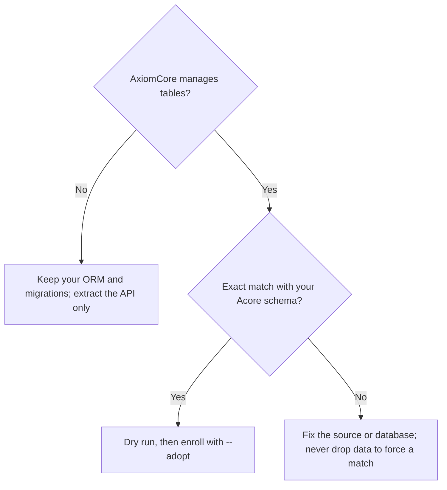

Decide who owns the database schema before you point AxiomCore at it. Adding
an API contract does not require moving database ownership to AxiomCore. When
you do want AxiomCore to manage some tables, you can **enroll** (adopt) them,
but only when they exactly match an Acore schema you wrote.

<StatusNote status="experimental" title="Database contracts are Experimental">
  PostgreSQL and SQLite contracts, persistence, inspection and adoption are
  Experimental. Only the named PostgreSQL production profile is Available, and
  only for its exact qualified release. See
  [capability boundaries](/reference/capability-boundaries) for engine,
  platform and workflow limits.
</StatusNote>

## Choose the boundary

| Goal | Keep | Introduce |
| --- | --- | --- |
| Add a contract to an existing service | Your database, ORM and migration system | [Backend extraction](/guides/backend-extraction) and a generated client |
| Describe an exported schema | Your database and migration authority | `axiom domain bootstrap --source sql`, for review |
| Let AxiomCore manage selected objects | Every object outside the selected scope | An Acore schema, ownership enrollment and reviewed version history |
| Use typed Acore persistence | The database and its operational ownership | Schema mappings, application credentials, grants and tenant policy |



If AxiomCore should manage no tables, keep your ORM and migrations and extract
only the API. If it should, enroll only tables that exactly match your Acore
schema; otherwise fix the source or the database first.

SQL bootstrap reads an exported DDL file. It does not connect to or manage a
live database. Native inspection, adoption, migrations and runtime persistence
each carry their own capability limits.

<span id="prepare-an-owned-disposable-target" />

## Prepare a disposable target

Work on a copy first. Use a supported PostgreSQL 17 or 18 server or a SQLite
file; [database contracts](/database/contracts) lists engine and platform
constraints. PostgreSQL needs a reachable server and a matching validator. The
CLI does not provision that server.

Before you enroll anything:

1. Take an inventory and a backup with the tools that already own the database.
2. Write the selected tables, keys, relationships, constraints and ownership
   scope in Acore.
3. Treat anything you did not model as unsafe to change or remove.

<span id="compare-before-enrolling" />

## Compare before you enroll

Run these from the directory that holds the database manifest. They select an
explicit disposable SQLite copy, `legacy.sqlite`:

```bash title="Database directory"
axiom check schema.acore
axiom database migrate schema.acore --database-file ./legacy.sqlite --adopt --dry-run
```

Review the reported differences and capability diagnostics before you allow
any change. For PostgreSQL, replace `--database-file` with `--database-url` or
the connection fields (`--host`, `--port` with default 5432, `--database`,
`--username`, `--ssl-mode`, `--tls-ca`); prefer `PGPASSWORD` or the masked
prompt to `--password`. Always name the target: without an endpoint, the CLI
falls back to the `DATABASE_URL` environment variable.

## Enroll an exact match

`--adopt` enrolls an existing scope **only when it exactly matches the
validated source**. Names, storage types, nullability, keys, collations and
the selected physical definition must all match. Adoption records management
ownership and migration history. It does not ignore drift and it never
overwrites a different schema.

```bash title="After reviewing an exact-match disposable scope"
axiom database migrate schema.acore --database-file ./legacy.sqlite --adopt
axiom database status schema.acore --database-file ./legacy.sqlite
axiom database history schema.acore --database-file ./legacy.sqlite
```

`ADB1105` means the comparison failed. Inspect the difference rather than
dropping data to get past it:

| Situation | Result |
| --- | --- |
| A similar-looking table differs from the source | `--adopt` is rejected with `ADB1105` |
| You migrate without `--adopt` into a scope that already has objects | Rejected with `ADB1105`; use a reviewed `--adopt` baseline |
| The scope is already enrolled, or drifted since the last release | Rejected with `ADB1105`; check `axiom database status` |

Production and fleet operations follow the separate
[fleet workflow](/database/fleets), with exact-profile admission and backup
and recovery requirements. A local migration does not broaden those
qualifications.

## Connect the application

Use [typed persistence](/database/persistence) to bind resource operations to
the selected tables. Keep application authentication, least-privilege
credentials, ownership rules and migration review. If you keep your existing
ORM, keep using it behind the extracted backend instead.

Start with a [small persisted app](/examples/task-app) before you migrate a
larger one. Compare schema and consumer impact together, and test the data-loss
limits of rollback on disposable data.

## Next steps

- [Database contracts](/database/contracts)
- [Migrations and persistence](/database/persistence)
- [Use your existing stack](/guides)
