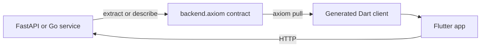

{/* VERIFY: package version. Written for the first axiom_flutter release with Android support (proposed 0.150.0). */}

Keep your backend as it is. AxiomCore needs only a contract that describes its
HTTP API. The Flutter app calls the service through a Dart client generated
from that contract, and the AxiomCore runtime in the app handles requests,
validation, caching and errors. Nothing is added to, or deployed in front of,
your service.

| Path | Status |
| --- | --- |
| Contract by FastAPI extraction | **Available**; the published extractor binary is for macOS arm64 |
| Contract by Go extraction | **Alpha**; the published extractor binary is for macOS arm64 |
| Contract written by hand in Acore | **Alpha** (CLI 0.156.0) |
| Flutter client (`axiom_flutter` 0.150.0) | **Alpha** on Android, iOS, macOS and the web |



This guide uses the FastAPI greeting service from the
[FastAPI guide](/guides/fastapi-to-web): one endpoint, `GET /greet/{name}`,
returning `Greeting { message }`.

## Requirements

| Tool | Version |
| --- | --- |
| [Axiom CLI](/getting-started/installation) | 0.156.0 |
| Python | 3.12 with FastAPI 0.123.5, Pydantic 2.13.4, Uvicorn 0.38.0 (from the example's `requirements.txt`) |
| Flutter | 3.32 or newer |
| FastAPI extractor (extraction only) | 0.1.4, macOS arm64 |

Ports 8083 and 5175 must be free.

## 1. Get and start the service

```bash title="Terminal 1"
git clone --depth 1 https://github.com/AxiomCore/AxiomCore.git
cd AxiomCore/examples/documentation/fastapi-web/backend
python3 -m venv .venv
.venv/bin/python -m pip install -r requirements.txt
.venv/bin/python -m uvicorn main:app --host 127.0.0.1 --port 8083
```

```bash title="Terminal 2"
curl -fsS http://127.0.0.1:8083/greet/Ada
```

```json title="Expected response"
{"message":"Hello, Ada!"}
```

## 2. Get a contract

Choose one of the two ways.

**Extract it (macOS arm64).** Install the FastAPI extractor as described in
[backend extractors](/getting-started/installation#backend-extractors), then
build the example's `axiom.acore`, which amends the extracted app:

```bash title="Terminal 2: fastapi-web/backend"
axiom build axiom.acore --out backend.axiom
```

{/* VERIFY: extraction needs the macOS arm64 extractor; not run on the docs machine (Linux). */}

For a Go service, use the Go extractor and `amends "axiom-go:main.go"` as in
the [Go guide](/guides/go-to-web). Review the extracted surface before you
use it: [how extraction works](/guides/backend-extraction).

**Describe it by hand (any platform).** Write the endpoints and models the app
uses. Endpoints without a `handle(...)` only describe the API; nothing runs
them on the AxiomCore side.

```toml title="fastapi-web/flutter-contract/AxiomDeps.toml"
type = "backend"
```

```acore title="fastapi-web/flutter-contract/greetings.acore"
project(id: "docs.fastapi.greeting", version: "1.0.0")
variant default(include: ["*"])

model Greeting { message: String }

endpoint greet(method: GET, path: "/greet/{name}") {
  request { path("name", type: String) }
  response(type: Models.Greeting)
}
```

```bash title="Terminal 2: fastapi-web/flutter-contract"
axiom check greetings.acore
axiom build greetings.acore --out backend.axiom
```

A hand-written contract is only as accurate as you make it. Keep it next to
the service, and test it against the real API in CI.

## 3. Generate the client in your Flutter app

```bash title="Terminal 2: your Flutter app"
flutter pub add axiom_flutter:^0.150.0 dev:axiom_flutter_generator:^0.150.0
axiom pull ../fastapi-web/backend/backend.axiom --framework flutter --name greetings --out lib/axiom_generated
```

Use the path of the `backend.axiom` you built in step 2. Then complete the
platform setup from
[the quickstart](/getting-started/quickstart-flutter#5-set-up-each-platform).

## 4. Call the service

```dart title="lib/main.dart"
import 'package:axiom_flutter/axiom_flutter.dart';
import 'package:flutter/foundation.dart';
import 'package:flutter/material.dart';

import 'axiom_generated/axiom_sdk.dart';
import 'axiom_generated/models.dart' as models;

late final AxiomSdk sdk;

String apiUrl() => !kIsWeb && defaultTargetPlatform == TargetPlatform.android
    ? 'http://10.0.2.2:8083'
    : 'http://127.0.0.1:8083';

Future<void> main() async {
  WidgetsFlutterBinding.ensureInitialized();
  sdk = await AxiomSdk.create(baseUrlOverrides: {'greetings': apiUrl()});
  runApp(const MaterialApp(home: Scaffold(body: Center(child: Greeting()))));
}

class Greeting extends StatelessWidget {
  const Greeting({super.key});

  @override
  Widget build(BuildContext context) {
    return AxiomBuilder<models.Greeting, models.Greeting>(
      query: sdk.greetings.greet(name: 'Ada'),
      loading: (context) => const CircularProgressIndicator(),
      error: (context, error) => Text(error.message),
      builder: (context, state, greeting) => Text(greeting.message),
    );
  }
}
```

Run it on the web on the port the service's CORS policy already allows:

```bash title="Terminal 2: your Flutter app"
flutter run -d chrome --web-port 5175
```

The page shows **Hello, Ada!**, and the Uvicorn log shows an `OPTIONS` and a
`GET /greet/Ada` request, both `200 OK`. On Android, iOS and macOS, run with
`flutter run -d <device>` after the platform setup.

{/* VERIFY: the hand-written contract path was run on the docs machine on the web (headless Chrome, 200 from Uvicorn); Android, iOS and macOS were not run. */}

## Errors and security

- FastAPI returns 422 for a name longer than 40 characters. The app receives an
  `AxiomError`; show `error.message` or branch on `error.code`. A hand-written contract does not
  know the 40-character limit unless you add it; add field rules to get Dart
  form validators too.
- **CORS (web only).** Allow the app's origin, port included, and the headers
  the SDK sends: `accept`, `content-type`, `x-axiom-request-id`,
  `x-axiom-cache-mode`, `traceparent` and `tracestate`, plus `authorization` or
  your API key header if the API uses them. A missing header makes the
  preflight fail and the app shows no data. The example's FastAPI middleware allows `content-type`,
  `traceparent` and `x-axiom-cache-mode` for `GET` from port 5175. If the
  browser reports a CORS error, add `accept` and `tracestate`.
- **Auth.** If your service checks a bearer token, pass it with
  `sdk.runtime.setGlobalAuthToken(token)`,
  `sdk.runtime.setNamespaceAuthToken(namespace: 'greetings', token: token)`
  or an auth provider. The SDK sends `Authorization: Bearer <token>`. See
  [Authentication](/sdks/flutter#authentication).
- The contract does not enforce anything on the server. Your service stays
  responsible for validation and authorization.

## Deployment

Nothing changes for the service. For the app, point each contract at the
deployed URL with `baseUrlOverrides`, an `AxiomEnvironment` or
`--dart-define=AXIOM_BASE_URL=...`, and pull again whenever the API changes so
the analyzer catches breaking changes. For release builds, consider
[signed and hash-locked contracts](/sdks/flutter#signed-and-hash-locked-contracts).

## Clean up

Stop Uvicorn and the app with Ctrl-C and delete the example directory.

## Next steps

- [Flutter SDK reference](/sdks/flutter)
- [Migrate from Dio and Retrofit](/guides/migrate-from-dio-retrofit)
- [Build a Flutter app before the backend exists](/guides/flutter-mock-first)
