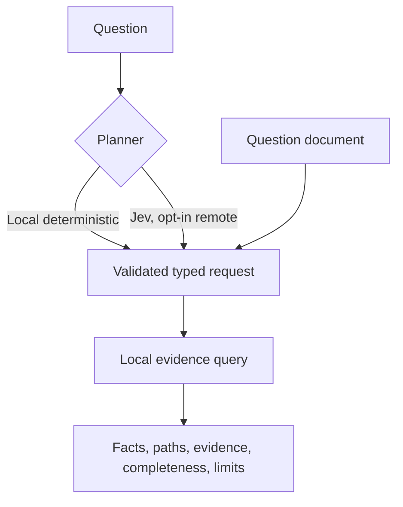

<span id="pre-plan-questions-for-agents" />

Ask Axiom turns a question into a validated Inspector query and answers it from
your local evidence graph. A **planner** only interprets the question; the
facts, paths and evidence always come from the deterministic local engine.



## Local deterministic planner

The deterministic planner is the default and makes no network request:

```bash title="Terminal"
axiom inspect ask "what can write Home.apiKey" .
```

```text title="Expected output"
AXIOM INSPECTOR ANSWER
Status: Incomplete
1 canonical write relationship can modify `home.apikey`.
Graph revision: 18be964eb0eb528277b270e4b48bf6aa7a444ebd76195f273454b1f961cae3fa
Validated query: {"format":"axiom-query/v1","operation":{"kind":"trace","root":"state:beb6895899277ccd1fbb36b3","direction":"upstream"},"maxDepth":8,"maxResults":250}
...
```

This output is from the task app in [Inspect an application](/inspector/inspect-an-application).
The question must be one printable line of at most 512 bytes. The planner
ignores case and trailing `?`, `.` or `!`, and recognizes these forms:

| Intent | Phrasings |
| --- | --- |
| Writers | `what can write X`, `who can write X` |
| Network access | `why does X have network access`, `why does extension X have network access`, `why network access X` |
| Execution | `what executes when I press X`, `what executes when I click X`, `what executes when X`, `trace execution X` |
| Why | `why X`, `explain X` |
| Changes | `what changed`, `what has changed` (needs `--changes`) |

```bash title="Terminal"
axiom inspect ask "what changed" . --changes semantic-changes.json
```

`--changes` takes the canonical report from
`axiom inspect diff --output`. See [Changes and impact](/inspector/changes-impact-and-ci).

Each answer has a status: **Answered**, **Incomplete** (for example, runtime
evidence was not collected) or **Unsupported** (the phrasing is not recognized;
the command still exits 0). An ambiguous label fails with
`selector ... is ambiguous; use a semantic ID` and a non-zero exit; ask again
with the exact ID. Add `--output FILE` to save the answer and `--format json` to
read it as `axiom-inspector-answer/v1`.

## Submit a question document

Agents and CI jobs should skip natural language and submit a validated
`axiom-inspector-question/v1` document:

```json title="question.json"
{
  "format": "axiom-inspector-question/v1",
  "intent": { "kind": "writers", "selector": "state:beb6895899277ccd1fbb36b3" },
  "maxDepth": 8,
  "maxResults": 250
}
```

```bash title="Terminal"
axiom inspect answer question.json .
```

Intent kinds are `writers`, `network-access`, `execution` and `why` (each with
a `selector`), and `changes` (pass `--changes FILE`). `maxDepth` defaults to 8
(maximum 16) and `maxResults` to 250 (1 to 1,000). `answer` prints JSON by
default.

Rules for agents:

- Use `--format json` or `jsonl`; never parse human output.
- Treat a non-zero exit as failure.
- Keep `graphRevision` and the format version with every result.
- Cite the returned evidence IDs, and read `completeness` and `limits` before
  claiming that something is absent.
- Use exact semantic IDs when a label could be ambiguous.

## Optional Jev planner

<StatusNote status="experimental" title="Remote probabilistic planning">
  Jev planning is opt-in and needs Vercel AI Gateway access. It selects a
  bounded intent and semantic target; it never generates Inspector facts.
</StatusNote>

Jev helps when people phrase questions freely. Make an AI Gateway API key
available as `AI_GATEWAY_API_KEY` (a general Vercel or provider token is
rejected), then pass both flags:

```bash title="Terminal"
axiom inspect ask "Who can modify Home.apiKey?" . --planner jev --allow-remote
```

Without `--allow-remote` the command stops before sending anything. Jev
(`typesafe-ai/jev`) receives only the question, narrow Inspector terminology and
a shortlist of up to 48 candidate semantic IDs, kinds and labels. It never
receives your source, the evidence graph, source spans, fact attributes,
runtime payloads or secret values.

Jev answers closed-choice questions for intent and target. Axiom then:

1. checks the intent probability;
2. resolves exact semantic names deterministically where possible;
3. requires fuzzy targets to pass the selector threshold;
4. rejects targets outside the local candidate list;
5. builds and validates the normal question request; and
6. answers it from the local evidence index.

The thresholds default to `0.65` for intent and `0.55` for fuzzy selectors
(`--jev-intent-threshold`, `--jev-selector-threshold`). They are evaluation
controls, not a way to bypass validation. A model probability is never
evidence confidence.

### Safe abstention

A precise question resolves cleanly. A vague phrase such as "the cart total"
can match several facts, so Jev may choose `none`, or Axiom may reject a choice
below the threshold. When Jev abstains, Axiom tries the local phrase planner;
if that also fails, the answer is **Unsupported** with Jev's reason. Abstaining
is better than tracing the wrong fact. Copy the intended label or ID from the
dashboard or `inspect graph` and ask again.

### Planning receipts

Every completed Jev decision writes an owner-only receipt
(`axiom-jev-planner-receipt/v1`) under `.axiom/inspector/planner-receipts/`. It
records the model, graph revision, a SHA-256 of the question (not the raw
text), the candidate set, thresholds, probabilities, the selected target and
how it was selected, the validated request, usage and gateway routing metadata.
The receipt is planning evidence; the Inspector answer stays a separate,
deterministic result.

### Enable Jev in the dashboard

```bash title="Terminal"
axiom inspect serve . --allow-remote-planner
```

The Ask Axiom view then offers **Local deterministic** or **Jev · remote** per
question. A normal dashboard session never enables remote planning.

## When to use each mode

| Mode | Use it when |
| --- | --- |
| Local deterministic | You know the supported phrasing, use exact labels or IDs, work offline, or need the smallest trust boundary |
| Jev | A person uses varied wording and accepts a remote planner with visible probabilities and abstention |
| Question document | An agent, CI job or integration needs a stable, reviewable request |

Jev improves question interpretation only. It does not replace semantic diff,
security analysis, runtime capture, source review or tests.

## Next steps

- [Trace relationships](/inspector/trace-and-explain)
- [AI coding agents](/guides/using-ai-agents)
- [`axiom inspect` reference](/tooling/cli-inspect)
