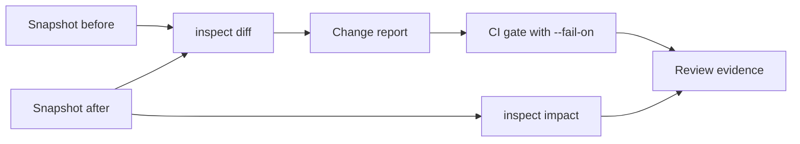

Git shows which lines changed. Axiom Inspector shows which application facts
changed and what those facts can affect. This guide snapshots evidence before
and after a change, compares the snapshots, measures impact and turns the result
into a CI gate.



## Create canonical snapshots

The outputs on this page come from the `examples/documentation/hello-api`
example, built with `axiom build main.acore --out hello.axiom` so the backend
contract sits where Inspector discovers it. Snapshot before the change, and
again after you rebuild:

```bash title="Terminal"
axiom inspect snapshot . --output before.evidence.json
axiom inspect snapshot . --output after.evidence.json
```

```text title="Expected output"
Snapshot before.evidence.json
Graph revision be4f295adb1cc7257c60ff10f58cb7cda22ba3cb91e29490a3ae356e9b7c7ad8
Cache <workspace>/.axiom/inspector/snapshots/be4f295adb1cc7257c60ff10f58cb7cda22ba3cb91e29490a3ae356e9b7c7ad8.jcs.json
```

A snapshot is canonical JSON (`axiom-application-evidence/v1`), content
addressed by graph revision. It holds semantic evidence, not a file backup or a
data dump. Inspector also keeps a copy under `.axiom/inspector/snapshots/`.
Snapshots are limited to 25 MiB, 100,000 facts and 500,000 relationships.

Verify a stored snapshot before you rely on it:

```bash title="Terminal"
axiom inspect validate-snapshot before.evidence.json
```

```text title="Expected output"
Valid axiom-application-evidence/v1
Graph revision be4f295adb1cc7257c60ff10f58cb7cda22ba3cb91e29490a3ae356e9b7c7ad8
14 nodes, 14 edges
```

Validation checks schema compatibility, references, revision and canonical
bytes. A file that is valid JSON but not canonical fails.

## Compare semantics

```bash title="Terminal"
axiom inspect diff before.evidence.json after.evidence.json
```

```text title="Expected output"
Axiom semantic change report
Policy axiom-change-policy/v1
Before be4f295adb1cc7257c60ff10f58cb7cda22ba3cb91e29490a3ae356e9b7c7ad8
After  bf7ab103798bd7d13bb6e38315ff881c813731398d1a7dc59bbebf6038cd8108
Breaking 0  Approval required 0  Warnings 1  Informational 26
- Warning / Api / Modified: hello
...
```

The change added a `language` field to the `Greeting` model. The report compares semantic identities across operations and
API surface, schema fields, projections, validation, cache and streaming, UI,
state, styles and accessibility, packages, provenance and targets, and
permissions and policy. Each change is classified as **breaking**,
**approval-required**, **warning** or **informational** where the policy has
enough evidence. Permission increases are tracked separately because they
usually need a security approval.

## Calculate impact

Evaluate impact against the after snapshot:

```bash title="Terminal"
axiom inspect impact Greeting.language . --against after.evidence.json
```

```text title="Expected output"
Axiom impact report
Root field:2181fa2d0b121f7b1cdb538b
Graph revision bf7ab103798bd7d13bb6e38315ff881c813731398d1a7dc59bbebf6038cd8108
Targets server
Affected facts 4  Truncated false
...
```

Impact traversal is bounded (`--max-depth` 16, `--max-results` 10000 by
default) and cycle-safe. The report lists affected facts, targets, exact
relationship paths, the limits used and whether the result was truncated. If
the selector was removed and is absent from the `--against` snapshot, Inspector
evaluates it in the current workspace instead, so removals still show impact.
Add `--output impact.json` for a canonical CI artifact.

Impact answers questions a text search cannot: which projections and endpoints
depend on a field, which UI and targets consume an operation, what a removed
permission disconnects, and which extensions and state paths a contract change
touches.

## Include runtime comparison

When you have normalized runtime sessions for both graphs, save each one as
JSON and pass them as a pair:

```bash title="Terminal"
axiom inspect runtime . --session before-run --format json > before.runtime.json
axiom inspect runtime . --session after-run --format json > after.runtime.json
axiom inspect diff before.evidence.json after.evidence.json \
  --before-runtime before.runtime.json \
  --after-runtime after.runtime.json
```

These files must be normalized sessions (`axiom-runtime-evidence/v1`); an
exported audit bundle is a different format and is rejected. The runtime
comparison ignores event IDs, timestamps, durations and other timing noise. It keeps differences in event kind, target, outcome, semantic identity,
authority, source and redaction. See
[Runtime evidence, security and audits](/inspector/runtime-and-audits) for
capturing sessions.

## Use it as a CI gate

```bash title="Terminal"
axiom inspect diff baseline.evidence.json candidate.evidence.json \
  --fail-on breaking,permission-increase \
  --output semantic-changes.json \
  --format json
```

| `--fail-on` class | Fails when the report has |
| --- | --- |
| `breaking` | Any breaking change |
| `approval-required` | Any change that needs a named approval |
| `permission-increase` | Any permission increase |
| `warning` | Any warning |

A failing gate prints `Error: semantic change policy gate failed` and exits
non-zero. `--output` writes the byte-stable canonical report even when the gate
fails. Choose classes deliberately: do not block on every warning until the team
has reviewed its baseline.

## Measure the Inspector release boundary

```bash title="Terminal"
axiom inspect release-check .
axiom inspect release-check . --enforce --format json
```

`release-check` measures Inspector on your workspace: cold snapshot under
2 seconds, repeat snapshot under 1 second and byte-identical, bounded query p95
under 100 ms, snapshot under 25 MiB, a packaged offline dashboard, no telemetry
transport, no implicit hosted upload, and no failing third-party dependency
policy finding. `--enforce` exits non-zero if any check fails. It evaluates
Inspector, not your application, so it does not replace building, testing,
signing or deploying.

## Recommended pull-request evidence

Keep these together for a reviewed change:

1. Baseline and candidate graph revisions.
2. The canonical semantic-change report.
3. Impact reports for breaking or authority-sensitive roots.
4. Named approvals the policy requires.
5. Relevant contract, extension and target tests.
6. Runtime evidence, only when the review depends on observed behavior.

## Next steps

- [CI checks](/testing/ci)
- [Contract pull requests](/delivery/contract-pull-requests)
- [Runtime evidence, security and audits](/inspector/runtime-and-audits)
