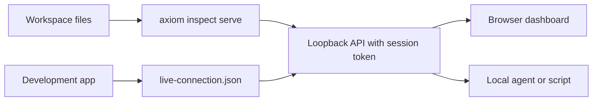

The Axiom Inspector dashboard ships inside the Axiom CLI. It is a local visual
client for the same evidence and query engine that `axiom inspect` commands
use, so every card, graph and answer carries the same semantic IDs and graph
revision.



`axiom inspect serve` builds the evidence, watches the workspace and serves a
token-protected API on `127.0.0.1`. The browser dashboard, a local agent and an
attached development app all talk to that API.

## Launch it

From a frontend, backend or combined workspace:

```bash title="Terminal"
axiom inspect serve .
```

```text title="Expected output"
Axiom Inspector dashboard
http://127.0.0.1:<port>/?token=<token>
Loopback only · random session token · read-only by default
Question planners: deterministic · Jev remote disabled
Live target connection <workspace>/.axiom/inspector/live-connection.json
Watching <workspace>. Press Ctrl-C to stop.
```

Inspector picks an available port, creates a random token for this session,
opens your browser and watches the workspace for changes.

| Option | Default | Effect |
| --- | --- | --- |
| `--port PORT` | `0` (any free port) | Listen on a fixed loopback port |
| `--no-open` | off | Do not open a browser |
| `--api-only` | off | Serve only the versioned API, no dashboard pages |
| `--allow-remote-planner` | off | Offer Jev planning in Ask Axiom (Experimental) |
| `--jev-intent-threshold` | `0.65` | Minimum intent probability for Jev |
| `--jev-selector-threshold` | `0.55` | Minimum fuzzy selector probability for Jev |

`--api-only` suits local agent integrations. It prints a
`/api/v1/status?token=...` URL; send the token as the `token` query parameter or
the `x-axiom-inspector-token` header.

## Dashboard areas


The Backend view for the documentation task app, listing operations as callable
contracts.

| Area | Use it for |
| --- | --- |
| Overview | Architecture, targets, verification summary, important findings and runtime attachment |
| Graph | One focused fact with upstream, downstream or both directions, a depth and relationship filters |
| Source | Source units and evidence-backed previews |
| UI & state | Pages, components, actions, state, styles, responsive branches, accessibility and target lowering |
| Backend | Services, operations, entities, projections, policies, exposure, caching and implementation evidence |
| Extensions | Sandboxed module identity, exports, authority, targets, provenance, limits and observed runs |
| Dependencies | Direct and transitive contracts, packages and executable closure |
| Security | Requested, granted and effective authority, exposure, findings and readiness |
| Runtime | Normalized sessions, traces, outcomes, lifecycle events, redaction and retention |
| Live | Development-target selection and causal explanation for the current graph revision |
| Changes | Semantic changes, classifications, evidence and runtime differences |
| Ask Axiom | Deterministic questions and, when enabled, Jev planning |

The **Target** and **Truth** (declared, resolved, observed) filters apply across
every area. Search finds semantic facts; it is not a source grep.

## Explore relationships

Select a node or card to open its evidence drawer. From there you can:

- choose **Trace upstream**, **Trace downstream**, **Trace both** or **Why?**;
- read the source evidence with surrounding lines;
- **Open in Editor** (a `vscode://` link) or **Copy path**;
- follow contract, operation, state, permission and provenance relationships;
- copy the semantic ID for a CLI or agent query.

The graph focuses one fact at a time on purpose: drawing every fact of a large
application at once is unreadable and adds no evidence. See
[Trace relationships](/inspector/trace-and-explain).

## Attach a development application

Keep the dashboard running, then start an Acore UI app with its normal
development command:

```bash title="Terminal"
axiom run frontend/main.acore --target web
```

The development host reads the owner-only descriptor
`.axiom/inspector/live-connection.json`. Alt-click an element on web, or
long-press it on iOS and Android, and the **Live** view connects it to its
component and source span, applied styles and responsive branch, accessibility
declaration, bound action and operation, state dependencies, and matching
redacted causal events.

Live instrumentation is development-only. Release archives and signed native
bundles never receive the Inspector token, picking overlay or capture
configuration.

## Source refresh and last-good evidence

Inspector checks the workspace for changes every 750 ms (ignoring `.git`,
`target`, `node_modules` and its own `.axiom/inspector` folder) and rebuilds
the evidence. If a rebuild fails, it keeps the previous valid graph and shows a
diagnostic instead of publishing a partial model. After the graph revision
changes, reload attached apps before you read live correlations.

## Local security boundary

- The server listens on `127.0.0.1` only.
- The dashboard page and every API request need the per-session token. Only
  the packaged stylesheet and script load without it.
- The dashboard sends a strict Content Security Policy (`default-src 'none'`,
  same-origin scripts, styles and connections, no framing).
- Source access is limited to validated evidence paths inside the workspace.
- Application values and secrets are not part of the evidence.
- The dashboard cannot grant permissions or execute an extension.
- Inspection never uploads anything to a hosted service.

Stop the server with Ctrl-C. Normal shutdown removes the connection descriptor.

## Jev in the dashboard

Remote planning is off by default. To offer it for one session, make
`AI_GATEWAY_API_KEY` available in the command's environment, then start the
dashboard with `--allow-remote-planner`:

```bash title="Terminal"
axiom inspect serve . --allow-remote-planner
```

Ask Axiom then lets you choose **Local deterministic** or **Jev · remote** for
each question. Read [Ask questions](/inspector/ask-axiom) first.

## Next steps

- [Trace relationships](/inspector/trace-and-explain)
- [Runtime evidence, security and audits](/inspector/runtime-and-audits)
- [Ask questions](/inspector/ask-axiom)
