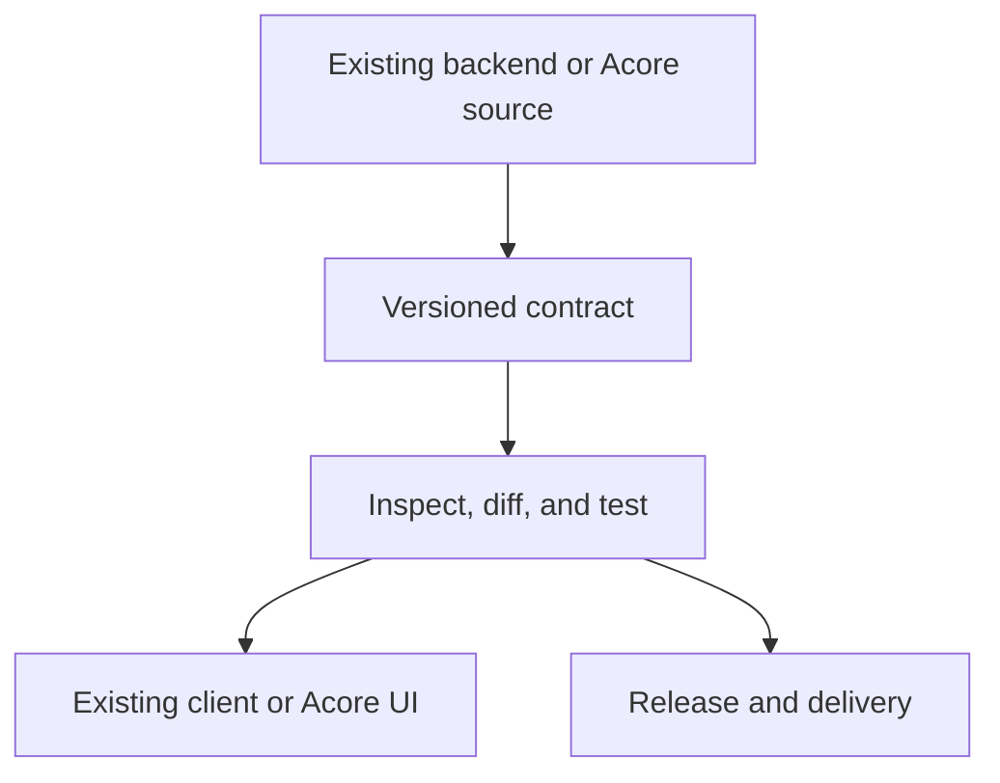

AxiomCore gives an application's frontend, backend, and data model a shared
contract. Developers can review that contract, generate a supported client,
test expected behavior, and inspect the effect of a change.

Use it in two ways:

- **Connect existing software.** Keep a supported service and client framework.
  Extract or author the contract between them.
- **Build with Acore.** Define API operations, managed backend logic, a user
  interface, and a database schema in Acore.

## The platform in four layers

Source becomes a contract package. Review and test the package before using it
from a client or delivering a release. Your database and executable backend
remain explicit parts of the application.

| Layer | What you do | Result |
| --- | --- | --- |
| Authoring and extraction | Write Acore or extract a supported backend surface | Reviewable source |
| Contracts and packages | Build, pin dependencies, compare versions | `.axiom` artifact and dependency lock |
| Development and execution | Run an API, connect a client, test or mock behavior | Working application; `.axiomapp` when packaging Acore UI |
| Coordination | Use implemented Cloud project and release workflows | Shared, versioned releases |

## Acore is the language, not the whole platform

[Acore](/introduction/what-is-acore) is AxiomCore's independent declarative
language. AxiomCore also includes the CLI, packages, clients, runtime tools,
testing, Inspector, and Cloud workflows.

## Contracts are incremental

Retain FastAPI or Go, consume contracts from web, React, Flutter, or a qualified
Swift integration, and introduce Acore where it helps. Typed theme and
component packages have their own contracts. Their metadata does not grant
permission to execute package code.

Each path has a separate [availability boundary](/introduction/support-matrix).
A successful contract build does not prove that an application works on every
target or that a deployment is production-ready.

## Continue reading

Start with the [first app](/getting-started/quickstart), compare
[existing-stack integrations](/guides), or read about
[contracts and artifacts](/core-concepts/contracts-and-artifacts).
