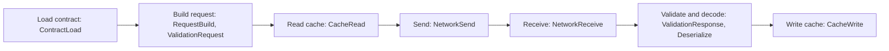

<span id="handling-pattern" />

When a request through the Axiom runtime fails, you get a structured
`AxiomError` instead of a bare exception. This page lists its fields and
values, how to handle them, typed business failures, and the `ADB` codes the
database commands print.

## The `AxiomError` object

| Field | Meaning |
| --- | --- |
| `stage` | The pipeline boundary where the failure happened |
| `category` | A broad class for UI, metrics, and policy decisions |
| `code` | The specific condition. An HTTP failure carries its status number |
| `message` | A human-readable summary that is safe for application handling |
| `retryable` | The runtime's assessment of whether another attempt may succeed |
| `details` | Optional extra context, such as field validation messages |
| `source` | Optional internal source context; bindings may omit it |

Match on `code` or `category`, never on `message`. Keep an unknown fallback so
a newer runtime does not break an older UI.

How each binding exposes the object:

| Binding | Shape |
| --- | --- |
| Web (`atmx-web`) | Errors from the engine use the names on this page: `stage` such as `"ContractLoad"`, `category` such as `"Auth"`, and `code` such as `"ContractInvalid"`, or an object for HTTP statuses: `{ "HttpStatus": 404 }`. Errors raised by the JavaScript layer use lower-camel-case `stage` and `category` values (`"ffiBoundary"`, `"runtime"`, `"network"`) and their own codes, listed below. No `source` field. |
| Flutter (`axiom_flutter`) | `stage` and `category` are lower-camel-case Dart enums (`ErrorStage.contractLoad`), parsed without regard to case. `code` is a class such as `ContractInvalid` or `HttpStatus(code)`; codes the binding does not name become `UnknownCode(raw)`. No `source` field. |

Compare `stage` and `category` without regard to case. Generated TypeScript or
Dart types are authoritative for exact casing.

Codes added by the `atmx-web` JavaScript layer (0.147.5):

| Code | When | Retryable |
| --- | --- | --- |
| `WasmFetchFailed` | The WebAssembly engine could not be downloaded | Yes |
| `InitFailed` | The engine failed to initialize | No |
| `ContractLoadFailed` | One or more contracts failed verification or loading during `init`; see `InitResult.contracts` | No |
| `FatalError` | An unexpected exception during `init` | No |
| `JsonParseFailure` | The engine returned an error the JavaScript layer could not parse | No |

## Stages

A failure's stage tells you where in the request it stopped:



Not every request passes every stage; a cache-only read stops early. Three
stages sit outside the request path: `Configuration` (runtime or contract
configuration), `Runtime` (engine lifecycle or internal execution), and
`FfiBoundary` (the native or WebAssembly binding).

| Stage | Boundary |
| --- | --- |
| `Configuration` | Runtime or contract configuration |
| `ContractLoad` | Loading or validating the contract artifact |
| `RequestBuild` | Endpoint lookup, path, headers, or body construction |
| `ValidationRequest` | The outgoing value does not satisfy the contract |
| `CacheRead` | Reading a configured cache |
| `NetworkSend` | Connecting or sending the request |
| `NetworkReceive` | Receiving transport or HTTP response data |
| `ValidationResponse` | The incoming value does not satisfy the contract |
| `Deserialize` | JSON or codec decoding |
| `CacheWrite` | Saving a response to the cache |
| `Runtime` | Engine lifecycle or internal execution |
| `FfiBoundary` | Native or WebAssembly binding boundary |

## Categories

The categories are `Contract`, `Validation`, `Network`, `Timeout`,
`Serialization`, `Cache`, `Auth`, `Server`, `Runtime`, and `Unknown`. A
category is broader than a code: several HTTP statuses can map to `Auth` or
`Server`.

<span id="symbolic-codes" />

## Codes

| Group | Codes |
| --- | --- |
| Contract | `ContractMissing`, `ContractInvalid`, `EndpointNotFound` |
| Request | `RequestCreationError`, `PayloadEncodingError` |
| Validation | `ValidationError` |
| Network | `NetworkConnectionFailed`, `NetworkTimeout`, `HttpStatus(status)` |
| Data | `JsonParseError`, `CodecError` |
| Cache | `CacheReadError`, `CacheWriteError` |
| Authentication | `AuthTokenMissing`, `AuthTokenExpired` |
| Runtime | `NotInitialized`, `InternalError` |

Lower-level numeric FFI status values can merge several codes into one. Use
the structured error your binding emits instead of copying a numeric table.

## Handle errors

```ts title="TypeScript excerpt"
function messageFor(error: AxiomError): string {
  if (error.category.toLowerCase() === 'auth') return 'Please sign in again.';
  if (error.retryable) return 'Request failed. Try again.';
  if (error.code === 'ContractInvalid') {
    return 'This application release has an invalid data contract.';
  }
  return 'Something went wrong.';
}
```

Keep detailed diagnostic context in protected logs, not in a message the user
sees.

<span id="retry-guidance" />

## Retry rules

- Retry only when `retryable` is true or your application policy explicitly
  allows it.
- Cap attempts and add jitter for network retries.
- Do not retry an invalid contract, unknown endpoint, request validation error,
  or deterministic decoding failure without changing the input or the
  deployment.
- Refresh or clear credentials before retrying an authentication failure.
- Treat cache errors separately: a cache write failure is not a failed server
  operation.

<span id="typed-domain-cases-and-execution-aborts" />

## Typed failures and execution aborts

A managed action declares named failure cases, each with a payload and an HTTP
status. The endpoint chooses which payload fields each audience may see. The
HTTP failure body carries only `error.code` and the selected `error.payload`.

- Malformed envelopes and unknown cases are sanitized into transport errors.
- Execution aborts (cancellation, deadline, budget, host fault, and an
  indeterminate outcome) stay separate from recoverable business cases.
- New payload contracts need the version 2 contract reader.

The backend declaration catalog (`axiom explain --schema`) lists these failure
categories: `invalidInput`, `unauthenticated`, `forbidden`, `domain`,
`invariant`, `policyExhausted`, `cancelled`, `deadline`, `internal`, and
`indeterminate`. See [Managed logic and concurrency](/acore-language/managed-language).

<span id="database-developer-lifecycle" />

## Database lifecycle codes (`ADB`)

The database commands (`axiom database`, `axiom run` on a database source) and
the backend storage compiler print these codes.

| Code | Meaning | What to do |
| --- | --- | --- |
| `ADB1100` | Missing or invalid project identity, or a version that is not `MAJOR.MINOR.PATCH` | Declare one `project(id: ..., version: "1.0.0")` in the entry source; remove conflicting duplicate manifest metadata |
| `ADB1101` | Invalid or tampered artifact, source snapshot, or ledger | Restore verified history; do not edit internal files |
| `ADB1102` | The requested migration version or baseline is not available | Keep the complete catalog or an exported prefix |
| `ADB1103` | The version is already used, or does not increase | Accept the suggested version, update the source, or opt in to `--auto-version` in CI |
| `ADB1104` | A concurrent publisher, a changed parent, or an interrupted source edit | Inspect, then retry against the accepted state |
| `ADB1105` | Drift, overlapping ownership, or unreviewed existing scope | Run `axiom database status`; establish an exact baseline |
| `ADB1106` | Unsupported engine capability, an unavailable or tampered validator runtime, or a replay mismatch | Install a matching validator or supported PostgreSQL; no candidate is accepted |
| `ADB1107` | Invalid or unavailable connection, or the wrong engine | Supply the URL, connection fields, or file for the declared engine |
| `ADB1108` | Database execution or transport failure | Check the reported transaction outcome before retrying |
| `ADB1109` | Missing or different signer | Restore the enrolled signing provider |
| `ADB1110` | A PostgreSQL password is required | Use the masked prompt, `PGPASSWORD`, or `--password` in non-interactive runs |
| `ADB1111` | A risk category needs approval | In CI, pass the specific flag: `--allow-destructive`, `--allow-data-dependent`, or `--allow-security-changes` |
| `ADB1112` | Existing rows have no value for a new required column | Make the column nullable, or declare a default or backfill |
| `ADB1113` | Rollback crosses a data overwrite whose old values were not archived | Define a compensating migration or restore a backup |
| `ADB1120` | Invalid typed backend storage mapping | Check the exact fields, values, and resource signatures |
| `ADB1121` | Invalid or unsupported typed data evolution | Use the supported atomic subset or its qualified adapter |

See [Database contracts](/database/contracts) and
[`axiom database`](/tooling/cli-database).

## Other diagnostic code families

| Prefix | Produced by | Reference |
| --- | --- | --- |
| `AXSEC-` | The security analyzer (`axiom security check`, `axiom build`) | [Security rules](/reference/security-rules) |
| `AUI` | The Acore UI compiler and development host | [Acore UI](/frontend/acore-ui) |
| `AXIOM_APP_` | `.axiomapp` verification, such as `AXIOM_APP_FORMAT` and `AXIOM_APP_CHECKSUM` | [App lifecycle and targets](/frontend/application-lifecycle) |
| `ADB` | Database contract commands | This page |
