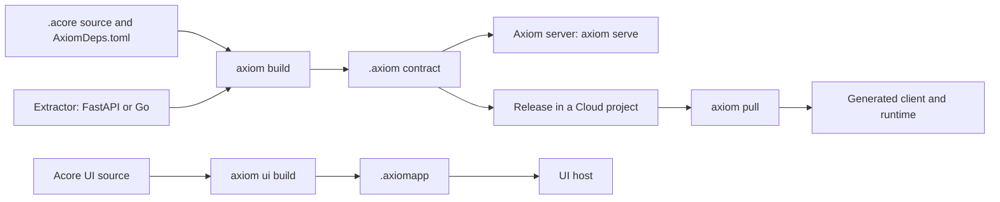

Each entry defines one AxiomCore term in one or two sentences. Status labels
(**Available**, **Alpha**, **Experimental**, **Coming soon**) are defined in
[Support and availability](/introduction/support-matrix).

Read the diagram left to right: you write `.acore` source (or extract it from
an existing service), build it into an `.axiom` contract, then serve it
locally, release it to Axiom Cloud, or pull it into a generated client. Acore UI
source builds into an `.axiomapp` that a UI host runs.

## Platform and products

| Term | Meaning |
| --- | --- |
| AxiomCore | The contract platform: the Acore language, the Axiom CLI, build and package tooling, runtimes and client SDKs, UI tooling, tests, mocks, security analysis, and Cloud services. |
| Acore | The declarative, contract-oriented language you write in `.acore` files. It has its own parser, evaluator, standard library, diagnostics, and language server. |
| Axiom CLI | The `axiom` command-line tool for local and connected workflows. |
| Acore language server | The editor server, run as `axiom lsp` or the standalone `acore-lsp`. It works offline. |
| Playground | The browser playground at `playground.axiomcore.dev`, where you can edit Acore source and preview the result. |
| Axiom Cloud | The hosted service for projects, releases, channels, environments, mocks, tests, and runtime evidence. **Alpha**. |
| Axiom Cloud Dashboard | The web control plane for accounts, projects, releases, and related Cloud workflows. **Alpha**. |
| Axiom Studio | <StatusBadge status="coming-soon" /> A planned visual, collaborative workspace for building software on AxiomCore. It is not installable today. |
| Acode | <StatusBadge status="coming-soon" /> A planned contract-aware IDE. The existing language server and editor extensions are not the Acode product. |
| Axiom Marketplace | <StatusBadge status="coming-soon" /> A planned catalog for browsing and installing Axiom packages. The package format exists; a supported marketplace workflow does not. |

## Source and files

| Term | Meaning |
| --- | --- |
| `.acore` | Editable Acore source. It is authoring input, not a locked distribution format. |
| `AxiomDeps.toml` | The manifest beside your source. Its `type` (for example `backend`, `frontend`, or `database`) selects how the files in that directory are compiled; it also lists targets and dependencies. |
| Declaration | A named, typed statement in Acore source, such as `project`, `model`, `endpoint`, or `action`. Declarations describe the contract; they do not execute handlers during evaluation. |
| Variant | A named selection of endpoints and models, such as `default`. A variant filters what goes into a build; it is not a runtime feature flag. |
| Annotation | Metadata written as `@name { ... }` before a member, such as `@deprecated { replacement = "newName" }`. |

## Contracts and artifacts

| Term | Meaning |
| --- | --- |
| Contract | A typed, versionable description of a software boundary. Depending on its type it can include operations, data, behavior, policy, domain, UI, package, and release metadata. |
| Artifact | A built, non-source file with its own manifest and verification rules. `.axiom` and `.axiomapp` are artifacts. |
| `.axiom` | A canonical contract or package artifact. Package kinds are service, theme, component library, database schema, extension, and application policy. |
| `.axiomapp` | A built Acore UI application artifact for one or more targets (web, iOS, Android). **Alpha**. |
| Package | A typed `.axiom` artifact that other projects depend on, such as a theme or component library. **Alpha**. |
| Lock (artifact lock) | A committed file that records the exact dependency artifacts selected for a build, with integrity data, so the build is deterministic. The default UI contract lock is `.axiom/axiom.ui.lock.json`. |
| Signature | Proof that exact artifact bytes came from a project's signing key. It does not prove the contract is correct, secure, or compatible. |
| Semantic diff | A comparison that classifies what a contract change means and its compatibility impact, rather than listing changed bytes or lines. Run it with `axiom diff --format semantic`. |
| Server plan | A private companion file built beside a backend artifact (for example `backend.server.json` next to `backend.axiom`) that tells the Axiom server how to run the artifact's actions. |

## Backend

| Term | Meaning |
| --- | --- |
| Model | A typed data shape, such as `model Task { id: String }`. |
| Endpoint | A public HTTP or WebSocket operation with a method, path, inputs, response type, and errors. |
| Action | A unit of managed backend logic. Its kind is `query`, `command`, or `stream`. |
| Resource | A provider-backed dependency, such as a database table, with typed operations an action can call. |
| Failure | A declared, typed error case with a payload and an HTTP status. An endpoint chooses which payload fields each audience sees. |
| Projection | An allowlist of fields from a domain entity that an endpoint may return to an audience. |
| Guard | A requirement an action checks before it runs, such as an authenticated caller. |
| Extractor | An adapter that reads an existing service and produces contract input. FastAPI extraction is **Available**; Go extraction is **Alpha**. |
| Axiom server | The local server the CLI starts with `axiom serve` or `axiom run` to execute a contract's actions for real. It never falls back to mocks or Cloud. |
| Deployment file | A reviewed `deployment.json` that supplies the providers, credentials, and grants a backend needs for real serving. |
| Domain model | Optional business semantics added to a contract: entities, relationships, invariants, and projections. |

## Frontend and clients

| Term | Meaning |
| --- | --- |
| Runtime | The library that loads a built contract and performs requests, validation, caching, and decoding on the client. Features and parity vary by target. |
| ATMX | The web runtime family: `atmx-web` (vanilla web, **Available**), `atmx-react` (**Alpha**), and the `atmx-cli` client generator. It includes a JavaScript layer and a WebAssembly engine. |
| Generated client | Typed client code that `axiom pull` writes for a framework (for example `atmx-web` or Flutter) from a contract. |
| Acore UI | The declarative UI profile of Acore and its build pipeline. **Alpha**. It is not Axiom Studio. |
| UI host | The signed host application that runs Acore UI for one target: a browser, the Android Emulator, or the iOS Simulator. Install it with `axiom ui host install`. |
| Target | The platform a build or host is for, such as `web`, `ios`, or `android`. |

## Testing, mocks and security

| Term | Meaning |
| --- | --- |
| Contract test | A suite declared in the contract (`testConfig`) that `axiom test` runs against a base URL. |
| Mock | Declared, deterministic responses for an endpoint, used in development and tests. Mock behavior is not proof of production behavior. |
| Server simulation | Running the real server boundary with simulated business execution (`axiom serve --mock` or `axiom mock --profile server`). |
| Scenario | A scripted development run against exact compiled artifacts, checked with `axiom scenario`. **Experimental**. |
| Security Mode | Optional `security(...)` declarations that the compiler checks and signs into the contract. `audit` reports findings; `strict` blocks builds with error findings. |
| AXSEC finding | A security rule result with a stable ID such as `AXSEC-001`. See [Security rules](/reference/security-rules). |
| Extension | Sandboxed code compiled to WebAssembly and called through a typed interface with signed permissions. **Experimental**. |

## Inspector

| Term | Meaning |
| --- | --- |
| Axiom Inspector | The CLI commands and secure local dashboard that build a queryable model of an Axiom application. **Alpha**. It shows declared, resolved, observed, and changed evidence, and never treats probabilistic output as authoritative. |
| Fact | A versioned statement in Inspector, such as a state declaration, operation, extension export, permission, target, or runtime event. A fact has a stable identity and points to its supporting evidence. |
| Relationship | A typed, directed edge between facts, such as `calls`, `reads`, `writes`, `imports`, `authorizes`, `renders`, or `observed-in`. Relationships power trace, lineage, reachability, why, and impact queries. |
| Graph revision | The content-derived identity of one Inspector evidence graph. Keep it with query, runtime, diff, and agent results so an answer is never read against different source or lock state. |

## Cloud and delivery

| Term | Meaning |
| --- | --- |
| Workspace | A group of members and projects in Axiom Cloud. |
| Cloud project | The Cloud home for one contract's releases, signing-key history, channels, mocks, environments, tests, and evidence. A local directory is linked to it with `axiom project link`. |
| Release | An immutable project and version pair in Axiom Cloud. Retrying the same bytes is allowed; different bytes need a new version. |
| Channel | A mutable pointer to an eligible release. `latest` is the current channel; activation and rollback move the pointer without editing artifacts. |
| Environment | A separate scope for application data, users, sessions, configuration, and secrets, such as development, staging, or production. |
| Sandbox | A managed Cloud environment that runs a verified artifact with synthetic mock data. It is not a production data plane. |

## Next steps

- See every term in context in [How AxiomCore works](/core-concepts).
- Check the status of each product in [Support and availability](/introduction/support-matrix).
