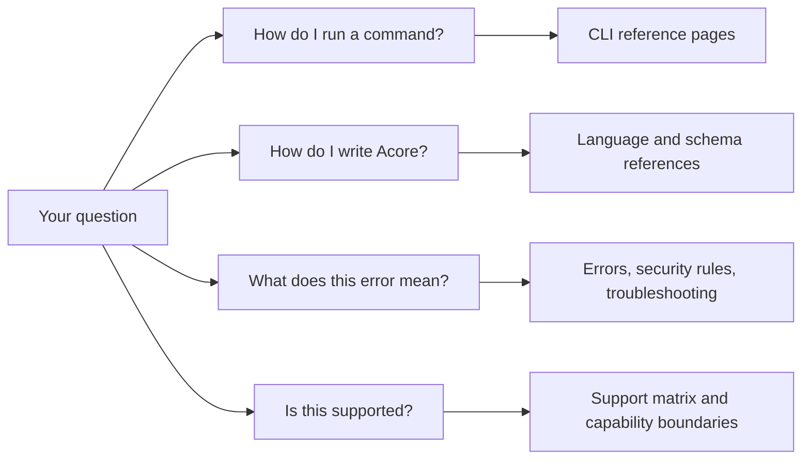

Use this page to find exact facts: command flags, Acore declarations, schema
fields, error codes, support status and site policies. Reference pages are
for lookup. For a guided start, use [Get started](/getting-started).

## Commands

The Axiom CLI (`axiom`) reference is split by command group. Start with the
overview for global behavior and the full command list.

| Page | Covers |
| --- | --- |
| [CLI overview](/tooling/cli-reference) | All command groups and global behavior |
| [Setup and project commands](/tooling/cli-project) | Setup, prerequisites, sign-in, and Cloud projects |
| [Build and run commands](/tooling/cli-build-and-run) | Check, build, run, and release |
| [`axiom server`](/tooling/cli-server) | Server plans, OpenAPI, types, and bundles |
| [`axiom database`](/tooling/cli-database) | Database migrations, status, and history |
| [`axiom ui`](/tooling/cli-ui) | UI hosts, checks, tests, and `.axiomapp` builds |
| [Contract, package and security commands](/tooling/cli-contracts) | Locks, packages, domain and security checks |
| [Test and mock commands](/tooling/cli-testing) | Tests, scenarios, mocks, and simulation |
| [`axiom extensions`](/tooling/cli-extensions) | Build, sign, and verify extensions |
| [`axiom inspect`](/tooling/cli-inspect) | Inspector queries and the local dashboard |
| [Secrets commands](/tooling/secrets-cli) | Source preview; not in the published CLI |

## Language and contracts

| Page | Covers |
| --- | --- |
| [Syntax](/acore-language/syntax-overview) | Files, declarations, and comments |
| [Values, types and operators](/acore-language/values-types-and-operators) | Literals, types, and operators |
| [Objects, classes and functions](/acore-language/objects-classes-and-functions) | Objects, classes, and functions |
| [Imports, amends and variants](/acore-language/imports-and-contracts) | Modules, merging, and variants |
| [Validation](/acore-language/validation) | Constraints and validation failures |
| [Managed logic and concurrency](/acore-language/managed-language) | Actions, typed failures, and concurrency |
| [Streams and WebSockets](/acore-language/streaming-and-websockets) | Streaming declarations |
| [Standard library](/acore-language/standard-library) | Built-in modules and functions |
| [Domain and security models](/acore-language/domain-and-security-models) | Entities and security declarations |
| [Backend declarations](/backend/declarations) | `project`, `model`, `endpoint`, `action`, and more |
| [Execution plan](/backend/execution) | How the server runs a backend |
| [Acore UI](/frontend/acore-ui) | UI declarations and target support |
| [Database contracts](/database/contracts) | Database declarations and engines |
| [Acore schema](/reference/acore-schema-reference) | The JSON fields declarations compile to |
| [Extension reference](/extensions/reference) and [dependencies](/extensions/dependencies) | Extension profiles, ABI, and packages |

## Errors and diagnostics

| Page | Covers |
| --- | --- |
| [Runtime errors](/reference/error-codes) | Runtime errors and `ADB` database codes |
| [Security rules](/reference/security-rules) | `AXSEC` rules and enforcement |
| [Troubleshooting](/reference/troubleshooting) | Symptoms, causes, and fixes |

## Support, versions and policies

| Page | Covers |
| --- | --- |
| [Support and availability](/introduction/support-matrix) | The status of every path |
| [Capability boundaries](/reference/capability-boundaries) | The exact limits behind each status |
| [Versioning and deprecation](/reference/versioning-and-deprecation) | Versions, compatibility, and upgrades |
| [Benchmarks](/reference/benchmarks) | Benchmarking and CLI usage data |
| [Glossary](/reference/glossary) | Every AxiomCore term |
| [FAQ](/reference/faqs) | Common adoption questions |
| [Support and feedback](/reference/support-and-feedback) | Reporting problems and contributing |
| [Docs site privacy](/reference/documentation-site-privacy) | Website analytics and consent |

## Next steps

- Look up a term in the [Glossary](/reference/glossary).
- Check a path's status in [Support and availability](/introduction/support-matrix).
- Fix a failing command with [Troubleshooting](/reference/troubleshooting).
