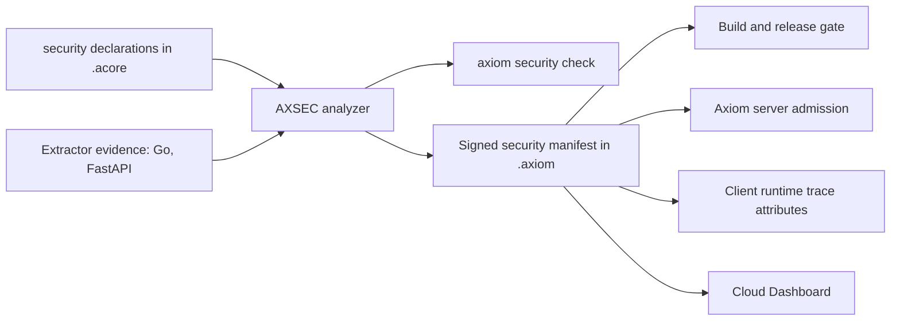

<span id="rule-delivery-groups" />
<span id="adoption-measurements" />

Security Mode is an optional `security(...)` block in a backend contract. The
compiler checks it and reports findings with stable `AXSEC` rule IDs. The same
IDs appear in local checks, CI, signed releases, contract pull requests,
contract pages, and trace context. A declaration is never presented as proof
that arbitrary handler code is safe. For the declaration syntax, see
[Domain and security models](/acore-language/domain-and-security-models); for
every field, see the [security schema](/reference/acore-schema-reference).



Declarations and extractor evidence both feed the analyzer. `axiom security
check` reports findings without writing an artifact. `axiom build` signs the
result into the `.axiom` contract as an `axiom-security-manifest/v1` manifest,
which the build gate, the Axiom server, the client runtime, and the dashboard
read.

## Modes

| Mode | `axiom security check` | `axiom build` and release | Axiom server |
| --- | --- | --- | --- |
| `audit` (default) | Reports all findings; exits 0 | Builds and releases | Advisory only; labeled `auditOnly` |
| `strict` | Exits non-zero on any error finding | Rejects the build with blocking findings | Enforces supported guards; refuses to start on unsupported declarations |

Add `--fail-on-warning` to `axiom security check` to fail on warnings too, for
example in a review-only CI job. Structural errors, such as a reference to an
unknown policy, stop compilation in either mode.

## Example

With no guard or policy for an endpoint, `strict` mode reports `AXSEC-001`:

```acore title="axiom.acore"
project(id: "notes-api", version: "1.0.0")
variant default(include: ["*"])

model Note { id: String }

endpoint GetNote(method: GET, path: "/notes/{id}") {
  request { path("id", type: String) }
  response(type: Models.Note)
}

security(mode: "strict")
```

The directory also needs an `AxiomDeps.toml` containing `type = "backend"`.

```bash title="Terminal"
axiom security check axiom.acore
```

```text title="Output"
Security Mode strict · 1 error(s), 0 warning(s) · 0 of 1 endpoints covered (0 direct, 0 default-policy)
AXSEC-001 ERROR [GetNote] `GetNote` is externally reachable but has no explicit public declaration or authorization policy.
  → Declare `security.endpoints[endpoint]` as public or bind it to a user-defined policy.
Error: security check found 1 error(s) and 0 warning(s)
```

Declaring the endpoint public clears the finding:

```acore title="axiom.acore: changed line"
security(mode: "strict", endpoints: { GetNote: EndpointGuard(public: true) })
```

`axiom build` on the first version fails with `security strict mode rejected
build: 1 blocking AXSEC finding(s)`. In `audit` mode the same finding is a
warning and the build succeeds.

## Finding statuses

| Status | Meaning |
| --- | --- |
| `invalid` | The declaration itself is unsafe, such as credentialed wildcard CORS |
| `uncovered` | A required declaration is missing |
| `declared_unproven` | A declaration exists, but nothing proves it is enforced |
| `observed` | An extractor found the condition in source code |

## Severity

Most findings are **mode-dependent**: a warning in `audit`, an error in
`strict`. The exceptions:

| Rule | Severity in every mode |
| --- | --- |
| `AXSEC-072`, `131`, `141`, `161` for a declared effect with no matching service, path, process, or upload policy | Error |
| `AXSEC-111` for declared credentialed wildcard CORS | Error |
| `AXSEC-121` | Error |
| `AXSEC-031` when the extracted authentication method is unknown | Warning |
| `AXSEC-041`, `AXSEC-151` | Warning |
| `AXSEC-111` when only an extractor observed wildcard CORS | Warning |

An error in `audit` mode is still non-blocking unless you add
`--fail-on-warning` or switch to `strict`.

## Rule families

| Family | Risks covered | AXSEC rules |
| --- | --- | --- |
| Identity | Broken authorization and IDOR; authentication | 001, 014, 031, 032 |
| Output and data | XSS; secret leakage; data exposure; observability leaks | 041, 051, 081, 082, 151 |
| Browser and network | SSRF; CSRF; rate limits and abuse; CORS | 061, 062, 072, 073, 091, 111 |
| Stateful and OS | Mass assignment; uploads; paths; commands; cache | 101, 121, 131, 132, 141, 142, 161, 162 |
| Global | Security invariants | Signed requirements that reuse the rule families above |

## Rule catalog

| Rule | Detects | Declaration or fix |
| --- | --- | --- |
| `AXSEC-001` | An endpoint with no public declaration or authorization policy | `EndpointGuard(public: true)` or a policy |
| `AXSEC-014` | A resource route with no resource binding (IDOR risk) | `EndpointGuard`, policy `resourceBinding`, domain relationship |
| `AXSEC-031`, `032` | A missing or unsafe authentication profile | `AuthenticationPolicy` transport safeguards |
| `AXSEC-041` | HTML output not marked as escaped | Escaped output boundary, or a reviewed unsafe exception |
| `AXSEC-051` | Secret or sensitive data not marked for redaction | `SensitiveData(redact: true)` plus adapter redaction |
| `AXSEC-061`, `062` | A required rate limit or idempotency key is missing | `RateLimit`, idempotency declaration, adapter key enforcement |
| `AXSEC-072`, `073` | Dynamic, unallowlisted, or private-network egress | Fixed `NetworkService` origin; private networks denied by default |
| `AXSEC-081`, `082` | A classified field returned without a projection or audience | Domain response projection and an approved audience |
| `AXSEC-091` | A cookie-authenticated mutation without CSRF protection | `CsrfPolicy`, or an explicit non-browser exemption |
| `AXSEC-101` | A mutation without a writable-field allowlist | `writableFields`; the adapter rejects unknown fields |
| `AXSEC-111` | Credentialed CORS with a wildcard origin | Explicit trusted origins; never credentials with `*` |
| `AXSEC-121` | Shared caching of authenticated responses without principal variation | Disable sharing, or require a principal vary key |
| `AXSEC-131`, `132` | Unrooted or dynamic filesystem access | Rooted `PathPolicy`; deny external input |
| `AXSEC-141`, `142` | A process without a fixed executable, or with shell access | Fixed executable and structured arguments |
| `AXSEC-151` | Possible sensitive value written to logs | Classify and redact; inspect the cited call site |
| `AXSEC-161`, `162` | An upload without a policy, or a policy missing safe defaults | Size and type limits, inspection, private non-executable storage |

## Extractor evidence without an SDK

The Go and Python (FastAPI) extractors record advisory facts in the signed
manifest: dynamic network targets, process execution, filesystem paths,
uploads, rate-limit signals, sensitive logging, and wildcard CORS. Each fact
has a file, line, confidence, and short description. Rate-limit signals are
recorded as evidence only and do not create a finding.

A fact can create a finding. It never grants access, marks a route public, or
weakens a policy. Existing services therefore need no SDK; you declare or
override a boundary in `axiom.acore` when the source evidence is incomplete.

<span id="enforcement-model" />

## Enforcement

| Boundary | Behavior |
| --- | --- |
| Compiler | Validates references and creates the canonical signed manifest |
| `axiom security check` | Reports the same deterministic rules locally and in CI |
| Build and release | `strict` rejects error findings; `audit` is non-blocking |
| Axiom server | `audit` manifests stay advisory. `strict` manifests enforce supported guards (policies, a single role, bearer JWT profiles, writable fields, CORS, rate limits, ownership bindings) and fail startup on declarations that need an unsupported enforcement capability. See [Identity and policies](/backend/policies). |
| Client runtime | Adds the manifest hash, mode, declared policy, auth and permission, and endpoint finding count to an OpenTelemetry span (`axiom.security.hash`, `.mode`, `.policy`, `.auth`, `.permission`, `.finding_count`) |
| Cloud Dashboard | Shows signed findings, coverage, the policy graph, diffs, and trace policy context |
| Existing Go or Python app | Unchanged by extraction; its own middleware and handlers enforce security at runtime |

The client runtime context is diagnostic only. Where no trusted server boundary
evaluates the signed policy against a principal and resource, the dashboard
labels the policy evidence `declared_unproven` instead of inventing a runtime
decision.
