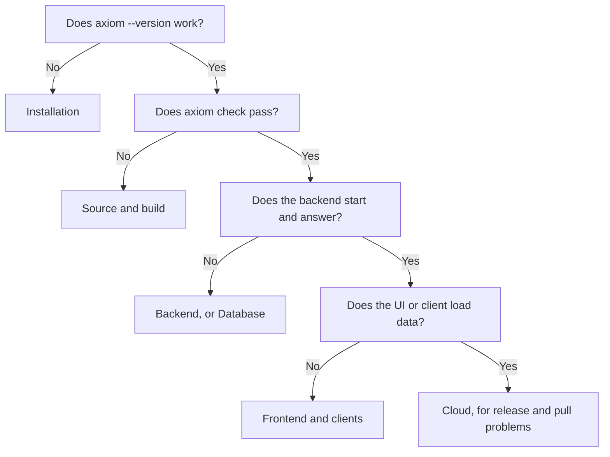

<span id="collect-a-safe-report" />
<span id="extraction-fails" />
<span id="build-or-lock-verification-fails" />
<span id="pull-or-generated-client-failure" />
<span id="browser-runtime-does-not-start" />
<span id="flutter-runtime-does-not-start" />
<span id="acore-ui-host-problems" />
<span id="cloud-release-stays-queued-or-fails" />
<span id="escalation-checklist" />

Find your symptom below, then apply the fix. Start at the narrowest failing
boundary and keep the **first** structured error: a later framework exception
often hides the extraction, artifact, or runtime condition that caused it.



Before you dig in, run the read-only diagnostics:

```bash title="Terminal"
axiom doctor
axiom ui doctor --target web
```

`axiom doctor` checks prerequisites without changing files, logging in, or
pulling a contract. Add `--json --strict` for a machine-readable report that
exits non-zero when a required prerequisite fails. Before sharing any output,
follow [Support and feedback](/reference/support-and-feedback) to remove
secrets and local paths.

## Installation

| Symptom | Cause | Fix |
| --- | --- | --- |
| `axiom: command not found` | The install directory is not on `PATH` | Add the directory (for example `$HOME/.local/bin`) to `PATH` in your shell profile, then open a new terminal |
| The checksum check fails | The download is incomplete or is not the expected file | Delete the archive and download it again. Do not run an unverified binary |
| `axiom --version` shows an older version than the guide | Another installation comes first on `PATH`, or an installer selected an older release | Run `which -a axiom`, remove or reorder the old copy, and install the version the guide names |
| No download for your operating system | Release archives are per platform; there is no native Windows download | Check the release assets and [Install the Axiom CLI](/getting-started/installation) |
| `MISSING_EXTRACTOR: fastapi-extractor` or `MISSING_EXTRACTOR: go-extractor` | Extractors install separately from the CLI. The CLI looks in `~/.acore/bin/` or at the path in `AXIOM_FASTAPI_EXTRACTOR` or `AXIOM_GO_EXTRACTOR` | Download the extractor binary as shown in [Backend extractors](/getting-started/installation#backend-extractors), or set the path variable |
| `axiom install axiom-fastapi --module` (or the Go equivalent) reports `Unknown tool` or a 404 download | Extractor installation through `axiom install --module` does not work in CLI 0.149.1 | Install the extractor manually; see [Backend extractors](/getting-started/installation#backend-extractors) |

## First app

| Symptom | Cause | Fix |
| --- | --- | --- |
| The UI reports an incompatible host | The installed web UI host does not match the CLI's capabilities | `axiom ui host install --target web --version 0.6.12 --non-interactive`, then check `axiom ui host status --target web` |
| The UI cannot load tasks | The backend is not running, the API key is wrong, or the frontend manifest's `baseUrl` is wrong | Check the backend terminal, paste the development API key it printed, and check `baseUrl` |
| Port already in use | Another process uses 8080 or 5173 | Change the port in the command, the manifest URL, and the CORS origins together |
| The backend connects to an unexpected database | `DATABASE_URL` is set in your shell | `unset DATABASE_URL`, then restart the backend |
| The frontend starts an iOS session instead of a browser | `axiom run` defaults Acore UI sources to `ios` | Add `--target web` |
| `AUI059 development contract ... uses an unsigned local artifact` | Local development uses unsigned contracts | Expected during development. A production release requires Axiom Cloud signing |

## Source and build

Run the checks one at a time to find the failing step:

```bash title="Terminal"
axiom check axiom.acore
axiom eval axiom.acore
axiom domain validate axiom.acore --json
axiom security check axiom.acore --json
axiom test axiom.acore
axiom build axiom.acore --out backend.axiom
axiom contract verify
```

| Symptom | Cause | Fix |
| --- | --- | --- |
| `Error: Read Acore source axiom.acore` with `No such file or directory` | No file argument was given and the current directory has no `axiom.acore` | Pass the source path, or run from its directory |
| `ParseError("Unexpected token: Colon")` on a line such as `project(id: ...)` | No `AxiomDeps.toml` in the source's directory or a parent, so the file is not compiled as a backend contract | Add `AxiomDeps.toml` with `type = "backend"` (or the matching type) beside the source |
| `No test configuration found` | `axiom test` ran on a contract without test suites | Declare `testConfig(suites: [...])`; see [Contract tests](/testing/contracts) |
| `security strict mode rejected build` | Security Mode is `strict` and the contract has error findings | Fix each `AXSEC` finding; see [Security rules](/reference/security-rules) |
| A build with `--frozen-interface` fails | The public interface drifted from the approved artifact | Review `axiom diff --format semantic`; update the approved artifact deliberately |
| `axiom contract verify` fails | A lock input no longer matches its recorded proof | Do not replace the lock with whatever the network returns. Confirm the intended immutable version, run `axiom contract resolve` deliberately, inspect `axiom contract diff`, and commit the dependency and lock together |

## Backend

| Symptom | Cause | Fix |
| --- | --- | --- |
| FastAPI extraction fails with a missing application object, an error from your own module, or attempts to reach infrastructure | Extraction imports your application's own modules and runs their top-level code. The extractor bundles FastAPI, Starlette, and Pydantic and replaces other third-party imports with placeholders | Check the `module:app` entrypoint passed to `axiom init`; move database connections, migrations, worker startup, and file writes out of import time; retry with the smallest module. You do not need the project's third-party packages installed to extract, only to run the service |
| A validation rule enforced by FastAPI or a Go handler is missing from the contract | Extraction does not carry path-parameter constraints (such as a maximum length) or checks inside Go handlers | Review the extracted contract with `axiom explain axiom.acore` and declare the rule in the contract if consumers need it |
| `axiom serve` fails before it is ready | A provider, credential, grant, or handler is missing, or a hash does not match. Real serving defaults to `deployment.json` beside the source | Pass the reviewed file with `--deployment` and check its bindings |
| A Python or Go service reports `application-adapter-required` | The CLI runs your entrypoint but adds no contract enforcement | Install the application adapter; see [Deployment targets](/backend/deployment) |
| `--watch` will not start | Watch needs a fixed loopback address and a source-owned managed or sandbox plan | Use the default host, and serve `.acore` source rather than an artifact |
| `strict security findings must be resolved before serving` | A `strict` manifest has error findings, or declares something the server cannot enforce | Fix the findings, or remove the unsupported declaration; see [Identity and policies](/backend/policies) |

See [Run a backend locally](/backend/local-development) for the full serving
workflow.

## Frontend and clients

| Symptom | Cause | Fix |
| --- | --- | --- |
| `atmx.init` resolves with `ok: false` | The contract, WebAssembly, or backend URL is unreachable; wrong content types; CORS; a signature without its public key; or a Content Security Policy that blocks WebAssembly | Read `InitResult.error` and `InitResult.contracts`. Check the URLs in the network tab, serve correct content types, allow the frontend origin in CORS, supply signature and public key together (or neither in local development), and allow WebAssembly in CSP |
| `WasmFetchFailed` | The WebAssembly engine URL is unreachable | Check `wasmUrl` or the default engine location |
| Queries fail right after page load | Code queries the SDK before `init` completes | Await `atmx.init` before mounting code that queries |
| Cached data hides a startup failure | A stored session cache | Record the failure, then clear the affected ATMX session cache |
| `npm ETARGET` during `axiom pull` | The automatic `atmx-cli` companion version is not published | Pin `atmx-cli` (for example 0.146.7) in the project before `axiom pull` |
| Generated client code does not compile | Hand-edited generated files, a wrong framework, or a moving channel | Regenerate into a clean directory with an explicit `--framework`, pin a release version, and compile the app before committing |
| `axiom pull` cannot find the contract | More than one source form, or no access to a private project | Use exactly one source form; sign in and confirm project membership |
| Flutter runtime does not start | An `assetPath` is not in the Flutter bundle, native libraries are missing, `dbPath` is not writable, or widgets query before `init` | Declare every generated asset, add the native runtime for the platform and architecture, use a writable `dbPath` (or omit it to isolate cache problems), initialize first, and test emulator and release builds |
| Swift integration behaves differently | Swift distribution is **Experimental** | A local XCFramework build does not establish a supported Swift package integration |
| An Acore UI host is stuck after a crash | Stale delivery records | `axiom ui host recover --target TARGET` restarts the host and discards stale records. It does not fix invalid source, missing assets, or a failed platform toolchain |

To diagnose an Acore UI target, run `axiom ui doctor --target ios --json`,
`axiom ui host status --target ios`, and `axiom ui test main.acore --target ios`
(replace `ios` with your target).

## Database

| Symptom | Cause | Fix |
| --- | --- | --- |
| `ADB1110` | PostgreSQL needs a password | Use the masked prompt, `PGPASSWORD`, or `--password` in non-interactive runs |
| `ADB1107` | The connection does not match the declared engine, for example a PostgreSQL URL for a SQLite contract | Supply the URL, fields, or `--database-file` for the declared engine |
| `ADB1106` | No validator runtime for the target PostgreSQL major version | Install a matching validator or a supported PostgreSQL; no migration ran |
| `ADB1103` | The version in `project(...)` is already used | Accept the suggested version, update the source, or use `--auto-version` in CI |
| `ADB1105` | The database has drifted from its recorded state | Run `axiom database status` and establish an exact baseline |
| `ADB1111` in CI | A destructive, data-dependent, or security change needs approval | Pass `--allow-destructive`, `--allow-data-dependent`, or `--allow-security-changes` for the reviewed risk |
| `ADB1112` | A new required column has no value for existing rows | Make it nullable, or declare a default or backfill |
| A primary-key conflict when you rerun a quickstart insert | The row already exists | Omit the insert on later runs |
| A browser preview shows data but no migration ran | Browser previews simulate storage and history | Run migrations with the CLI |

All `ADB` codes are listed in [Runtime errors](/reference/error-codes).

## Cloud

| Symptom | Cause | Fix |
| --- | --- | --- |
| `Not logged in. Run 'axiom login' first.` | The CLI has no Cloud session | Run `axiom login`. Cloud access requires an authorized machine; local commands do not |
| `This contract is private. Run axiom login` | `axiom pull` of a private project | Sign in and confirm project membership |
| `This artifact has no release version` | Neither the contract nor the command sets a version | Pass `--version`, or declare a version in `project(...)` |
| A version collision on release | A project and version pair is immutable | Interactive releases suggest the next free version. In CI, pass a new `--version` |
| `Release versions may only contain letters, numbers, ...` | The version has other characters | Use only letters, numbers, `.`, `_`, `-`, and `+` |
| A managed environment is disabled although release verification works | Managed environments are separate from contract storage | Check the environment's state in the dashboard |
| A mock configuration is saved but no sandbox is ready | Saving mocks does not provision a sandbox | Provision the sandbox and wait for it to be ready |
| A secret has no value, or runtime access is denied | Values are per environment; access needs a binding and grant | See [Secrets](/cloud/secrets) |

A release that stays queued or fails is in one of these states:

| State | What it means | What to do |
| --- | --- | --- |
| Upload failure | Authentication, project membership, version collision, or artifact validation failed | Fix the reported cause and upload again |
| Queued or running | Durable work exists, but a worker or provider step has not finished | Wait, then check the recorded stage |
| Failed | A stage failed | Inspect the recorded stage and attempt; do not retry the whole workflow blindly |
| Warning | Semantic or policy evidence needs review | Review it; an owner can acknowledge it if appropriate |
| Deployable but not latest | Activation policy or channel generation still needs action | A project owner activates the release on the channel |

See [Releases and environments](/cloud/releases-and-environments).

## Still stuck

Collect a sanitized report and contact the project through
[Support and feedback](/reference/support-and-feedback).
