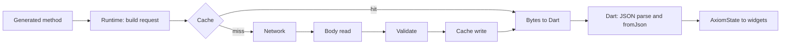

<StatusNote status="alpha" title="axiom_flutter 0.150.1">
  Timings on this page come from the SDK's own measurements on a Linux test
  machine. Measure release builds of your app on your target devices.
</StatusNote>

A call from a generated Dart client goes through the AxiomCore runtime before
and after the network. The runtime owns retries, auth, the cache, cancellation
and validation for that call, so it adds some work to every request. This page
explains where that time goes and which settings change it. Measured results
are on [Flutter benchmarks](/sdks/flutter-benchmarks).

## How a call flows



1. **Request build.** The generated method passes the endpoint and arguments to
   the runtime: through `dart:ffi` on Android, iOS and macOS, through
   JavaScript interop into WebAssembly on the web.
2. **Pipeline.** The runtime applies the contract: base URL, path, query,
   headers, auth token, retry policy and the cache strategy.
3. **Network.** The runtime's own HTTP stack sends the request over HTTP/1.1.
   On the web the request is a browser `fetch`.
4. **Body read.** On the web, a body that the runtime must check is copied once
   into wasm memory. Dart then reads the browser's buffer directly, so there
   is no copy back out.
5. **Validation.** The body is checked against the contract (see below).
6. **Cache write.** Only for endpoints whose cache strategy has a TTL.
7. **Hand-off.** On native platforms the bytes go to Dart without an extra
   copy.
8. **Decode.** Dart parses the JSON and the generated `fromJson` builds your
   models.

In the SDK's stage measurements, steps 1 and 2 cost well under a tenth of a
millisecond. For large lists, the time is in the network, the body copy on
the web, validation and the Dart decode.

## Response validation

The runtime checks every response before your code sees it:

- **Endpoints without field rules** (no `minLength`, ranges, enums and so on in
  the response models) get an exact JSON syntax check. A malformed body fails
  with a typed `ValidationError` instead of a Dart `FormatException`. Since
  0.150.1 this check no longer builds a JSON tree.
- **Endpoints with field rules** are validated against the rules, according to
  the validation policy.

### Validation policy

| Policy | What is checked |
| --- | --- |
| `auto` (default) | Bodies under 64 KiB: everything. Bodies of 64 KiB or more: sampled |
| `full` | Every item of every list |
| `sample` | The envelope, every field outside lists, the real length of each list against its `min` and `max`, and the first and last items of large lists |
| `off` | JSON syntax only |

Sampling applies only to plain lists. Lists with other schemas (tuples, sets,
unions, records, references) are always validated in full, and a sampled check
never rejects a body that the full check accepts.

**Behaviour change in 0.150.1:** large responses are sampled by default. Each
`AxiomState` reports what ran in `state.validation`
(`AxiomValidationMode.full`, `sampled`, `off`, or `unknown` when the runtime
does not report it, as with the published Apple runtime 0.148.6). To get the
0.150.0 behaviour, validate everything:

```dart title="Dart excerpt: full validation"
// For the whole app:
sdk = await AxiomSdk.create(
  config: AxiomDefaultConfig.config.copyWith(
    validation: AxiomValidationPolicy.full,
  ),
);

// For one call:
sdk.tasks.listTasks(
  options: const AxiomCallOptions(validation: AxiomValidationPolicy.full),
);
```

A call option wins over the global setting. The published Apple runtime
0.148.6 used on iOS and macOS has no validation policy: it ignores both
settings and validates in full.

## Cache layers

| Layer | Where | What it holds | Default |
| --- | --- | --- | --- |
| Response cache | Runtime; on-device store on Android, iOS and macOS, `localStorage` on the web | Response bytes for endpoints with `cacheFirst`, `networkFirst` or `staleWhileRevalidate` | On, per the contract's strategy and TTL; survives restarts |
| Query state | Dart | The last `AxiomState` of each active query | On, while the query has listeners |
| Decoded object cache | Dart, native platforms | Decoded models, reused when the runtime returns byte for byte the same body | **Off** |

Identical queries that run at the same time in Dart share one request.

The decoded object cache skips `fromJson` when a cached response is served
again. Turn it on only if your app treats models as immutable, because a
repeat call can then return the same model instance:

```dart title="Dart excerpt: opt in to the decoded object cache"
sdk = await AxiomSdk.create(
  config: AxiomDefaultConfig.config.copyWith(objectCacheMaxEntries: 64),
);
```

`objectCacheMaxBytes` (default 8 MB) limits its memory. The cache is cleared by
`clearCache`, `purgeCache`, `invalidate` and `resetSession`.

## Background JSON parsing

On Android, iOS and macOS, a response body of 256 KB or more is parsed from
JSON on a background isolate. Only the parse moves: the generated `fromJson`
still runs on the calling isolate, so decoder state is kept. Smaller bodies
and stream events are parsed inline. Change the threshold, or set it to `0` to
parse everything inline as in 0.150.0:

```dart title="Dart excerpt: decode threshold"
sdk = await AxiomSdk.create(
  config: AxiomDefaultConfig.config.copyWith(decodeIsolateThreshold: 0),
);
```

On the web, Dart runs on the browser's main thread and parsing stays there.

## Web fast start (opt-in)

By default, `AxiomSdk.create()` on the web waits until the WebAssembly runtime
has started and accepted every contract. With fast start, it returns as soon
as the contract assets are read, and eligible `GET` calls run as a plain
`fetch` until the runtime is ready:

```bash title="Terminal: Flutter project root"
flutter run -d chrome --dart-define=AXIOM_WEB_FAST_START=true
```

Limits:

- Only contracts that need no signature verification, and only namespaces in
  which no endpoint declares auth, get fast start. Validated endpoints always
  wait for the runtime.
- The runtime checks the contract later. If that check or the runtime start
  fails, the failure goes to `sdk.runtime.onError`, `initResult` is replaced
  by the failure, and every queued and later call fails with that error.

## What stays slower than a bare request

Compared with a plain `http` or `dio` call that decodes the same JSON, an
Axiom call does extra work:

- **The body is checked by the runtime.** On the web this means one copy into
  wasm memory. The check turns a malformed body into a typed error.
- **Cold start on the web.** The first call waits for the WebAssembly runtime
  to download and compile and for the contracts to load. Clients without a
  runtime do not pay this. Fast start shortens the wait for eligible calls.

The cache and shared in-flight requests can make repeated calls faster than a
bare client. The benchmarks page lists the measured rows, including the ones
where Axiom is slower.

## Planned

These are not in 0.150.1: HTTP/2, the binary (FlatBuffers) codec for
Axiom-to-Axiom lists, request batching, streaming decode of large lists, and
conditional requests (ETag). Stage timings per call are recorded by the native
runtime but have no Dart API yet.

## Make your app faster

- Choose a cache strategy with a TTL for data that does not change on every
  request (`cacheFirst` or `staleWhileRevalidate`).
- Page large lists on the backend instead of returning thousands of items.
- On the web, call `AxiomSdk.create()` early in `main` so the runtime loads
  while your first frame renders.
- Measure release builds. Debug builds and hot reload are much slower and do
  not reflect what users see.

## Related

- [Flutter benchmarks](/sdks/flutter-benchmarks)
- [Flutter app size](/sdks/flutter-app-size)
- [Cache strategies and control](/sdks/flutter#cache-strategies-and-control)
