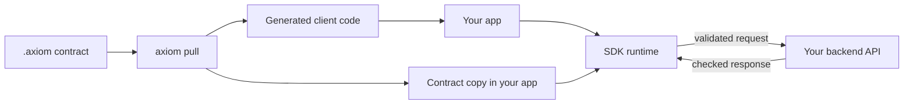

A client SDK lets an existing browser, React or Flutter app call an AxiomCore
backend through its `.axiom` contract. `axiom pull` copies the contract into
your project and generates typed client code. The SDK's runtime then builds,
sends and validates every request against that contract.



## Published SDKs

| Package | Ecosystem | Install | Version | Status |
| --- | --- | --- | --- | --- |
| [`atmx-web`](/sdks/web) | npm | `npm install atmx-web@0.147.5` | 0.147.5 | **Available** |
| [`atmx-react`](/sdks/react) | npm | `npm install atmx-react@0.147.4` | 0.147.4 | **Alpha** |
| `atmx-cli` (generator for both npm SDKs) | npm | `npm install --save-dev atmx-cli@0.146.7` | 0.146.7 | Follows the SDK it generates for |
| [`axiom_flutter`](/sdks/flutter) | pub.dev | `flutter pub add axiom_flutter:^0.147.5` | 0.147.5 | **Alpha** |
| `axiom_flutter_generator` | pub.dev | `flutter pub add dev:axiom_flutter_generator:^0.146.6` | 0.146.6 | **Alpha** |
| [Swift package](/sdks/swift) | Source only | Not published | None | **Experimental** |

`atmx-react` depends on `atmx-web` `^0.147.5` and needs `react` and `react-dom`
18 or 19. For Flutter, `axiom pull` adds both pub.dev packages to
`pubspec.yaml` when they are missing.

## Generate a client

```bash title="Terminal (in your frontend project)"
axiom pull ../backend/backend.axiom --framework atmx-web --name tasks --out src/generated
```

| `--framework` | Default `--out` | Files written |
| --- | --- | --- |
| `atmx-web` | `src/generated` | `public/<name>.axiom`, `sdk.ts`, `models.ts` |
| `atmx-react` | `src/generated` | The same files, with React query definitions and hooks |
| `flutter` | `lib/axiom_generated` | `assets/axiom/<name>.axiom` (registered in `pubspec.yaml`), `axiom_sdk.dart`, `models.dart` |
| `dart` | `lib/axiom_generated` | Accepted by the CLI; it does not add packages or copy the contract asset, and these guides do not cover it |

What `pull` does, in order:

1. **Picks the framework:** `--framework`, else the `framework` key in
   `AxiomDeps.toml`, else detection, which you confirm. A `pubspec.yaml` that
   depends on Flutter gives `flutter`, any other `pubspec.yaml` gives `dart`, a
   `package.json` listing `react` or `atmx-react` gives `atmx-react`, and any
   other `package.json` gives `atmx-web`.
2. **Resolves the source:** a local `.axiom` file, an `AxiomDeps.toml` or JSON
   config, an AxiomCore URL, or `organization/project[/version]`, given
   positionally or with `--contract` (not both). With no source it re-pulls
   every contract in `AxiomDeps.toml`. Private projects need `axiom login`; a
   reference without a version follows the release promoted to latest.
3. **Fetches everything first** into `~/.axiom/contracts/<name>/`, so a failed
   download leaves `AxiomDeps.toml` untouched.
4. **Records the dependency:** `framework`, plus a `[contracts.<name>]` table
   with `source`, optional `version`, and the Cloud `signature` and
   `public_key` when the release has them (public verification material, not
   credentials).
5. **Generates code** with the framework's generator.

Pass `--framework`, `--name` and `--out` in scripts; otherwise `pull` prompts
for the name and output directory. Commit `AxiomDeps.toml` with the generated
files and treat generated files as read-only.

The generated backend URL is `http://localhost:8080` (web and React) or
`http://localhost:8000` (Flutter) unless the contract's table in
`AxiomDeps.toml` sets `base_url` before you pull. You can also override it at
startup.

<Callout type="warn" title="Install atmx-cli before pulling for web or React">
  CLI 0.149.1 runs the project's own `node_modules/.bin/atmx` when present.
  Otherwise it runs `npx atmx-cli@0.149.1`, which is not published, and the
  pull fails with npm `ETARGET`. Install `atmx-cli@0.146.7` as a dev
  dependency first.
</Callout>

## What the runtime does in your app

The runtime is Rust code compiled to Wasm for the browser and to a native
library for Flutter. For each call it:

- loads the contract and verifies its signature when one is configured;
- resolves the endpoint and places arguments in the path, query, headers or
  body as the contract declares;
- applies the endpoint's cache policy and shares identical in-flight queries;
- attaches credentials you supplied, held in memory only;
- validates and decodes the response, or returns a structured error with
  stage, category, code, message and retryability.

See [The contract runtime](/core-concepts/the-generic-runtime) for the request
lifecycle and [Runtime errors](/reference/error-codes) for error codes.

## Next steps

- [Web (atmx-web)](/sdks/web), the **Available** path
- [React (atmx-react)](/sdks/react)
- [Flutter and Dart](/sdks/flutter)
- [FastAPI to web](/guides/fastapi-to-web), a complete tested example
