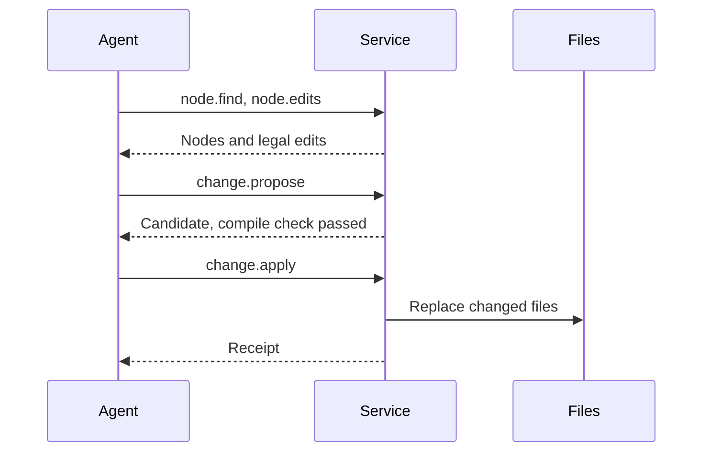

`acore-semantic` is a local service that lets a coding agent read and change
an Acore UI project through compiler facts instead of searching and rewriting
text. An agent asks for nodes, relationships and the edits that are legal; it
proposes a change, sees it compiled and checked, and only then writes the
files, with a receipt.

<StatusNote status="experimental" title="Preview">
  The semantic service is a preview for Acore UI projects (profile `acore-ui`,
  target `web`) on macOS arm64. It is not published yet; see
  [Quick start](/semantic-service/quickstart#1-install).
</StatusNote>

## Who it is for

- Developers who use Claude Code, Codex or another MCP client on an Acore UI
  project and want edits that preserve every byte the change does not touch.
- Tool authors who want typed, bounded answers about an Acore UI project from
  a stable protocol.

## What it does

The service compiles the project and answers from the compiler's results:

| Task | Operations |
| --- | --- |
| Attach a project and list its modules, entry points and contracts | `workspace.open`, `project.overview` |
| Find nodes and read their properties and relationships | `node.find`, `node.get`, `graph.query`, `impact.analyze` |
| Build a bounded slice of context for a task | `context.build` |
| Discover legal edits, dry-run them, and propose a change | `node.edits`, `edit.plan`, `change.propose` |
| Review and check a proposed change | `change.inspect`, `check.run` |
| Write a change, or drop it | `change.apply`, `change.discard` |
| Follow nodes across changes made by others | `changes.since`, `node.relocate` |

## Terms

| Term | Meaning |
| --- | --- |
| Workspace | One attached project root. One service process serves one root. |
| Snapshot | An immutable capture of the project's sources and inputs. Every read names one, and the answer describes exactly that state. |
| Node id | The name of a page, component, state, action or element within one snapshot, such as `element:Home/view/0/1`. Opaque: copy it, do not build it. |
| Candidate | A proposed change, compiled in a private copy of the project. Nothing is written until it is applied. |
| Receipt | The record `change.apply` returns: outcome, files with digests before and after, id changes and the new snapshot. |

## Example

Take this excerpt from a page's view:

```acore title="main.acore (excerpt)"
Input(value: draft, placeholder: "Add a task")
Button(label: "Add", on_press: submit)
```

`node.find` with the query `Add` returns the Input and the Button, each with
an id such as `element:Home/view/0/1`. `node.edits` on the Button says its
`label` can be set to a string or bound to the state `draft`. `change.propose`
with `old_value: "Add"` and `new_value: "Add task"` returns a candidate whose
compile check passed, and `change.apply` writes exactly one line of
`main.acore` and returns a receipt with the file's digests before and after.
The [quick start](/semantic-service/quickstart) runs this flow.

## How it fits



The agent talks to the service over MCP. The service reads the project files,
compiles them, keeps its state in `.axiom/semantic` under the project root,
and writes project files only during `change.apply`. It needs no account or
network and never calls a model.

## Boundaries

- One project root per workspace. The project must be on a local
  filesystem; remote and network filesystems are not supported. (Publishing a
  change anywhere other than the local files is also not offered.)
- At most 64 source files per project, counting the entry and every file it
  imports. A larger project is refused with `resource_limit`
  (`too_many_modules`).
- Profile `acore-ui` (pages and components in `.acore` files) and target `web`
  only. Other profiles, targets and backend, data or API code are not served.
- The service never installs dependencies or runs project code. A project
  without its prepared contracts and UI lock reports `needs_preparation`.
- Edits are the seven families in the [support matrix](/semantic-service/support-matrix#edit-families).
  Not supported: expression- or statement-level edits inside a declaration,
  edits of a signature across modules, and rename, move or extract refactors.
- Relationships come from declared and resolved compiler facts. There are no
  facts observed at run time, no test associations and no authorization
  policies.
- Applying a change replaces files one at a time, each atomically. It is not
  atomic across files for other readers and is not proven against power loss.
- Idempotency records (one per `request_id` and per discarded candidate)
  have no retention limit, so `.axiom/semantic` grows with use. See
  [Clean up](/semantic-service/quickstart#clean-up).

## Next steps

- [Quick start](/semantic-service/quickstart): connect a client and make a first edit.
- [Protocol reference](/semantic-service/protocol): operations, errors and limits.
- [Agent skill](/semantic-service/agent-skill): the workflow to give your agent.
