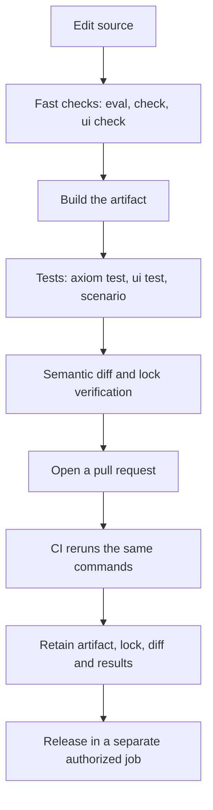

<span id="review-artifacts" />

AxiomCore checks answer different questions: is the contract valid, does a
running API meet its declared expectations, does a client handle every declared
response, does managed logic retry and clean up correctly, and what does a
change do to consumers. This page maps each question to a command and shows the
loop that runs the same commands locally and in CI.

## Choose a check

| Need to check | Command | Status | Guide |
| --- | --- | --- | --- |
| Source, domain and security models | `axiom check`, `axiom eval`, `axiom domain validate`, `axiom security check` | Alpha | [CI checks](/testing/ci) |
| A running API against declared expectations | `axiom test` | Alpha | [Contract tests](/testing/contracts) |
| Managed retry, cancellation and expiry with logical time | `axiom scenario` | Experimental | [Contract tests](/testing/contracts) |
| A client without a live service | `axiom mock --profile contract` | Alpha | [Mocks](/testing/mocks) |
| Managed server behavior with explicit fixtures | `axiom serve --mock`, `axiom mock` | Experimental | [Server simulation](/testing/server-simulation) |
| Acore UI forms, queries, state and cleanup | `axiom ui test` | Alpha | [Frontend tests](/testing/frontend-applications) |
| Consumer impact of a change | `axiom diff`, `axiom inspect diff` | Alpha | [CI checks](/testing/ci) |

## What each check proves

Each check exercises a different layer. Every one is useful; none replaces a
real request through the backend and database, or a run on a mounted native
target.

| Check | Runs | Does not prove |
| --- | --- | --- |
| Contract mock | Declared endpoint `MockConfig` responses | Private actions, guards or providers |
| Server simulation | Real routing, authentication, guards, validation and transport, with fixture replies | Native or sandbox action bodies and production providers |
| Scenario (`compiler-host`) | The compiled managed host with scripted read replies and logical time | Persistence, transport or native OS behavior |
| UI application suite (`compiler-host`) | Reference semantics, or the generated web and native adapters | A mounted browser, emulator or simulator |
| Browser database preview | Simulated storage and history | Native migrations or persistence |
| `axiom test` | Live HTTP and WebSocket requests to the suite's base URL | Anything about targets it did not call |

## The local and CI validation loop



Run the smallest check for what you changed, then the consumer check that can
reveal integration failures. CI repeats exactly those commands with pinned
versions, keeps the evidence, and only then lets a separate job release.

| Change | Fast check | Consumer check |
| --- | --- | --- |
| Contract source | `axiom eval axiom.acore` | `axiom build`, `axiom test`, semantic diff |
| Domain semantics | `axiom domain validate axiom.acore` | Build and domain review |
| Security semantics | `axiom security check axiom.acore` | Strict build or release gate where enabled |
| Acore UI | `axiom ui check main.acore --target web` | `axiom ui test` and a target host run |
| Contract lock | `axiom contract verify` | `axiom contract check-source main.acore` |
| Package lock | `axiom packages verify` | Package-backed source check or build |
| Database contract | `axiom database check database/schema.acore` | `axiom database status ... --check` |

<span id="host-independent-ui-ci" />

### Host-independent UI checks

```bash title="Terminal"
axiom run main.acore --target web --once
axiom run main.acore --target android --once
axiom run main.acore --target ios --once
```

`--once` compiles and exits, which suits CI machines without an emulator. It
does not replace an emulator, simulator or browser interaction test.

## Keep the evidence

- Keep the source, dependency manifest, committed lock, semantic diff and test
  result that belong to the same candidate.
- Reject a pipeline that pulls an unpinned latest package between checking and
  building.
- Use synthetic data and test the relevant failure paths.
- For an environment-specific failure, attach `axiom doctor --json` after
  reviewing the local project path it contains. Never attach credentials or
  secret-bearing runtime configuration.

## Next steps

- Write a first suite in [Contract tests](/testing/contracts).
- Add the [CI contract gate](/testing/ci).
- Review evidence across an app with [Changes and impact](/inspector/changes-impact-and-ci).
