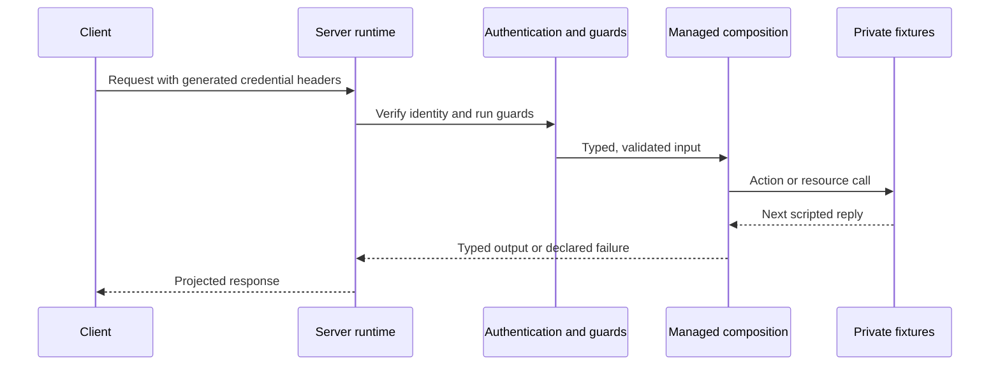

<span id="prepare-the-managed-example" />
<span id="explicit-delivery-and-evidence" />
<span id="logical-scenario-replay" />

`axiom serve --mock` simulates business execution inside the same server
runtime and HTTP transport as real serving. Managed composition, nested guards,
typed inputs and failures, response projections, metadata, admission and
supported transport checks stay active. Native and sandbox action bodies and
application callbacks are replaced by fixture replies; no production provider,
guest module, network client or worker is loaded.

<StatusNote status="experimental" title="Experimental">
Server simulation is part of the Experimental managed server runtime. It does
not verify the native implementations, real provider retries or circuits, user
callbacks or infrastructure that it replaces.
</StatusNote>

## How a simulated request runs



The client sends credentials that the simulator generated for a reviewed
identity. The server verifies them with the same authenticator as real serving
and runs the guards. Managed code runs for real; each native action, resource
operation, interceptor and webhook it reaches returns its next fixture reply
instead. The response is projected exactly as in real serving.

## Choose a profile

```bash title="Terminal: project root"
axiom serve service.acore --mock --fixtures mock.json --identities mock-identities.json --port 8080
axiom mock service.acore --fixtures mock.json --identities mock-identities.json --port 8080
axiom run service.acore --mode mock --fixtures mock.json --identities mock-identities.json --port 8080
axiom mock backend.axiom --plan backend.server.json --profile server --fixtures mock.json --identities mock-identities.json
axiom mock contract.acore --profile contract --port 8080
axiom mock --cloud --port 8080
```

- Omitted input means `axiom.acore` in the current directory.
- `axiom mock` selects the server profile when compilation supplies a private
  server plan; otherwise it selects the labeled [contract profile](/testing/mocks).
  A broken or unsupported plan fails without downgrading. `serve --mock` always
  requires a server plan.
- Contract simulation keeps endpoint scenarios and legacy state but cannot
  enforce private actions absent from its input.
- Companion paths are relative to where you run the command. Defaults are
  `mock.json` and `mock-identities.json` beside the selected source or
  artifact; an artifact also uses the adjacent `INPUT.server.json` plan.
- Full mocks reject real `--deployment`, `--bindings` and `--delivery`. Real
  serving rejects fixtures and mock identities.
- Local commands need no Cloud account. `--cloud` needs a linked project and a
  Cloud session.

## Set up fixtures and identities

1. Build the contract and its private plan:

   ```bash title="Terminal: project root"
   axiom build service.acore --out backend.axiom
   axiom server inspect backend.axiom backend.server.json
   ```

   `server inspect` prints JSON that includes `contractSha256` and `planSha256`.

2. Write `mock-identities.json`. Data fixtures cannot create principals,
   credentials, permissions or resource-operation grants; only this reviewed
   file defines who can call:

   ```json title="mock-identities.json"
   {
     "format": "axiom-mock-identities/v1",
     "identities": {
       "reader": { "subject": "reader", "tenant": "development", "permissions": ["task.read"] },
       "denied": { "subject": "denied", "tenant": "development", "permissions": [] }
     }
   }
   ```

   The file is limited to 1 MiB and 64 identities. Without it, authenticated
   requests cannot acquire a development identity.

3. Write `mock.json` (see [Fixture format](#fixture-format)) with synthetic data
   only, and keep both files private.

4. Start the simulator:

   ```bash title="Terminal 1: project root"
   axiom serve service.acore --mock --fixtures mock.json --identities mock-identities.json --port 8080
   ```

   Startup reports `mode: "server-mock"`, the actual port, a `credentialsFile`
   and a `sessionFile`. The credentials file is owner-only (mode 0600) and
   holds each identity's generated request headers and real expiry. Generated
   development JWT keys, API keys and session credentials are isolated from
   production, and request-supplied principals are never accepted.

5. Send a request without printing credentials:

   ```bash title="Terminal 2"
   export AXIOM_MOCK_CREDENTIALS=/absolute/path/from/startup/credentials.json
   python3 - <<'PY'
   import json, os, urllib.request
   with open(os.environ["AXIOM_MOCK_CREDENTIALS"]) as stream:
       headers = json.load(stream)["reader"]["headers"]
   request = urllib.request.Request("http://127.0.0.1:8080/tasks/1", headers=headers)
   with urllib.request.urlopen(request) as response:
       print(response.read().decode())
   PY
   ```

With the fixture below, the first call returns the synthetic task, the second a
sanitized provider failure, and the third `mock_exhausted` (HTTP 503). Restart
to restore the FIFO sequences and state. Shutdown removes the owned
credentials, session file and upload staging. Debug output stays redacted.

<span id="private-fixture-format" />

## Fixture format

```json title="mock.json (excerpt)"
{
  "format": "axiom-server-mock/v1",
  "contractSha256": "<contractSha256 from axiom server inspect>",
  "planSha256": "<planSha256 from axiom server inspect>",
  "seed": 7,
  "clockUnixMs": 1700000000000,
  "resources": {
    "tasks": {
      "read": { "replies": [
        { "outcome": { "kind": "value", "value": { "title": "Synthetic task", "completed": false } } },
        { "outcome": { "kind": "unavailable" } }
      ] }
    }
  }
}
```

`axiom-server-mock/v1` binds the exact contract and plan hashes. Fixtures stay
private companion files: public `.axiom` codecs and production packages contain
no fixture, identity, generated credential or simulation state.

| Field | Meaning |
| --- | --- |
| `seed`, `clockUnixMs` | Required deterministic session controls. Selection is FIFO, not random. |
| `actions` | Native or sandbox action name to `{ "replies": [...] }`. Managed programs cannot be overridden. |
| `resources` | Every resource and declared operation to finite replies, including guard dependencies |
| `interceptors` | Every declared interceptor to `{ "reject": false, "delayMs": 0 }`. Its native callback never loads. |
| `metadata` | Optional per-endpoint typed `headers` and `cookies`. Required metadata needs an explicit producer fixture. |
| `webhooks` | Every declared webhook to finite `null` acknowledgments or `unavailable` outcomes |
| `initialState` | Bounded literal synthetic state, separate from identity and authority |

Each reply has an `outcome`, an optional `delayMs`, literal `state` updates and
optional explicit simulated `effects`:

```json title="Reply outcomes"
{"kind":"value","value":{"title":"Synthetic task","completed":false}}
{"kind":"failure","failure":"missing","payload":{"message":"Synthetic absence"}}
{"kind":"unavailable"}
{"kind":"frames","frames":[{"id":"1","value":1,"padding":""}]}
{"kind":"input","path":["file"]}
```

- `failure` must be declared on its action.
- `frames` must match the stream schema and policy. A WebSocket sequence
  supplies one frame per client message.
- `input` copies a validated typed input path, which suits generated upload
  descriptors. It is not an expression or template. An empty path copies a
  resource input, or a whole action input whose fields exactly match the output
  model.

An opaque upload success needs explicit effects. For an action whose input has
a typed `file` descriptor and whose declared effects include `files.store`:

```json title="Reply with an upload effect"
{
  "outcome": { "kind": "input", "path": ["file"] },
  "effects": [{ "resource": "files", "operation": "store", "inputPath": ["file"] }]
}
```

The matching `files.store` resource reply uses `{ "kind": "input", "path": [] }`.
Each effect passes the unchanged action effect and provider-operation gates, so
fixtures cannot add grants or invent undeclared calls. Uploads use owned
temporary storage with the real size, content, ownership and cancellation
checks. Missing, invalid or exhausted replies fail explicitly; they never call
a real implementation or provider.

<span id="bounds-time-and-lifecycle" />

## Limits, time and reset

Fixtures with duplicate keys, unknown fields, wrong hashes or invalid typed
values fail before the server listens.

| Limit | Value |
| --- | --- |
| Fixture document | 4 MiB, 32 nesting levels, 32,768 JSON nodes |
| Targets and replies | 256 targets, 4,096 replies in total, 1 to 256 per sequence |
| One value or state entry | 256 KiB |
| Reply delay | 30 seconds |
| Initial state | 256 entries |
| State partitions | 64, each with up to 256 entries, 16 MiB of mutable state in total |

Stream policies can set smaller limits. Scenario cursors and state are
partitioned by verified subject and tenant, with a separate anonymous
partition. A capacity error keeps the existing partitions. Declared caches keep
their own entry and byte limits and isolation, and authorization still runs
before every cache read.

Admission and cache TTLs use the simulation clock, which starts at
`clockUnixMs`. Only a compatible embedded host can advance it; the CLI does not
substitute it for transport time. Real credential expiry, transport timeouts
and cancellation use real time. For synthetic credential or provider expiry and
logical batch windows, use [scenarios](/testing/contracts); the live simulator
does not inherit their clocks. Memory admission simulates declared distributed
or durable policies for development only: it does not show Redis durability,
multi-process replay or crash recovery.

An embedded simulation host can reset scenarios, state, caches and memory
admission after active work drains; the simulation clock keeps its value. Full
mock hosts expose no HTTP docs or reset route that could bypass action
authentication. Ctrl+C and SIGTERM use the real bounded drain and cleanup.

## Reload source and fixtures

```bash title="Terminal: project root"
axiom serve service.acore --mock --fixtures mock.json --identities mock-identities.json --watch --port 8080
axiom run service.acore --mode mock --fixtures mock.json --identities mock-identities.json --watch --port 8080
```

- Watch needs local `.acore` source and a fixed loopback port. Cloud, artifact,
  non-loopback and port-zero watch are not supported.
- Each reload captures source, fixtures and identities into an owned snapshot;
  companion files outside the project are watched too. A snapshot build has 30
  seconds.
- Invalid source, malformed fixtures, hash drift or incompatible authority
  keeps the last valid service, credentials and state running.
- Reload accepts managed computation changes only within unchanged public
  interfaces, guards, implementation kinds, resource operations and action
  authority. Fixture hashes must match the initial reviewed session or the
  exact candidate; only then does the supervisor rebind metadata in its own
  fixture copy. Your files and built artifacts are never rewritten. Type, route,
  guard, capability or profile changes need a new build, reviewed fixtures and
  a restart. A contract session cannot gain a private server plan by reloading.
- Activation drains the old listener, briefly interrupting requests. A
  successful reload starts fresh state, FIFO cursors, clock, caches, admission
  and credentials; read the new `credentialsFile`, because the old one is
  removed. A failed activation restarts the last validated snapshot, also with
  fresh state and credentials.
- A snapshot holds at most 1,024 source files, 16 directory levels and 16 MiB
  of source, or 32 MiB with companions. Symbolic links and special files fail
  closed. Hidden, build, dependency and generated-artifact directories are
  excluded, so install dependencies before starting watch.

<span id="inspect-the-selected-execution" />

## Inspect the running session

```bash title="Terminal: project root"
axiom inspect server backend.axiom backend.server.json --session /absolute/path/from/startup/session.json --format json
```

The `sessionFile` from startup is a redacted observation bound to the exact
contract and plan. The view reports `server-mock`, managed composition, typed
simulated bodies and providers, active framework boundaries and unknown
production internals. Without `--session` it reports declared plan facts and
`not-observed`. A mismatched receipt fails; after a source reload, build
matching inspection artifacts in a separate directory instead of passing old
ones. The receipt is startup information, not request capture or signed
production evidence. Contract-only browser and CLI mocks produce no server
enforcement receipts.

## Simulated delivery

`SimulatedDelivery`, a Rust API of the server runtime, needs a mock server
runtime, explicit declared enqueue and publish grants, and issued service or
delegated identity bindings. Its `submit` and `run_one` methods simulate typed
jobs, consumer fan-out, webhook acknowledgments, retries and ordering. It keeps
at most 128 records with 64 KiB payloads, and reset needs no active attempt.
No runner starts with HTTP serving, and automatic schedules fail preflight
because this profile has no simulated scheduler. No Redis or outbound webhook
request is made.

Readiness reports simulated business execution. Direct invocation evidence
keeps guards `runtimeEnforced`, reports simulated execution separately and
marks production internals `unknown`.

## Simulation or scenario

Use HTTP simulation when routing, authentication or transport is what you are
asserting. Use [`axiom scenario`](/testing/contracts) for deterministic managed
query ordering: it runs the compiled managed host with exact scripted read
replies and logical policy time, without opening a listener or resolving live
provider configuration. Both report development evidence levels. Actual signed
guests, transport, Redis or database recovery and mounted frontends need their
own qualified runs, and an authored scenario cannot raise its evidence level or
inject a principal, credential resolver or production provider.

## Next steps

- Run the real service in [Run a backend locally](/backend/local-development).
- Script logical time with [scenarios](/testing/contracts).
- Serve endpoint-only responses with [contract mocks](/testing/mocks).
- Review runtime evidence with [Inspector](/inspector/runtime-and-audits).
