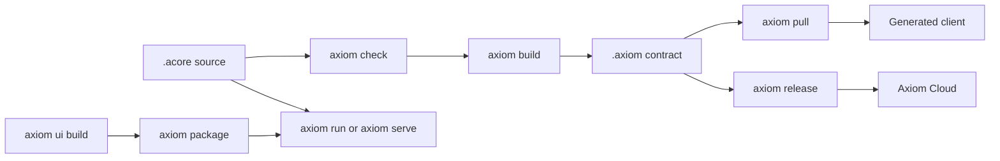

These commands take Acore source to a checked contract, a running local service
or application, a generated client, or a Cloud release. This page covers `check`,
`build`, `run`, `serve`, `watch`, `explain`, `diff`, `pull`, `package`,
`release`, `deploy`, `migrate` and `benchmark` in Axiom CLI 0.149.1.

<StatusNote status="alpha" title="Axiom CLI">
  `.axiom` service contracts, local build, diff, test, mock, release, pull and
  runtime workflows are **Alpha**. Cloud releases and pull are **Alpha** and need
  a live account. Database execution through `axiom run` is **Experimental**.
</StatusNote>



`check` validates source and `build` writes a `.axiom` contract. `run` and
`serve` execute source locally without building first. `pull` turns a contract
into a client for your framework, and `release` uploads a backend contract to
Axiom Cloud. Application artifacts (`.axiomapp`) come from `axiom ui build`;
`package` combines them and `run` opens them.

| Command | Needs network or Cloud |
| --- | --- |
| `check`, `build`, `run`, `serve`, `watch --build`, `explain`, `diff`, `package`, `migrate`, `benchmark` | No. |
| `pull` | Only for a remote contract reference or a dependency config. |
| `build --release`, `release`, `deploy mock-server` | Network and `axiom login`. |
| `watch` without `--build` | Network: it pulls first. |

## Check and build contracts

`check` and `build` select the frontend, backend or database compiler from the
nearest `AxiomDeps.toml` and its `type` field. Legacy sources without a declared
type keep their profile or module selection. Options that belong to another
contract type fail with a clear error.

### axiom check

Check a frontend, backend or database contract without writing project outputs.
Use it before every build and as a CI gate.

```text title="Usage"
axiom check [OPTIONS] [FILE]
```

| Option | Value | Default | Meaning |
| --- | --- | --- | --- |
| `[FILE]` | path | `axiom.acore` | Contract source to validate. |
| `--variant` | name | `default` | Backend contract variant. With no declared variants, the implicit default includes every endpoint and model. |
| `--json` | flag | off | Print an `axiom-contract-check/v1` report, including on failure. |
| `--target` | `web`, `ios`, `android` | from `AcoreUI.json`, then manifest targets, then `web` | Frontend target override. |
| `--lock` | path | project `axiom.ui.lock.json`, then `.axiom/dev/axiom.ui.lock.json` | Existing frontend contract lock. `check` never resolves or modifies it. |
| `--frozen-interface` | path | none | Approved backend `.axiom` artifact. Rejects public interface drift from it. |

`check` prints diagnostics and exits non-zero on an error. The JSON report has
`valid`, `profile`, `variant`, `file` and `diagnostics`. It leaves source,
artifacts, project locks and diff baselines untouched, does not need Cloud login,
and does not resolve or download frontend dependencies: prepare the locks first.

```bash title="Terminal: hello-api example"
axiom check main.acore --json
```

```json title="Expected output"
{"diagnostics":[],"file":"main.acore","format":"axiom-contract-check/v1","profile":"backend","valid":true,"variant":"default"}
```

### axiom build

Build a contract under the owning project's `.axiom/contracts/` directory, or
export it to a path you choose with `--out`.

```text title="Usage"
axiom build [OPTIONS] [FILE]
```

| Option | Value | Default | Meaning |
| --- | --- | --- | --- |
| `[FILE]` | path | `axiom.acore` | Acore source to build. |
| `-o, --out` | path | `.axiom/contracts/<type>.axiom` | Output `.axiom` path, relative to the current directory or absolute. Missing directories are created. |
| `--target` | `web`, `ios`, `android` | from `AcoreUI.json`, then manifest targets, then `web` | Frontend target override. Every selected target is checked before output is replaced. |
| `--lock` | path | project `axiom.ui.lock.json`, then `.axiom/dev/axiom.ui.lock.json` | Existing frontend contract lock. `build` does not fetch dependencies. |
| `--variant` | name | `default` | Backend contract variant. |
| `--compatibility-baseline` | path | none | Existing backend artifact whose FlatBuffers field slots must stay compatible. |
| `--frozen-interface` | path | none | Approved backend artifact. Rejects public interface drift before any backend output is replaced. |
| `--release` | flag | off | Release the compiled backend contract to Axiom Cloud. Needs `axiom login`. |
| `--project` | ID or slug | the linked project | Cloud project override. Requires `--release`. |
| `--version` | version | the source version | Immutable Cloud release version. Requires `--release`. Interactive releases suggest the next free version on a collision. |

Default outputs, wherever you run the command from:

| Contract | Output |
| --- | --- |
| Frontend | `frontend/.axiom/contracts/frontend.axiom`: a canonical `axiom-frontend-contract/v1` snapshot of the compiled UI IR. |
| Backend | `backend/.axiom/contracts/backend.axiom`, plus a private `backend.server.json` plan when the source owns server behavior. `build` also records the diff baseline under `.axiom/baselines/`. |
| Database | `database/.axiom/contracts/database.axiom`, a typed schema package, plus its `.sources.axiom` companion. |

With `--out`, the backend plan is written beside the output, for example
`dist/hello.axiom` and `dist/hello.server.json`. Use an explicit export path when
you distribute a schema package.

`--frozen-interface` compares the public interface before replacing outputs. An
inferred new failure, type or projection needs an explicitly reviewed baseline
update. This check is separate from FlatBuffers slot compatibility. Frontend
snapshots and database packages cannot use the backend Cloud release path: to
run frontend source use `axiom run`, and to create an installable application use
[`axiom ui build`](/tooling/cli-ui#axiom-ui-build).

```bash title="Terminal"
axiom build frontend/main.acore
axiom build backend/axiom.acore
axiom build database/schema.acore --out dist/schema.axiom
axiom build axiom.acore --release --project my-project --version 1.2.1
```

### axiom explain

Print the expanded backend contract JSON, or the machine-readable catalog of
backend declarations. Use it to see exactly what the compiler produced.

```text title="Usage"
axiom explain [OPTIONS] [FILE]
```

| Option | Value | Default | Meaning |
| --- | --- | --- | --- |
| `[FILE]` | path | required unless `--schema` | Backend source to expand. Conflicts with `--schema`. |
| `--variant` | name | `default` | Contract variant to expand. |
| `--schema` | flag | off | Print the shared backend declaration catalog: constructors, signatures, argument types, defaults and enum choices. |
| `--provenance` | flag | off | Add source spans, compiler defaults, identities and effective policy origins. Conflicts with `--schema`. |

```bash title="Terminal"
axiom explain axiom.acore --provenance
axiom explain --schema
```

## Run locally

### axiom run

Run a backend, a frontend, a database SQL console or a packaged `.axiomapp`. The
CLI picks the behavior from the input and builds stale local contracts as needed.

```text title="Usage"
axiom run [OPTIONS] <SOURCE>
```

| Input | What `run` does |
| --- | --- |
| Backend `.acore` | Starts the local API. `--mode service` (default) uses the same preparation as `axiom serve`; `--mode mock` uses the [`axiom mock`](/tooling/cli-testing#axiom-mock) profiles. |
| Backend `.acore` that declares `storage` | Without `--deployment`, migrates the database, binds the storage resources and serves the API. It prints a development API key. |
| Frontend `.acore` (a `module` with an `app`, `page` or `component`) | Starts a UI development session. Maintains the development lock under `.axiom/dev`, builds stale local contracts and prepares registered sandbox extensions. |
| Database `.acore`, release bundle or schema package | Applies pending migrations, verifies them, then opens the SQL console. |
| `.axiomapp` | Verifies the package and runs the selected target. Native targets open only with `--launch`. |

| Option | Value | Default | Meaning |
| --- | --- | --- | --- |
| `<SOURCE>` | path | required | Backend or frontend `.acore`, database source or package, or `.axiomapp`. |
| `--lock` | path | prepared automatically | Advanced UI lock override (frontend). |
| `--target` | `web`, `ios`, `android` | frontend: from `AcoreUI.json` or manifest targets, preferring `web`, else `ios` | Frontend or `.axiomapp` target. A multi-target `.axiomapp` prompts when omitted. |
| `--mode` | `service`, `mock` | `service` | Backend execution mode. Service mode never falls back to mocks. |
| `--database-url` | URL | `DATABASE_URL` | Database URL. See [connection options](/tooling/cli-database#connection-options). |
| `--host` | host | `127.0.0.1` for a backend | PostgreSQL host for a database; HTTP listener host for a backend. |
| `-p, --port` | number | `8080` for a backend, `5432` for PostgreSQL | PostgreSQL port for a database; HTTP port for a backend or a web frontend. |
| `--database`, `--username`, `--password`, `--database-file`, `--ssl-mode`, `--tls-ca` | connection fields | see database page | Database connection. Same rules as [`axiom database`](/tooling/cli-database#connection-options). |
| `--auto-version`, `--non-interactive`, `--dry-run`, `--allow-destructive`, `--allow-data-dependent`, `--allow-security-changes`, `--adopt`, `--json`, `--export` | policy flags | off | Database migration policy. Same meaning as [migration policy options](/tooling/cli-database#migration-policy-options). |
| `--no-shell` | flag | off | Apply and verify database migrations without opening the SQL console. |
| `--execute` | SQL | none | SQL statement or script to run after database synchronization. |
| `--variant` | name | `default` | Backend contract variant. |
| `--deployment` | path | adjacent `deployment.json` | Reviewed backend deployment configuration (service mode). |
| `--bindings` | path | none | Verified sandbox implementation references (service mode). |
| `--delivery` | path | none | Reviewed durable controller for backend producer actions. |
| `--fixtures` | path | adjacent `mock.json` | Private typed simulation fixtures. Mock mode only. |
| `--identities` | path | adjacent `mock-identities.json` | Reviewed development identities. Mock mode only. |
| `--watch` | flag | off | Reload source-owned action plans within reviewed grants (backend). |
| `-d, --debug` | flag | off | Redacted backend startup diagnostics. |
| `--frozen` | flag | off | Require reviewed locks and extension workflows with no development regeneration (frontend), or apply only an existing immutable release (database). |
| `--once` | flag | off | Compile once and exit, for CI and host-independent checks (frontend). For a database it skips the console. |
| `--launch` | flag | off | Open the browser or native simulator after the UI session starts. Conflicts with `--once`. |

Options for another input kind are rejected. For example `--target`, `--lock`,
`--frozen`, `--once` and `--launch` fail for a backend, and the backend options
fail for a frontend or `.axiomapp`. A database run rejects `--target`, `--mode`,
`--launch` and `--watch`; use `axiom database status --watch` to monitor.

**Backend.** `--watch` needs source-owned managed or sandbox plans and a fixed
loopback port; external services use their own reload tooling. Missing executable
configuration fails. Native action symbols need a registered application host,
and Python or Go services need their server adapter (see
[`axiom server boundary`](/tooling/cli-server#axiom-server-boundary)). With
declared `storage`, the CLI compiles the private plan and bindings itself. Send
the printed development key in the `apikey` header. The key is stored in
`.axiom/database/development.key`; keep it local.

**Database console.** The console accepts SQL plus `\dt`, `\d TABLE`,
`\conninfo` and `\q`. Ctrl+C cancels the current input or query and Ctrl+D exits.

```bash title="Terminal"
axiom run backend/main.acore --database-url "$DATABASE_URL"
axiom run frontend/main.acore --target web --port 5173 --launch
axiom run database/schema.acore --database-file ./tasks.sqlite --no-shell --execute 'SELECT count(*) FROM tasks'
axiom run dist/my-app-web.axiomapp --target web
```

### axiom serve

Start the real local API. `serve` never falls back to mocks or to Cloud.

```text title="Usage"
axiom serve [OPTIONS] [INPUT]
```

| Option | Value | Default | Meaning |
| --- | --- | --- | --- |
| `[INPUT]` | path | `axiom.acore` | `.acore` source or compiled `.axiom` artifact. |
| `--plan` | path | adjacent `<name>.server.json` | Exact private companion plan. Artifact input only; an artifact cannot be served without it. |
| `--deployment` | path | adjacent `deployment.json` | Reviewed deployment for real serving. |
| `--bindings` | path | none | Explicit, hash-bound sandbox implementation references. |
| `--delivery` | path | none | Explicit exact-plan durable delivery configuration. Real serving only. |
| `--fixtures` | path | adjacent `mock.json` with `--mock` | Private typed mock fixtures. Invalid in real mode. |
| `--identities` | path | adjacent `mock-identities.json` | Reviewed mock identities. Invalid in real mode. |
| `--variant` | name | `default` | Source variant. Artifact variants are immutable. |
| `--watch` | flag | off | Reload local source or fixtures, keeping the mode and the last valid service. Source input only. |
| `--host` | IP address | `127.0.0.1` | Listener address. |
| `-p, --port` | number | `8080` | Listener port. `0` selects an ephemeral port, except with `--watch`. |
| `-d, --debug` | flag | off | Redacted diagnostics. Never prints raw credentials or request or response bodies. |
| `--mock` | flag | off | Simulate business execution inside the real server boundary. Requires a server plan and fixtures. |

Managed and sandbox serving needs reviewed configuration. With `--mock`, the
full simulation keeps action guards and supported transport enforcement, uses no
production bodies or providers, and rejects `--deployment`, `--bindings` and
`--delivery`. Input files must be regular files no larger than 16 MiB. Provider
values that a deployment references by environment variable name are read from
the environment.

```bash title="Terminal"
axiom serve axiom.acore --watch --port 8080
axiom serve backend.axiom --plan backend.server.json --deployment deployment.json
axiom serve axiom.acore --mock --fixtures mock.json --identities mock-identities.json
```

### axiom watch

Watch for changes and rebuild or pull automatically. The watch display is a
terminal interface: press `q` (or `Esc` with `--build`) to stop, and `r` to
refresh with `--build`.

```text title="Usage"
axiom watch [OPTIONS]
```

| Option | Value | Default | Meaning |
| --- | --- | --- | --- |
| `--build` | flag | off | Watch `axiom.acore` in the current directory and rebuild the backend contract on every change. |
| `--variant` | name | `default` | Variant used for evaluation and rebuilds. Requires `--build`. |

With `--build`, the command watches `axiom.acore`, the FastAPI or Go entrypoint
file named in its `amends` line, and the source path its manifest declares. It
shows rebuild state, the last synchronization time and semantic changes. It is
not a recursive, framework-independent development server: confirm that your
extractor entrypoint is among the watched paths, and use explicit `build` and
`test` commands in CI. Without `axiom.acore` in the current directory it prints a
notice and exits.

Without `--build`, the command first runs `axiom pull` with the current
dependency configuration, then watches `project.axiom` in the current directory
for contract changes.

## Compare and migrate source

### axiom diff

Show what changed between two Acore files, or between a file and the baseline
that `axiom build` recorded.

```text title="Usage"
axiom diff [OPTIONS] <FILE1> [FILE2]
```

| Option | Value | Default | Meaning |
| --- | --- | --- | --- |
| `<FILE1>` | path | required | The main file, or the old file when `FILE2` is given. |
| `[FILE2]` | path | none | The new file. Without it, `FILE1` is compared with its build baseline under `.axiom/baselines/`. |
| `--format` | `text`, `semantic`, `atom`, `changelog` | `changelog` | `changelog`: grouped human summary. `semantic`: changed contract paths with old and new values. `atom`: JSON Atom operations. `text`: line diff of the source. An unknown value falls back to `changelog`. |
| `--variant` | name | `default` | Variant to evaluate before diffing. |

`diff` reports changes and exits 0. It does not fail on breaking changes; use
[`axiom inspect diff --fail-on`](/tooling/cli-inspect#axiom-inspect-diff) for a
CI gate. Without a baseline it tells you to run `axiom build FILE` first.

```bash title="Terminal"
axiom diff main.acore v2.acore --format semantic
```

```text title="Expected output"
Semantic State Changes:

+ $.models.Greeting.fields.note = {"isOptional":true,"name":"note","typeRef":{"kind":"strin...
```

### axiom migrate

Convert a legacy backend contract into a new sibling source that uses the
backend profile. The original source is preserved.

```text title="Usage"
axiom migrate --output <OUTPUT> <FILE>
```

| Option | Value | Default | Meaning |
| --- | --- | --- | --- |
| `<FILE>` | path | required | Legacy backend source. |
| `-o, --output` | path | required | New `.acore` file in the same directory as `FILE`, so relative imports keep their meaning. |

The command writes the new source only when every variant preserves its
evaluated JSON. It also writes an identity sidecar that keeps endpoint IDs
stable, and sets `type = "backend"` in `AxiomDeps.toml`. It refuses an existing
output or sidecar, and a source that already uses the backend profile.

```bash title="Terminal"
axiom migrate axiom.acore --output service.acore
```

## Clients, packages and releases

### axiom pull

Fetch a contract and generate a typed client for your framework. Use it in a
frontend project that consumes a backend contract.

```text title="Usage"
axiom pull [OPTIONS] [SOURCE]
```

| Option | Value | Default | Meaning |
| --- | --- | --- | --- |
| `[SOURCE]` | reference | none | Local `.axiom` artifact, `AxiomDeps.toml` or JSON config, AxiomCore URL, or `organization/project[/version]` contract reference. |
| `--contract` | reference | none | The same source as an explicit option. |
| `--contract-config` | path | `AxiomDeps.toml` | Dependency configuration that lists contracts to pull. |
| `--framework` | `flutter`, `dart`, `atmx-web`, `atmx-react` | from `AxiomDeps.toml`, else detected and confirmed | Client to generate. |
| `--name` | name | from the contract | Name of the contract entry written to `AxiomDeps.toml`. |
| `-o, --out` | directory | prompted: `lib/axiom_generated` (Flutter, Dart) or `src/generated` (web) | Output directory for generated code. |

`pull` fetches every contract before it writes `AxiomDeps.toml`, so a failed
lookup does not leave an unusable dependency. Remote references need network
and are authorized by the service; a local artifact does not. Do not infer from
an anonymous `not found` whether a private project exists. Flutter generation
needs Flutter. Web generation (`atmx-web`, `atmx-react`) needs Node.js and npm
and runs the project's `node_modules/.bin/atmx`. Install the published
generator first with `npm install --save-dev atmx-cli@0.146.7`: without a local
copy, the CLI runs `npx atmx-cli@<CLI version>`, and no `atmx-cli` 0.149.1 is
published.

```bash title="Terminal"
axiom pull ../backend/backend.axiom --framework atmx-web
axiom pull organization/project/1.2.0 --framework flutter --out lib/axiom
axiom pull --contract-config AxiomDeps.toml --framework atmx-react
```

### axiom package

Combine target-specific `.axiomapp` builds into one multi-target artifact.

```text title="Usage"
axiom package [OPTIONS] <ARTIFACTS>...
```

| Option | Value | Default | Meaning |
| --- | --- | --- | --- |
| `<ARTIFACTS>...` | paths | required | One or more `.axiomapp` files from `axiom ui build`. |
| `-o, --out` | path | `dist/application.axiomapp` | Output artifact. |

All inputs must share one application ID, and each target may appear once.
Playground exports already contain their selected targets and cannot be
repackaged.

```bash title="Terminal"
axiom package dist/my-app-web.axiomapp dist/my-app-android.axiomapp
```

### axiom release

Upload a compiled backend artifact to the linked or selected Cloud project as an
immutable version. Needs network and `axiom login`.

```text title="Usage"
axiom release [OPTIONS] [FILE_PATH]
```

| Option | Value | Default | Meaning |
| --- | --- | --- | --- |
| `[FILE_PATH]` | path | `backend.axiom` in the current directory, then legacy `axiom.axiom` or `.axiom` | Backend artifact to release. |
| `--project` | ID or slug | the project linked to this directory | Cloud project override. |
| `--version` | version | the contract's version | Immutable release version override. |

A `--version` that differs from the compiled version must run from the contract
directory: the CLI updates `axiom.acore` to that version and rebuilds first.
Versions may contain letters, numbers, `.`, `_`, `-` and `+`. If the version
already holds different bytes, an interactive release suggests the next free
version, and a non-interactive or CI release fails and prints the suggestion.
Releasing is not immediate production deployment: Cloud validation, policy,
channel and environment state decide the outcome. Frontend snapshots and database
packages are local build outputs and cannot be released this way.

`axiom build` writes to `.axiom/contracts/`, so pass that path or build with
`--out`:

```bash title="Terminal"
axiom check axiom.acore
axiom build axiom.acore --out backend.axiom
axiom login
axiom project link
axiom release backend.axiom --version 1.2.0
```

### axiom deploy

Deploy Cloud-side configuration for the linked project.

```text title="Usage"
axiom deploy <COMMAND>
```

| Subcommand | Purpose |
| --- | --- |
| [`mock-server`](#axiom-deploy-mock-server) | Save a mock configuration for the linked Cloud project. |

### axiom deploy mock-server

Evaluate a local Acore file and upload its mock configuration to the linked
Cloud project. Needs network, `axiom login` and a directory linked with
`axiom project link`.

```text title="Usage"
axiom deploy mock-server [FILE]
```

| Option | Value | Default | Meaning |
| --- | --- | --- | --- |
| `[FILE]` | path | `axiom.acore` in the current directory | Acore source to evaluate. |

Serve the saved configuration with `axiom mock --cloud`. For a local contract
simulation, use `axiom mock FILE.acore --profile contract` instead.

## Measure

### axiom benchmark

Measure local backend build time and artifact-load time reproducibly, and write a
JSON report.

```text title="Usage"
axiom benchmark [OPTIONS] [FILE]
```

| Option | Value | Default | Meaning |
| --- | --- | --- | --- |
| `[FILE]` | path | `axiom.acore` | Backend contract source. |
| `--variant` | name | `default` | Contract variant to build. |
| `--iterations` | 1 to 1000 | `10` | Measured iterations. |
| `--warmup` | 0 to 1000 | `2` | Unmeasured warmup builds. |
| `--output` | path | `axiom-benchmark.json` | Report file. It is always written. |
| `--json` | flag | off | Also print the report to stdout. |

The report gives the median and p95 of build and artifact decode times, the
artifact size and the endpoint count. An existing `axiom.axiom` in the current
directory is restored afterwards. Results describe that machine and checkout:
compare reports only with the same inputs and environment.

```bash title="Terminal"
axiom benchmark axiom.acore --iterations 20 --json
```
