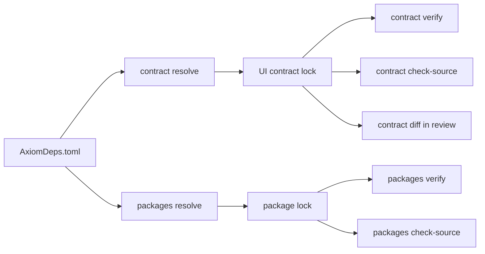

These commands manage what a frontend depends on (contract locks, typed
frontend packages, and third-party packages for authored extensions) and
analyze a backend contract's optional domain and security layers. This page
covers Axiom CLI 0.149.1. None of them needs a Cloud login; only
`dependencies resolve` and `dependencies cache recover` contact package
registries over the network.

| Group | Use it to | Status |
| --- | --- | --- |
| [`axiom contract`](#axiom-contract) | Lock and verify the backend contracts a frontend imports. | Alpha |
| [`axiom packages`](#axiom-packages) | Build, lock, verify and review typed frontend `.axiom` packages, and author component library source. | Alpha; [library adaptation](#library-adaptation-commands) Experimental |
| [`axiom dependencies`](#axiom-dependencies) | Resolve and audit third-party packages used by authored extensions. | Experimental |
| [`axiom domain`](#axiom-domain) | Validate the Domain Model v1 layer, or bootstrap it from OpenAPI or SQL. | Alpha (`validate`), Experimental (`bootstrap`) |
| [`axiom security`](#axiom-security) | Analyze the opt-in Security Model v1 layer without building. | Alpha, as part of the Acore contract toolchain |

Axiom Marketplace is **Coming soon**. The `packages` commands do not discover
or install packages from a catalog; they consume explicit package files and
locks.



`AxiomDeps.toml` declares the contracts and packages a frontend uses.
`contract resolve` and `packages resolve` turn it into deterministic locks under
`.axiom/`. In CI, `verify` re-resolves the manifest and fails if the committed
lock differs, `check-source` validates imports against the lock alone, and the
`diff` commands show semantic changes for review.

## axiom contract

Resolves and verifies the signed backend contract artifacts that a frontend
imports with `use contract`, and records them in a deterministic UI contract
lock. Normal development through `axiom run FRONTEND.acore` discovers the
manifest and maintains an internal development lock under `.axiom/dev`
automatically. Use these commands to manage a reviewed lock for CI and release
workflows.

```text title="Usage"
axiom contract <COMMAND>
```

No options other than `--help`.

| Command | Purpose |
| --- | --- |
| [`contract resolve`](#axiom-contract-resolve) | Resolve manifest entries, show changes and write the lock. |
| [`contract verify`](#axiom-contract-verify) | Re-resolve and verify locked bytes and proof without changing files. |
| [`contract diff`](#axiom-contract-diff) | Show semantic changes between two locks. |
| [`contract facade`](#axiom-contract-facade) | Print read-only virtual-facade metadata for a locked alias. |
| [`contract check-source`](#axiom-contract-check-source) | Validate `use contract` declarations against the committed lock. |

A frontend manifest names each contract alias, its artifact and the operations
it uses. This is the task-app example:

```toml title="frontend/AxiomDeps.toml"
type = "frontend"
targets = ["web"]

[contracts.tasks]
artifact = "../backend/.axiom/contracts/backend.axiom"
baseUrl = "http://127.0.0.1:8080"
audience = "web"
operations = ["create_task", "delete_task", "list_tasks", "update_task"]
```

An entry that points at an unsigned local artifact produces a warning: it is
allowed for development, and you release the contract through Axiom Cloud
before production use.

### axiom contract resolve

Resolves the contract entries in `AxiomDeps.toml` into a deterministic lock.
When the lock already exists and changes, it prints the semantic diff as JSON
before writing. It reads only the local artifacts the manifest names. With the
default `--lock`, the lock path is relative to the manifest's directory.

```text title="Usage"
axiom contract resolve [OPTIONS]
```

| Option | Value | Default | Meaning |
| --- | --- | --- | --- |
| `--deps` | file | `AxiomDeps.toml` | Dependency manifest to resolve. |
| `--lock` | file | `.axiom/axiom.ui.lock.json` | Lock file to write. |

```bash title="Terminal"
axiom contract resolve
```

### axiom contract verify

Re-resolves the manifest and checks every locked input, byte for byte, without
changing files. Use it in CI. On a mismatch it fails and asks you to resolve and
review the semantic diff. On success it reports how many aliases are signed and
unsigned.

```text title="Usage"
axiom contract verify [OPTIONS]
```

| Option | Value | Default | Meaning |
| --- | --- | --- | --- |
| `--deps` | file | `AxiomDeps.toml` | Dependency manifest. |
| `--lock` | file | `.axiom/axiom.ui.lock.json` | Lock file to verify, relative to the manifest's directory by default. |

```bash title="Terminal"
axiom contract verify
```

### axiom contract diff

Prints the semantic changes between two UI contract locks as JSON. Use it to
review a lock update.

```text title="Usage"
axiom contract diff <BEFORE> <AFTER>
```

| Option | Value | Default | Meaning |
| --- | --- | --- | --- |
| `<BEFORE>` | lock file | required | Earlier lock. |
| `<AFTER>` | lock file | required | Later lock. |

### axiom contract facade

Prints read-only virtual-facade metadata for one locked alias: the typed
interface the UI compiler derives for that contract. No facade file is
generated.

```text title="Usage"
axiom contract facade [OPTIONS] <ALIAS>
```

| Option | Value | Default | Meaning |
| --- | --- | --- | --- |
| `<ALIAS>` | name | required | Contract alias from the lock, such as `tasks`. |
| `--lock` | file | `.axiom/axiom.ui.lock.json` | Lock to read. |

### axiom contract check-source

Validates the `use contract` declarations in one source file against only the
committed lock. It never resolves or writes files, and exits non-zero with one
diagnostic per problem.

```text title="Usage"
axiom contract check-source [OPTIONS] <SOURCE>
```

| Option | Value | Default | Meaning |
| --- | --- | --- | --- |
| `<SOURCE>` | `.acore` file | required | Frontend source to validate. |
| `--lock` | file | `.axiom/axiom.ui.lock.json` | Committed lock. |

```bash title="Terminal"
axiom contract check-source main.acore
```

## axiom packages

Builds, resolves, verifies, inspects, diffs and source-checks typed frontend
`.axiom` packages, such as theme and component libraries. Resolution reads only
local files inside the manifest's directory, and rejects an artifact that
resolves outside it. See [Packages](/extensions/packages).

```text title="Usage"
axiom packages <COMMAND>
```

No options other than `--help`.

| Command | Purpose |
| --- | --- |
| [`packages build`](#axiom-packages-build) | Validate and canonically encode a package envelope. |
| [`packages resolve`](#axiom-packages-resolve) | Resolve package dependencies into the package lock. |
| [`packages verify`](#axiom-packages-verify) | Re-resolve locked bytes and proofs. |
| [`packages inspect`](#axiom-packages-inspect) | Print one verified locked envelope. |
| [`packages diff`](#axiom-packages-diff) | Classify package changes and enforce explicit approvals. |
| [`packages check-source`](#axiom-packages-check-source) | Validate imports and compile the unchanged source for a target. |
| [`packages run`](#axiom-packages-run) | Run package-backed source through the normal target session. |

CLI 0.151.0 adds commands for component library source and for adapting
pinned upstream component source. They are listed in
[Library source commands](#library-source-commands) and
[Library adaptation commands](#library-adaptation-commands).

### axiom packages build

Validates a typed package envelope, writes its canonical encoding to `--out`,
and prints the output path and SHA-256 digest.

```text title="Usage"
axiom packages build [OPTIONS] --out <OUT> [SOURCE]
```

| Option | Value | Default | Meaning |
| --- | --- | --- | --- |
| `[SOURCE]` | JSON file | required unless `--source-manifest` is given | Package envelope to encode. |
| `--source-manifest` | `AxiomLibrary.toml` file | none | Build a component library from its source manifest instead of an envelope. Cannot be combined with `[SOURCE]`. CLI 0.151.0. |
| `-o, --out` | file | required | Encoded `.axiom` package to write. |
| `--json` | flag | off | Print the result as JSON. CLI 0.151.0. |

With `--source-manifest`, the command runs the same checks as
[`packages check-library`](#axiom-packages-check-library), writes the package
to `--out`, and prints `Built <OUT> (<sha256>)`. With `--json` it prints the
library build report instead.

```bash title="Terminal"
axiom packages build --source-manifest acme-widgets/AxiomLibrary.toml --out acme-widgets-1.0.0.axiom
```

### axiom packages resolve

Resolves the package entries in `AxiomDeps.toml` into a canonical lock that you
commit. It validates the complete lock before replacing any output.

```text title="Usage"
axiom packages resolve [OPTIONS]
```

| Option | Value | Default | Meaning |
| --- | --- | --- | --- |
| `--deps` | file | `AxiomDeps.toml` | Dependency manifest. |
| `--lock` | file | `.axiom/AxiomPackages.lock` | Package lock to write. |

```bash title="Terminal"
axiom packages resolve
```

### axiom packages verify

Re-resolves the manifest and verifies every locked package's bytes and proofs
without changing files. Use it in CI.

```text title="Usage"
axiom packages verify [OPTIONS]
```

| Option | Value | Default | Meaning |
| --- | --- | --- | --- |
| `--deps` | file | `AxiomDeps.toml` | Dependency manifest. |
| `--lock` | file | `.axiom/AxiomPackages.lock` | Package lock to verify. |

```bash title="Terminal"
axiom packages verify
```

### axiom packages inspect

Prints one verified locked package envelope as JSON.

```text title="Usage"
axiom packages inspect [OPTIONS] <ALIAS>
```

| Option | Value | Default | Meaning |
| --- | --- | --- | --- |
| `<ALIAS>` | name | required | Package alias from the lock. |
| `--lock` | file | `.axiom/AxiomPackages.lock` | Package lock to read. |

### axiom packages diff

Prints a semantic diff of two encoded packages as JSON, then fails unless every
change that needs review is approved. Approval values are `breaking-change`,
`target-reduction`, `new-required-theme-role` and `permission-increase`.

```text title="Usage"
axiom packages diff [OPTIONS] <BEFORE> <AFTER>
```

| Option | Value | Default | Meaning |
| --- | --- | --- | --- |
| `<BEFORE>` | `.axiom` package | required | Earlier package. |
| `<AFTER>` | `.axiom` package | required | Later package. |
| `--approve` | approval | none | Approve one change class. Repeat for several. |

```bash title="Terminal"
axiom packages diff theme-1.0.0.axiom theme-2.0.0.axiom --approve breaking-change
```

### axiom packages check-source

Validates package imports against the package lock and compiles the unchanged
source for one target. It writes no files and exits non-zero on a diagnostic.

```text title="Usage"
axiom packages check-source [OPTIONS] <SOURCE>
```

| Option | Value | Default | Meaning |
| --- | --- | --- | --- |
| `<SOURCE>` | `.acore` file | required | Package-backed UI source. |
| `--package-lock` | file | `.axiom/AxiomPackages.lock` | Package lock. |
| `--ui-lock` | file | `.axiom/axiom.ui.lock.json` | UI contract lock. |
| `--target` | `web`, `android`, `ios` | `ios` | Target to compile for. |

### axiom packages run

Runs package-backed source through the normal target host session, like
[`axiom ui run`](/tooling/cli-ui#axiom-ui-run) with a package lock. Host and
Node.js requirements are the same as for `ui run`.

```text title="Usage"
axiom packages run [OPTIONS] <SOURCE>
```

| Option | Value | Default | Meaning |
| --- | --- | --- | --- |
| `<SOURCE>` | `.acore` file | required | Package-backed UI source. |
| `--package-lock` | file | `.axiom/AxiomPackages.lock` | Package lock. |
| `--ui-lock` | file | `.axiom/axiom.ui.lock.json` | UI contract lock. |
| `--target` | `web`, `android`, `ios` | `ios` | Target to run. |
| `--once` | flag | off | Compile once and exit. |
| `--launch` | flag | off | Open the browser or deliver to the native host. Cannot be combined with `--once`. |

### Library source commands

These commands are in CLI 0.151.0. They work on a component library written
as ordinary Acore source and described by an `AxiomLibrary.toml` source
manifest (format `axiom-component-source/v1`). They run locally and change no
package lock. Library source authoring is **Alpha**, like the rest of the typed
package toolchain.

| Command | Purpose |
| --- | --- |
| [`packages init-library`](#axiom-packages-init-library) | Create a starter library: one component, typed themes and an explicit profile. |
| [`packages check-library`](#axiom-packages-check-library) | Build the library on every declared target and read it back, without writing files. |
| [`packages fork-library`](#axiom-packages-fork-library) | Copy a validated library into a new, independently named and versioned package. |

A typical sequence creates, checks and encodes a library:

```bash title="Terminal"
axiom packages init-library acme-widgets --name acme.widgets
axiom packages check-library --source-manifest acme-widgets/AxiomLibrary.toml
axiom packages build --source-manifest acme-widgets/AxiomLibrary.toml --out acme-widgets-1.0.0.axiom
```

#### axiom packages init-library

Creates a starter library in `<DIRECTORY>`. The directory must be absent or
empty; otherwise the command fails with `PK_SOURCE_EXISTS: starter directory
must be empty`. Files are written to a staging directory first, so a failure
leaves no partial output.

```text title="Usage"
axiom packages init-library [OPTIONS] <DIRECTORY>
```

| Option | Value | Default | Meaning |
| --- | --- | --- | --- |
| `<DIRECTORY>` | directory | required | New library directory. |
| `--name` | package name | `example.widgets` | Package name written to `AxiomLibrary.toml`. |
| `--json` | flag | off | Print the directory, package name and created files as JSON. |

The starter contains these files:

| File | Contents |
| --- | --- |
| `AxiomLibrary.toml` | Source manifest: package identity, build entry, themes and exports. |
| `Button.acore` | A button component that implements `core.button@1.0.0`. |
| `Theme.toml` | The `Family` theme: typed color tokens, each with a kind and a meaning. |
| `Brand.toml` | The `Brand` theme, with its own role schema. |
| `Profiles.toml` | The `Default` profile for `android`, `ios` and `web`, which binds `core.button@1.0.0` to `Button` and maps brand roles to family roles. |

```bash title="Terminal"
axiom packages init-library acme-widgets --name acme.widgets
```

```text title="Expected output"
Created acme-widgets. Check it with `axiom packages check-library --source-manifest acme-widgets/AxiomLibrary.toml`.
```

#### axiom packages check-library

Builds the library from its source manifest on every target it declares, then
reads the encoded package back through the same package reader that consumers
use. It writes no files and exits non-zero on the first diagnostic.

```text title="Usage"
axiom packages check-library [OPTIONS]
```

| Option | Value | Default | Meaning |
| --- | --- | --- | --- |
| `--source-manifest` | file | `AxiomLibrary.toml` | Library source manifest. |
| `--json` | flag | off | Print the build report as JSON: package, compiler identity, package digest, the digest of every source file, and the checked targets. On failure, print `passed: false` and the diagnostic. |

```bash title="Terminal"
axiom packages check-library --source-manifest acme-widgets/AxiomLibrary.toml
```

```text title="Expected output"
Checked acme-widgets/AxiomLibrary.toml (<sha256>) on every declared target and the verified consumer path.
```

#### axiom packages fork-library

Copies a library into a new package that you own and version separately. The
source must pass the same checks as `check-library` first. The fork needs a new
package name (`AD_FORK_IDENTITY` otherwise) and a new output directory
(`AD_OUTPUT_EXISTS` otherwise). The original source and its locks are not
changed.

```text title="Usage"
axiom packages fork-library --source-manifest <SOURCE_MANIFEST> --name <NAME> --out <OUT>
```

| Option | Value | Default | Meaning |
| --- | --- | --- | --- |
| `--source-manifest` | file | required | `AxiomLibrary.toml` of the library to fork. |
| `--name` | package name | required | Name of the new package. Must differ from the source package. |
| `--version` | semantic version | `1.0.0` | Version of the new package. |
| `--out` | directory | required | New directory for the fork. |

The output directory holds the copied source with the new name and version in
`AxiomLibrary.toml`, the built `library.axiom`, and `FORK.json`. `FORK.json`
records the parent package, the digest of the parent's source build and the
digest of the new artifact. The command prints the same JSON. When the source
is an adaptation candidate, its adaptation report is kept as historical
provenance only: it does not describe or certify the fork's API.

```bash title="Terminal"
axiom packages fork-library --source-manifest acme-widgets/AxiomLibrary.toml \
  --name acme.buttons --version 1.0.0 --out acme-buttons
```

### Library adaptation commands

These commands are in CLI 0.151.0 and are **Experimental**. They turn pinned
upstream component source (for example a React component and its CSS) into
ordinary, checked Acore library source at build time. They never install or run
the upstream runtime, never change a package lock, and never publish. A
passing check is not runtime qualification: every check, plan and adaptation
report carries `"runtimeQualified": false`, and mounted behavior, accessibility and visual
fidelity still need their own testing.

| Command | Purpose |
| --- | --- |
| [`packages adaptation-inputs`](#axiom-packages-adaptation-inputs) | Verify the pinned upstream files, licenses, dependency pins and export inventory. |
| [`packages check-library-api`](#axiom-packages-check-library-api) | Validate a typed library API recipe against the pinned inputs. |
| [`packages plan-adaptation`](#axiom-packages-plan-adaptation) | Write an API review plan for every pinned export. |
| [`packages adapt-library`](#axiom-packages-adapt-library) | Build an isolated adaptation candidate from a recipe. |
| [`packages check-adaptation`](#axiom-packages-check-adaptation) | Check an adaptation report against its pinned inputs. |
| [`packages diff-adaptation`](#axiom-packages-diff-adaptation) | Compare two checked adaptation reports for review. |

Behavior shared by all six commands:

- They print JSON. On failure they print
  `{"format":"acore-adaptation-check/v1","passed":false,"diagnostic":"..."}`
  with an `AD_` diagnostic code, and exit non-zero.
- A command that writes output requires a new path and fails with
  `AD_OUTPUT_EXISTS` rather than overwrite a reviewed report, candidate or fork.
- Parsing pinned JSX or CSS runs a pinned parser with Node.js. Install
  Node.js 22.13 or later; otherwise the command fails with `AD_NODE_REQUIRED`.
- Inputs are bounded: 8 MiB per JSON or source file, 32 MiB of pinned files in
  total, and 4096 pinned files. Duplicate JSON members are rejected.

The inputs file, usually `UPSTREAM.lock.json` (format
`acore-adaptation-inputs/v1`), pins the upstream source. Paths are relative to
the inputs file and must stay inside its directory.

| Field | Meaning |
| --- | --- |
| `repository`, `commit` | Upstream repository and its 40-character commit hash. |
| `referenceGeneration` | Which upstream release or design generation the pin represents. |
| `files` | Every selected file with its `sha256`, `license` and `kind`: `jsx`, `html`, `css`, `reference`, `dependency`, `notice`, `asset` or `acore`. |
| `exports` | Each upstream export, written `module#Name`, with the files it comes from. Every export of a pinned `jsx` file must be listed. |
| `dependencies` | Exact `name` and `version`, `sha512-` `integrity`, the pinned `source` file, and `usage`: `reference-only` or `translated-runtime`. |
| `notices` | License notice files. At least one is required. |

This example pins one synthetic component. The digests are shown as
placeholders:

```json title="UPSTREAM.lock.json"
{
  "format": "acore-adaptation-inputs/v1",
  "repository": "example/author-owned-action",
  "commit": "1111111111111111111111111111111111111111",
  "referenceGeneration": "Synthetic author-owned example",
  "files": {
    "vendor/LICENSE": { "kind": "notice", "license": "MIT", "sha256": "<sha256>" },
    "vendor/action.css": { "kind": "css", "license": "MIT", "sha256": "<sha256>" },
    "vendor/action.tsx": { "kind": "jsx", "license": "MIT", "sha256": "<sha256>" }
  },
  "exports": {
    "react-action#Action": ["vendor/action.tsx", "vendor/action.css"]
  },
  "dependencies": [],
  "notices": ["vendor/LICENSE"]
}
```

A first adaptation verifies the inputs, reviews the API, then builds and checks
a candidate:

```bash title="Terminal"
axiom packages adaptation-inputs UPSTREAM.lock.json
axiom packages check-library-api --inputs UPSTREAM.lock.json API.json
axiom packages plan-adaptation --inputs UPSTREAM.lock.json --api API.json --out ADAPTATION.plan.json
axiom packages adapt-library --inputs UPSTREAM.lock.json --recipe RECIPE.json --out candidate-v1
axiom packages check-adaptation --inputs candidate-v1/UPSTREAM.lock.json candidate-v1/ADAPTATION.json
axiom packages check-library --source-manifest candidate-v1/AxiomLibrary.toml
```

To customize a candidate, edit the pinned author-owned inputs and build a new
candidate, or copy it with
[`packages fork-library`](#axiom-packages-fork-library).

#### axiom packages adaptation-inputs

Verifies the inputs file: every pinned file's bytes against its SHA-256, the
license notices, the dependency pins, and the export inventory. For `jsx` files
it parses the source and fails with `AD_EXPORT_COVERAGE` when the declared
exports differ from the parsed ones, or with `AD_EXPORT_REEXPORT` when a
wildcard re-export is not enumerated. On success it prints an inventory
(format `acore-adaptation-input-inventory/v1`) with the inputs digest
(`sourceManifestSha256`), exports, dependencies and licenses.

```text title="Usage"
axiom packages adaptation-inputs <INPUTS>
```

| Option | Value | Default | Meaning |
| --- | --- | --- | --- |
| `<INPUTS>` | file | required | Inputs file, format `acore-adaptation-inputs/v1`. |

```bash title="Terminal"
axiom packages adaptation-inputs UPSTREAM.lock.json
```

#### axiom packages check-library-api

Verifies the inputs, then validates a typed library API recipe (format
`acore-library-api-recipes/v1`) against them. For each export the recipe
describes props, types and defaults, events, slots, parts, state ownership,
required token roles, and a migration for each unsupported source API. The
check requires that:

- the recipe pins the inputs digest and lists exactly the pinned exports;
- each required token matches a family token role in both kind and meaning,
  and every role kind is `color`, `spacing`, `shape`, `motion`, `typography` or
  `elevation`;
- each profile binding names an API with exactly that common interface;
- each brand mapping connects roles of the same kind and meaning;
- importing the library stays inert: no root variables and no root reset.

The result (format `acore-library-api-check/v1`) reports the number of exports
and always reports `"implemented": false`: the check reviews the API and builds
nothing.

```text title="Usage"
axiom packages check-library-api --inputs <INPUTS> <API>
```

| Option | Value | Default | Meaning |
| --- | --- | --- | --- |
| `<API>` | file | required | Library API recipe file. |
| `--inputs` | file | required | Inputs file the recipe pins. |

```bash title="Terminal"
axiom packages check-library-api --inputs UPSTREAM.lock.json API.json
```

#### axiom packages plan-adaptation

Verifies the inputs and the API recipe, then writes an adaptation report
(format `acore-component-adaptation/v1`) with one row for every pinned export.
The report is a review plan, not an implementation: each target status is
`planned`, `blocked` when the API recipe lists a blocking requirement, or
`unsupported` for an API that only has a migration. The command validates the
written report and prints the same result as
[`packages check-adaptation`](#axiom-packages-check-adaptation).

```text title="Usage"
axiom packages plan-adaptation --inputs <INPUTS> --api <API> --out <OUT>
```

| Option | Value | Default | Meaning |
| --- | --- | --- | --- |
| `--inputs` | file | required | Inputs file. |
| `--api` | file | required | Library API recipe file. |
| `--out` | file | required | New report file. An existing file is never replaced. |

```bash title="Terminal"
axiom packages plan-adaptation --inputs UPSTREAM.lock.json --api API.json --out ADAPTATION.plan.json
```

#### axiom packages adapt-library

Builds an adaptation candidate from the inputs and an adaptation recipe
(format `acore-adaptation-recipe/v1`). The recipe holds a source manifest, one
row for every upstream export, the component and CSS transforms to generate,
and separately hash-pinned authored files. The candidate is built in a staging
directory through the ordinary library compiler on each declared target and
read back by the package reader before `--out` is created. Package locks and
existing source are not changed.

```text title="Usage"
axiom packages adapt-library --inputs <INPUTS> --recipe <RECIPE> --out <OUT>
```

| Option | Value | Default | Meaning |
| --- | --- | --- | --- |
| `--inputs` | file | required | Inputs file. |
| `--recipe` | file | required | Adaptation recipe file. |
| `--out` | directory | required | New candidate directory. |

The candidate directory contains:

| Path | Contents |
| --- | --- |
| `AxiomLibrary.toml`, `.acore` and theme files | Generated and authored library source. |
| `vendor/` (the pinned paths) | The inert upstream snapshot and its notices. |
| `UPSTREAM.lock.json` | The inputs file for the candidate. |
| `ADAPTATION.json` | The adaptation report. |
| `ADAPTATION-MAP.json` | Source map from generated output to pinned upstream byte positions. |
| `adaptation-inputs/` | The original recipe and its authored files, so the candidate can be rebuilt. |
| `library.axiom` | The encoded package. |
| `BUILD.json` | Build result: package digest, report digest, `"runtimeQualified": false` and `"locksChanged": false`. |

The command prints the contents of `BUILD.json`. Check the candidate with
`check-adaptation` and `check-library` before you use it.

```bash title="Terminal"
axiom packages adapt-library --inputs UPSTREAM.lock.json --recipe RECIPE.json --out candidate-v1
```

#### axiom packages check-adaptation

Verifies the inputs, then checks an adaptation report against them: the inputs
digest, upstream repository and commit, recipe identity, licenses and
dependencies, and exactly one row for every pinned export with the same source
files. The update mode must be manual review with no automatic merge or
publish. Every export needs a status for `android`, `ios` and `web`, and each
status must be `planned`, `blocked` or `unsupported`; a report cannot mark
itself implemented or qualified. The result
(format `acore-adaptation-check/v1`) includes `passed`, the report digest and
the number of exports covered.

```text title="Usage"
axiom packages check-adaptation --inputs <INPUTS> <REPORT>
```

| Option | Value | Default | Meaning |
| --- | --- | --- | --- |
| `<REPORT>` | file | required | Adaptation report, such as `ADAPTATION.json` or a plan from `plan-adaptation`. |
| `--inputs` | file | required | Inputs file the report was produced from. |

```bash title="Terminal"
axiom packages check-adaptation --inputs candidate-v1/UPSTREAM.lock.json candidate-v1/ADAPTATION.json
```

#### axiom packages diff-adaptation

Checks two adaptation reports against their own inputs, then prints a review
diff (format `acore-adaptation-diff/v1`). Use it when you pin a new upstream
snapshot and build a separate candidate. The command applies no patches, merges,
publications or lock updates.

```text title="Usage"
axiom packages diff-adaptation --before-inputs <BEFORE_INPUTS> --after-inputs <AFTER_INPUTS> <BEFORE> <AFTER>
```

| Option | Value | Default | Meaning |
| --- | --- | --- | --- |
| `<BEFORE>` | file | required | Earlier adaptation report. |
| `<AFTER>` | file | required | Later adaptation report. |
| `--before-inputs` | file | required | Inputs file for `<BEFORE>`. |
| `--after-inputs` | file | required | Inputs file for `<AFTER>`. |

The diff lists each added, removed or changed export with the dimensions that
changed: `api`, `behavior/accessibility/owner`, `visual/tokens/parts/resources`,
`target/capability/authority`, `source-map/license/dependency/toolchain`,
`implementation-strategy`, `unsupported-api/migration` and
`qualification-requirements`. `manualConflicts` lists authored files that need
semantic review or a rebase onto the new inputs. Flags report whether the
upstream, inputs, licenses, dependencies, recipe, source maps or transforms
changed. `automaticMerge`, `automaticPublish` and `locksChanged` are always
`false`.

The command exits 0 whenever both reports are valid, even when they differ.
Read `manualReviewRequired`, which is `true` whenever the reports differ, to
gate a review in CI.

```bash title="Terminal"
axiom packages diff-adaptation \
  --before-inputs candidate-v1/UPSTREAM.lock.json \
  --after-inputs candidate-v2/UPSTREAM.lock.json \
  candidate-v1/ADAPTATION.json candidate-v2/ADAPTATION.json
```

## axiom dependencies

Resolves and audits third-party packages that authored executable extensions
use. The manifest is `AxiomDeps.toml` in its strict v2 schema, which declares
registries and build environments. Resolution writes the canonical lock
`.axiom/AxiomDeps.lock`, stores artifacts in an immutable content-addressed
cache, and materializes a workspace view. Package scripts and advisories are
recorded, never executed. Executable extensions are **Experimental**; see
[Extension dependencies](/extensions/dependencies).

```text title="Usage"
axiom dependencies <COMMAND>
```

No options other than `--help`.

| Command | Purpose |
| --- | --- |
| [`dependencies check`](#axiom-dependencies-check) | Validate the v2 manifest without fetching. |
| [`dependencies format`](#axiom-dependencies-format) | Canonically format the manifest. |
| [`dependencies migrate`](#axiom-dependencies-migrate) | Convert a v1 manifest to v2. |
| [`dependencies schema`](#axiom-dependencies-schema) | Print the v2 JSON Schema. |
| [`dependencies completions`](#axiom-dependencies-completions) | Return editor completions for a TOML path. |
| [`dependencies hover`](#axiom-dependencies-hover) | Explain one manifest field. |
| [`dependencies resolve`](#axiom-dependencies-resolve) | Resolve package graphs and write the lock. |
| [`dependencies verify`](#axiom-dependencies-verify) | Validate the lock and every cached byte. |
| [`dependencies inspect`](#axiom-dependencies-inspect) | Explain environments, provenance, licenses, advisories and scripts. |
| [`dependencies cache`](#axiom-dependencies-cache) | Verify, prune or recover the cache. |
| [`dependencies check-compat`](#axiom-dependencies-check-compat) | Check whether an npm package can run in a TypeScript extension. CLI 0.151.0. |

When `--cache` is omitted, the cache is `axiom/dependencies/v1` inside the user
cache directory.

### axiom dependencies check

Validates the complete `AxiomDeps.toml` v2 document without fetching anything.
It prints the canonical manifest digest and the number of contracts, packages,
extensions and build environments, and exits non-zero on the first problem.

```text title="Usage"
axiom dependencies check [OPTIONS]
```

| Option | Value | Default | Meaning |
| --- | --- | --- | --- |
| `--deps` | file | `AxiomDeps.toml` | Manifest to validate. |
| `--json` | flag | off | Print the result or diagnostics as JSON. |

```bash title="Terminal"
axiom dependencies check
```

### axiom dependencies format

Canonically formats a v2 manifest. By default it prints the formatted manifest
to standard output.

```text title="Usage"
axiom dependencies format [OPTIONS]
```

| Option | Value | Default | Meaning |
| --- | --- | --- | --- |
| `--deps` | file | `AxiomDeps.toml` | Manifest to format. |
| `--check` | flag | off | Fail if formatting would change the file. Cannot be combined with `--write`. |
| `--write` | flag | off | Replace the manifest after successful validation. |

### axiom dependencies migrate

Converts a supported v1 manifest to the strict v2 schema in memory. By default
it prints the result to standard output.

```text title="Usage"
axiom dependencies migrate [OPTIONS]
```

| Option | Value | Default | Meaning |
| --- | --- | --- | --- |
| `--deps` | file | `AxiomDeps.toml` | v1 manifest to convert. |
| `--out` | file | none | Write the migrated manifest to a new file. Cannot be combined with `--write`. |
| `--write` | flag | off | Replace the input after a successful migration. |

### axiom dependencies schema

Prints the checked-in `AxiomDeps.toml` v2 JSON Schema, for editors and
validation tools.

```text title="Usage"
axiom dependencies schema
```

No options other than `--help`.

### axiom dependencies completions

Returns deterministic editor completion candidates for a position in the
manifest, given as a TOML path.

```text title="Usage"
axiom dependencies completions [OPTIONS]
```

| Option | Value | Default | Meaning |
| --- | --- | --- | --- |
| `--path` | TOML path | empty (the document root) | Path to complete. |
| `--json` | flag | off | Print JSON. |

### axiom dependencies hover

Explains one `AxiomDeps.toml` v2 field. It fails when the path has no
documentation.

```text title="Usage"
axiom dependencies hover [OPTIONS] <PATH>
```

| Option | Value | Default | Meaning |
| --- | --- | --- | --- |
| `<PATH>` | TOML path | required | Field to explain. |
| `--json` | flag | off | Print JSON. |

### axiom dependencies resolve

Resolves exact package graphs from the registries the manifest declares,
verifies and stores every artifact in the cache, writes the canonical lock and
materializes the workspace view. It needs network access to those registries
unless you pass `--locked` or `--offline`. Direct exact-version conflicts are
rejected before any network request.

```text title="Usage"
axiom dependencies resolve [OPTIONS]
```

| Option | Value | Default | Meaning |
| --- | --- | --- | --- |
| `--deps` | file | `AxiomDeps.toml` | Manifest to resolve. |
| `--lock` | file | `.axiom/AxiomDeps.lock` | Canonical lock to write. |
| `--cache` | directory | user cache `axiom/dependencies/v1` | Content-addressed cache. |
| `--workspace-view` | directory | `.axiom/dependencies` | Where locked artifacts are materialized for the workspace. |
| `--locked` | flag | off | Require the existing lock and cache; never resolve or fetch. Cannot be combined with `--offline`. |
| `--offline` | flag | off | Reuse the existing lock and cache without network access. |
| `--json` | flag | off | Print a JSON summary. |

With `--locked` or `--offline`, the lock must match the current manifest and
the cache must hold every locked artifact.

```bash title="Terminal"
axiom dependencies resolve
axiom dependencies resolve --locked
```

### axiom dependencies verify

Validates the canonical lock and every cached byte it references, offline. It
fails on a corrupt or malformed cache object. Use it in CI.

```text title="Usage"
axiom dependencies verify [OPTIONS]
```

| Option | Value | Default | Meaning |
| --- | --- | --- | --- |
| `--lock` | file | `.axiom/AxiomDeps.lock` | Lock to verify. |
| `--cache` | directory | user cache `axiom/dependencies/v1` | Cache to check. |
| `--json` | flag | off | Print JSON. |

```bash title="Terminal"
axiom dependencies verify
```

### axiom dependencies inspect

Explains the environments, provenance, licenses, advisories and package scripts
recorded in the lock.

```text title="Usage"
axiom dependencies inspect [OPTIONS]
```

| Option | Value | Default | Meaning |
| --- | --- | --- | --- |
| `--lock` | file | `.axiom/AxiomDeps.lock` | Lock to explain. |
| `--json` | flag | off | Print the complete lock as JSON. |

### axiom dependencies cache

Verifies, prunes or recovers the immutable authored-dependency cache.

```text title="Usage"
axiom dependencies cache <COMMAND>
```

No options other than `--help`. The subcommands are `verify`, `prune` and
`recover`.

### axiom dependencies cache verify

Checks every object in the cache against its digest and exits non-zero when any
object is corrupt or malformed.

```text title="Usage"
axiom dependencies cache verify [OPTIONS]
```

| Option | Value | Default | Meaning |
| --- | --- | --- | --- |
| `--cache` | directory | user cache `axiom/dependencies/v1` | Cache to verify. |
| `--json` | flag | off | Print JSON. |

### axiom dependencies cache prune

Removes cache objects that none of the given locks reference. It requires at
least one `--lock`; there is no implicit global deletion.

```text title="Usage"
axiom dependencies cache prune [OPTIONS] --lock <LOCKS>
```

| Option | Value | Default | Meaning |
| --- | --- | --- | --- |
| `--cache` | directory | user cache `axiom/dependencies/v1` | Cache to prune. |
| `--lock` | file | required | Canonical lock whose objects are retained. Repeat for several locks. |
| `--json` | flag | off | Print JSON. |

### axiom dependencies cache recover

Downloads the cache objects a lock needs from their recorded registries and
verifies them. It needs network access.

```text title="Usage"
axiom dependencies cache recover [OPTIONS]
```

| Option | Value | Default | Meaning |
| --- | --- | --- | --- |
| `--lock` | file | `.axiom/AxiomDeps.lock` | Lock whose objects to recover. |
| `--cache` | directory | user cache `axiom/dependencies/v1` | Cache to fill. |
| `--json` | flag | off | Print JSON. |

### axiom dependencies check-compat

Checks whether one npm package, at an exact version, can run in a TypeScript
extension. This command is in CLI 0.151.0 and, like executable extensions, is
**Experimental**. It uses the real extension pipeline: it creates a temporary
probe project with the TypeScript dependency environment, one TypeScript
registry and the `dependencyPolicy` from your manifest, adds a probe extension
that imports the whole package, resolves it, builds it, and runs one
invocation in the extension sandbox. The report names the first stage that
failed and what to do about it.

```text title="Usage"
axiom dependencies check-compat [OPTIONS] <PACKAGE>
```

| Option | Value | Default | Meaning |
| --- | --- | --- | --- |
| `<PACKAGE>` | `name@version` | required | Package and exact version, such as `zod@4.1.12` or `@scope/name@1.0.0`. |
| `--deps` | file | `AxiomDeps.toml` | Manifest that supplies the environment, registry and policy. |
| `--registry` | registry name | the only TypeScript registry | TypeScript registry to resolve from. Required when the manifest declares several. |
| `--cache` | directory | user cache `axiom/dependencies/v1` | Content-addressed cache for resolved artifacts. |
| `--json` | flag | off | Print the report as JSON (format `axiom-dependency-compatibility/v1`). |

Before you run it:

- The manifest must be a v2 `AxiomDeps.toml` that declares a
  `dependencyEnvironments` entry with `language = "typescript"` and at least
  one `dependencyRegistries` entry with `language = "typescript"`.
- The TypeScript extension SDK, `@axiomcore/extension-sdk`, must be installed
  in `node_modules` next to the manifest.
- The resolve stage reads the registry, so it needs network access to it.

The probe project lives in a temporary directory, so your manifest, lock and
workspace view are not changed. Resolved artifacts are stored in the cache.

The report lists each stage it reached:

| Stage | Fails when |
| --- | --- |
| `resolve` | The package or a dependency cannot be resolved from the registry, or the dependency policy rejects it (license, advisory, lifecycle script). |
| `typecheck` | The package's type declarations do not type-check against the extension. |
| `bundle` | The package needs a Node built-in, a native add-on or a module loaded by a computed name. |
| `install` | The package needs an install script or native code, which Axiom never runs. |
| `compile` | The bundle cannot be compiled for the managed engine. |
| `build` | The probe cannot be built for another reason. On success, this is the stage reported for the whole build. |
| `load` | The built module exceeds the managed engine's module size or memory limits. |
| `execute` | Loading the package fails inside the extension realm, for example because it expects a browser or Node global, generates code from strings, or exhausts its fuel, memory or deadline. |

The text output prints `<name>@<version>: compatible` or `not compatible`, one
`ok` or `FAIL` line per stage, and a `What to do:` line for a failure. The
probe only imports the package. When the package loads but contains code that
generates code from strings, the report is still compatible and adds a
`Caveat:` line: calling those functions fails with `AXIOM_REALM_DENIED`. Build
notes are printed as `note:` lines.

The command exits 1 when the package is not compatible. It also exits non-zero
before any stage runs when the package is not written as `name@version`, the
manifest has no TypeScript environment or registry, or several TypeScript
registries are declared and `--registry` is missing.

```bash title="Terminal"
axiom dependencies check-compat zod@4.1.12
axiom dependencies check-compat @scope/name@1.0.0 --registry npm --json
```

## axiom domain

Validates or bootstraps the optional Domain Model v1 layer of a backend
contract. See [Domain and security models](/acore-language/domain-and-security-models).

```text title="Usage"
axiom domain <COMMAND>
```

No options other than `--help`.

| Command | Purpose |
| --- | --- |
| [`domain validate`](#axiom-domain-validate) | Validate domain references and print the canonical manifest hash. |
| [`domain bootstrap`](#axiom-domain-bootstrap) | Write reviewable domain suggestions from OpenAPI or SQL. |

### axiom domain validate

Validates domain references and prints the canonical domain manifest hash with
the number of entities, relationships and projections. A contract without a
domain block is reported as such and the command succeeds.

```text title="Usage"
axiom domain validate [OPTIONS] [FILE]
```

| Option | Value | Default | Meaning |
| --- | --- | --- | --- |
| `[FILE]` | `.acore` file | `axiom.acore` | Contract to validate. |
| `--json` | flag | off | Print JSON. |

```bash title="Terminal"
axiom domain validate main.acore --json
```

For the `hello-api` example, which declares no domain block, the output is:

```json title="Expected output"
{
  "format": "none",
  "message": "No optional domain block is declared."
}
```

### axiom domain bootstrap

Writes a reviewable Domain Model v1 block from OpenAPI JSON or exported SQL DDL.
It writes suggestions only: it never modifies the input or your contract and
never connects to a live database. It refuses to overwrite an existing output
file, and the input limit is 8 MiB. Review model names, ownership, audiences and
invariants before you copy the block into `axiom.acore`. OpenAPI and SQL input
is **Experimental** and bounded; it is not full behavior or runtime parity. See
[Existing database](/guides/existing-database).

```text title="Usage"
axiom domain bootstrap [OPTIONS] --source <SOURCE> <INPUT>
```

| Option | Value | Default | Meaning |
| --- | --- | --- | --- |
| `<INPUT>` | file | required | OpenAPI JSON document or exported SQL DDL. |
| `--source` | `openapi`, `sql` | required | Input kind. |
| `--output` | file | `axiom.domain.acore` | New file for the suggestions. |

```bash title="Terminal"
axiom domain bootstrap openapi.json --source openapi
```

## axiom security

Inspects the opt-in Security Model v1 policy, its source evidence and its
coverage. See [Domain and security models](/acore-language/domain-and-security-models)
and [Security rules](/reference/security-rules).

```text title="Usage"
axiom security <COMMAND>
```

No options other than `--help`. The only subcommand is `check`.

### axiom security check

Runs the same deterministic security analysis as `axiom build` without writing
an artifact. It renders the manifest a build embeds: mode, findings, coverage,
policy graph, source evidence and canonical hash. Run it locally, in CI and
before a release. It does not read secret values.

```text title="Usage"
axiom security check [OPTIONS] [FILE]
```

| Option | Value | Default | Meaning |
| --- | --- | --- | --- |
| `[FILE]` | `.acore` file | `axiom.acore` | Contract to analyze. |
| `--json` | flag | off | Print the full report as JSON, suitable for CI annotations. |
| `--fail-on-warning` | flag | off | Return non-zero when there are warnings, for a review-only CI job. |

```bash title="Terminal"
axiom security check axiom.acore
axiom security check axiom.acore --json > security-report.json
axiom build axiom.acore --out backend.axiom
```

For the `hello-api` example with `security(mode: "audit")` added, the report
lists one warning and the command exits with status 0:

```text title="Expected output"
Security Mode audit · 0 error(s), 1 warning(s) · 0 of 1 endpoints covered (0 direct, 0 default-policy)
AXSEC-001 WARNING [hello] `hello` is externally reachable but has no explicit public declaration or authorization policy.
  → Declare `security.endpoints[endpoint]` as public or bind it to a user-defined policy.
```

<span id="exit-behavior" />

#### Exit status

| Situation | Result |
| --- | --- |
| No `security` block | Exits 0 and explains that Security Mode is not enabled. |
| `audit` mode | Exits 0 after reporting findings, including errors that would block strict mode. This makes baseline adoption safe. |
| `strict` mode with error findings | Exits non-zero. `axiom build` uses the same rule. |
| `--fail-on-warning` with warnings | Exits non-zero, so CI can enforce warnings once a team agrees on its baseline. |
| Invalid Acore or invalid policy references | Always exits non-zero. |

#### Recommended rollout

1. Run a Go or Python extractor and review its advisory facts.
2. Add `security(mode: "audit")`, explicit public routes and policies.
3. Classify sensitive fields and add response projections.
4. Declare network, upload, path, process, cache, CORS and logging controls only
   for boundaries the service actually owns.
5. Review each security change in a native contract pull request.
6. Move to `strict` after a trusted server adapter enforces the declarations.

Put policy-safe identifiers such as origins and issuers in Acore, and keep
credentials in deployment secrets. See
[Production readiness](/delivery/production-readiness) for the release review.
